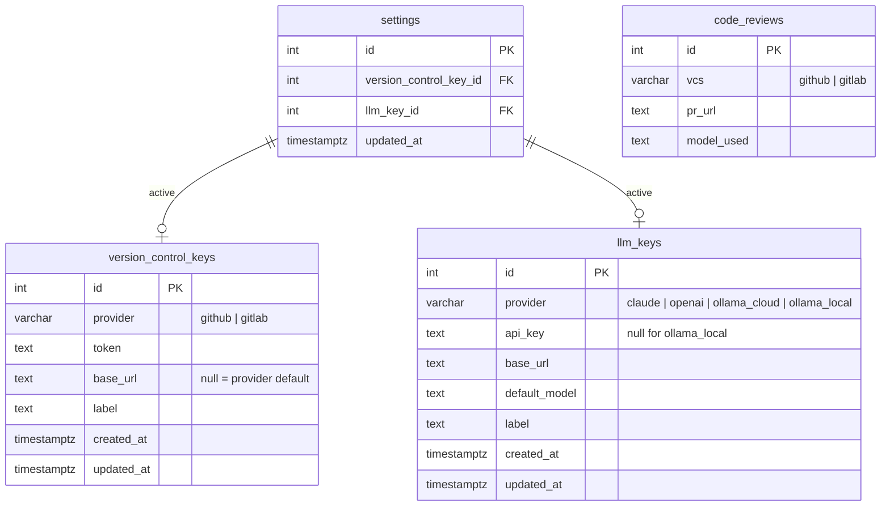
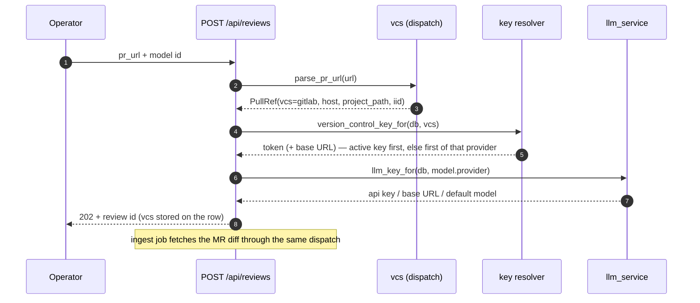
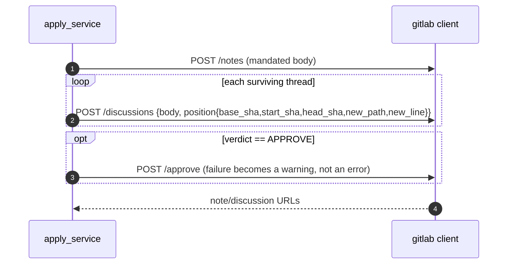

# Phase 10 — Provider Credentials (GitLab + more LLMs) and a Normalised Key Design

## Objective & Scope

Two things at once, because they are the same problem: the `settings` table hard-codes **one**
version-control token (GitHub) and **one** model provider's credentials in flat columns, which
cannot express "GitHub + GitLab" or "Claude + Ollama + OpenAI" at the same time.

**In scope**

- **New tables.** `version_control_keys` (provider `github` | `gitlab`, token, optional base URL,
  optional label) and `llm_keys` (provider `claude` | `openai` | `ollama_cloud` | `ollama_local`,
  api key, optional base URL, optional default model). `settings` keeps two foreign keys —
  `version_control_key_id` and `llm_key_id` — for the operator's active choices. Credentials stop
  living in `settings`.
- **GitLab support end to end.** Merge-request URLs are parsed, the MR + diff are fetched with
  `PRIVATE-TOKEN`, and publishing posts an overall note plus one discussion per finding with an
  inline `position` (GitLab has no multi-comment review object), then approves when the verdict is
  `APPROVE`.
- **OpenAI transport.** `openai:<model>` talks to the Chat Completions API, so the `llm_keys` table
  is not decorative: three real provider families are addressable.
- **Data migration.** Existing `github_token`, `claude_api_key`, `ollama_api_key`,
  `ollama_base_url`, `ollama_model`, `ollama_mode` are converted into rows in the new tables and
  the columns are dropped.
- **UI.** Settings manages a list of keys per family with add/replace/delete/test and an "active"
  selector; the setup guide lets the operator pick GitHub or GitLab; the review header names the
  host.

**Out of scope**

- Encryption at rest, multi-user accounts, OAuth device flows — still a single-operator local tool.
- GitLab thread replies / resolving discussions; the discussion workspace stays local.
- Bitbucket, Azure DevOps, Gitea.
- GitLab approval rules beyond a best-effort `POST /approve`.
- Migrating reviews to a different VCS (a review keeps the `vcs` it was created with).

## High-Level Design

### Schema



`settings` is still a singleton row; the keys are independent, so several can exist per family
(two GitLab instances, Claude plus a local Ollama) and the operator switches the active one.

### Key resolution at review time



### Publishing to GitLab



## API Contracts & Database Schema Updates

### Migration `0006_provider_keys`

Creates both tables, adds the two FKs plus `code_reviews.vcs`, backfills from the old columns, then
drops them. `settings` changes go through `op.batch_alter_table` so SQLite (tests) and PostgreSQL
both apply cleanly.

```python
op.create_table("version_control_keys", ...)   # provider, token, base_url, label, timestamps
op.create_table("llm_keys", ...)               # provider, api_key, base_url, default_model, label
op.add_column("settings", sa.Column("version_control_key_id", sa.Integer(), nullable=True))
op.add_column("settings", sa.Column("llm_key_id", sa.Integer(), nullable=True))
op.add_column("code_reviews", sa.Column("vcs", sa.String(16), server_default="github", nullable=False))
# backfill: github_token → version_control_keys(github); claude_api_key → llm_keys(claude);
#           ollama_api_key → llm_keys(ollama_cloud, default_model=ollama_model);
#           ollama_mode='local' → llm_keys(ollama_local, base_url=ollama_base_url)
# then batch_alter_table("settings"): create FKs, drop the six legacy columns
```

Downgrade re-adds the columns, copies the active key values back, drops the FKs/columns/tables.

### Keys API

| Method | Path | Body / notes |
|---|---|---|
| `GET` | `/api/keys/version-control` | list, masked tokens, `is_active` |
| `POST` | `/api/keys/version-control` | `{provider, token, base_url?, label?}` → 201 |
| `PATCH` | `/api/keys/version-control/{id}` | `{token?, base_url?, label?}` |
| `DELETE` | `/api/keys/version-control/{id}` | 204; clears `settings.version_control_key_id` if it pointed here |
| `POST` | `/api/keys/version-control/{id}/test` | `{ok, detail, metadata}` |
| `GET` | `/api/keys/llm` | list, masked keys, `is_active` |
| `POST` | `/api/keys/llm` | `{provider, api_key?, base_url?, default_model?, label?}` → 201 |
| `PATCH` | `/api/keys/llm/{id}` | `{api_key?, base_url?, default_model?, label?}` |
| `DELETE` | `/api/keys/llm/{id}` | 204 |
| `POST` | `/api/keys/llm/{id}/test` | `{ok, detail, metadata}` |

Validation: `provider` must be one of the literals; `token`/`api_key` required except for
`ollama_local`; `base_url` must be http(s). Secrets return masked unless `?reveal=true`.

### Settings API

```json
{ "version_control_key_id": 2, "llm_key_id": 1 }
```

```json
{ "version_control_key_id": 2, "llm_key_id": 1, "needs_setup": false,
  "version_control": {"id": 2, "provider": "gitlab", "base_url": "https://gitlab.com", "label": "work",
                      "token_masked": "glo••••••••3f2a"},
  "llm": {"id": 1, "provider": "claude", "default_model": "claude-sonnet-4-5-20250929",
          "api_key_masked": "sk-••••••••9c1d"} }
```

`needs_setup` is true until both ids resolve to rows. The old `github_token` / `claude_api_key` /
`ollama_*` fields are gone; the frontend is updated in the same phase.

### Model catalog

`GET /api/models` groups options by the providers that actually have an `llm_keys` row:
`claude:` (API list or fallback), `openai:` (API list or static), `ollama-cloud:` (tags from
ollama.com), `ollama-local:` (tags from each local base URL). `default_model` of the active key is
returned as `preferred`.

### Review creation and apply

- `POST /api/reviews` body is unchanged. Provider prefix still names the model; the VCS comes from
  the URL. Unknown host → `422`; no key for that VCS or provider → `422` naming what to add.
- `code_reviews.vcs` is persisted; `PullRequestInfo` gains `base_sha`/`start_sha` (GitLab
  `diff_refs`) and `html_url`.
- `POST /api/reviews/{id}/apply`: dispatches on `review.vcs`. GitHub keeps the single review POST
  (with the existing 422 body-only retry). GitLab posts a note + one discussion per comment and
  attempts an approval; `github_review_url` becomes `review_url` in the response, while the column
  name stays for compatibility.

## Target File Map

### New — backend

| File | Purpose |
|---|---|
| `app/models/keys.py` | `VersionControlKey`, `LLMKey` |
| `app/schemas/keys.py` | key CRUD payloads, masked reads, provider literals |
| `app/services/keys_service.py` | CRUD, active selection, key resolution by provider, probes |
| `app/services/gitlab_service.py` | MR URL parsing, fetch + diff, discussions/notes/approve |
| `app/services/vcs.py` | `PullRef`, `parse_pr_url`, `fetch_pr`/`fetch_diff`/`post_review` dispatch |
| `alembic/versions/0006_provider_keys.py` | schema + data migration |
| `tests/test_keys_api.py`, `tests/test_gitlab_service.py`, `tests/test_migration_0006.py` | coverage |

### Changed — backend

| File | Change |
|---|---|
| `app/models/settings.py` | two FKs, legacy columns removed |
| `app/schemas/settings.py` | ids + resolved key summaries; `needs_setup` from keys |
| `app/api/routes/settings.py` | patch ids; test-connection delegates to keys |
| `app/api/routes/keys.py` (new router) | the table above |
| `app/api/router.py` | mount `/keys` |
| `app/services/llm_service.py` | `openai` provider, credentials injected instead of read from settings |
| `app/services/review_pipeline.py` | resolve VCS + keys, store `vcs`, GitLab diff |
| `app/services/discussion.py` | resolve the LLM key, not `settings.*` |
| `app/services/apply_service.py` | dispatch GitHub/GitLab |
| `app/api/routes/models.py` | catalog built from `llm_keys` |
| `app/core/config.py` | `gitlab_base_url`, `openai_url` |
| `tests/*` | settings/pipeline/discussion/apply tests updated for keys |

### Changed — frontend

| File | Change |
|---|---|
| `src/types/index.ts`, `src/services/api.ts` | key types + CRUD calls, settings shape |
| `src/pages/SettingsPage.tsx` | two credential families with active selection |
| `src/pages/SetupPage.tsx` | choose GitHub/GitLab, then an LLM provider |
| `src/components/ReviewHeader.tsx` | host/VCS chip |
| `src/components/KeyRow.tsx` (new) | masked key row with add/replace/delete/test |

## Step-by-Step Implementation Steps

1. Models + migration `0006`, with the data backfill and a downgrade that restores the old columns.
2. `keys_service`: CRUD, mask/reveal, provider validation, active-key resolution
   (`version_control_key_for(db, vcs)`, `llm_key_for(db, provider)`).
3. Providers: extend `llm_service` with `openai` and credential injection; keep Claude and both
   Ollama transports working from an `LLMKey` row instead of `Settings`.
4. VCS layer: `gitlab_service` (URL parse incl. nested groups, `GET /projects/:id/merge_requests/:iid`,
   `/diffs` pagination, `diff_refs`, note/discussion/approve) and `vcs.py` dispatch; GitHub keeps its
   client, now taking a base URL + token.
5. Routes: `/keys` CRUD + tests; settings rewritten around the two ids; models catalog from keys.
6. Pipeline/discussion: resolve keys per review, store `vcs`, surface the VCS name in progress and
   in `CodeReviewDetail`.
7. Apply: GitHub path unchanged in shape; GitLab note + discussions + optional approve; warnings
   instead of failures for the optional steps.
8. Frontend: types + api, `KeyRow`, Settings page, Setup page, review header.
9. Tests: keys CRUD/masking/validation, resolver precedence, GitLab URL + payload shape, migration
   backfill (SQLite), updated pipeline/apply suites.
10. Docs: README (credentials model, GitLab usage, endpoints), AGENTS.md if conventions moved.

## Verification & Acceptance Criteria

- `alembic upgrade head` **and** `alembic downgrade 0005` on a scratch PostgreSQL database, plus the
  same round-trip on SQLite via the test suite.
- Backfill proof: a database seeded with the old columns produces exactly one `github` key, one
  `claude` key, one `ollama_cloud` key with the old default model, and `settings` pointing at them.
- `pytest -q` green (existing 125 plus the new modules).
- `npm run build` green.
- Live run against a mock GitLab (`/api/v4`): an MR URL ingests with a real diff, findings anchor to
  RIGHT-side lines, discuss works, and Apply posts **one note + one discussion per surviving
  thread** with `base_sha`/`start_sha`/`head_sha`/`new_path`/`new_line`; an `APPROVE` verdict also
  calls `/approve`. Dropped threads post nothing.
- Switching the active keys in Settings changes which credentials the next review uses, without
  touching existing rows.
