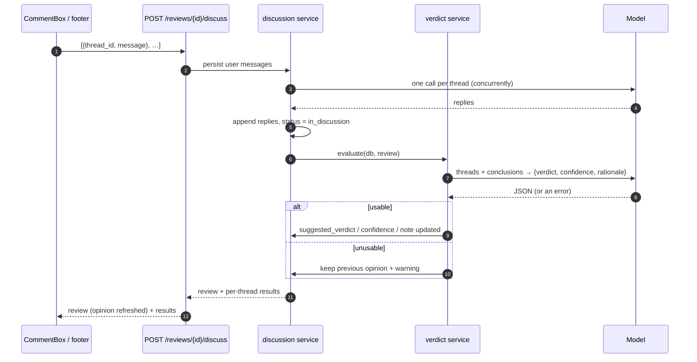
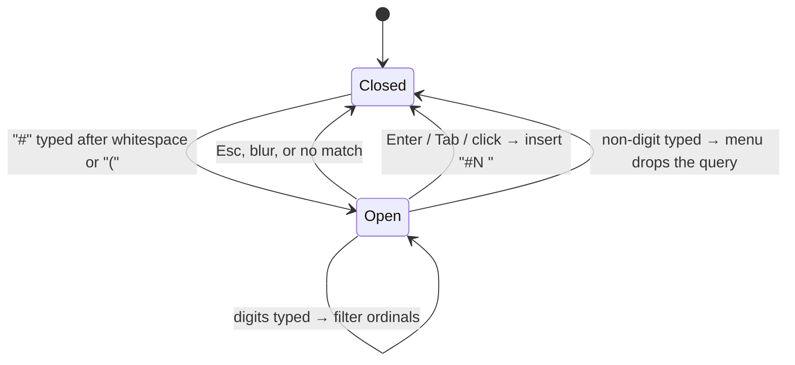

# Phase 11 — Re-evaluated Verdict & `#` Mention Autocomplete

## Objective & Scope

Two follow-ups that make the discussion loop feel finished: the AI opinion stops being a snapshot
from ingest time, and referencing another thread stops requiring memory.

**In scope**

- **Re-evaluate the verdict after a discussion submit.** Once the replies are stored, one extra
  model pass reads the whole review (every thread, its original finding and its latest conclusion,
  including withdrawn ones) and returns an updated `{verdict, confidence, rationale}`. It is
  stored on the review and returned in the same response, so the sticky footer updates without a
  reload.
- **The pass is advisory and non-fatal.** Any provider error, timeout or unparsable answer keeps
  the previous opinion and adds a warning; the discussion itself still succeeds.
- **Rationale column.** `code_reviews.suggested_verdict_note` (one short sentence) so the UI can
  explain *why* the opinion moved, not just what it is.
- **`#` autocomplete in the composer.** Typing `#` shows the threads available in this review
  (ordinal, `path:line`, a one-line excerpt), filters as digits are typed, and inserts `#N` on
  click, `Enter` or `Tab`; `↑`/`↓` move, `Esc` closes. The current thread is not offered.

**Out of scope**

- Streaming the verdict pass token by token; it is a single blocking call inside the submit.
- Re-evaluating on every message edit, on ingest, or after publishing (GitHub reviews are immutable).
- Mentioning people, PRs, files or issues — only review threads exist.
- Server-side validation that a submitted `#N` exists (unknown numbers are already ignored by the
  reference resolver).

## High-Level Design

### Discussion submit with re-evaluated opinion



### `#` autocomplete state



## API Contracts & Database Schema Updates

### Migration `0007_verdict_note`

```python
op.add_column("code_reviews", sa.Column("suggested_verdict_note", sa.Text(), nullable=True))
```

Downgrade drops the column. No data backfill: existing reviews simply have no rationale.

### Model output (verdict re-evaluation)

```json
{ "verdict": "APPROVE", "confidence": 88,
  "rationale": "Both findings were resolved in discussion and nothing else is outstanding." }
```

`verdict` is normalised to `APPROVE` / `REQUEST_CHANGES` / `COMMENT` (unknown values are ignored),
`confidence` is clamped to 0–100, `rationale` is trimmed to one line (~240 chars). A response
without a usable verdict is treated as a failure and changes nothing.

### `POST /api/reviews/{id}/discuss`

Request unchanged. The returned review gains the refreshed opinion; the response shape is stable:

```json
{
  "review": { "suggested_verdict": "APPROVE", "confidence_percentage": 88,
              "suggested_verdict_note": "Both findings were resolved in discussion.", "...": "…" },
  "results": [{ "thread_id": 7, "ok": true, "error": null, "references": [1] }]
}
```

`GET /api/reviews/{id}` and `GET /api/reviews` also expose `suggested_verdict_note`.

### Prompt contract

`app/services/prompts.py` gains `VERDICT_CONTRACT` + `build_verdict_prompt(threads)`: one block per
thread with `#ordinal`, `path:line`, the original finding, the latest conclusion and a
`withdrawn` marker, then the JSON contract above. The skill bundle is reused as the system prompt
so the verdict follows the same review standards as the findings.

## Target File Map

### New

| File | Purpose |
|---|---|
| `app/services/verdict.py` | `evaluate(db, review)` → normalised verdict/confidence/rationale, or `None` |
| `alembic/versions/0007_verdict_note.py` | the rationale column |
| `tests/test_verdict.py` | prompt shape, parsing, failure isolation, discussion integration |
| `frontend/src/components/MentionMenu.tsx` | the `#` popup (list, keyboard handling, insertion helper) |

### Changed

| File | Change |
|---|---|
| `app/models/review.py` | `suggested_verdict_note` column |
| `app/schemas/review.py` | expose the note on summary/detail |
| `app/schemas/discuss` (same file) | no shape change; document that the review is refreshed |
| `app/services/discussion.py` | run the verdict pass after replies are stored |
| `app/services/prompts.py` | `VERDICT_CONTRACT`, `build_verdict_prompt` |
| `frontend/src/components/CommentBox.tsx` | mention detection, menu, insertion |
| `frontend/src/pages/ReviewDetailPage.tsx` | pass thread options; surface the refreshed opinion |
| `frontend/src/components/StickyActionBar.tsx` | show the rationale next to the AI opinion |
| `frontend/src/types/index.ts` | `suggested_verdict_note`, mention option type |

## Step-by-Step Implementation Steps

1. Migration `0007` + model column + schema field.
2. `verdict.py`: build the prompt from the review, call the model, normalise, and return `None`
   (never raise) on any failure.
3. `prompts.py`: the verdict contract, kept separate from the findings contract.
4. `discussion.py`: after replies and the status flip, call `evaluate`; on success store verdict,
   confidence and note; on `None` append a warning and keep the old opinion.
5. Frontend types + `StickyActionBar` rationale line + `ReviewDetailPage` wiring.
6. `MentionMenu` + `CommentBox`: detect `#` at the caret, filter by digits, keyboard + click insert,
   exclude the current thread, close on blur/Esc.
7. Tests: verdict parsing/normalisation, failure keeps the previous opinion, discuss response
   carries the new opinion, prompt includes withdrawn markers; frontend verified in the browser.
8. Docs: README (discussion section), CHANGELOG phase 11, phase plan cross-links.

## Verification & Acceptance Criteria

- `alembic upgrade head` → `downgrade 0006` → `upgrade head` on scratch PostgreSQL and SQLite.
- `pytest -q` green (existing 132 plus the new module); `npm run build` green.
- Live run with a stubbed provider:
  - discussing a thread returns a review whose `suggested_verdict` / `confidence_percentage` /
    `suggested_verdict_note` changed from the ingest-time values;
  - a failing verdict pass leaves the old opinion intact and adds a warning, while the replies are
    still stored.
- Browser check: typing `#` in a comment box opens the thread list, typing `2` filters to `#2`,
  `Enter` inserts `#2 `, and the footer shows the refreshed opinion plus its rationale.
