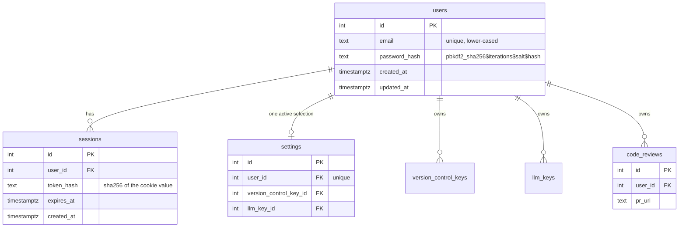
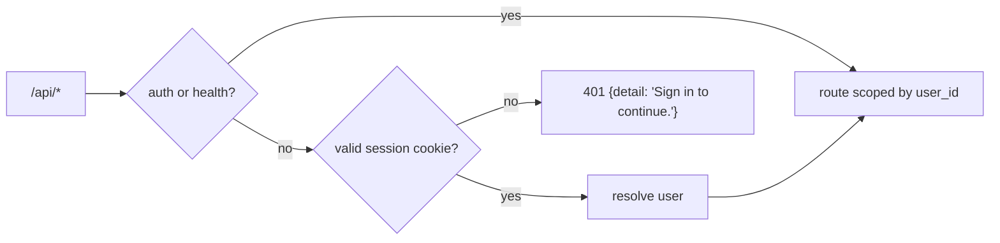

# Phase 12 — User Accounts (email + password) and Per-User Credentials

## Objective & Scope

One operator currently owns everything: the two credential tables, the singleton settings row and
every review. This phase introduces accounts so several people can use the same installation
without seeing each other's tokens or reviews.

**In scope**

- **`users`** (email, password hash) and **`sessions`** (hashed bearer token stored in an
  HttpOnly cookie).
- **Sign up / log in / log out / me** endpoints, password hashing with stdlib PBKDF2-SHA256
  (no new dependency), constant-time comparison, and a minimum password length.
- **Ownership**: `version_control_keys`, `llm_keys`, `code_reviews` and `settings` gain a
  `user_id`. Every API route resolves the signed-in user and scopes its query — a review or key
  belonging to someone else is a `404`, not a `403`, so ids cannot be probed.
- **Per-user credentials**: each account keeps its own GitHub and GitLab tokens and its own Claude,
  OpenAI/Codex, Ollama Cloud and Ollama local keys, with its own active selection.
- **Migration `0008`**: create the two tables, add and backfill `user_id`, then enforce NOT NULL and
  one settings row per user. Existing rows are attached to a disabled `legacy@localhost` account
  only when data exists.
- **Frontend**: `/login` and `/signup` pages, an `AuthProvider`, a route guard, the signed-in email
  and a sign-out action in the nav; every request carries the session cookie.

**Out of scope**

- Email verification, password reset mail, OAuth/SSO, 2FA, account deletion, admin roles.
- Per-user skill foundations: `code-review/` and `code-review-foundations/` stay a shared, on-disk
  library (documented as a deliberate sharing decision).
- Rate limiting / lockout (noted as a follow-up; a local tool on localhost).
- Sharing a review with another account.

## High-Level Design

### Data model



### Login and session use

```mermaid
sequenceDiagram
    autonumber
    participant B as Browser
    participant A as FastAPI
    participant D as PostgreSQL

    B->>A: POST /api/auth/login {email, password}
    A->>D: SELECT user WHERE lower(email) = …
    A->>A: PBKDF2 verify (constant time)
    alt valid
        A->>D: INSERT session (sha256(token), expires_at)
        A-->>B: 200 + Set-Cookie acr_session=…; HttpOnly; SameSite=Lax
    else invalid
        A-->>B: 401 "Email or password is incorrect."
    end
    B->>A: GET /api/reviews (cookie)
    A->>D: SELECT session JOIN user WHERE token_hash = sha256(cookie)
    A->>D: SELECT reviews WHERE user_id = session.user_id
    A-->>B: only that user's reviews
```

### Route guard



## API Contracts & Database Schema Updates

### Migration `0008_users_and_ownership`

```python
op.create_table("users", ...)      # email unique, password_hash, timestamps
op.create_table("sessions", ...)   # user_id FK cascade, token_hash unique, expires_at
for table in ("version_control_keys", "llm_keys", "code_reviews"):
    op.add_column(table, sa.Column("user_id", sa.Integer(), nullable=True))
    op.create_foreign_key(..., ondelete="CASCADE")
op.add_column("settings", sa.Column("user_id", sa.Integer(), nullable=True))
# backfill: only when rows exist → one disabled legacy@localhost account owns them
# then: NOT NULL on all four, unique index on settings.user_id
```

Downgrade drops the unique index, the four `user_id` columns and both tables.

### Auth endpoints (public)

| Method | Path | Body | Notes |
|---|---|---|---|
| `POST` | `/api/auth/signup` | `{email, password}` | 201 + session cookie; `409` if the email exists |
| `POST` | `/api/auth/login` | `{email, password}` | 200 + session cookie; `401` otherwise |
| `POST` | `/api/auth/logout` | — | deletes the session, clears the cookie, `204` |
| `GET` | `/api/auth/me` | — | `{id, email, created_at}`; `401` when not signed in |

Rules: email is trimmed and lower-cased, validated with a simple pattern (no new dependency);
password is 8–128 characters. The session token is 32 random bytes, `secrets.token_urlsafe`, stored
as SHA-256 so the database never holds a usable cookie. Cookie: `acr_session`, `HttpOnly`,
`SameSite=Lax`, `Path=/`, `Max-Age` 14 days, `Secure` only when the request is HTTPS.

Error semantics: `401` for bad credentials or a missing/expired session; `409` for a duplicate
email; `422` for malformed input. Everything else under `/api` now requires a session, except
`/api/health` and the auth routes.

### Per-user scoping

Every route resolves `current_user` through `Depends(get_current_user)` and passes it to the
service layer. Service signatures gain a user (or the owner id):

```python
keys_service.version_control_for(db, user_id, provider)
keys_service.llm_for(db, user_id, provider)
settings_service.get_or_create(db, user_id)
list/review queries: WHERE user_id = :user_id
detail/discuss/apply/events: load by (id, user_id), else 404
```

Reviews stay reachable only by their owner, and `create_running_review(db, user, …)` stamps
`user_id`. The pipeline, discussion, summarise and verdict services resolve credentials from
`review.user_id`, so a background job cannot borrow another account's key.

## Target File Map

### New — backend

| File | Purpose |
|---|---|
| `app/models/user.py` | `User`, `Session` |
| `app/schemas/auth.py` | signup/login payloads, `UserRead`, validation |
| `app/services/auth_service.py` | hashing, session issue/validate/revoke, user lookup |
| `app/api/routes/auth.py` | the four endpoints + cookie handling |
| `app/api/deps.py` | `get_current_user`, `CurrentUser` alias |
| `alembic/versions/0008_users_and_ownership.py` | schema + backfill |
| `tests/test_auth.py`, `tests/test_isolation.py` | credentials, sessions, cross-user isolation |

### Changed — backend

| File | Change |
|---|---|
| `app/models/settings.py`, `keys.py`, `review.py` | nullable-by-migration `user_id`, now required |
| `app/services/settings_service.py` | `get_or_create(db, user_id)` |
| `app/services/keys_service.py` | every function takes the owner |
| `app/services/review_pipeline.py`, `discussion.py`, `summarise.py`, `verdict.py`, `apply_service.py` | resolve credentials for `review.user_id` |
| `app/api/routes/{settings,keys,reviews,models,skills}.py` | require the current user; scope queries |
| `app/main.py` | register the auth router; CORS already allows the dev origin with credentials |
| `tests/conftest.py` | sign up + log in one test user per session; `anon_client` for 401 tests |

### Changed — frontend

| File | Change |
|---|---|
| `src/context/AuthContext.tsx` (new) | `me`, `signup`, `login`, `logout`, `loading` |
| `src/components/RequireAuth.tsx`, `AuthForm.tsx` (new) | guard for private routes; shared card for both forms |
| `src/pages/LoginPage.tsx`, `SignupPage.tsx` (new) | forms with inline errors |
| `src/App.tsx` | `/login`, `/signup` public; everything else behind `RequireAuth` |
| `src/services/api.ts` | `me/signup/login/logout`; `credentials: "same-origin"`; 401 → auth error |
| `src/components/Navbar.tsx` | signed-in email + sign out |
| `src/types/index.ts` | `AuthUser`, `Credentials` |

## Step-by-Step Implementation Steps

1. Models + migration `0008`, including the conditional legacy backfill and the unique settings index.
2. `auth_service`: PBKDF2 hash/verify, session create/validate/revoke, email normalisation.
3. `deps.get_current_user` reading the cookie; mount the auth router publicly and require a user on
   every other router.
4. Thread `user_id` through settings, keys, reviews and the background services.
5. Auth tests (signup/login/logout/me, duplicate email, weak password, wrong password, expiry) and
   isolation tests (user A cannot read B's keys or reviews).
6. Adapt `conftest.py` so the existing suite runs as an authenticated user; add `anon_client`.
7. Frontend: AuthContext, login/signup pages, route guard, nav, api calls.
8. Docs: README (accounts, endpoints, env), CHANGELOG, this plan.

## Verification & Acceptance Criteria

- `alembic upgrade head` → `downgrade 0007` → `upgrade head` on scratch PostgreSQL and SQLite;
  `settings` has one row per user and a unique `user_id`.
- `pytest -q` green, including the new auth and isolation modules; `npm run build` green.
- Live proof with two accounts:
  - sign up `a@example.com` and `b@example.com`; each gets its own empty settings row;
  - A adds a GitLab key and an Ollama key; B sees an empty key list and `needs_setup: true`;
  - A creates a review; B's `GET /api/reviews` is empty and `GET /api/reviews/{A_id}` is `404`;
  - no cookie → `401` on `/api/reviews`, `/api/settings`, `/api/keys/llm`;
  - logout clears the cookie and the same request returns `401` again.
- Browser: unauthenticated visit redirects to `/login`; signing up lands on `/setup`; the nav shows
  the email and signing out returns to `/login`.
