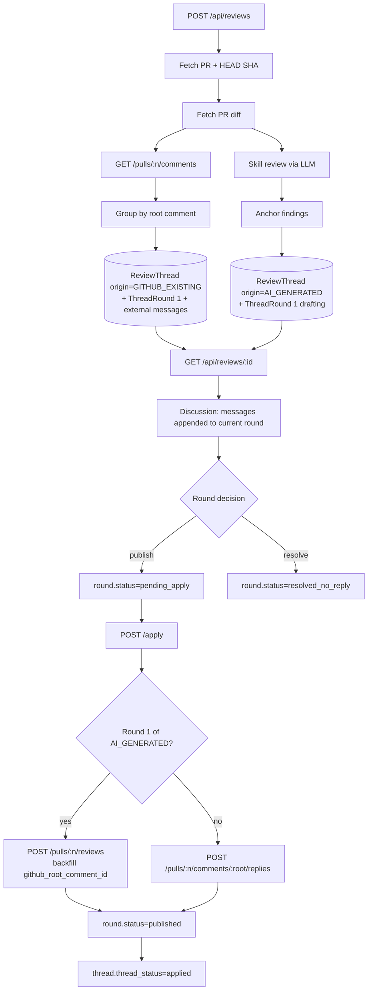
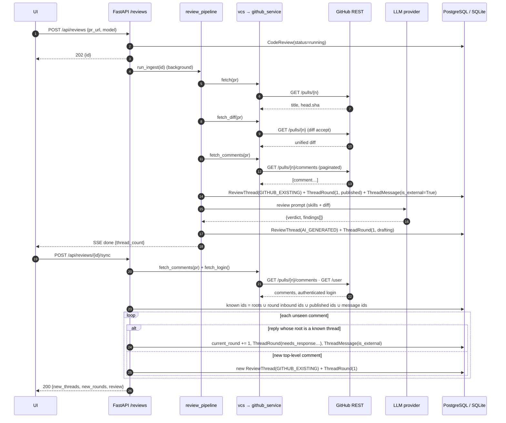
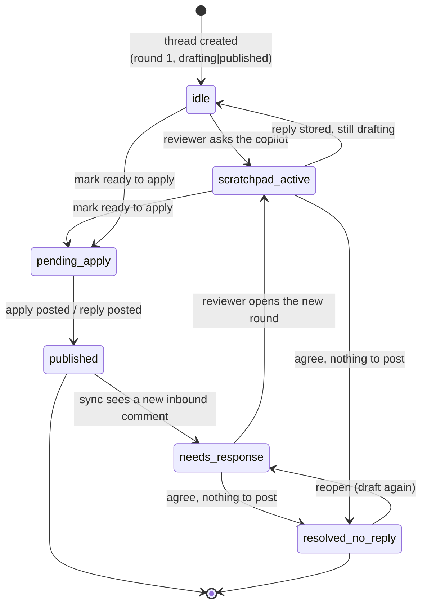

# Phase 13 — Existing GitHub Comments & Unified Multi-Round Discussion

> The brief that requested this phase named the file `phase_9_plan.md`. Phase 9 already exists in
> this repository, and `AGENTS.md` §1 derives `N` from the folder (`highest + 1`), so this plan is
> recorded as **phase 13** and phase 9 is left untouched.

## 1. Objective & Scope

### Problem

The workspace only knows about findings the local model produced. Real PRs already carry review
threads written by humans, and a review is rarely finished in one pass: reviewers answer, the
author replies, and a second opinion is needed on comments that were never ours. Today the only way
to see or answer those threads is github.com, and applying a review twice is refused instead of
posting only what is new.

### In scope

- Ingest every existing PR review comment when a review is created, grouped into threads by root
  comment, stored as `GITHUB_EXISTING` threads with their full discussion history.
- Persist rounds explicitly: one `ThreadRound` per inbound message and per outbound reply, so a
  thread can be discussed repeatedly without losing which message each reply answers.
- `POST /api/reviews/{id}/sync`: pull comments again, append unseen inbound replies as new rounds,
  spawn threads for unseen top-level comments, ignore our own posts, never duplicate.
- Per-round decisions: publish (draft → `pending_apply`), resolve without reply
  (`resolved_no_reply`), or back to drafting.
- Delta apply: post a formal review only for unapplied AI findings, then reply individually to
  every `pending_apply` round; backfill the GitHub root comment id of AI findings so later replies
  can be threaded; re-apply is allowed when something is pending, and is a `409` when nothing is.
- Split-pane UI: filter bar with counts, distinct styling per origin, collapsible historical rounds,
  AI copilot scratchpad on GitHub threads, dynamic apply label.

### Out of scope

- GitLab discussion ingestion/sync. GitLab exposes MR discussions with a different shape; the
  feature is GitHub-only in this phase and the product says so rather than silently doing nothing.
- Resolving/unresolving GitHub review threads, reactions, or editing/deleting published comments.
- Webhooks or background polling. Sync is user-triggered.
- Re-anchoring an existing GitHub thread when the branch moves; its stored `diff_hunk` is display
  context only, and replies are posted against the thread id, not a line.
- Posting anything on the user's behalf without an explicit per-round decision.

## 2. High-Level Design

### Data flow



### Sequence — initialization and sync



### Thread round state machine

`thread_status` is the coarse state shown by the filter bar; `ThreadRound.status` is the state of one
exchange. "scratchpad_active" is the round's `drafting` status while the reviewer and the model are
talking — the UI renders it as an open scratchpad, the database keeps one honest value.



Mapping to persisted columns:

| UI state | `ReviewThread.thread_status` | `ThreadRound.status` |
| --- | --- | --- |
| idle | `active` | `drafting` or `published` |
| scratchpad_active | `active` / `needs_response` | `drafting` |
| needs_response | `needs_response` | `drafting` |
| pending_apply | `active` / `needs_response` | `pending_apply` |
| published | `applied` | `published` |
| resolved_no_reply | `resolved` | `resolved_no_reply` |

## 3. API Contracts & Database Schema

### 3.1 Schema changes (Alembic `0009_thread_rounds`)

`review_threads` (added columns):

| column | type | null | default | meaning |
| --- | --- | --- | --- | --- |
| `origin` | `String(16)` | no | `AI_GENERATED` | `AI_GENERATED` \| `GITHUB_EXISTING` |
| `github_root_comment_id` | `BigInteger` | yes | — | root PR comment id; set at ingest for existing threads, after apply for AI findings |
| `original_author` | `Text` | yes | — | GitHub login that opened the thread |
| `current_round` | `Integer` | no | `1` | highest round number in the thread |
| `thread_status` | `String(24)` | no | `active` | `active` \| `needs_response` \| `applied` \| `resolved` |

`thread_rounds` (new table):

| column | type | null | default |
| --- | --- | --- | --- |
| `id` | `Integer` PK | no | autoincrement |
| `thread_id` | FK `review_threads.id` ON DELETE CASCADE, indexed | no | — |
| `round_number` | `Integer` | no | `1` |
| `inbound_github_comment_id` | `BigInteger` | yes | — |
| `inbound_author` | `Text` | yes | — |
| `inbound_body` | `Text` | yes | — |
| `final_summary` | `Text` | yes | — |
| `status` | `String(24)` | no | `drafting` (`drafting` \| `pending_apply` \| `published` \| `resolved_no_reply`) |
| `published_github_comment_id` | `BigInteger` | yes | — |
| `created_at` / `updated_at` | `DateTime(timezone=True)` | no | `now()` |

`thread_messages` (added columns):

| column | type | null | default |
| --- | --- | --- | --- |
| `round_number` | `Integer` | no | `1` |
| `is_external` | `Boolean` | no | `false` |
| `github_comment_id` | `BigInteger` | yes | — |
| `author` | `Text` | yes | — |

`github_comment_id` and `author` are the two columns beyond the brief's list. Without the id, replies
already imported as history in round 1 have no stored identity and the first sync would re-import
them as new rounds — it is the dedupe key for every external message we have ever seen. Without the
author, round 1 of an imported conversation would attribute every reply to the root commenter.

Backfill: existing threads get `origin=AI_GENERATED`, `current_round=1`, `thread_status=active`;
all existing messages get `round_number=1`, `is_external=false`; one `ThreadRound(round_number=1)`
is inserted per existing thread, with `status='published'` when its review is `applied` and
`drafting` otherwise, and `final_summary` = its last assistant message. No column or row is dropped,
so `downgrade` only removes what this revision added.

### 3.2 Wire shapes

`ReviewThreadRead` (added fields):

```json
{
  "id": 12,
  "review_id": 4,
  "ordinal": 1,
  "origin": "GITHUB_EXISTING",
  "github_root_comment_id": 2918,
  "original_author": "octocat",
  "current_round": 2,
  "thread_status": "needs_response",
  "file_path": "src/services/auth.py",
  "line_number": 11,
  "diff_hunk": "@@ -10,4 +10,5 @@",
  "side": "RIGHT",
  "summary": null,
  "dropped": false,
  "created_at": "2026-11-08T09:12:03Z",
  "messages": [
    {
      "id": 40,
      "role": "user",
      "content": "This is unbounded on large tenants.",
      "round_number": 1,
      "is_external": true,
      "created_at": "2026-11-08T09:12:03Z"
    }
  ],
  "rounds": [
    {
      "id": 30,
      "round_number": 1,
      "inbound_github_comment_id": 2918,
      "inbound_author": "octocat",
      "inbound_body": "This is unbounded on large tenants.",
      "final_summary": null,
      "status": "published",
      "published_github_comment_id": null,
      "created_at": "2026-11-08T09:12:03Z",
      "updated_at": "2026-11-08T09:12:03Z"
    }
  ]
}
```

`POST /api/reviews/{id}/sync` → `200`:

```json
{
  "review": { "…CodeReviewDetail…": null },
  "new_threads": 1,
  "new_rounds": 2,
  "warnings": []
}
```

`POST /api/reviews/{id}/rounds/{round_id}/decision`:

```json
{ "decision": "publish", "summary": null }
```

- `decision`: `publish` | `resolve` | `draft`.
- `summary` optional; when null, `publish` uses the last assistant message in that round, and
  `resolve` keeps whatever summary is already stored.
- Returns `200 { "review": CodeReviewDetail }`; `404` for a round outside the review; `422` for an
  unknown decision or for `publish` on a round with no assistant message and no summary.

`ApplyResponse` gains `replies_posted`. `ApplyRequest` is unchanged (`event`, optional `thread_ids`).

Status codes:

| code | condition |
| --- | --- |
| 200 | sync/decision/apply succeeded |
| 400 | malformed URL, thread/round not owned by the review, no credential |
| 404 | review or round not found |
| 409 | apply with nothing pending (including a second apply after everything was posted) |
| 422 | unknown decision, unusable request (no PR identity) |
| 502 | GitHub rejected the request |

## 4. Target File Map

New files:

- `backend/alembic/versions/0009_thread_rounds.py` — origin/round columns, `thread_rounds`, backfill.
- `backend/app/services/thread_sync.py` — group comments into threads, ingest, sync, known-id set.
- `backend/tests/test_thread_sync.py` — ingest, sync (reply/new root/dedupe/self), GitLab notice.
- `frontend/src/components/ThreadFilterBar.tsx` — All / AI / GitHub / Needs response tabs.
- `frontend/src/components/RoundPanel.tsx` — one collapsible round: messages, status, decision
  buttons.

Changed files:

- `backend/app/models/review.py` — `ThreadOrigin`, `ThreadStatus`, `RoundStatus`, new columns,
  `ThreadRound`, `ReviewThread.rounds`.
- `backend/app/schemas/review.py` — round read/write schemas, sync and decision payloads.
- `backend/app/services/github_service.py` — `fetch_review_comments`, `fetch_login`, `post_reply`.
- `backend/app/services/vcs.py` — `fetch_comments`, `fetch_login`, `post_reply` dispatch.
- `backend/app/services/review_pipeline.py` — ingest existing comments, create round 1 for AI threads.
- `backend/app/services/apply_service.py` — delta apply: initial review + per-round replies + backfill.
- `backend/app/services/discussion.py` — open a draft round when the current one is closed, stamp
  messages with that round.
- `backend/app/services/prompts.py` — label external GitHub messages with their author.
- `backend/app/api/routes/reviews.py` — `/sync`, `/rounds/{id}/decision`.
- `backend/tests/conftest.py` — reset `thread_rounds` before parents.
- `frontend/src/types/index.ts`, `frontend/src/services/api.ts` — mirrors + `syncReview`, `decideRound`.
- `frontend/src/pages/ReviewDetailPage.tsx` — filter state, sync, decisions, pending count.
- `frontend/src/components/CommentBox.tsx` — origin badge, rounds, composer; keeps `#N` stable when
  filtered.
- `frontend/src/components/CodeSnippetBox.tsx` — origin marker on the code pane.
- `frontend/src/components/StickyActionBar.tsx` — dynamic apply label, pending count.
- `frontend/src/lib/utils.ts` — `pendingRoundCount` helper.
- `AGENTS.md`, `README.md`, `CHANGELOG.md` — service roster, feature, history.

Deliberately untouched: auth, keys, settings, skills, GitLab client, diff parser, migration script.

## 5. Step-by-Step Implementation

1. Alembic `0009`: add thread columns, create `thread_rounds`, add message columns, backfill rounds.
   Verify `upgrade head` and `downgrade -1` on `sqlite:////tmp/p13-verify.db`.
2. Models: constants + columns + `ThreadRound` relationship; keep `ThreadMessage.role` unchanged.
3. GitHub client: paginated comment list, `/user` login (best effort), reply POST; vcs dispatch.
4. `thread_sync`: `group_comments` (root resolution through reply chains), `ingest_existing_threads`,
   `known_comment_ids`, `sync_review`.
5. Pipeline: ingest existing comments (warning, not failure, when GitHub refuses), create round 1 for
   every AI finding.
6. Schemas: `ThreadRoundRead`, extended thread/message reads, `SyncResponse`, `RoundDecisionRequest`.
7. Discussion: reuse the open round or open a new draft when the current one is closed (an imported
   round 1 is already `published`); prompts label external messages and their round.
8. Apply: initial-review path with root-id backfill; reply path; resolve path; delta guard.
9. Routes: `POST /sync`, `POST /rounds/{round_id}/decision`; thin, service-backed.
10. Tests: new module + update reset fixture; run full suite.
11. UI: types → api → filter bar → round component → CommentBox → page → action bar.
12. Docs: README section, CHANGELOG entry, AGENTS service roster and test count.

## 6. Verification & Acceptance

Automated:

```bash
cd backend && source .venv/bin/activate && pytest -q
cd frontend && npm run build
cd backend && DATABASE_URL=sqlite:////tmp/p13-verify.db alembic upgrade head \
  && DATABASE_URL=sqlite:////tmp/p13-verify.db alembic downgrade -1 \
  && DATABASE_URL=sqlite:////tmp/p13-verify.db alembic upgrade head
```

Behavioural evidence to assert:

- Ingest with two existing root comments and one reply stores 2 `GITHUB_EXISTING` threads, 3 external
  messages, round 1 `published`, and `original_author` from the root comment.
- Sync after a stub reply: `new_rounds == 1`, `current_round == 2`, `thread_status == needs_response`,
  round 2 `drafting`, and a second identical sync reports `0 / 0` (no duplicates).
- Sync with a brand-new root comment creates one thread with `origin=GITHUB_EXISTING`.
- Sync ignores a comment authored by the authenticated login and keeps the known id set stable.
- Apply posts one formal review for unapplied AI findings, backfills `github_root_comment_id`, and
  posts one reply per `pending_apply` round to `/comments/{root}/replies`; `replies_posted` matches.
- Apply with nothing pending is `409`; applying with only a new reply does not re-post the review.
- `resolve` marks the round `resolved_no_reply`, the thread `resolved`, and apply skips it.
- Discussing an imported thread whose round 1 is `published` opens round 2; queueing it and applying
  posts exactly one reply to the root comment id.
- Filtering the workspace never changes a badge: AI findings keep `#2`/`#3` under every filter.
- GitLab review: sync returns an explanatory warning, no requests, `0 / 0`.

Live check (manual, against a local mock):

- Start backend on a scratch `DATABASE_URL`, create a review against the GitHub mock, confirm the
  filter counts (`All`, `AI`, `GitHub`, `Needs response`), sync after adding a mock reply, confirm the
  new round opens with the inbound body, mark it ready, and confirm the apply button reads
  "Apply 1 pending reply" and posts exactly one reply.

## 7. UI Structure

```
ReviewDetailPage
├── ReviewHeader                       … + "Sync GitHub" button, counts in notice
├── WarningsBanner
├── ThreadFilterBar                    All (n) · 🤖 AI Findings (n) · 🐙 GitHub Threads (n) · ⚠️ Needs Response (n)
├── SplitPane
│   ├── left : CodeSnippetBox[]        origin marker: violet bar for AI, blue-grey for GitHub
│   └── right: CommentBox[]
│       ├── header                     🤖 AI Finding #1  |  🐙 GitHub Discussion #1 · by @octocat
│       ├── ThreadRound (collapsed)    ▶ Round 1 · published
│       ├── ThreadRound (active)       inbound author + body
│       │   ├── messages               GitHub / You / AI review
│       │   └── scratchpad textarea    drafts stay local until bulk submit
│       └── decision row               [Mark ready to apply] [Resolve without reply]
└── StickyActionBar                    Submit responses (n) · Apply n pending findings|replies
```

Styling: AI cards use `border-accent/45` with an accent left rail and the `🤖 AI Finding` badge;
existing threads use `border-borderStrong` with a blue-grey (`accentStrong`/`inkMuted`) rail and
`🐙 GitHub Discussion` badge, so the two are distinguishable without reading the label. Filtering
hides cards, never reorders or renumbers them: `#N` stays the review-wide ordinal.
