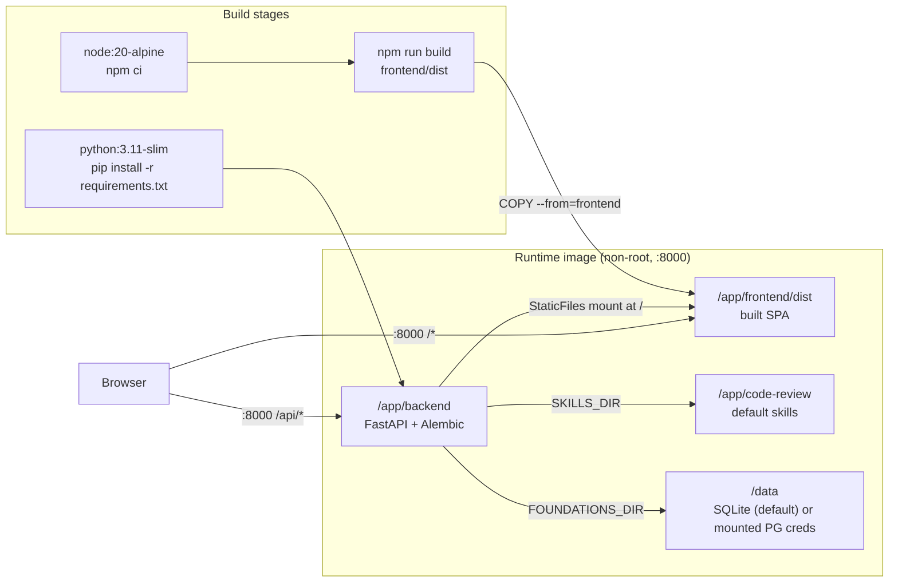
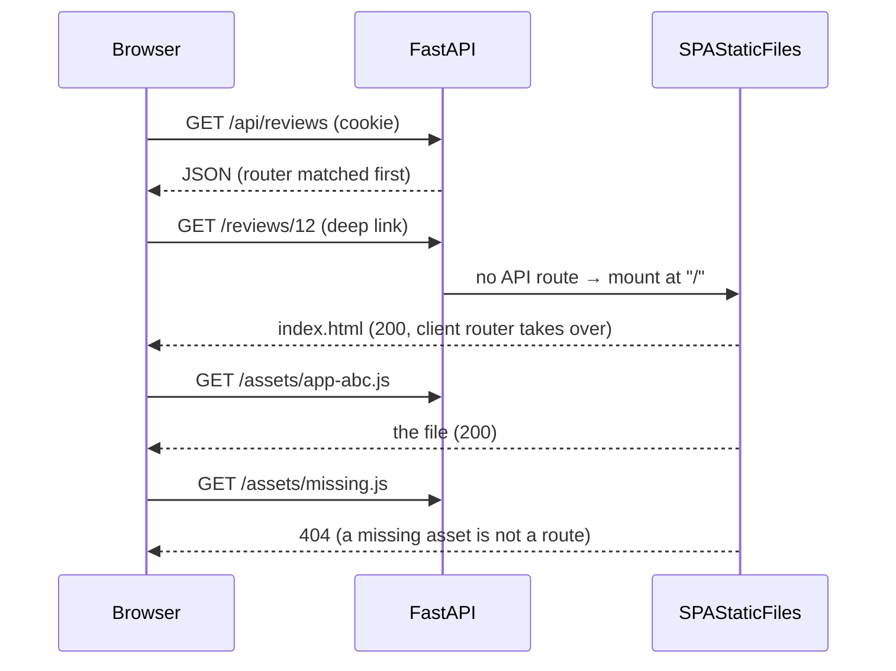

# Phase 14 — Container Image (Dedicated Dockerfile)

## 1. Objective & Scope

### Problem

The README describes a two-process local install (uvicorn on `:8000`, Vite on `:5173`, plus a
PostgreSQL instance). Anyone who wants to run the tool on another machine — or on a home server —
has to reproduce that toolchain by hand. There is no build artifact that carries the API, the
compiled UI and the default skill library together.

### In scope

- A repo-root `Dockerfile`: multi-stage, one image, one exposed port.
  - Stage `frontend`: Node 20, `npm ci`, `npm run build` from `package-lock.json`.
  - Stage `runtime`: Python 3.11 slim, backend requirements, backend source, `code-review/`
    skill library, and the built `dist/` copied from the frontend stage.
- Serving the compiled SPA from FastAPI on the same origin, because the frontend calls `/api`
  with `credentials: "same-origin"` and the backend has no static mounting today. This is gated by
  a new optional `FRONTEND_DIR` setting, so a development checkout behaves exactly as before
  (`npm run dev` + Vite proxy) and only the image turns the mount on.
- Client-side route fallback: `GET /reviews/12` returns `index.html`, while a missing asset still
  returns `404`.
- `.dockerignore` so `.env`, `app.db`, `node_modules`, `dist/`, tests and uploaded foundations do
  not enter the build context or the image.
- Documentation: README "Docker" section and configuration row, CHANGELOG entry, one line in
  `AGENTS.md` §9.

### Out of scope

- `docker compose`, TLS/reverse proxy, multi-replica orchestration. SSE is an in-process bus and
  the app is documented as single-worker; the image runs exactly one uvicorn worker.
- Publishing to a registry, CI pipelines, image signing.
- Changing the application's runtime defaults for a normal (non-container) install. PostgreSQL
  remains the documented default; the image only sets a convenient `DATABASE_URL` default because
  a container has no `localhost:5432`.
- Baking user data into the image: credentials, `app.db` and `code-review-foundations/` stay out.
- Static-site server (nginx) sidecar: one process serves API + UI, so cookies, SSE and CORS need
  no extra configuration.

## 2. High-Level Design

Request routing inside the image:

## 3. API Contracts & Database Schema Updates

- **No new endpoints.** `GET /` and other non-`/api` paths start returning the built SPA when
  `FRONTEND_DIR` is set; `/api/*`, `/docs`, `/redoc` and `/openapi.json` keep their current
  handlers because they are registered before the mount.
- **New setting:** `FRONTEND_DIR` (optional, no default). Absolute, or relative to `backend/`.
  Unset ⇒ no mount, current behaviour. Resolved through `Settings.resolved_frontend_dir`.
- **No database changes**, no Alembic revision. Startup still runs `alembic upgrade head`, which
  is what creates the schema in a fresh container volume.
- **Image environment:** `SKILLS_DIR=/app/code-review`, `FOUNDATIONS_DIR=/data/foundations`,
  `FRONTEND_DIR=/app/frontend/dist`, `DATABASE_URL=sqlite:////data/app.db` (image default;
  overridden for PostgreSQL). The Docker `HEALTHCHECK` calls `GET /api/health`.

## 4. Target File Map

New files:

- `Dockerfile` — multi-stage build + runtime.
- `.dockerignore` — build-context hygiene.
- `docs/plans/phase_14_plan.md` — this plan.
- `backend/tests/test_spa_static.py` — mount, deep-link fallback, missing asset, `/api` priority.

Changed files:

- `backend/app/core/config.py` — `frontend_dir` + `resolved_frontend_dir`.
- `backend/app/main.py` — `SPAStaticFiles` and the conditional mount.
- `README.md` — Docker section, `FRONTEND_DIR` row, Requirements note.
- `CHANGELOG.md` — Phase 14 entry.
- `AGENTS.md` — one line in §9 pointing at the image.

Deliberately left alone:

- `backend/requirements.txt` — dev-only `pytest` in the runtime image costs one small layer and
  keeps a single source of pinned versions; a second requirements file is not worth it.
- `frontend/vite.config.ts` — the proxy is a dev-server concern and stays.
- `backend/app/api/*`, services, models — no contract or behaviour change.

## 5. Step-by-Step Implementation Steps

1. Add `frontend_dir` to `Settings` and resolve it relative to `BACKEND_DIR`; nothing mounts when
   it is unset.
2. Add `SPAStaticFiles` in `main.py` (client-route fallback for extensionless paths only) and mount
   it at `/` after routers and docs routes.
3. Add `backend/tests/test_spa_static.py` covering `/`, a deep link, a real asset, a missing asset
   and `/api/health` priority.
4. Add `.dockerignore` (secrets, databases, dependencies, build output, tests, user uploads).
5. Add the `Dockerfile`: frontend stage (`npm ci`, `npm run build`), runtime stage (Python 3.11
   slim, requirements, backend, skills, `dist`), non-root user, `/data` volume, healthcheck,
   single-worker uvicorn on `0.0.0.0:8000`.
6. Document `docker build` / `docker run` (SQLite default and PostgreSQL override), `FRONTEND_DIR`,
   and the single-worker caveat in README; record the change in CHANGELOG and AGENTS.
7. Build the image, run it on a scratch volume, and exercise the real HTTP surface.

## 6. Verification & Acceptance Criteria

- `cd backend && pytest -q` green, including the new static-mount test.
- `cd frontend && npm run build` green (the Dockerfile runs the same command).
- `docker build -t code-review-master:dev .` succeeds.
- `docker run --rm -d -p 18000:8000 -v acr-verify:/data code-review-master:dev` then:
  - `GET /api/health` → `200 {"status":"ok"}`;
  - `GET /` → `200 text/html`, the built `index.html`;
  - `GET /reviews/1` → `200 text/html` (deep-link fallback);
  - `GET /assets/<hashed>.js` → `200` with JavaScript content type;
  - `GET /assets/does-not-exist.js` → `404`;
  - the container logs `Database: sqlite:////data/app.db` and the Alembic upgrade, i.e. the schema
    was created in the volume;
  - `docker inspect` health status becomes `healthy`.
- `docker run` without `FRONTEND_DIR` is not exercised separately: the setting is unset in the
  local test suite, which proves the mount is opt-in (`GET /` stays `404` there).
- Cleanup: stop the container, remove the scratch volume, state the commands used.
