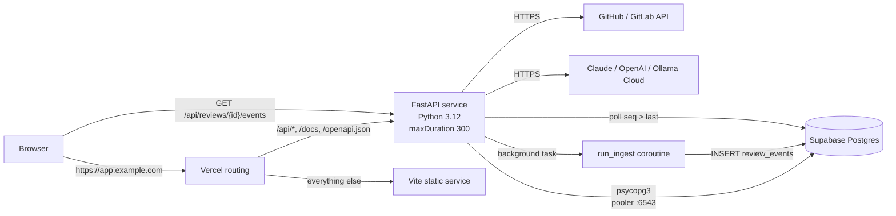
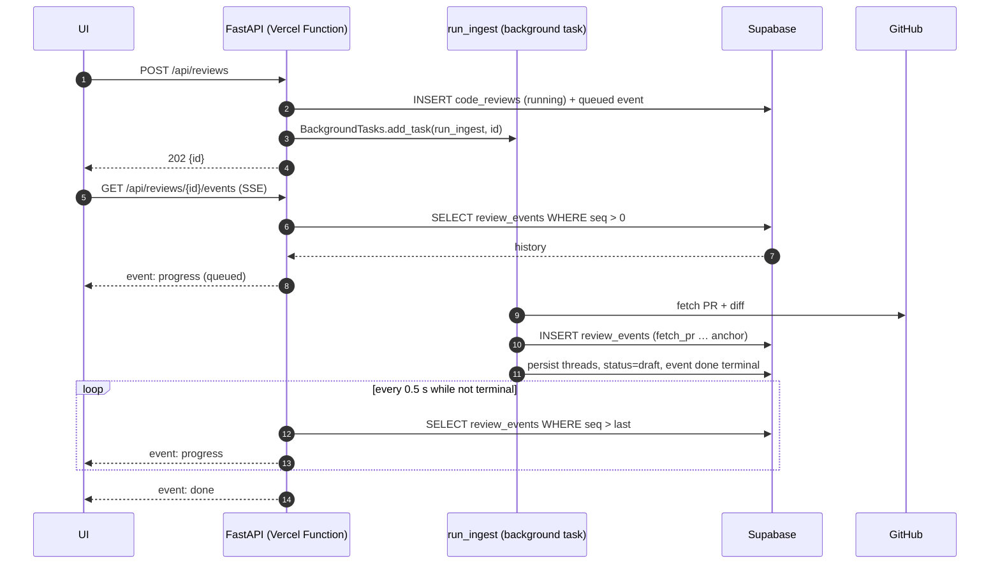
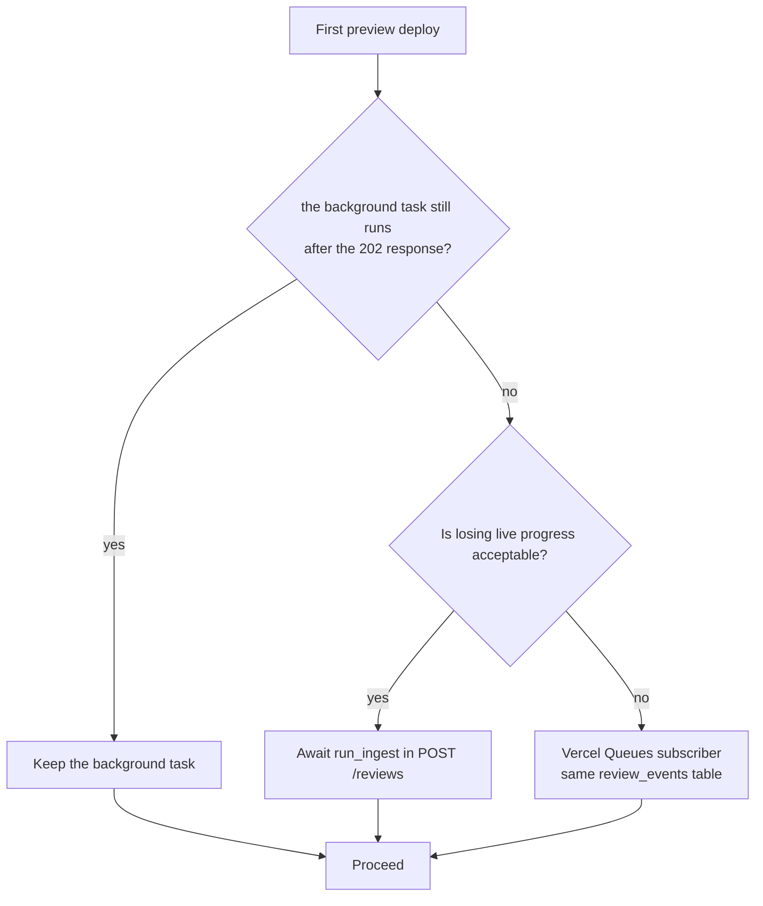

# Phase 15 — Vercel + Supabase deployment

> Status: **implemented**. This plan was rewritten against the tree at phase 20 (185 tests on
> CPython 3.11.14, Alembic head `0011`, credentials encrypted at rest, rounds/decisions,
> accept-time summarisation and comments-only publishing landed). The previous draft was written
> when head was `0009` and provider tokens were plaintext; every fact it relied on that has since
> changed is corrected below.

## 1. Objective & Scope

### Problem

The only deployment artifact is a long-lived Docker container. Vercel Functions are
request-scoped, the filesystem is read-only outside `/tmp`, and several instances may share one
database. Four things break under that model as the code stands today:

1. **Ingest dies with the response.** `review_pipeline.schedule_ingest` uses
   `asyncio.create_task` (`app/services/review_pipeline.py:167-171`); the coroutine needs the
   request's event loop to stay alive.
2. **Progress lives in process memory.** `app/services/progress.py` keeps event history and
   subscriber queues in a module dict, so a second instance cannot read it and a cold start
   loses it.
3. **Startup writes schema and fails other instances' work.** `app/main.py:49-50` runs
   `alembic upgrade head` and `fail_orphaned_reviews()`, which marks **every** `running` row
   failed (`app/db/init_db.py:43-64`) — with concurrent instances that kills a live review.
4. **The runtime is 3.11.** Vercel supports Python 3.12 (default), 3.13 and 3.14 only;
   `Dockerfile:15` is `python:3.11-slim` and there is no `backend/.python-version`.

Supabase adds a transaction pooler on port 6543, IPv4-only connectivity and a public network,
which rules out the current pooled engine (`app/db/session.py:9-18`) and psycopg3's automatic
prepared statements.

### In scope

- Python **3.12** as the single tested runtime: `backend/.python-version`, the Docker base
  image, and the 185-test suite re-run on 3.12 before anything else.
- Vercel **Services** (Beta): one project, `web` (Vite static) and `api` (FastAPI) on one domain,
  `/api/*` to the API, service-scoped SPA fallback.
- Supabase Postgres through the **shared pooler, transaction mode (6543)**: `NullPool`,
  `prepare_threshold=None`, SSL in the URL.
- **DB-backed progress events** (`review_events`, Alembic `0012`) plus a Starlette **background
  task** for ingest, so a review created without a connected client still completes and a late
  client replays every stage from `seq=1`.
- Startup split by mode: migrations become a release step; orphan detection becomes a
  time-based staleness check (`> maxDuration`) on reads and at SSE start.
- **Read-only skill storage on Vercel.** The bundled `code-review/` directory is the skill
  library; upload, create and delete return `403` and the Skills UI hides the write controls.
  Markdown added to the repository and redeployed is how a skill file changes on this
  deployment. Runtime uploads return in phase 21 (S3 object storage).
- Serverless guards: `SIGNUP_ENABLED` for invite-only bootstrap, `ollama-local` rejected (422)
  and hidden from `/models`, `uploads_enabled` on `GET /api/skills`.
- Vercel project files (`vercel.json`, `.vercelignore`, `backend/.python-version`), environment
  documentation and the phase 15 changelog entry.

### Out of scope

- Object storage for skill files (phase 21, `docs/plans/phase_21_plan.md`). Until then a Vercel
  deployment cannot accept uploads at runtime; it serves the bundled library read-only.
- Vercel Queues/Workflows as the primary execution model, Supabase Auth/Storage, per-PR preview
  databases, multi-region deployment, removing the Dockerfile.
- Changing the review/discussion/apply contracts, anchoring, round state machine or prompts.
- Rewriting migration history: `0012` is a child of `0011`; 0001–0011 are untouched.

### Decisions

1. **Services, not two projects.** Same origin keeps the `acr_session` cookie, `BASE_URL`
   (`frontend/src/services/api.ts:26`) and `EventSource` unchanged. Services is still Beta on all
   plans (checked for this plan); the fallback is a static project plus a container API, out of
   scope here.
2. **3.12, not 3.11 or 3.13.** Vercel's default is 3.12; pinning it in `backend/.python-version`
   and bumping the Docker base keeps the container and the deployment on the version the tests
   run on. 3.13/3.14 buy nothing here.
3. **Migration `0012`, not the reserved `0010`.** `0011_encrypt_credentials` deliberately left
   `0010` free for this phase, but every database already stamped `0011` (the operator database
   among them) is at head, so an inserted `0010` would never run there and `review_events` would
   silently not exist. `0012_review_events` with `down_revision="0011"` reaches every database,
   fresh or existing. 0011's docstring reservation note is corrected in the same change.
4. **The progress bus becomes DB-backed for every mode.** Two implementations (memory locally,
   DB on Vercel) would mean two behaviours and two test suites. The table is small, the write
   path is one insert per event, and the SSE endpoint already replays history, which the client
   de-duplicates by `seq` (`frontend/src/components/IngestProgress.tsx:28-31`).
5. **`publish` owns a short session.** Progress is best-effort and must survive the caller's
   rollback: the terminal event for a crashed ingest is published *after* `db.rollback()`. All
   current call sites publish outside a transaction, so a separate session cannot deadlock the
   caller on SQLite.
6. **A background task, not the `vercel` SDK.** `schedule_ingest(review_id, background)` adds
   `run_ingest` to the response's `BackgroundTasks` when `SERVERLESS=true`; the deployed runtime
   keeps the invocation alive for ASGI background tasks, which is what Vercel's FastAPI
   background-task support exists for. `asyncio.create_task` stays the local path. The
   `vercel==0.12.2` package was rejected after checking it: it pulls thirteen packages and
   requires `pydantic>=2.12` transitively (via `vercel-workflow`), which conflicts with the pinned
   `pydantic==2.10.4` — an unsatisfiable install. Fallback if the gate shows the task is cut:
   `wait_until` plus a pydantic bump, or Vercel Queues; both reuse `review_events`.
7. **Read-only skills over silent data loss.** `/tmp` is per-instance and dies with the
   instance; accepting an upload into it would look successful and vanish. The API says so in
   one sentence and the UI shows the same sentence.
8. **Invite-only after bootstrap.** `SIGNUP_ENABLED` starts `true`, the operator creates the
   account, sets it `false`, redeploys. The API returns `403` with a clear detail instead of
   creating accounts.

## 2. High-Level Design

### Topology



### Ingest and progress sequence



### Execution-model gate



The gate changes only `schedule_ingest`; the table, SSE endpoint and client stay as designed.

### Routing table

| Request | Service | Path the service receives |
|---|---|---|
| `GET /api/health` | `api` | `/api/health` |
| `POST /api/reviews`, `GET /api/reviews/7/events` | `api` | unchanged |
| `GET /docs`, `/openapi.json` | `api` | unchanged |
| `GET /`, `/reviews/7`, `/skills` | `web` | then SPA fallback to `/index.html` |
| `GET /assets/index-*.js` | `web` | the file |

Vercel preserves the original path, so the `/api` prefix needs no `root_path`. In services mode
`rewrites`/`headers` stay at the top level and `framework`/`buildCommand`/`functions` live
inside the service object.

## 3. API Contracts & Database Schema Updates

### New table `review_events` (Alembic `0012_review_events`, `down_revision = "0011"`)

| Column | Type | Notes |
|---|---|---|
| `id` | `Integer` PK | autoincrement |
| `review_id` | FK `code_reviews.id` | `ON DELETE CASCADE` |
| `seq` | `Integer` | per review, starts at 1 |
| `ts` | `DateTime(timezone=True)` | UTC, `app.db.base.utcnow` |
| `stage` | `String(32)` | `queued`, `fetch_pr`, `skills`, `model`, `anchor`, `done`, `error`, … |
| `label` | `String(255)` | display text |
| `detail` | `Text` nullable | free text |
| `level` | `String(8)` | `info` / `warn` / `error` |
| `progress` | `SmallInteger` nullable | 0–100 |
| `data` | `JSON` nullable | structured extras |
| `terminal` | `Boolean` | at most one per review |

Constraints: `UNIQUE (review_id, seq)`, index on `(review_id, seq)`. The model lives in
`app/models/review.py` next to `CodeReview`; the migration is hand-written and dialect-agnostic
(`sa.JSON()` works on PostgreSQL and SQLite). Retention: after an insert, rows with
`seq <= max_seq - 200` for that review are deleted, matching today's `MAX_EVENTS_PER_REVIEW`.

No other table changes. The table is created on a fresh Supabase database by
`alembic upgrade head` and on an existing one by the normal upgrade path — this is why the
revision is `0012` and not the `0010` slot.

### API deltas

| Endpoint | Change |
|---|---|
| `GET /api/skills` | adds `uploads_enabled: boolean`; `false` when `SERVERLESS=true` |
| `POST /api/skills/files` | `403 {"detail":"Skill files are read-only on this deployment. …"}` when disabled |
| `POST /api/skills/foundations` | same `403` |
| `DELETE /api/skills/foundations/{id}` | same `403` |
| `POST /api/auth/signup` | `403 {"detail":"Sign-up is disabled on this deployment."}` when `SIGNUP_ENABLED=false` |
| `POST /api/reviews` | unchanged `202`; `422` for `ollama-local:` in serverless mode |
| `GET /api/models` | omits `ollama-local` entries when `SERVERLESS=true` |
| `GET /api/reviews/{id}/events` | unchanged event names/payload; history now read from `review_events` |

No review, thread, discussion, apply or auth payload shape changes. The `acr_session` cookie keeps
`HttpOnly`, `SameSite=Lax` and the existing scheme-based `Secure` flag.

### Configuration

| Variable | Local default | Vercel value | Purpose |
|---|---|---|---|
| `SERVERLESS` | `false` | `true` | engine mode, startup gating, feature guards |
| `SIGNUP_ENABLED` | `true` | `true`, then `false` | invite-only after bootstrap |
| `DATABASE_URL` | `postgresql+psycopg://localhost:5432/code_review` | `postgresql+psycopg://postgres.<ref>:<pw>@aws-0-<region>.pooler.supabase.com:6543/postgres?sslmode=require` | Supabase pooler |
| `CREDENTIALS_ENCRYPTION_KEY` | from `backend/.env` | set before the release migration | Fernet key set; required by `0011` when plaintext credential rows exist |
| `CORS_ORIGINS` | localhost pair | production domain | same-origin in practice |
| `SKILLS_DIR` | repo `./code-review` | unset; resolves to the bundled folder | read-only skill library |
| `FOUNDATIONS_DIR` | `code-review-foundations` | unset | unused while uploads are disabled |
| `FRONTEND_DIR` | unset | unset | the SPA is served by Vercel |
| `LLM_TIMEOUT_S` | `180` | `180` | below `maxDuration` |
| `GITHUB_TIMEOUT_S` | `30` | `30` | unchanged |

Engine change in `app/db/session.py` when `SERVERLESS=true` and the URL is PostgreSQL:

```python
create_engine(url, poolclass=NullPool, connect_args={"prepare_threshold": None})
```

`pool_pre_ping` is dropped with `NullPool`. `prepare_threshold=None` is mandatory under Supabase's
transaction pooler because psycopg3 auto-prepares after five executions and prepared statements are
connection-local. `sslmode` stays in the URL (putting it in `connect_args` as well is redundant —
psycopg lets the keyword win).

### Release step

Migrations are not run by the app on Vercel. Once, from a laptop or CI, against the session-mode
URL (port 5432) or the pooler:

```bash
cd backend && CREDENTIALS_ENCRYPTION_KEY=<key> DATABASE_URL=<supabase-url> alembic upgrade head
```

`0011` refuses to upgrade when plaintext credential rows exist and no key is configured, so the
key must be exported for this command. A fresh database has no credential rows and needs no key.
The `docker` flow keeps `init_db()` at startup because it is a single long-lived process.

### PII / secret classification

`review_events` adds no personal data: stages, labels, progress, counts, PR identity the review
already stores. `detail` may carry a PR URL or model id, which are not PII under
`backend/rules/privacy.md`. Provider credentials remain encrypted at rest (`enc:v1:`, phase 16);
this phase moves no secret into a new column, a log or the frontend. `CREDENTIALS_ENCRYPTION_KEY`
lives in the Vercel environment (and the operator's `.env` locally) and is never stored in the
database.

## 4. Target File Map

New files:

- `vercel.json` — Services, rewrites, `maxDuration`, `includeFiles` for the skill library.
- `.vercelignore` — CLI upload hygiene.
- `backend/.python-version` — `3.12`.
- `backend/alembic/versions/0012_review_events.py` — events table.
- `docs/plans/phase_21_plan.md` — S3 object storage (design record).
- `backend/tests/test_serverless_mode.py` — guards and staleness.

Changed files:

- `backend/app/core/config.py` — `serverless`, `signup_enabled`.
- `backend/app/db/session.py` — `NullPool` + psycopg pooler settings.
- `backend/app/db/init_db.py` — `mark_stale_running_reviews`.
- `backend/app/main.py` — skip `init_db()`/`fail_orphaned_reviews()` when serverless; keep the
  credential report.
- `backend/app/models/review.py` — `ReviewEvent`.
- `backend/app/services/progress.py` — DB-backed publish/history/subscribe/reset.
- `backend/app/services/review_pipeline.py` — background-task scheduling, guarded terminal
  publish, `ollama-local` rejection.
- `backend/app/api/routes/reviews.py` — staleness on list/detail/SSE.
- `backend/app/api/routes/skills.py`, `backend/app/services/skills_service.py`,
  `backend/app/schemas/skills.py` — `uploads_enabled`, read-only guards.
- `backend/app/api/routes/auth.py` — sign-up gate.
- `backend/app/api/routes/models.py` — omit local Ollama in serverless.
- `backend/requirements.txt` — unchanged: no `vercel` SDK (see decision 6).
- `backend/tests/test_progress.py`, `test_skills_api.py`, `conftest.py` — DB events, clean-up.
- `frontend/src/types/index.ts`, `frontend/src/pages/SkillsPage.tsx` — read-only notice, hidden
  write actions.
- `Dockerfile` — `python:3.12-slim`, `SKILLS_DIR=/data/code-review`, entrypoint.
- `docker-entrypoint.sh` — seeds the volume from `/opt/code-review` when it is empty.
- `README.md`, `AGENTS.md`, `CHANGELOG.md` — runtime and deployment docs.

Deliberately left alone:

- `apply_service.py`, `discussion.py`, `diff_parser.py`, `skill_loader.py`, `summarise.py` — no
  contract or anchoring changes. Their model calls stay request-scoped, under `maxDuration`.
- `frontend/src/services/api.ts` — `/api` stays same-origin.
- The Docker SPA mount and `FRONTEND_DIR` — still the container path, unset on Vercel.
- Migrations 0001–0011 (0011's docstring reservation sentence is corrected).

## 5. Step-by-Step Implementation Steps

1. **3.12 baseline.** Add `backend/.python-version`; bump the Docker base to
   `python:3.12-slim`; create a 3.12 environment and run the whole suite before changing code.
2. **Config and engine.** `serverless`, `signup_enabled`; `NullPool` + `prepare_threshold=None`
   for PostgreSQL in serverless mode. `requirements.txt` stays as it is: decision 6 rejects the
   `vercel` SDK (unsatisfiable with the pinned pydantic).
3. **Startup split.** Gate `init_db()` and `fail_orphaned_reviews()`; keep
   `log_startup_report()`. Add `mark_stale_running_reviews()` (10 minutes, greater than
   `maxDuration`) and call it from review list/detail and at SSE start; each flip publishes a
   terminal `error` event.
4. **Events model and migration.** `ReviewEvent`, hand-write `0012_review_events`, verify
   `upgrade` and `downgrade -1` on a scratch SQLite database and on a scratch PostgreSQL
   database.
5. **DB bus.** Replace the in-memory body: `publish` inserts with `seq = max+1` (unique-constraint
   retry once) and prunes; `history`/`is_finished` query; `subscribe` polls `seq > last` every
   0.5 s from its own session and yields `None` for the 15 s heartbeat; stops on the terminal row.
   `reset` deletes all rows (tests).
6. **SSE route and tests.** Keep `progress`/`done`/`failed` and the payload shape. Rewrite
   `test_progress.py` for replay-from-DB, late subscriber, terminal event and retention; add the
   staleness test.
7. **Ingest scheduling.** `schedule_ingest(review_id, background)` hands the coroutine to the
   route's `BackgroundTasks` when serverless and keeps `asyncio.create_task` otherwise; the service
   types it as a `BackgroundScheduler` protocol so it never imports FastAPI. Wrap the terminal
   publish in `_fail` so a broken database cannot mask the original error.
8. **Guards.** Skills upload/create/delete `403` in the service (so every caller is covered) and
   `uploads_enabled` in the response; sign-up `403` when `signup_enabled` is false;
   `ollama-local:` rejected `422` at review creation and hidden from `/models`.
9. **Frontend.** Add `uploads_enabled` to `SkillsResponse`; when false hide the single-file
   upload, the new-foundation form and delete buttons, and show one sentence explaining that the
   bundled library is read-only and files ship with the repository. No API base or SSE changes.
10. **Vercel files.** `vercel.json` (Services, top-level rewrites, per-service `functions` with
    `maxDuration` and `includeFiles: ["code-review/**"]`), `.vercelignore`. Build once and inspect
    the function bundle for `code-review/SKILL.md` and the absence of `.env`, `*.db`, `.venv`,
    `node_modules` and tests.
11. **Supabase.** Create the project, copy the transaction-pooler string, rewrite the scheme to
    `postgresql+psycopg://`, run `alembic upgrade head` once with
    `CREDENTIALS_ENCRYPTION_KEY` exported, verify all revisions, disable the Data API (or enable
    RLS with no policies), and set the Vercel env vars for Production only.
12. **Docs.** README deployment section (bootstrap order, env vars, migrations, read-only skills,
    key custody), CHANGELOG phase 15 entry, AGENTS notes for `SERVERLESS`, the release migration
    step and the DB-backed bus.
13. **End-to-end verification** per §6, including the background-task gate; only then declare done.

## 6. Verification & Acceptance Criteria

- `cd backend && pytest -q` on **3.12**: 185 existing tests plus the 6 new ones → **191 passed**;
  `cd frontend && npm run build` green.
- `alembic upgrade head` on a scratch database that is stamped `0011` creates `review_events`;
  `downgrade -1` removes it; a second `upgrade` restores it; the operator database reaches
  `0012` the same way.
- Preview deployment:
  - `GET /api/health` → `200 {"status":"ok"}`.
  - `GET /` → the SPA; `GET /reviews/1` → SPA (deep-link fallback); hashed asset → `200`;
    missing asset → `404`.
  - `POST /api/auth/signup` → `201` with `SIGNUP_ENABLED=true`, then `403` after flipping it.
  - A real PR review: `POST /api/reviews` → `202`; with no SSE client connected the review
    reaches `draft`; connecting afterwards replays every stage from `seq=1` and ends with `done`.
  - Background-task gate: a 20 s job scheduled from a request completes after the response,
    writes its row and is not cancelled; the 300 s ceiling is honoured.
  - Skill upload/create/delete → `403` with the exact detail; `GET /api/skills` reports
    `uploads_enabled:false`; the Skills page has no write controls and shows the notice; the
    bundled `code-review/` library is listed with its files.
  - `ollama-local:` → `422`; `/api/models` has no local entries.
  - Cold-start logs show no `alembic` run and no orphan sweep; a `running` review younger than
    the threshold is left alone, one older than it flips to `failed` with a terminal event.
- Supabase: `alembic_version` is `0012`; 10 concurrent `GET /api/reviews` requests produce no
  prepared-statement errors and the pooler connection count stays bounded; the Data API does not
  expose the tables to anon.
- Bundle: `code-review/SKILL.md` present; no `.env`, `*.db`, `node_modules`, `.venv` or tests;
  uncompressed bundle under 500 MB.
- Rollback: promote the previous Vercel deployment; revert `0012` only on a scratch database. The
  production database is never downgraded or truncated without explicit, separate approval.

## 7. Implementation notes (as built)

- **`review_events` landed as `0012`.** A scratch database that was upgraded to `0011` and then to
  `head` gained the table (`alembic_version = 0012`); `downgrade -1` removed it and `upgrade head`
  restored it. The same round-trip ran on the scratch PostgreSQL database `code_review_check_p15`.
  `alembic heads` is `0012` and the chain is `0011 → 0012`; 0011's old "0010 reserved" sentence was
  corrected. The operator database reached `0012` through the normal startup upgrade of the
  running dev server (`alembic current` → `0012`), and `review_events` exists there — additive DDL
  only.
- **The `vercel` SDK was rejected after trying to install it.** `vercel==0.12.2` depends on
  `vercel-workflow>=0.12.1`, which requires `pydantic>=2.12.0`; the project pins
  `pydantic==2.10.4`, so `uv pip install -r requirements.txt` failed as unsatisfiable. Pinning the
  SDK also drags thirteen packages (blob, cache, headers, oidc, queue, sandbox, workflow, websockets,
  httpx2 …) into the function bundle for one helper. Ingest therefore uses Starlette's
  `BackgroundTasks`, which Vercel's Python runtime keeps alive after the response (its FastAPI
  background-task support), and `requirements.txt` is unchanged. `wait_until` remains the documented
  fallback if a preview deploy shows the task being cut.
- **The service layer stays framework-free.** `schedule_ingest` takes a
  `BackgroundScheduler` `Protocol` (`add_task(...)`), so `review_pipeline` imports neither FastAPI
  nor Starlette; the route passes FastAPI's `BackgroundTasks`.
- **`progress.publish` owns its session and never raises.** It inserts with `seq = max+1`, prunes
  rows below `MAX_EVENTS_PER_REVIEW`, retries once on the unique-constraint race, and logs instead of
  failing the ingest. `subscribe` polls `seq > last` every 0.5 s on a thread and sends the 15 s
  heartbeat. The terminal publish in `_fail` is wrapped, so a broken database cannot hide the real
  cause.
- **Serverless startup leaves the schema alone.** On an empty scratch database with
  `SERVERLESS=true`, the lifespan created no tables (`sqlite_master` empty, no `alembic_version`) and
  `GET /api/health` still returned `200 {"status":"ok"}`. The credential report logs its "no such
  table" failure and returns, by design.
- **Engine:** with `SERVERLESS=true` and a PostgreSQL URL the pool is `NullPool` with
  `prepare_threshold=None`; the same URL without the flag still builds a `QueuePool`.
- **Guards:** `GET /api/skills` returns `uploads_enabled: false` under `SERVERLESS=true`;
  upload/create/delete return `403 "Skill files are read-only on this deployment. …"`; sign-up
  returns `403` with `SIGNUP_ENABLED=false`; `ollama-local:` is `422` at review creation and absent
  from `/api/models`. The Skills page hides upload, delete and the new-foundation form and shows the
  read-only sentence. `npm run build` is green.
- **Tests:** `pytest -q` → **191 passed** on CPython 3.11.14 and on **3.12.12** (uv-created venv from
  `requirements.txt`). The six new cases are the retention prune, the serverless guards (skills,
  sign-up, models/ollama), the background-task scheduling and the stale-review read; the old in-memory bus test now creates a real
  review row because the events are a foreign-keyed table.
- **`alembic check`** on the freshly migrated scratch PostgreSQL database reports only the known
  0008-era index drift (`ix_*_provider` / `uq_settings_user_id`); it reports nothing for
  `review_events`, so the new table matches the model.
- **Container verified end to end.** `docker build` succeeded on `python:3.12-slim`; inside the
  image `python -V` is 3.12.16, startup reaches `0012`, `review_events` exists, sign-up is `201`
  and `GET /api/skills` reports `uploads_enabled: true`. The first build exposed a real defect: the
  bundled library was copied to `/app/code-review` as root, so a single-file upload returned `500
  PermissionError` (and would have been lost with the container). The image now keeps it at
  `/opt/code-review`, `SKILLS_DIR` points at `/data/code-review`, and `docker-entrypoint.sh` seeds
  the volume when it is empty — re-verified: upload `201`, file count 26 → 27 and still there after
  `docker restart`, a duplicate name stored `container-rule-2.md`, image 248 MB.
- **Not exercised here:** an actual Vercel preview deployment and the function-bundle inspection.
  They need a Vercel project and are listed as the remaining acceptance gates in §6.
