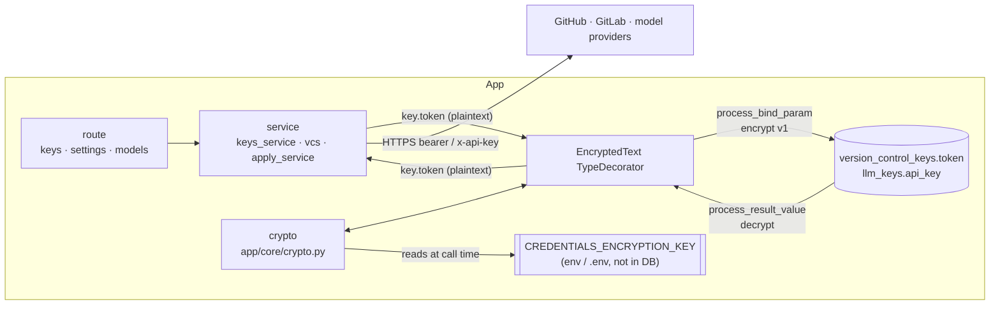
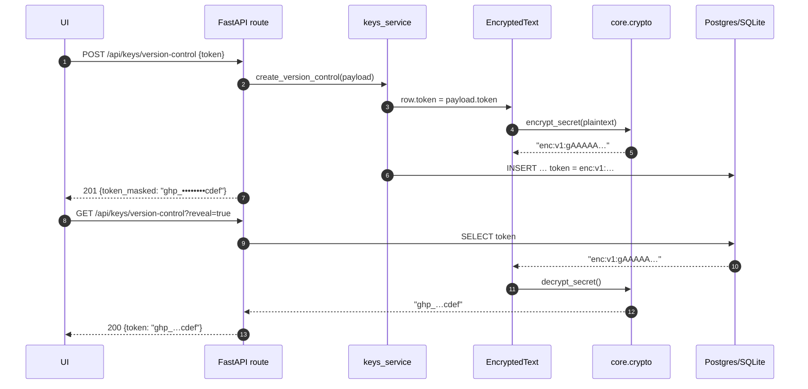
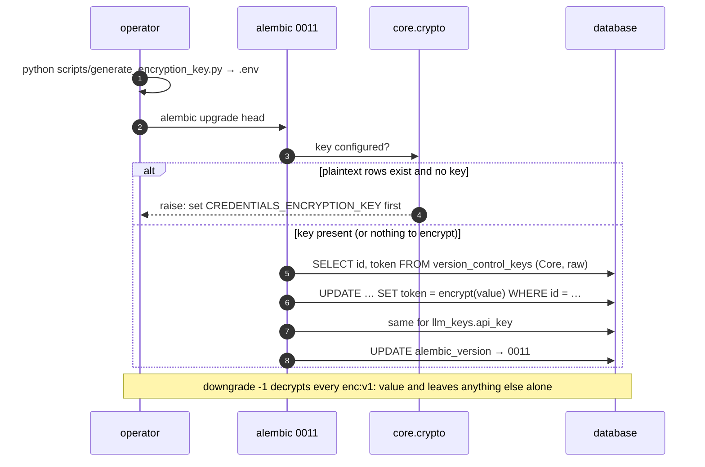

# Phase 16 — Encrypt provider credentials at rest

> Status: **implemented**. Code, revision `0011`, scripts, tests and documentation are in the tree;
> §7 records the few places the build diverged from this design. Baseline evidence collected when
> the plan was written: `cd backend && pytest -q` → **168 passed**, 1 warning in
> 2.76 s on CPython 3.11.14 (the pinned `requirements.txt` venv); Alembic head was
> `0009_thread_rounds`; `cryptography` was not installed; `version_control_keys.token` and
> `llm_keys.api_key` were `Text` and stored verbatim (`app/models/keys.py:53,79`). The plaintext
> decision this plan reverses was recorded at `README.md:250`, `README.md:652` and
> `docs/plans/phase_15_plan.md:265-266`.

## 1. Objective & Scope

### Problem

The two credential tables hold live secrets: GitHub/GitLab tokens that can push and publish, and
model-provider API keys that bill the operator. They are stored as plaintext, masked only at the API
edge (`services/secrets.mask_secret` is a display function — the database value is untouched). Any
copy of the database therefore hands over every credential in clear text: a stolen laptop, a
`pg_dump` file, a copied `app.db`, a `/data` volume snapshot, a backup bucket. `backend/rules/privacy.md`
already says to encrypt "when the application must display the value again"; this phase applies that
rule to the two columns that need it.

### Threat model (what this does and does not buy)

- **Protects:** offline copies of the database — disk theft, dumps, volume and backup snapshots —
  when the attacker does not also hold the process environment.
- **Does not protect:** a compromised running host or process, a leaked `.env`, memory dumps, or an
  attacker with API access to the app. Encryption at rest is not access control.
- **Irreversible by design:** without the key, stored credentials cannot be recovered. Losing the
  key means every key/token is re-entered in Settings. This is stated in README and in the startup
  log, not discovered later.

### In scope

- Authenticated symmetric encryption of `version_control_keys.token` and `llm_keys.api_key`, with the
  key supplied by the environment and never stored in the database.
- A transparent SQLAlchemy type so the ~25 existing read sites (`vcs.py`, `apply_service.py`,
  `routes/models.py`, `keys_service.py`, the key/settings schemas) keep using `key.token` /
  `key.api_key` and cannot accidentally send ciphertext to GitHub.
- Alembic revision `0011_encrypt_credentials`: a **data-only** revision that encrypts existing rows
  and restores plaintext on `downgrade`.
- Key generation and rotation tooling, plus the SQLite→PostgreSQL copy script encrypting rows it
  copies from an old database.
- Startup reporting of encryption state (counts only), clear `503` errors when the server cannot
  handle secrets, and tests for every one of those paths.
- Documentation and rules: README (configuration, backup/loss warning, remove the "plaintext by
  design" notes), `CHANGELOG.md`, `AGENTS.md`, `backend/rules/privacy.md`.

### Out of scope

- Encrypting anything else: `users.email` stays plaintext by the recorded decision in
  `backend/rules/privacy.md`, and passwords/session tokens stay hashed. Diffs, prompts, thread text
  and review titles are not affected.
- KMS / Vault / cloud secret managers, per-user or per-row data keys, envelope encryption with
  wrapped DEKs, HSM-backed keys, hardware sealing, TLS configuration.
- Column-level grants, a separate "secrets" database, and auditing of secret reads.
- Frontend changes: every response shape is unchanged, so `frontend/` is untouched.
- Implementing phase 15 (Vercel + Supabase). Phase 15 remains a design record; this phase lands on
  `0009` and does not depend on it. If phase 15 ships first, `SERVERLESS` only changes the engine,
  not this design.
- Encrypting the Fernet token further, or hiding *which* provider a row belongs to.

### Decisions

1. **Fernet via `cryptography`, wrapped in `MultiFernet`.** Fernet is AES-128-CBC + HMAC-SHA256 with a
   version byte, nonce, timestamp and authentication tag already in the token — authenticated
   encryption with no nonce management of our own. `MultiFernet` makes rotation a configuration
   change (encrypt with the first key, decrypt with any). Rejected: hand-rolled AES-GCM (we would own
   nonce storage and AAD), and hashing (the value must be sent upstream, so it must be reversible).
2. **A `TypeDecorator`, not an encrypt/decrypt service API.** `EncryptedText` binds ciphertext and
   returns plaintext, so the 25 call sites that read `.token` / `.api_key` are untouched. An
   explicit API was rejected because one missed call site posts a Fernet string to GitHub as a
   bearer token — a silent, confusing outage instead of a compile-time error.
3. **Envelope prefix `enc:v1:`.** It distinguishes ciphertext from pre-0011 plaintext, which makes
   the backfill idempotent, lets a restored old backup keep working (with a warning), and leaves room
   for a future `v2` algorithm without guessing at row contents.
4. **Key from `CREDENTIALS_ENCRYPTION_KEY`, comma-separated, first = active.** Never in the database,
   never in the repo (`.env` is gitignored). Multiple keys exist only to make rotation safe.
5. **The migration is the gate, not a silent no-op.** If plaintext credential rows exist and no key
   is configured, `alembic upgrade` fails with the exact remediation (this also fails app startup,
   because `init_db()` runs `upgrade head`). A fresh or empty database upgrades with no key. The
   alternative — upgrading and leaving plaintext in place — would let a phase that claims "encrypted
   at rest" ship with clear-text rows.
6. **Reads tolerate legacy plaintext, writes never produce it.** A database restored from a pre-0011
   backup stays usable (a 500 on every Settings load would be worse than the status quo) and the
   startup log states plainly how many rows are still plaintext. Tolerating plaintext on read is the
   only concession; no code path writes an unencrypted secret.
7. **`503` for "the server cannot handle secrets", not `500`.** Missing key, undecryptable row and
   wrong key are operator-fixable configuration states; `503` plus a one-sentence `detail` lets the
   UI show that instead of a generic server error, and keeps `500` meaning "bug".
8. **Rotation is a script, not a revision.** Rotating keys is a repeatable operational act; an
   Alembic revision per rotation would grow history linearly and could not be re-run. The script
   re-encrypts every row and is safe to run twice.
9. **No row binding (AAD).** Fernet has no associated data, so a ciphertext pasted over another row
   still decrypts. That is irrelevant to the threat model (an attacker who can write to the database
   already has the app database) and adds no defence worth the complexity; recorded here so it is not
   re-litigated.

## 2. High-Level Design

### Where the boundary sits



Only the database values change. HTTP responses, masks, `reveal=true`, probes and publishing keep
their existing plaintext-in-memory behaviour.

### Envelope and key set

| Piece | Value |
|---|---|
| Stored value | `enc:v1:` + Fernet token (URL-safe base64 of `version ‖ timestamp ‖ IV ‖ ciphertext ‖ HMAC-SHA256`) |
| Example row | `enc:v1:gAAAAABn...` (a 500-char secret becomes ≈750 chars; both columns are `Text`) |
| Prefix check | `is_encrypted(value)` — used by the backfill, never by the ORM write path |
| Key set | `CREDENTIALS_ENCRYPTION_KEY=<k1>[,<k2>,…]`; `k1` encrypts, all decrypt (`MultiFernet`) |
| Missing key | `CredentialKeyError` from `encrypt_secret`; mapped to `503` at the route boundary |
| Wrong key / tampered value | `InvalidToken` → `CredentialDecryptionError`; mapped to `503`, never echoing the value |

The Fernet timestamp inside the token reveals when a secret was encrypted, not what it is. Nothing
else about the row changes: `provider`, `base_url`, `default_model`, labels and timestamps stay as
they are.

### Normal request path (unchanged from the caller's point of view)



### Upgrade / downgrade path



The backfill reads and writes through **Core SQL**, not the ORM models: the ORM would hide whether a
value was already encrypted (the decorator decrypts on load), making the pass non-idempotent.

## 3. API Contracts & Database Schema Updates

### Schema

**No DDL.** Both columns are already `Text`, and Fernet ciphertext is text — so `0011` is a data-only
revision, identical on PostgreSQL and SQLite, and `batch_alter_table` is not needed. `alembic
downgrade -1` restores plaintext; the revision is reversible because the key set that produced the
ciphertext must still be configured to downgrade (stated in the revision docstring and README).

| Table | Column | Before | After |
|---|---|---|---|
| `version_control_keys` | `token` | `Text`, plaintext | `Text`, `enc:v1:…` ciphertext (non-null) |
| `llm_keys` | `api_key` | `Text`, plaintext, nullable | `Text`, `enc:v1:…` ciphertext; `NULL` stays `NULL` |
| `alembic_version` | — | `0009` | `0011` |

Revision `backend/alembic/versions/0011_encrypt_credentials.py`:

```python
revision = "0011"
down_revision = "0009"

def upgrade() -> None:
    # Data-only: encrypts any value that lacks the envelope; refuses when a key is required
    # and none is configured (remediation text names the env var and the generator script).
    from app.db.encryption import encrypt_plaintext

    encrypt_plaintext(op.get_bind())

def downgrade() -> None:
    from app.db.encryption import decrypt_all

    decrypt_all(op.get_bind())
```

`app/db/encryption.py` holds the two table/column pairs as literals (`("version_control_keys",
"token")`, `("llm_keys", "api_key")`), so no SQL is built from input. `encrypt_plaintext` returns
`{"version_control_keys": n, "llm_keys": m}`; both functions are shared by the revision, the copy
script, the rotation script and the startup report — one implementation, four callers.

### API deltas

Every response shape is unchanged; only new failure modes appear.

| Endpoint | Change |
|---|---|
| `POST /api/keys/version-control`, `PATCH …/{id}` | `503 {"detail":"Credential encryption is not configured. Set CREDENTIALS_ENCRYPTION_KEY and restart."}` when no key is set |
| `POST /api/keys/llm`, `PATCH …/{id}` | same |
| `GET /api/keys/version-control`, `GET /api/keys/llm`, `GET /api/settings` (including `?reveal=true`) | `503 {"detail":"Stored credentials cannot be decrypted with the configured key."}` when a row carries ciphertext the key set cannot open |
| `POST /api/keys/{version-control,llm}/{id}/test` | same `503` mapping before the outbound probe runs |
| `GET /api/models`, `POST /api/reviews` | unchanged codes; a credential that cannot be decrypted surfaces as the same `503` instead of an `httpx`/auth error |
| `DELETE` endpoints | unchanged — deleting a credential never decrypts it |

Unchanged on purpose: `token` / `api_key` are `null` without `reveal=true`; `token_masked` /
`api_key_masked` keep the `prefix + ••••••••  + suffix` form (`mask_secret` runs on the decrypted
value); `is_active`, `base_url`, `default_model`, timestamps. The frontend already reads `detail`
from `ApiError`, so no UI change is required.

### Configuration

| Variable | Local default | Meaning |
|---|---|---|
| `CREDENTIALS_ENCRYPTION_KEY` | unset (empty string treated as unset) | One or more Fernet keys, comma-separated; the first encrypts, all decrypt. Required once any credential exists. Generate with `cd backend && python scripts/generate_encryption_key.py` |

`Settings` gains `credentials_encryption_key: str | None = None` and a
`encryption_keys -> tuple[str, ...]` property that strips whitespace and drops empty entries. A
malformed key raises at first use with a message naming the variable (never printing the value), and
the startup report logs it as an error rather than exiting — the app serves `/api/health` while the
Settings page explains itself.

Operational consequences that must be written down in README, not implied:

- `docker run -e CREDENTIALS_ENCRYPTION_KEY=…` (or `--env-file backend/.env`); a container without
  it on a database that already holds credentials fails startup at `alembic upgrade`.
- A `pg_dump`/`app.db` copy is now useless without the key — that is the point, and it also means
  backups and the key must be stored separately and both retained.
- Rotation: set `<new>,<old>`, restart, run `python scripts/rotate_credentials_key.py --dry-run`
  then without the flag, remove `<old>`, restart.

### PII / secret classification (`backend/rules/privacy.md`)

| Value | Column | Classification after this phase |
|---|---|---|
| API tokens / provider keys | `version_control_keys.token`, `llm_keys.api_key` | **encrypted** — Fernet (`enc:v1:`), key in `CREDENTIALS_ENCRYPTION_KEY`, masked in every API read, `[REDACTED]` in logs |
| Password / session token | `users.password_hash`, `sessions.token_hash` | unchanged: hashed |
| Email | `users.email` | unchanged: plaintext by recorded decision |

The privacy table's row for credentials changes from "stored as-is because outbound calls need them"
to "encrypted at rest; decrypted only in memory for an outbound call or a `reveal=true` read".

## 4. Target File Map

New files:

- `backend/app/core/crypto.py` — `is_encrypted`, `encrypt_secret`, `decrypt_secret`,
  `CredentialKeyError`, `CredentialDecryptionError`, cached `MultiFernet` built from the key tuple.
- `backend/app/db/types.py` — `EncryptedText(TypeDecorator)` (`impl = sa.Text`, `cache_ok = True`).
- `backend/app/db/encryption.py` — `encrypt_plaintext`, `decrypt_all`, `reencrypt_all`,
  `credential_report` (counts only, no values).
- `backend/alembic/versions/0011_encrypt_credentials.py` — data-only revision.
- `backend/scripts/generate_encryption_key.py` — prints one Fernet key (no `--write`: never edits
  `.env` silently).
- `backend/scripts/rotate_credentials_key.py` — `--dry-run` reports rows that would be re-encrypted;
  otherwise re-encrypts all rows with the active (first) key in one transaction.
- `backend/tests/test_credentials_encryption.py` — the tests listed in §6.
- `docs/plans/phase_16_plan.md` — this plan.

Changed files:

- `backend/app/models/keys.py` — `token` / `api_key` mapped as `EncryptedText` (column DDL unchanged).
- `backend/app/core/config.py` — `credentials_encryption_key`, `encryption_keys`.
- `backend/app/services/keys_service.py` — `ensure_encryption_configured()` before any write path, so
  a missing key raises before SQLAlchemy wraps it in a `StatementError`.
- `backend/app/main.py` — app-level `CredentialError` handler (`503`), startup credential report,
  `app` logger at INFO.
- `backend/alembic/env.py` — `fileConfig(..., disable_existing_loggers=False)`, so in-process
  migrations stop disabling the server's loggers.
- `backend/scripts/migrate_sqlite_to_postgres.py` — run `encrypt_plaintext(connection)` inside the
  copy transaction after the inserts and before the count verification; print per-table counts;
  include the counts in `--dry-run`.
- `backend/tests/conftest.py` — set `CREDENTIALS_ENCRYPTION_KEY` (fixed test key) before importing the
  app, next to `DATABASE_URL`.
- `backend/requirements.txt` — `cryptography==44.0.0` (verify the wheel installs in the project venv).
- `backend/.env.example` — commented `CREDENTIALS_ENCRYPTION_KEY` with the generator command.
- `README.md` — configuration table row; rewrite the two "plaintext by design" notes (`:250`, `:652`);
  a short "Credential encryption" section (generate, run, back up the key separately, rotate, what
  happens if it is lost); Docker run example gains the env var.
- `CHANGELOG.md` — Phase 16 entry with the observed test count and the manual evidence.
- `AGENTS.md` — §4 layout (`core/crypto.py`, `db/types.py`, `db/encryption.py`), §5 note that
  credentials cross the ORM decrypted, §10 rule: the encryption key lives in the environment and is
  never stored in the database, committed, or logged.
- `backend/rules/privacy.md` — the classification table row and one line on key handling.

Deliberately left alone:

- `backend/app/services/vcs.py`, `apply_service.py`, `routes/models.py` — they read `.token` /
  `.api_key` and get plaintext from the decorator; touching them would be churn.
- `backend/app/schemas/keys.py`, `schemas/settings.py`, `services/secrets.py` — masking and the wire
  contracts do not change.
- `frontend/**` — no field or status-code shape it does not already handle.
- `users`, `sessions`, `settings`, review/thread tables, migrations `0001`–`0009`.
- `Dockerfile` — environment variables already pass through; no build change.

## 5. Step-by-Step Implementation Steps

1. **Dependency and key material.** Add `cryptography==44.0.0`; add `scripts/generate_encryption_key.py`;
   put a placeholder in `backend/.env.example`; add the config field and `encryption_keys` property.
2. **Crypto primitives.** `app/core/crypto.py` with the envelope prefix, `MultiFernet` keyed by the
   configured tuple, `CredentialKeyError` (no key) and `CredentialDecryptionError` (bad key/tampered),
   a `logger.warning` when a value arrives without the prefix, and **no** logging of values.
3. **ORM type.** `app/db/types.py::EncryptedText`; switch the two model columns; confirm nothing else
   in `Base.metadata` changes (`impl = Text` keeps `compare_type` quiet).
4. **Maintenance helpers.** `app/db/encryption.py` — raw Core SELECT/UPDATE per table/column pair,
   parameterised by id, one transaction per caller, returning counts. Idempotent by prefix check.
5. **Revision 0011.** Hand-write it; run `upgrade` then `downgrade -1` then `upgrade` on
   `sqlite:////tmp/verify.db` **and** a scratch PostgreSQL database, with a row in each of three
   states: plaintext, already `enc:v1:` (must not double-encrypt), `NULL` `api_key`.
6. **Route mapping.** Translate the two crypto errors to `503` at `keys` and `settings` route
   boundaries; keep `404`/`422` behaviour and the existing `reveal` contract.
7. **Startup report.** After `init_db()` in `main.py` lifespan, log
   `"Credential encryption: configured=yes keys=1 encrypted=2 plaintext=0"` (or the error form). No
   values, ids optional.
8. **Copy script.** Encrypt after the row copy inside the same transaction; report counts; keep the
   existing count verification as the rollback gate.
9. **Rotation script.** Re-encrypt every row with the active key; `--dry-run` prints the rows;
   refuses to run when any row fails to decrypt with the current key set.
10. **Tests.** `conftest.py` key; `test_credentials_encryption.py` covering ciphertext-at-rest,
    masks/reveal, distinct ciphertext for equal plaintext, legacy plaintext tolerance, missing key
    `503`, wrong key `503`, rotation, and "no secret in logs or in the stored row".
11. **Docs.** README configuration + encryption section + Docker example; remove the two plaintext
    notes; `CHANGELOG.md` phase entry; `AGENTS.md` layout/service/security lines;
    `backend/rules/privacy.md` table.
12. **End-to-end evidence** per §6, including a real `pg_dump` grep. Only then declare done.

## 6. Verification & Acceptance Criteria

- `cd backend && pytest -q` green, with the 9 new tests present (baseline 168; the observed total is
  recorded in `CHANGELOG.md`). `cd frontend && npm run build` not required unless `frontend/` changes
  — it does not.
- **At rest:** after creating a GitHub key and a Claude key through the API, a raw read
  (`sqlite3 app.db "select token from version_control_keys"` / `psql -c`) shows an `enc:v1:` value;
  grepping that same database file and a real `pg_dump` for the token's prefix (e.g. `ghp_`, `sk-ant-`)
  returns **0 hits**. Identical plaintexts in two rows produce different ciphertexts.
- **In use:** `GET …?reveal=true` returns the exact token; `token_masked` ends with its last four;
  `POST …/test` reaches the provider; a review with that credential completes ingest and a
  discussion reply publishes.
- **Migration:** on a scratch database seeded with plaintext rows, `upgrade head` encrypts every
  non-null value (counts reported), a second `upgrade` changes nothing, `downgrade -1` restores the
  exact plaintexts, and a further `upgrade` re-encrypts them. With plaintext rows and no key,
  `upgrade` fails with the remediation message, rolls back, and leaves `alembic_version` at `0009`
  with the rows untouched.
- **Copy script:** `python scripts/migrate_sqlite_to_postgres.py --source <old sqlite> --target
  <scratch pg>` reports `encrypted 2`, and the target rows carry `enc:v1:`; `--dry-run` reports the
  same counts without writing.
- **Failure modes:** unset key + existing credentials → `POST /api/keys/llm` returns `503` with the
  documented detail; a row encrypted with another key → `GET /api/settings` and
  `GET /api/keys/version-control?reveal=true` return `503` with a message containing neither the
  ciphertext nor the key; the app still serves `/api/health`.
- **Rotation:** with `<new>,<old>` configured, `rotate_credentials_key.py` re-encrypts every row;
  removing `<old>` and restarting still decrypts everything; running it twice is a no-op.
- **No leaks:** `caplog` over the full test module contains no secret and no `enc:v1:` payload; the
  startup report logs counts only; `GET /api/keys/*` without `reveal` returns masks only.
- **Docs:** README no longer claims credentials are stored unencrypted; it states the key-loss
  consequence and the rotation procedure; AGENTS §10 carries the key-handling rule;
  `backend/rules/privacy.md` classifies both columns as encrypted.
- **Not destructive:** no command in this phase touches the operator's configured database; every
  schema/data verification runs on `sqlite:////tmp/verify.db` or a separate `createdb
  code_review_check` database. A real database is never downgraded, truncated or re-keyed without an
  explicit, separate approval.

## 7. Implementation notes (as built)

- **The `503` mapping sits one level higher than planned.** §4 originally put it in the `keys` and
  `settings` routes; it is one `@application.exception_handler(CredentialError)` in `create_app`,
  because the same failure also reaches `/api/models` and `POST /api/reviews`. One handler covers
  every route and no route carries credential plumbing.
- **`ensure_encryption_configured()` before writes.** SQLAlchemy wraps a bind-time failure in
  `sqlalchemy.exc.StatementError`, so the handler would have seen the wrong exception type (the
  missing-key test caught it). `keys_service` checks first, on exactly the paths that write a secret.
- **Two logging defects surfaced and were fixed.** `alembic/env.py` called `fileConfig()` with the
  default `disable_existing_loggers=True`, silencing uvicorn's own loggers for the life of the
  process; it now passes `False`. `alembic.ini` also resets the root logger to `WARN`, so
  `app/main.py` sets the `app` namespace to `INFO` — without both, the startup credential report and
  every later application log were invisible.
- **Test isolation matters.** The suite shares one database, so the rotation test re-encrypts
  everything back onto the suite key after asserting rotation; without that, earlier modules'
  credentials were stranded under the rotation key and 40 unrelated tests failed.
- **Evidence:** `pytest -q` → 177 passed (168 + 9) on CPython 3.11.14; scratch SQLite and scratch
  PostgreSQL round-trips; a `pg_dump` of the scratch database has 0 plaintext hits and 2 `enc:v1:`
  rows; live uvicorn create/reveal verified against the scratch database.
- **Local environment:** `backend/.env` gained a generated `CREDENTIALS_ENCRYPTION_KEY` (it had none).
  The configured `code_review` database was already at `0011` with 0 credential rows, so no existing
  secret was re-encrypted here.

