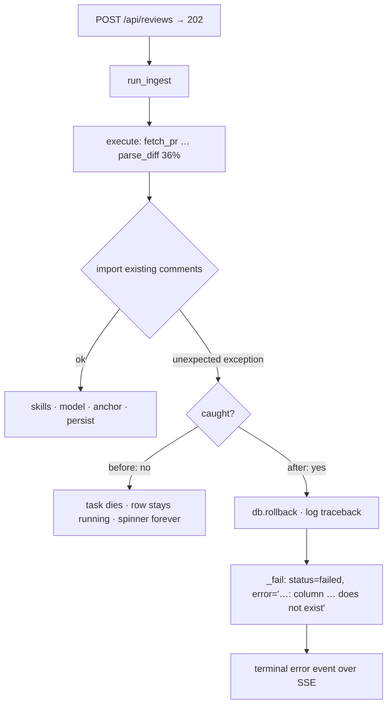
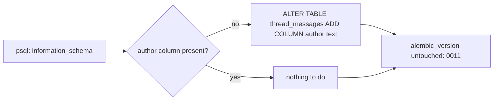

# Phase 17 — Ad-hoc schema repair and fail-fast ingest

> Status: **implemented**. Trigger: reviews 9, 10 and 11 stayed `running` at 36%; the cause was a
> missing `thread_messages.author` column plus an ingest job that dies without recording a failure.
> Decisions taken by the operator: the three reviews are marked failed rather than recovered, and the
> column is repaired **as an ad-hoc database action, not an Alembic revision** (an interim `0012`
> revision was written, applied and then removed).

## 1. Objective & Scope

### Problem

Three reviews stopped at 36% with no error in the UI and no error in the database. Evidence
collected before this plan:

- `code_reviews` rows 9, 10, 11 had `status='running'`, `error IS NULL`, and `updated_at` frozen
  about one second after creation; none had a `review_threads` row.
- PostgreSQL logged `column "author" of relation "thread_messages" does not exist` at 18:10:29,
  18:18:29 and 18:21:20, each two seconds after the corresponding review row was created.
- The live database's `thread_messages` had `id, thread_id, role, content, created_at,
  round_number, is_external, github_comment_id` — no `author`, although the model declares it
  (`0009_thread_rounds.py:85`) and `alembic_version` said `0011`. `alembic check` reported
  `thread_messages.author` as the only column-level drift: the database was migrated with an earlier
  draft of revision 0009.
- The uvicorn log recorded `ERROR [asyncio] Task exception was never retrieved … run_ingest() …
  review_pipeline.py:262 in execute → db.commit() → ProgrammingError`.

So there are two independent defects:

1. **Schema drift.** A live database can disagree with the revision history. Nothing detects it at
   startup, and tests always build from today's migrations, so no test can see it.
2. **Silent crash.** Any exception the pipeline does not expect (a DB error, a bug in an importer)
   escapes `execute()`, kills the ingest task, and leaves the review `running` forever — the API
   returned `202`, the UI keeps a spinner, and only a restart relabels it "Interrupted by a server
   restart", which hides the real cause.

### In scope

- An **ad-hoc repair** of the operator's database: add `thread_messages.author` when the table lacks
  it, then leave the revision history untouched (`alembic_version` stays at head, `0011`).
- A written, reproducible procedure for any other drifted database (the SQL plus the guard query),
  kept in this plan rather than in the shared migration history.
- `run_ingest` catches unexpected exceptions: rollback, log the traceback, set `failed` with a short
  cause, and publish a terminal `error` event so the workspace stops waiting.
- A test for the crash path; marking reviews 9, 10 and 11 `failed` with an explicit error.

### Out of scope

- Recovering or re-running reviews 9, 10, 11. They are marked failed; the operator re-creates them.
- **A migration for this repair.** Decided against: a one-off fix for one drifted operator database
  does not belong in the shared history — it would have to stay a permanent conditional no-op, and
  `alembic check` already surfaces real drift.
- A general "schema doctor", startup drift auditing, or automatic retries.
- The 0008-era index drift `alembic check` also reports (`ix_*_provider` / `uq_settings_user_id` in
  the database, `ix_*_user_id` in the models). No query is wrong, only slower; a separate change.
- Phase 15 (Vercel/Supabase) and its `0010` reservation.

### Decisions

1. **Ad-hoc DDL, not a revision** (operator's call). The repair is one statement against one
   database; the revision was removed after the operator rejected it. `alembic_version` stays at the
   real head (`0011`), so `alembic upgrade head` and `alembic check` keep their meaning.
2. **The column stays after the revert.** `0012`'s own downgrade was a no-op because 0009 owns the
   column; reverting the revision therefore means removing the file and stamping the database back to
   `0011`, not dropping the column — dropping it would re-break comment import.
3. **Stamping happens before the file is deleted.** With the revision gone, Alembic cannot resolve a
   database stamped `0012`; the operator database was stamped `0011` first, and any database already
   stamped `0012` needs `UPDATE alembic_version SET version_num='0011'`.
4. **The catch is in `run_ingest`, not in every importer.** One boundary that always sees the review
   id and the session; `execute()` keeps reporting its known failures (`VCSError`, `LLMError`,
   `KeyError`) as it does today.
5. **The stored error is a short line, never a traceback.** `str(exc).splitlines()[0]`, capped at
   200 characters: SQLAlchemy puts parameters (comment bodies, emails) on later lines, so this keeps
   prompt data out of `code_reviews.error` while still naming the cause. The full traceback goes to
   the server log only.
6. **No change to the API contract.** A crashed review becomes a normal `failed` review, which the
   UI already renders with its `error` text.

## 2. High-Level Design

### Crash path before / after



### Ad-hoc repair procedure



## 3. API Contracts & Database Schema Updates

### No repository schema change

There is no new revision, no model change and no `alembic.ini` change. `alembic heads` stays `0011`.

### Operator database, applied once

| Statement | Effect |
|---|---|
| `ALTER TABLE thread_messages ADD COLUMN author text` | restores the column 0009 declares; nullable, so existing rows are valid |

Guard query (run first; skip the `ALTER` when it returns a row):

```sql
SELECT column_name, data_type, is_nullable
  FROM information_schema.columns
 WHERE table_name = 'thread_messages' AND column_name = 'author';
```

`alembic_version` remains `0011`; `alembic check` stops reporting
`add_column thread_messages.author` while still reporting the pre-existing 0008 index drift. Any
other database showing this drift is repaired the same way — the query is in this plan, not in the
history.

### API deltas

None. `GET /api/reviews` and `GET /api/reviews/{id}` already carry `status` and `error`; a crashed
review now shows `failed` with a one-line cause instead of `running` forever. `GET
/api/reviews/{id}/events` already forwards `error` events with `terminal: true`.

### PII / secrecy

`code_reviews.error` receives an exception's first line only — no SQL parameters, no prompt text, no
credentials. Logs get the traceback (server-side), which contains comment bodies from the PR, as
today; no new secret reaches a log.

## 4. Target File Map

New files:

- `docs/plans/phase_17_plan.md` — this plan.

Changed files:

- `backend/app/services/review_pipeline.py` — `run_ingest` catches unexpected exceptions, rolls back,
  logs, calls `_fail` with `_short_error(exc)`.
- `backend/tests/test_review_pipeline.py` — a test that a crashing `execute()` leaves `failed` +
  `error` and a terminal error event.
- `README.md` — one design-note line (no revision-count change).
- `AGENTS.md` — §5 ingest bullet; §6 note that an ad-hoc repair of a drifted operator database is
  recorded in the phase plan and is not a revision.
- `CHANGELOG.md` — Phase 17 entry with the observed evidence and the ad-hoc decision.

Deliberately left alone:

- `backend/alembic/versions/` — no new revision; the interim `0012` was deleted.
- `services/thread_sync.py`, `vcs.py`, `apply_service.py` — importers and clients are unchanged.
- The 0008 index drift and `alembic check`'s remaining noise.
- `fail_orphaned_reviews()` — still the restart-time sweep; this phase stops relying on it for
  crashes inside a live process.

## 5. Step-by-Step Implementation Steps

1. Diagnose with `information_schema` and `alembic check`; confirm the column is the only gap.
2. Repair the operator database: guard query, then `ALTER TABLE thread_messages ADD COLUMN author
   text`; keep `alembic_version` at `0011`.
3. Wrap `await execute(...)` in `run_ingest` with rollback + `logger.exception` + `_fail`, and add
   `_short_error`.
4. Add the crash test to `test_review_pipeline.py`; run `pytest -q`.
5. Mark reviews 9, 10 and 11 `failed` with an explicit error naming the schema cause, and confirm no
   `running` row remains.
6. Prove the repaired path with real data: fetch and import review 10's five existing comments inside
   a transaction, then roll back — no rows written.
7. Update README, AGENTS, CHANGELOG, and set this plan's status.

## 6. Verification & Acceptance Criteria

- `pytest -q` green with the new crash test (177 baseline + 1 → **178**).
- Operator database: `thread_messages` has exactly one `author text NULL` column, `alembic_version`
  is `0011` (head), `alembic heads` reports `0011`, and `alembic upgrade head` is a no-op.
- `alembic check` no longer lists `add_column thread_messages.author`.
- Crash path: a review whose `execute()` raises shows `status='failed'` and an `error` that contains
  the exception's first line, and the last progress event is `error` with `terminal: true`.
- Repaired path with real data: importing review 10's comments flushes without error and reports five
  threads; the transaction is rolled back, so `review_threads` for 9/10/11 stays empty.
- Reviews 9, 10, 11 end as `failed` with the explicit message; `SELECT count(*) FROM code_reviews
  WHERE status='running'` is 0.
- No destructive command: the only schema change is an additive column; no credential, review or
  comment row is deleted.

## 7. Implementation notes (as built)

- **The running server applied the interim revision before the operator's decision arrived.** Editing
  `review_pipeline.py` triggered the `--reload` worker, whose startup `init_db()` ran
  `alembic upgrade head` and therefore the interim `0012`. When the operator asked for a revert, the
  database was stamped back to `0011` **before** the revision file was deleted (with the file gone,
  Alembic cannot resolve a database stamped `0012`), and the file plus its bytecode were removed.
  `alembic heads`, `alembic current` and `alembic upgrade head` now all agree on `0011`.
- **A scratch database needed the SQL fallback.** `code_review_check_p16` was stamped `0012` when the
  revision disappeared, so `alembic stamp 0011` refused ("Can't locate revision identified by
  '0012'"); `UPDATE alembic_version SET version_num='0011'` fixed it. That is the documented recovery
  path in decision 3.
- **Reviews were already `failed` before the manual step.** The same reload ran
  `fail_orphaned_reviews()`, which relabelled 9/10/11 "Interrupted by a server restart…". The
  `UPDATE … WHERE status='running'` matched nothing, so only the `error` text was replaced with the
  real cause (3 rows); status was already `failed`.
