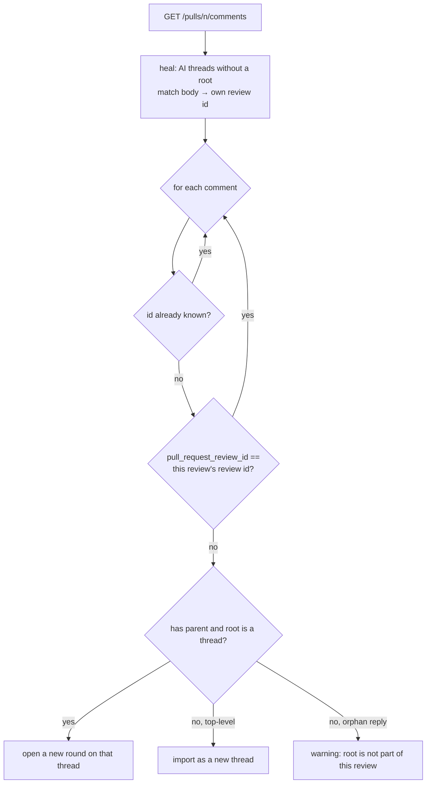
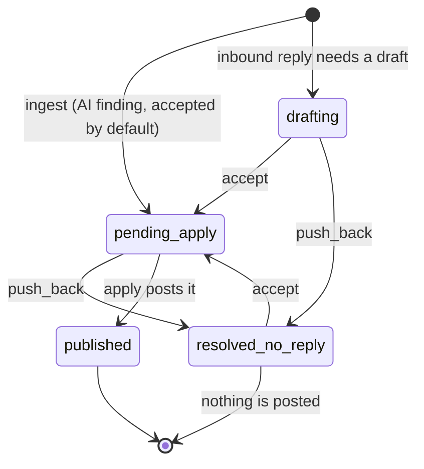

# Phase 18 — Sync by review id and a two-way decision per round

> Status: **implemented**. Trigger: on review 12, four new GitHub comments (three replies plus one new
> thread) were invisible to `POST /api/reviews/12/sync`, and the finding the reviewer asked to push
> back in thread #4 was published anyway. The reviewer asked for the sync to stop ignoring comments
> by author, and for every round to offer the two GitHub-like choices — accept (publish) or push back
> (do not publish).

## 1. Objective & Scope

### Problem

Two confirmed defects, both with data from review 12 (PR `Thinkei/employment-hero#72058`):

1. **Sync ignores the operator's own replies.** `thread_sync.sync_review` skipped every comment whose
   author equalled the token's login. In a single-account setup the tool posts *and* the human
   replies with the same account, so all four comments (`4506050804`, `4506051469`, `4506051796`,
   `4506052217`) were discarded before grouping — the endpoint reported "no new comments".
2. **A push-back could not stop a finding.** The only state that excludes a finding from an apply is
   a round decision (`resolve`), and `RoundPanel` hid every decision control for an initial finding
   (`thread.origin === "AI_GENERATED" && round.round_number === 1`). Chat text changes no state, so
   "push back" in thread #4 left round 1 `drafting`, and apply published it as comment `4506049104`.

Behind defect 1 sits a second, quieter one: the apply-time backfill of GitHub root ids never worked
for these comments. `_backfill_root_ids` matched on `(path, line)` but read
`/pulls/{n}/reviews/{id}/comments`, which returns `line: null, original_line: null` — while
`/pulls/{n}/comments` returns `line: 43` for the same comment. Threads 39–42 therefore kept
`github_root_comment_id = NULL`, so even without the author filter a reply could not be attached
("its top-level comment is not part of this review").

### In scope

- **Sync identifies its own comments by review id, not by author.** The review id is already known
  from `code_reviews.github_review_url` (`…#pullrequestreview-<id>`); comments whose
  `pull_request_review_id` equals it are the findings this review posted, everything else is inbound
  — including comments written by the same GitHub account.
- **Root ids are healed.** `fetch_review_id_comments` reads `/pulls/{n}/comments` and filters by
  `pull_request_review_id`, so the payload carries `line`; the matcher tries the comment body first
  and the anchor second; round 1's `published_github_comment_id` is stored as well. Sync also heals
  threads that still have no root by matching this review's own comments by body.
- **Two decisions on every round, including initial findings**: `accept` (publish on the next apply)
  and `push_back` (never publish; the finding is marked withdrawn). `publish`/`resolve` remain
  accepted as aliases so old clients keep working.
- **Initial findings start `pending_apply`.** That is what the app already did to them (apply posted
  every drafted finding); the status now says so, which makes "accept" the visible default and
  "push back" the exception — the GitHub model the reviewer asked for.
- The discussion contract states that the copilot cannot publish, remove or withdraw a finding.
- UI, tests and documentation for all of the above.

### Out of scope

- Posting to GitHub automatically from a chat message. The reviewer chooses per round; the copilot
  only drafts.
- A "withdraw" tool inside the discussion JSON contract, a bulk accept/push-back-all action, and
  editing a decided round's text after acceptance (the summary can still be supplied with the
  decision).
- Persisting apply warnings into `code_reviews.notes` (a real gap, but separate).
- Re-importing review 12's four comments automatically; the sync fix makes that possible, and the
  operator runs it.

### Decisions

1. **Identity by id, never by author.** The token and the human are the same account, so authorship
   carries no information. `known_comment_ids` already covers everything the tool posted; the review
   id covers anything it posted whose id was not recorded. The author filter is deleted, and with it
   `vcs.fetch_login` / `github_service.fetch_login` (no remaining caller).
2. **Healing beats backfill-only.** The apply-time backfill now works, but existing reviews already
   carry `NULL` roots. Sync repairs them from the comment list it has already fetched, by exact body
   match against the review's own `pull_request_review_id` comments — no extra request, no schema
   change.
3. **Two decisions, both meaningful on round 1.** `accept` → `pending_apply`; `push_back` →
   `resolved_no_reply` plus `thread.dropped = True` for an AI thread's round 1, so the verdict prompt
   also sees the finding as withdrawn. Accepting again clears the flag.
4. **Default stays "accepted".** Findings reach GitHub unless the reviewer pushes back, matching the
   GitHub thread model the reviewer named. Requiring an accept per finding first was rejected: it
   would block the apply button on every review and add a click per finding without changing what is
   published.
5. **No new column.** Round status is the state machine: `pending_apply` = accepted, `resolved_no_reply`
   = pushed back, `published` = already on GitHub, `drafting` = not decided (reply rounds only).

## 2. High-Level Design

### Sync identity



### Round decisions



## 3. API Contracts & Database Schema Updates

No schema change, no migration.

### `POST /api/reviews/{id}/rounds/{round_id}/decision`

```json
{ "decision": "accept",    "summary": "optional text to publish" }
{ "decision": "push_back", "summary": null }
```

| decision | effect | apply |
|---|---|---|
| `accept` | round → `pending_apply`; AI round 1 clears `dropped`; needs publishable text (422 otherwise) | posted next apply |
| `push_back` | round → `resolved_no_reply`; AI round 1 sets `thread.dropped = true` and thread `resolved` | never posted |
| `publish` / `resolve` | legacy aliases of the two above | as before |

`409` when the round is already `published`; `404` when the round belongs to another review.

### `GET /api/reviews/{id}`

`rounds[].status` now starts as `pending_apply` for AI findings instead of `drafting`. The UI maps it
to "Ready to apply", which is what apply already did.

### Sync

No wire change: `POST /api/reviews/{id}/sync` still returns `{review, new_threads, new_rounds,
warnings}`. The difference is that comments from the token's own account now arrive as rounds or
threads, while comments belonging to this review's published review are skipped.

## 4. Target File Map

Changed files:

- `backend/app/services/thread_sync.py` — drop the author filter; add `_own_review_id`,
  `backfill_roots_from_comments`; resolve roots before the loop.
- `backend/app/services/github_service.py` — `fetch_review_id_comments` pages `/pulls/{n}/comments`
  and filters on `pull_request_review_id`; remove `fetch_login`.
- `backend/app/services/vcs.py` — remove `fetch_login`.
- `backend/app/services/apply_service.py` — `_backfill_root_ids` matches body first, stores round 1's
  published id; `decide_round` accepts `accept`/`push_back` (+ aliases) and maintains `dropped`.
- `backend/app/services/review_pipeline.py` — a new AI thread's round 1 is `pending_apply`.
- `backend/app/services/prompts.py` — discussion contract: the copilot cannot publish or remove.
- `backend/app/schemas/review.py` — `RoundDecisionRequest.decision` literal widened.
- `frontend/src/types/index.ts` — `RoundDecision = "accept" | "push_back"`.
- `frontend/src/components/RoundPanel.tsx` — two buttons on every undecided/pushed-back round,
  initial findings included; "Back to draft" removed.
- `backend/tests/test_thread_sync.py` — author-filter test replaced; accept/push-back and heal tests;
  the ingest round status assertion.
- `backend/tests/test_review_pipeline.py` — drop the `fetch_login` stub.
- `README.md`, `AGENTS.md`, `CHANGELOG.md` — behaviour notes.

Left alone: `discussion.py`, `summarise.py`, `routes/reviews.py` (the endpoint already forwards the
decision), the UI's apply flow, and every migration.

## 5. Step-by-Step Implementation Steps

1. `github_service.fetch_review_id_comments`: page `/pulls/{n}/comments`, filter on
   `pull_request_review_id == review_id`; keep the signature.
2. `apply_service._backfill_root_ids`: body match first, anchor fallback; also set
   `thread.round(1).published_github_comment_id`.
3. `thread_sync`: `_own_review_id(review)`, `backfill_roots_from_comments(review, comments, review_id)`,
   delete the author branch and the `fetch_login` call.
4. `decide_round`: normalise `accept`/`publish` and `push_back`/`resolve`; maintain `dropped` for AI
   round 1; keep the 409/422 guards.
5. `review_pipeline`: round 1 of a new AI thread → `pending_apply`.
6. `prompts.DISCUSSION_CONTRACT`: one line stating the copilot cannot publish or remove findings.
7. Frontend: type, two buttons, states, copy.
8. Tests: sync by review id; heal + reply round; push-back excludes a finding from apply; accept
   restores it; round 1 starts `pending_apply`.
9. Docs: plan status, CHANGELOG, README, AGENTS; run `pytest -q` and `npm run build`.

## 6. Verification & Acceptance Criteria

- `pytest -q` green; `npm run build` green.
- Sync with a comment authored by the token's account but under a different `pull_request_review_id`
  opens a round (or thread) — the exact case that failed on review 12.
- A comment whose `pull_request_review_id` equals the review's own id is skipped even though its id was
  never stored, so the tool cannot import its own findings twice.
- Healing: an AI thread with `github_root_comment_id = NULL` and a matching own-review comment gets the
  root and round 1's published id recorded; a reply to it then lands as round 2.
- Backfill: with `fetch_review_id_comments` returning `line`-bearing comments, apply stores root ids
  and round 1 published ids for every posted finding.
- Decisions: `push_back` on an AI finding leaves it out of the next apply (`comments_posted` drops by
  one) and marks the thread `resolved`/`dropped`; `accept` puts it back; `publish`/`resolve` still work.
- UI: every round in `drafting`, `pending_apply` or `resolved_no_reply` shows Accept and Push back,
  initial findings included; the decision survives a reload (it is server state).
- A new review's findings appear as `pending_apply`, and apply posts them unchanged.
- Operator follow-up: after the change, `POST /api/reviews/12/sync` imports `4506052217` as a new
  thread and opens round 2 on threads 39/40/41 for the three replies.

## 7. Implementation notes (as built)

- The author filter's removal also removed `vcs.fetch_login` and `github_service.fetch_login`; no
  caller remained, and a stub in `tests/test_review_pipeline.py` was deleted with them.
- `_backfill_root_ids` matches anchor + body first (two findings can share a summary), then body
  alone (a payload without `line`), then a lone anchor; the first draft used body-first, which
  collapsed two identical summaries onto one comment and was caught by
  `test_delta_apply_posts_the_review_then_only_the_new_reply`.
- Review 12 was re-synced against the live PR after the change: 1 new thread (`4506052217`), 3 new
  rounds (`4506050804`/`4506051469`/`4506051796`), and roots healed for all four posted findings
  (`4506049093`/`4506049098`/`4506049104`/`4506049108`); a second run returned `0 / 0`. The review now
  holds 6 threads and 11 rounds, and the three replies sit in round 2 awaiting a decision.
