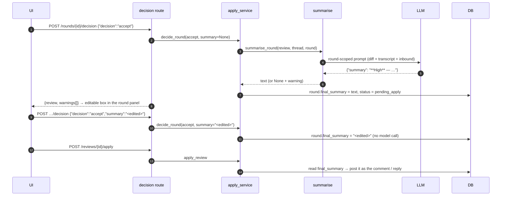

# Phase 19 — Accept generates the GitHub comment, and the reviewer can edit it

> Status: **implemented**. Trigger: on review 12 the reply published for thread 42 (`4506586971`) was
> message 70 pasted verbatim (727 characters). Replies were never summarised, and `final_summary`
> was filled by copying the assistant's last message. The reviewer asked for the opposite: accepting
> a round should produce a summarised GitHub comment that can be adjusted before Apply.

## 1. Objective & Scope

### Problem

`decide_round(accept)` stored `summary or item.final_summary or _last_assistant_text(...)`, so with no
`summary` the round's publishable text was the chat message itself. The pre-publish summariser ran only
over `initial` AI findings, inside `apply_review`, and never over replies (`apply_service.py:377`,
`:416-417`). Two consequences:

- A chat answer and a GitHub comment were the same text: chat prose, first person, referring to the
  conversation, often with reasoning that does not belong in a review comment.
- The text was only visible after acceptance, read-only, so the reviewer could not adjust it before
  Apply. The decision endpoint already accepts a `summary` override; the UI never used it.

### In scope

- **Accept summarises.** Accepting a round runs a one-round model pass that rewrites the thread into
  one self-contained GitHub comment — for a first-round finding (problem, location, agreed fix,
  severity prefix) and for a reply round (a direct answer to the inbound comment, no transcript
  recap). The result is stored in `final_summary`.
- **The reviewer can edit it.** The round panel shows the accepted text in an editable box with
  **Save**; saving sends the same `accept` decision with `summary`, which is stored verbatim and is
  not regenerated.
- **Apply never rewrites an accepted text.** For initial findings, threads that already carry a
  `final_summary` are posted with it; only threads without one still go through the old
  summarise-and-collate pass, so reviews created before this change keep working.
- Fallback: when the pass fails or returns something unusable, the round keeps the assistant's last
  message, and the decision response says so in `warnings`.
- UI, tests and documentation.

### Out of scope

- Summarising the whole thread into one comment at apply time for replies (the round-scoped pass
  replaces it).
- Editing a text after Apply (it is on GitHub).
- A background job for the summary: the decision call is synchronous and takes one model call, like
  a discussion turn.
- Changing the discussion contract's length limit or the verdict pass.

### Decisions

1. **Summarise at accept, not at apply.** The reviewer needs the text before approving it, and an
   apply-time pass would overwrite edits. This also removes the surprise of a body that changes
   between accepting and publishing.
2. **One round, one comment.** The pass takes the thread context, the transcript so far and the
   round's inbound comment, and returns exactly one GitHub-ready comment. It is a new contract
   (`ROUND_SUMMARY_CONTRACT`) next to the existing thread-scoped one.
3. **`summary` means "the reviewer's text".** Supplied → stored verbatim, no model call. Absent →
   regenerate, because a round can keep collecting messages while it is `pending_apply` (that status
   is in `OPEN_ROUND_STATUSES`), and a stale summary is worse than a fresh one.
4. **Apply prefers `final_summary`.** A thread whose round 1 was accepted is published from that
   text; the old summarise/collate path remains only as the fallback for threads with no accepted
   text (older reviews, or an apply triggered before any decision).
5. **Failure is soft.** A failed or malformed pass falls back to the assistant's last message and
   returns a warning, never a 5xx: publishing must not depend on the model being up.

## 2. High-Level Design



## 3. API Contracts & Database Schema Updates

No schema change.

### `POST /api/reviews/{id}/rounds/{round_id}/decision`

Request unchanged (`accept` | `push_back`, optional `summary`). Behaviour:

| request | effect |
|---|---|
| `accept`, no `summary` | one model pass over the thread + round → `final_summary` (fallback: assistant's last message + warning) |
| `accept`, `summary` | stores that text verbatim, no model call |
| `push_back` | unchanged (no text, nothing posted; withdraws an AI round 1) |

Response gains an additive field:

```json
{ "review": { "...": "..." }, "warnings": ["Could not summarise this round (LLMError); the copilot's reply was kept."] }
```

`422` when there is no assistant message and no text to summarise; `409` when the round is already
published; `404` for another review's round.

## 4. Target File Map

- `backend/app/services/summarise.py` — `ROUND_SUMMARY_CONTRACT`, `summarise_round(...)`.
- `backend/app/services/apply_service.py` — `decide_round` becomes async, returns `(review,
  warnings)`, generates on accept; `apply_review` posts accepted `final_summary` for initial threads
  instead of re-summarising them.
- `backend/app/api/routes/reviews.py` — the decision route becomes async and forwards warnings.
- `backend/app/schemas/review.py` — `RoundDecisionResponse.warnings`.
- `frontend/src/types/index.ts` — response type; `RoundPanel`/`CommentBox`/`ReviewDetailPage` —
  editable accepted text + Save, and surface the decision warnings as a notice.
- `backend/tests/test_thread_sync.py` (or a new `test_round_summary.py`) — accept generates, supplied
  text is kept, failure falls back, apply posts the accepted text.
- `README.md`, `AGENTS.md`, `CHANGELOG.md`.

Left alone: prompts for review generation and discussion, the verdict pass, the round state machine,
every migration and the schema.

## 5. Step-by-Step Implementation Steps

1. `summarise_round`: build the prompt (PR identity, anchor + diff hunk, transcript, inbound comment),
   call the model with `json_mode=True`, parse `{"summary": ...}`, return `(text | None, warnings)`.
2. `decide_round`: make it async; on accept, use a supplied `summary`, else generate, else fall back;
   collect warnings either way.
3. Route + schema: async handler, `warnings` in the response.
4. `apply_review`: split `initial` into "has accepted text" and "needs a summary"; post the accepted
   text unchanged; keep `build_comments` only for the latter.
5. Frontend: textarea bound to `round.final_summary` for `pending_apply`, Save via the decision
   endpoint with `summary`; show `warnings` from the decision response.
6. Tests for the four paths; `pytest -q`, `npm run build`.
7. Docs: plan status, CHANGELOG, AGENTS §5, README (workspace + decision API).

## 6. Verification & Acceptance Criteria

- Accepting a first-round finding and a reply round stores a rewritten comment (asserted different
  from the assistant message), and apply publishes exactly that text.
- Supplying `summary` stores it verbatim with no model call (the stub raises if called).
- A failing summariser keeps the assistant's message and returns a warning; the decision is still
  `200` and the round `pending_apply`.
- Apply after acceptance never rewrites the text (a summariser stub that would change it is not
  consulted for that thread); a second apply still returns `409`.
- UI: the accepted round shows an editable box pre-filled with the generated text; Save persists it
  (`GET /api/reviews/{id}` returns the edited text) and Apply publishes the edited version.
- `pytest -q` green, `npm run build` green, and review 12's next reply shows a summarised body rather
  than the chat message.

## 7. Implementation notes (as built)

- `decide_round` now takes `db, review, round_id, decision, summary` and returns
  `(review, warnings)`; the route is `async def` and maps `PipelineError` exactly as before.
- `summarise_round` reuses `thread_sync`-independent plumbing from `summarise.py`: model resolution,
  the foundation bundle, `_transcript`, `MAX_MESSAGE_CHARS`, and `extract_json_document`; a malformed
  or non-dict document is a soft failure, not an exception.
- `apply_review` partitions the initial findings: accepted text is posted as-is, the rest still go
  through `build_comments`, so `dropped`/collate behaviour survives for older reviews.
- The UI sends `accept` with no text (generate) and `accept` + text (save), which is also how a
  re-accept after a push-back keeps the reviewer's wording.
- Live check against review 12's real threads, with no writes: `summarise_round` on thread 41 round 2
  returned "Closing this thread as deferred, not fixed, at this head. …" and thread 42 round 2
  returned a self-contained `**Low** — …` comment with the agreed fix; both with `warnings=[]`. The
  chat message it replaced for thread 42 was 727 characters of first-person conversational text.
- `pytest -q` → 184 passed (180 + 4 new); `npm run build` green.
