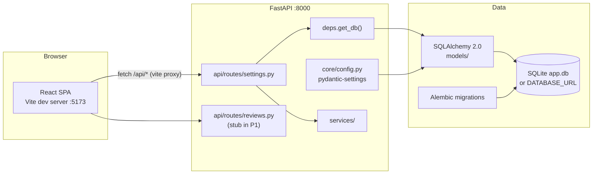
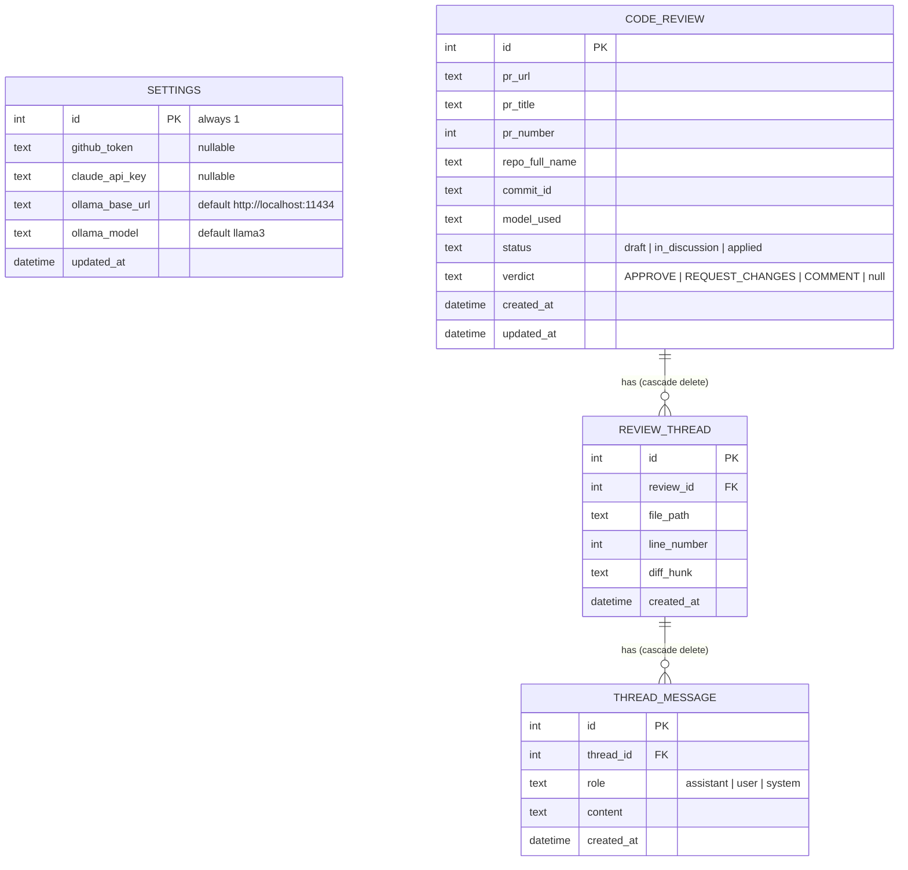
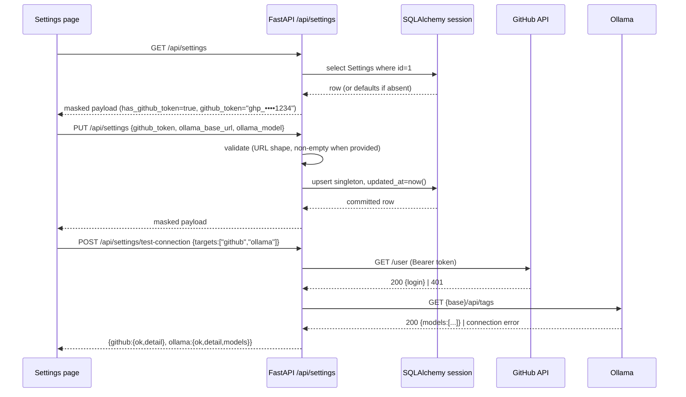

# Phase 1 — Project Setup, Database Layer & Token Settings

## Objective & Scope

Stand up the full skeleton of the AI Code Review Assistant and make the credential layer
usable end to end: a FastAPI backend with a PostgreSQL-portable SQLAlchemy 2.0 data layer
managed by Alembic, a `/api/settings` read/write/test surface with masked secret handling,
and a React (Vite + TS + Tailwind) shell containing the Settings page plus a Dashboard
placeholder that later phases fill in.

**In scope**

- Repository layout (`backend/`, `frontend/`, `docs/plans/`).
- `Settings`, `CodeReview`, `ReviewThread`, `ThreadMessage` SQLAlchemy models and the
  Alembic migration that creates them (all four exist from Phase 1 so later phases never
  need a schema rewrite).
- `DATABASE_URL`-driven engine, SQLite by default, PostgreSQL by connection string only.
- `GET /api/settings`, `PUT /api/settings`, `POST /api/settings/test-connection`.
- Secret masking + explicit reveal + explicit clear semantics.
- Frontend: app shell (navbar, routing), Settings page form wired to the API, Dashboard
  page shell listing reviews (empty in Phase 1).
- Automated verification: pytest suite for settings routes + masking, `alembic upgrade head`
  run against a throwaway DB.

**Out of scope (later phases)**

- GitHub PR ingest, skill loading, LLM calls (Phase 2).
- Split-pane detail workspace (Phase 3), discussion loop (Phase 4), GitHub submission (Phase 5).
- Multi-user auth, encryption-at-rest for tokens (local-first, single operator; noted as a
  known limitation, secrets stored as text in the local DB).

## High-Level Design

### Component / runtime topology



### Entity–relationship model (all four tables created in Phase 1)



`Settings` is a deliberate singleton (`id = 1`) because the product is a local-first
single-operator tool; a row-keyed design would add nothing but a lookup.

### API flow — settings write and connection test



## API Contracts & Data Schemas

### `GET /api/settings`

`200 application/json`

```json
{
  "has_github_token": true,
  "github_token_masked": "ghp_••••••••a1b2",
  "has_claude_api_key": false,
  "claude_api_key_masked": null,
  "ollama_base_url": "http://localhost:11434",
  "ollama_model": "llama3",
  "updated_at": "2026-11-07T12:30:00Z"
}
```

With `?reveal=true` the payload additionally returns the raw strings in
`github_token` / `claude_api_key` so the operator can edit an existing value. Masking is
applied server-side; the raw values are never in the default response.

### `PUT /api/settings`

```json
{
  "github_token": "ghp_new…",
  "claude_api_key": null,
  "ollama_base_url": "http://localhost:11434",
  "ollama_model": "qwen2.5-coder:14b"
}
```

Semantics: **absent or `null` = leave unchanged**; **empty string = clear the stored value**.
Response is the same masked payload as `GET`. `422` on an invalid URL (`ollama_base_url`).

### `POST /api/settings/test-connection`

```json
{ "targets": ["github", "ollama", "claude"] }
```

`200`

```json
{
  "results": [
    { "target": "github", "ok": true,  "detail": "Authenticated as octocat", "metadata": {"login": "octocat"} },
    { "target": "ollama", "ok": false, "detail": "Connection refused", "metadata": null },
    { "target": "claude", "ok": true,  "detail": "API key accepted", "metadata": null }
  ]
}
```

A failing target is `ok:false` with a human-readable `detail` — never a 5xx, because the
point of the call is to report failures. Missing credentials short-circuit with
`detail: "No token configured"`.

### Shared enums / literals

- `ReviewStatus` = `draft` | `in_discussion` | `applied`
- `ReviewVerdict` = `APPROVE` | `REQUEST_CHANGES` | `COMMENT`
- `MessageRole` = `assistant` | `user` | `system`

Stored as `String(32)` columns (portable to PostgreSQL, no native enum migration friction).

### Backend module contracts

- `app.core.config.Settings` (pydantic-settings): `database_url`, `skills_dir`,
  `cors_origins`, `ollama_timeout_s`, `llm_timeout_s`, `github_api_url`.
  Env prefix none, reads `.env`.
- `app.db.session`: `engine`, `SessionLocal`, `get_db()` generator dependency.
  SQLite gets `check_same_thread=False`; every other dialect gets pool pre-ping.
- `app.services.skill_loader`: `load_skills() -> SkillBundle` (Phase 2 consumer, stub added
  in Phase 1 with the directory-resolution rule).

## Target File Map

### Backend — new files

| File | Responsibility |
|---|---|
| `backend/requirements.txt` | pinned runtime + dev dependencies |
| `backend/.env.example` | documented environment variables |
| `backend/main.py` | uvicorn entrypoint (`app.main:app`) |
| `backend/app/main.py` | FastAPI factory, CORS, router registration, `/api/health` |
| `backend/app/core/config.py` | pydantic-settings `Settings` + `get_settings()` cache |
| `backend/app/db/base.py` | `Base` declarative class + metadata |
| `backend/app/db/session.py` | engine, `SessionLocal`, `get_db` dependency |
| `backend/app/models/__init__.py` | re-export models so Alembic autogenerate sees them |
| `backend/app/models/settings.py` | `Settings` singleton model |
| `backend/app/models/review.py` | `CodeReview`, `ReviewThread`, `ThreadMessage` |
| `backend/app/schemas/settings.py` | settings request/response models, masking helpers |
| `backend/app/schemas/review.py` | review/thread/message response models (Phase 2+ consumers) |
| `backend/app/api/deps.py` | shared dependencies (db session) |
| `backend/app/api/routes/settings.py` | GET/PUT/test-connection |
| `backend/app/api/routes/reviews.py` | list endpoint (empty-capable) for the dashboard |
| `backend/app/api/router.py` | aggregates routers under `/api` |
| `backend/app/services/secrets.py` | mask/reveal helpers |
| `backend/app/services/github_service.py` | Phase 2 placeholder module with `verify_token` |
| `backend/app/services/llm_service.py` | Phase 2 placeholder module with `probe_ollama`, `probe_claude` |
| `backend/app/services/skill_loader.py` | directory resolution + file scan (Phase 2 body) |
| `backend/alembic.ini` | Alembic config, URL from env |
| `backend/alembic/env.py` | sync engine, `target_metadata = Base.metadata` |
| `backend/alembic/script.py.mako` | migration template |
| `backend/alembic/versions/0001_initial_schema.py` | creates all four tables |
| `backend/tests/conftest.py` | temp-file SQLite app fixture |
| `backend/tests/test_settings_api.py` | masking, patch semantics, validation, test-connection |

### Frontend — new files

| File | Responsibility |
|---|---|
| `frontend/package.json`, `vite.config.ts`, `tsconfig*.json`, `tailwind.config.js`, `postcss.config.js`, `index.html` | toolchain |
| `frontend/src/main.tsx`, `src/App.tsx` | router + shell |
| `frontend/src/index.css` | Tailwind layers + design tokens |
| `frontend/src/components/ui/*` | Button, Input, Card, Badge, Label, Select primitives (shadcn-style, no CLI) |
| `frontend/src/components/Navbar.tsx` | top nav |
| `frontend/src/services/api.ts` | typed fetch wrapper + settings/reviews calls |
| `frontend/src/types/index.ts` | shared interfaces mirroring the Pydantic schemas |
| `frontend/src/pages/SettingsPage.tsx` | credential form, reveal/clear, test buttons |
| `frontend/src/pages/DashboardPage.tsx` | review list shell |
| `frontend/src/pages/ReviewDetailPage.tsx` | placeholder route (Phase 3) |

### Files modified

| File | Change |
|---|---|
| `.gitignore` | new — ignore `app.db`, `node_modules`, `.env`, `dist`, caches |
| `README.md` | new — run instructions for backend + frontend |

## Step-by-Step Implementation Steps

1. Create `backend/` tree, `requirements.txt`, `.env.example`; create venv with `uv` on
   Python 3.11 and install.
2. `core/config.py`: settings with `DATABASE_URL` default `sqlite:///./app.db` and
   `SKILLS_DIR` default resolving to the repo `code-review/` folder.
3. `db/base.py` + `db/session.py`; dialect-aware engine kwargs.
4. Models: `Settings` singleton, `CodeReview` + `ReviewThread` + `ThreadMessage` with
   cascade `all, delete-orphan` on the relationships and `DateTime(timezone=True)`.
5. Alembic: `alembic init`, point `env.py` at `Base.metadata` and `DATABASE_URL`, write
   `0001_initial_schema` by hand (deterministic, reviewable), run `upgrade head`.
6. Schemas + `services/secrets.py` masking.
7. Routes: settings GET/PUT/test-connection, reviews list; wire `api/router.py` into
   `app/main.py` with CORS for `localhost:5173`.
8. Backend tests with a temp SQLite file; run `pytest`.
9. Scaffold frontend with Vite React-TS, install Tailwind + lucide-react, add the API
   wrapper and types.
10. Build UI primitives, Navbar, Settings page (masked display, reveal toggle, clear,
    save, per-target test with inline status), Dashboard shell.
11. Run `npm run build` (typecheck + bundle) and boot both servers, exercising the
    settings round-trip against the live backend.

## Verification & Acceptance Criteria

1. `cd backend && alembic upgrade head` creates `app.db` containing tables `settings`,
   `code_reviews`, `review_threads`, `thread_messages` (verified with `sqlite3 .tables`).
2. `cd backend && alembic downgrade base && alembic upgrade head` succeeds (migration is
   reversible).
3. `pytest` passes, covering:
   - default settings payload when the table is empty;
   - `PUT` stores and the next `GET` returns the value masked;
   - `reveal=true` returns the raw value;
   - `null`/absent field leaves the value untouched; `""` clears it;
   - invalid `ollama_base_url` → 422;
   - `test-connection` with no credentials returns `ok:false` for github/claude and does not 5xx.
4. `GET /api/health` returns `{"status":"ok"}` from a live `uvicorn` process on :8000.
5. Frontend `npm run build` completes with no TS errors.
6. Manual: with the Vite dev server on :5173, saving a GitHub token shows the masked value
   after reload, the reveal toggle shows the raw token, Clear removes it, and Test
   Connection reports GitHub `ok` for a valid token and a readable failure for a bad one.
7. `DATABASE_URL=postgresql+psycopg://…` requires no code changes — only a new driver
   install (no dialect-specific column types anywhere in `models/`).
