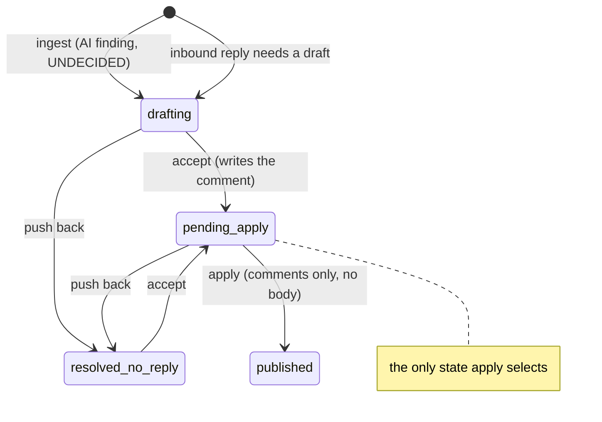
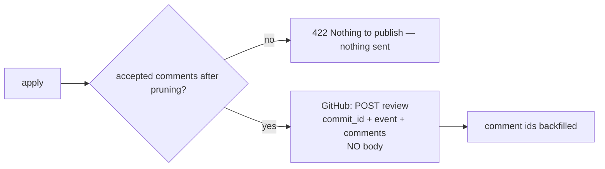

# Phase 20 — Inline comments only, and a round that starts undecided

> Status: **implemented**. Two operator decisions after using the tool on a real PR: drop the fixed
> review body ("Code review completed with N inline findings…") and stop treating a finding as
> accepted before anyone chose. Apply now publishes comments only, and nothing is published until a
> round is explicitly accepted.

## 1. Objective & Scope

### Problem

1. **The review body is noise on the PR.** Every apply posts one review whose body is
   `Code review completed with {n} inline findings, discussed and verified by human - By Code Review
   Master`. The reviewer wants the inline comments only — the body repeats what the comments say and
   is the same sentence on every review.
2. **A finding looks accepted before the reviewer has decided.** Phase 18 made an AI round 1 start as
   `pending_apply`, so the round panel showed "Accepted" (and apply would publish it) without any
   decision. The reviewer wants a real third state: undecided.

### In scope

- Remove the fixed body from publication: GitHub creates the review without `body`, carrying only
  `comments` plus the verdict `event`; GitLab posts one discussion per finding and no summary note.
- Refuse to publish an empty review: when pruning/anchor revalidation leaves no comment, apply returns
  `422` and posts nothing (GitHub would reject it, and a verdict alone is not what this tool is for).
  The old "retry without comments and post the summary only" path is deleted — with no body there is
  nothing left to post.
- AI round 1 starts `drafting` (undecided). Apply publishes only `pending_apply` rounds, so nothing
  goes to GitHub before the reviewer accepts it. `pending_round_count`, the apply button and the round
  badge all follow that.
- UI copy for the undecided state, tests and documentation.

### Out of scope

- The verdict (`event`) — still sent with the review, still the reviewer's choice.
- Posting a review with zero comments (GitLab's summary note included).
- The accepted-comment generation and editing from phase 19, and the round decision semantics
  (`accept` / `push_back`).
- Any migration: no column, table or index changes.

### Decisions

1. **No body at all**, rather than an empty string. GitHub accepts a review with comments and no
   body; sending `""` looks accidental and shows an empty body in the UI.
2. **A review with nothing to post is an error, not a no-op.** Deleting the body removes the only
   thing left when every anchor is stale, so the fallback goes with it: `422 "Nothing to publish…"`,
   review untouched, warning named. Silently posting an empty verdict would be worse.
3. **GitLab loses its summary note.** `post_note` carried only this body; findings are already one
   discussion each, and the approval stays best-effort.
4. **Undecided is a real state.** `drafting` = nobody decided, `pending_apply` = accepted, `published` =
   on GitHub, `resolved_no_reply` = pushed back. Apply selects only `pending_apply`, so the default
   answer to "publish this?" is "no answer yet", never "yes".
5. **The count is the same everywhere**: `pending_round_count`, the action-bar badge and the frontend
   helper all count `pending_apply` rounds only (plus nothing for resolved/published).

## 2. High-Level Design

## 3. API Contracts & Database Schema Updates

No schema change.

| Endpoint | Change |
|---|---|
| `POST /api/reviews/{id}/apply` | review published without a body; `422` when no comment survives pruning/anchor revalidation; `409` when everything is already on GitHub; `400` when nothing is accepted yet |
| round `status` | a new AI finding is `drafting` (was `pending_apply`) |
| `GET /api/reviews/{id}` | unchanged shape; `rounds[].status` starts `drafting`, `pending_count`-style helpers count `pending_apply` only |
| `POST …/rounds/{id}/decision` | unchanged (`accept` generates the comment, `push_back` posts nothing) |

## 4. Target File Map

- `backend/app/services/vcs.py` — drop `MANDATED_BODY`/`mandated_body`; `publish(..., event, comments)`;
  GitHub payload without `body`; delete the 422 summary-only retry; GitLab posts discussions only.
- `backend/app/services/apply_service.py` — no body; `_initial_threads` requires `pending_apply`; the
  empty-comment guard; message for "nothing accepted".
- `backend/app/services/review_pipeline.py` — AI round 1 → `drafting`.
- `frontend/src/lib/utils.ts` — remove `MANDATED_BODY`/`mandatedBody`; `pendingApplyCount` counts
  `pending_apply`.
- `frontend/src/components/RoundPanel.tsx` — "Not decided" for an undecided first round.
- `frontend/src/components/StickyActionBar.tsx`, `pages/ReviewDetailPage.tsx` — drop the body preview.
- `backend/tests/*` — a shared `accept_findings` helper; body assertions removed; retry test becomes a
  failure test; stale-anchor test expects `422`; GitLab publish test updated.
- `README.md`, `AGENTS.md`, `CHANGELOG.md`.

## 5. Step-by-Step Implementation Steps

1. `vcs`: remove the body from both publishers and the constant; GitHub call sends `commit_id`,
   `event`, `comments`; GitLab skips `post_note`; delete the retry branch.
2. `apply_service`: call `vcs.publish` without a body; after `revalidate_anchors`, `422` when
   `initial` was non-empty and nothing is left; `_initial_threads` selects `pending_apply` only;
   update the "nothing pending" message.
3. `review_pipeline`: round 1 `DRAFTING`.
4. Frontend: helper + badge + remove the body preview + "Not decided" label.
5. Tests: `accept_findings(client, review)` in `tests/fixtures.py`, wired into every apply test that
   expects publishing; rewrite the 422-retry and stale-anchor tests; assert the GitHub payload has no
   `body` key; assert an undecided review cannot be applied.
6. Docs and gates.

## 6. Verification & Acceptance Criteria

- A GitHub payload contains `commit_id`, `event`, `comments` and **no** `body` key; GitLab publishes
  discussions and never `post_note`.
- Apply with an undecided finding → `400` and no HTTP call to GitHub; after `accept` → published.
- All anchors stale → `422`, no GitHub call, review stays `draft`.
- GitHub rejects the review (422) → `502`, no retry, review untouched.
- `pytest -q` green (**185 passed**, from 184), `npm run build` green.
- README/AGENTS no longer mention the fixed body or the "apply posts drafted findings" behaviour.

## 7. Implementation notes (as built)

- The 422 "retry without inline comments" path disappeared with the body: with no body there is
  nothing to send, so the test that exercised it now asserts a `502` and an untouched review.
- `tests/fixtures.py::accept_findings` posts `accept` with the finding text as `summary`, so the
  apply tests exercise the accepted-text path without a model call.
- The stale-anchor test now expects `422`, because pruning every comment leaves nothing publishable;
  the warnings it asserted are still returned by `revalidate_anchors` before the guard, but the
  request fails rather than posting an empty review. The guard sits inside `if initial:` — a pure
  reply apply (`initial == []`) never had a review to reject, so an empty `comments` list there is
  valid.
- `apply` still answers `409` first when the review is already `applied`; the "nothing is accepted"
  `400` is the message for a review that is still `draft`. Both happen before any HTTP call.
- Test bookkeeping: 178 → 180 (phase 18) → 184 (phase 19) → **185** here. The one net new test is
  `test_apply_refuses_a_review_where_nothing_is_accepted`; `test_422_retries_without_inline_comments`
  and `test_summariser_failure_still_publishes_with_collation` were replaced by
  `test_github_rejection_is_reported_without_a_retry` and `test_apply_does_not_need_the_summariser`
  (the collation fallback now only runs for a legacy round that has no accepted text, so a test
  cannot reach it through the public API).
- Verified: `POST /pulls/{n}/reviews` payload captured in `tests/test_apply.py` has keys
  `commit_id`, `event`, `comments` only; a `422` from GitHub makes exactly one call and leaves the
  review `draft` with `github_review_url = null`.
