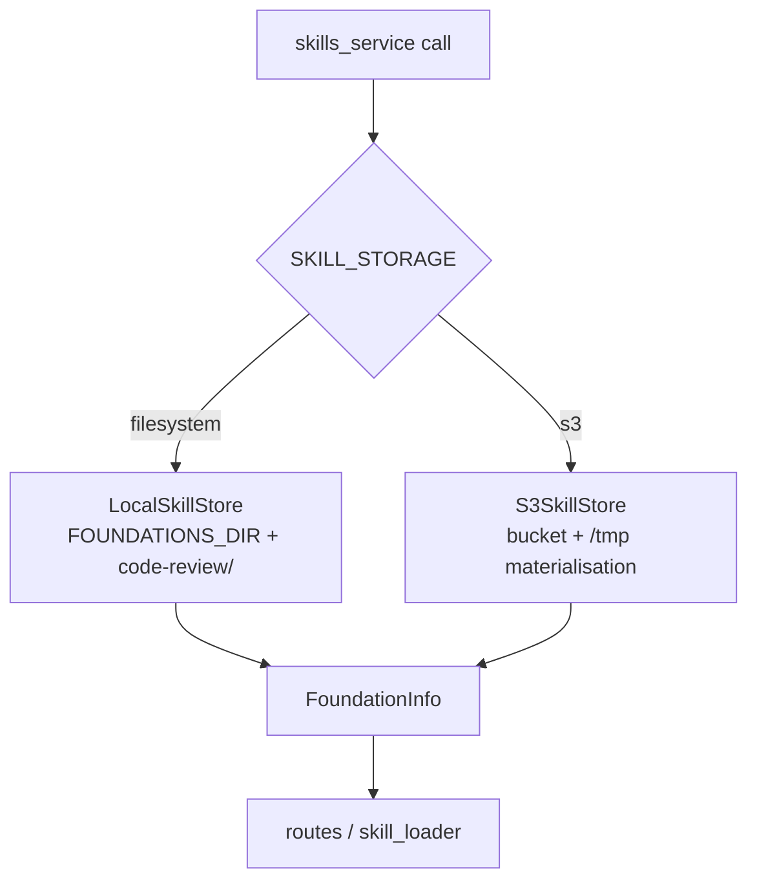
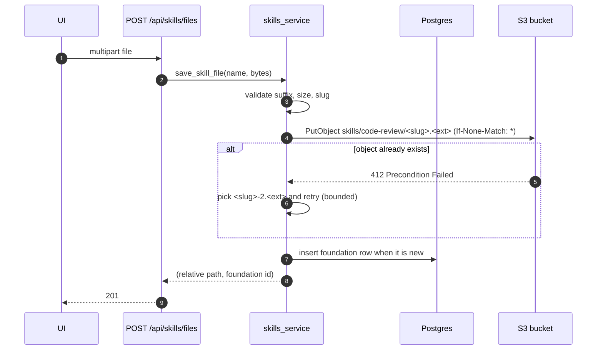
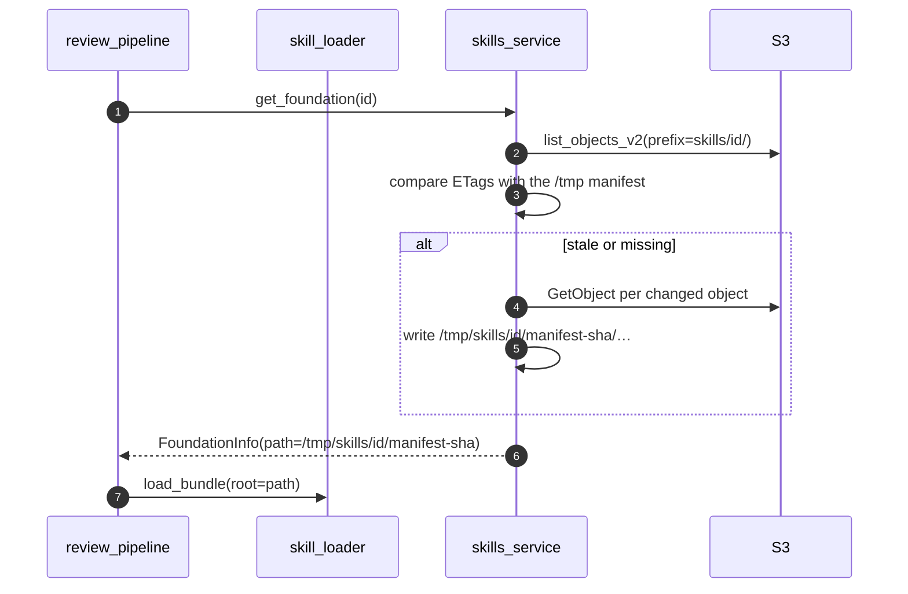

# Phase 21 — Skill file storage in S3-compatible object storage

> Status: **design record only**. No application code, dependency, migration or bucket is
> introduced by this plan; implementation is a separate turn. Phase 15 ships the bundled
> `code-review/` library read-only on Vercel and disables uploads; this phase restores them
> without a writable filesystem.

## 1. Objective & Scope

### Problem

After phase 15 a Vercel deployment cannot accept skill markdown: `/tmp` is per-instance and
discarded, and the deployed filesystem is read-only, so `POST /api/skills/files`,
`POST /api/skills/foundations` and `DELETE /api/skills/foundations/{id}` return `403`. The
operator's only way to change the skill library on Vercel is to edit `code-review/` and redeploy.
That is acceptable for the bundled defaults but not for per-review "Core Skill Foundations",
which are the feature the Skills page exists for.

### In scope

- **One storage abstraction** behind `skills_service`, with two backends chosen by configuration:
  `filesystem` (today's behaviour, unchanged, default) and `s3` (new).
- An S3-compatible bucket as the source of truth for **uploaded** foundations. The bundled
  default foundation stays in the repository/image, read-only, in both modes.
- The same wire contract the UI already uses — `GET /api/skills`, `POST /api/skills/files`,
  `POST /api/skills/foundations`, `DELETE /api/skills/foundations/{id}` — with
  `uploads_enabled: true` again. No frontend redesign.
- Upload through the API (server-side `PutObject`) with the existing validation path
  (`skills_service` extension, size, path-traversal and zip-bomb rules) so the rules are enforced
  in one place; a presigned-PUT fast path is a follow-up, not part of this phase.
- Listing and reading: `list_objects_v2` per foundation prefix, `GetObject` for the prompt
  bundle, with an in-process, ETag-keyed cache so a warm invocation does not re-download the
  library on every review.
- Migration `0013_skill_objects` — the minimum metadata PostgreSQL needs that S3 cannot answer
  cheaply: foundation identity, ownership, label, created-at. (Object bytes stay in S3; no file
  content in the database.)
- A one-off backfill command that uploads existing `code-review-foundations/` folders, plus
  documentation of the bucket policy, lifecycle rule and credential handling.

### Out of scope

- Other object stores with different SDKs (Azure Blob, GCS native API): the S3 API covers AWS S3,
  Cloudflare R2, Supabase Storage's S3 endpoint, MinIO and Backblaze B2, which is enough.
- Presigned browser uploads, multipart/chunked uploads, per-user buckets, CDN-fronted delivery,
  virus scanning, content versioning or a trash/undo flow.
- Storing review artifacts (diffs, prompts, published comments) in S3. Only skill files move.
- Changing how skills are selected, budgeted or injected (`skill_loader` stays as it is; it is
  handed a directory path as today).
- Phase 15's Vercel/Supabase work itself; this phase only changes the skill store.

### Decisions

1. **Bucket, not a database blob table.** Skill files are text read on every review; an object
   store is the right shape and keeps `SELECT * FROM code_reviews` and backups cheap. A
   `BYTEA`/`TEXT` column would bloat dumps and the pooler payloads.
2. **Local mode stays filesystem.** `SKILL_STORAGE=filesystem` (default) keeps the Docker and
   development paths byte-identical to today, so the test suite and the operator's local
   database need no new service. S3 is opt-in with `SKILL_STORAGE=s3` + bucket settings.
3. **The default foundation never leaves the image.** `code-review/` is bundled, reviewed in the
   repository and read-only everywhere; S3 holds only uploaded foundations. That keeps
   "review standards are code" true and means a bucket outage degrades uploads, not reviews.
4. **Server-side upload.** Validation stays in `skills_service` (extension allow-list, size caps,
   path traversal, zip expansion) and the browser keeps sending one multipart request. Vercel's
   request-body limit (4.5 MB) is already above `SKILL_FILE_MAX_BYTES` (2 MB); archives get their
   own cap. Presigned PUT would move validation to the client and is left for later.
5. **Materialise on demand, cache by ETag.** `skill_loader` wants a directory. The S3 backend
   downloads into `/tmp/skills/<foundation>/<manifest-sha>` only when the listing's ETags differ
   from the cached manifest, so one warm instance downloads each revision once. `/tmp` usage is
   bounded by `FOUNDATION_MAX_CHARS` (20 MB).
6. **Metadata table only where S3 cannot answer.** Listing gives keys and sizes but not the
   foundation label, creation time or an atomic "create or 409" claim; `skill_foundations`
   supplies those. Object listings stay derived from S3, so a bucket restored from a backup is
   immediately consistent.
7. **Fail closed on misconfiguration.** `SKILL_STORAGE=s3` without a bucket, region or
   credentials returns `503` from the write endpoints and reports it at startup — never a silent
   fallback to a read-only `/tmp`, which would look like success.

## 2. High-Level Design

### Storage selection

### Upload path (S3 mode)

### Materialisation for a review

## 3. API Contracts & Database Schema Updates

### No wire-shape change

| Endpoint | Change |
|---|---|
| `GET /api/skills` | `uploads_enabled: true` when the store is writable (filesystem, or S3 configured) |
| `POST /api/skills/files` | unchanged `201 {path, foundation, bytes}`; `503` when `SKILL_STORAGE=s3` is misconfigured |
| `POST /api/skills/foundations` | unchanged `201 FoundationRead`; `409` duplicate name stays |
| `DELETE /api/skills/foundations/{id}` | unchanged `204`; S3 prefix delete + metadata row delete |
| `POST /api/reviews` | unchanged; `skill_foundation` still validated against the listing |

`FoundationRead` keeps `id`, `label`, `is_default`, `file_count`, `total_chars`, `files`. The S3
backend fills `file_count`/`total_chars` from the listing (sizes) and `files` from key suffixes, so
the Skills page renders identically.

### New table `skill_foundations` (Alembic `0013_skill_objects`, `down_revision = "0012"`)

| Column | Type | Notes |
|---|---|---|
| `id` | `Integer` PK | autoincrement |
| `foundation_id` | `String(50)` | unique, slug rules from `skills_service.validate_slug` |
| `label` | `String(120)` | display name |
| `storage` | `String(16)` | `filesystem` / `s3`, so a mixed history is explainable |
| `created_by` | FK `users.id` | nullable: backfilled foundations have no owner |
| `created_at` | `DateTime(timezone=True)` | UTC |
| `deleted_at` | `DateTime(timezone=True)` nullable | soft delete while object cleanup runs |

`skill_objects` is deliberately **not** created: keys, sizes and ETags come from
`list_objects_v2`. The table above is about identity and ownership, which S3 cannot model.

Backfill: `python scripts/upload_foundations_to_s3.py --dry-run|--prefix skills/` walks
`FOUNDATIONS_DIR`, uploads each file (skip identical content by SHA-256), inserts the foundation
rows and prints per-foundation counts. Same shape as `migrate_sqlite_to_postgres.py`: dry-run
first, one failure aborts, counts verified before commit.

### Configuration

| Variable | Default | Meaning |
|---|---|---|
| `SKILL_STORAGE` | `filesystem` | `filesystem` or `s3` |
| `S3_BUCKET` | unset | bucket name; required when `SKILL_STORAGE=s3` |
| `S3_REGION` | unset | required for AWS; R2 uses `auto` |
| `S3_ENDPOINT_URL` | unset | R2/MinIO/Supabase Storage endpoint; empty for AWS |
| `S3_ACCESS_KEY_ID` / `S3_SECRET_ACCESS_KEY` | unset | credentials; never logged, never in the database |
| `S3_PREFIX` | `skills/` | key prefix, so one bucket can host other data |
| `S3_CACHE_DIR` | `/tmp/skills` | materialisation root; must be writable |

`boto3` is the only new dependency (works against every S3-compatible endpoint). Credential
handling follows `backend/rules/privacy.md`: environment only, `[REDACTED]` in logs, and the
startup report states `storage=s3 bucket=<name> configured=yes` without keys.

### PII / secret classification

Skill markdown is operator-authored prompt material, not personal data; object keys carry
foundation slugs and file names, never user identity. `created_by` is an internal user id, the
same as every other ownership column. No secret enters the bucket: diff and PR data never leave
the review tables, and credentials stay in `version_control_keys` / `llm_keys`.

## 4. Target File Map

New files:

- `backend/app/services/skill_store.py` — `SkillStore` protocol, `LocalSkillStore`,
  `S3SkillStore`, `get_store()` selection.
- `backend/app/services/s3_client.py` — boto3 client construction, endpoint/credentials handling,
  `503` mapping (`SkillStorageError`).
- `backend/alembic/versions/0013_skill_objects.py` — `skill_foundations`.
- `backend/scripts/upload_foundations_to_s3.py` — backfill.
- `backend/tests/test_skill_s3_store.py` — store contract against a stubbed S3 client; tests never
  touch the network.
- `docs/plans/phase_21_plan.md` — this plan.

Changed files:

- `backend/app/services/skills_service.py` — delegate to the store; keep validation and slug
  rules in place; keep `get_foundation`/`list_foundations` signatures used by the pipeline.
- `backend/app/services/skill_loader.py` — accept the materialised path, no other change.
- `backend/app/api/routes/skills.py`, `backend/app/schemas/skills.py` — `uploads_enabled` driven
  by the store, `503` mapping.
- `backend/app/core/config.py` — `skill_storage` and the `S3_*` settings.
- `backend/requirements.txt` — `boto3`.
- `backend/.env.example`, `README.md`, `AGENTS.md`, `CHANGELOG.md` — configuration, bucket policy
  (private, no public ACL, lifecycle for deleted prefixes), backfill and rollback.

Left alone:

- `review_pipeline.py` — it already calls `skills_service.get_foundation(...)` and `skill_loader`
  with a path.
- `frontend/**` — the contract is unchanged; `uploads_enabled` flips back to `true`.
- The default foundation contents and every migration before `0012`.

## 5. Step-by-Step Implementation Steps

1. **Store interface.** Extract the current filesystem code path into `LocalSkillStore` behind a
   `SkillStore` protocol (`list`, `get`, `save_file`, `create`, `delete`, `materialise`), with no
   behaviour change and the suite green.
2. **Config and errors.** Add `skill_storage` + `S3_*`; `SkillStorageError` mapped to `503` at the
   route boundary, mirroring `CredentialError`.
3. **S3 store.** Implement listing, `PutObject` with `If-None-Match: *`, prefix delete,
   materialisation into `/tmp/skills/<foundation>/<manifest-sha>`, and a manifest cache keyed by
   ETags. Enforce the existing size/count/extension rules before any upload.
4. **Metadata table.** Hand-write `0013_skill_objects`, model `SkillFoundation`, verify
   `upgrade`/`downgrade -1` on scratch SQLite and PostgreSQL.
5. **Backfill script.** Walk `FOUNDATIONS_DIR`, upload, insert rows, `--dry-run` prints counts,
   one transaction, verification by re-listing.
6. **Wiring.** `skills_service` selects the store once per call; `uploads_enabled` reflects it;
   `GET /api/skills` merges the bundled default foundation with the S3 listing.
7. **Tests.** Store contract tests for both backends (same assertions), duplicate-name `409`,
   traversal and zip-bomb rejection, missing bucket `503`, cache reuse on a second call, delete
   removing both objects and the row.
8. **Docs.** README section (bucket policy, endpoint per provider, backfill, rollback to
   filesystem), AGENTS storage rule, CHANGELOG entry with observed counts.
9. **Verify end to end:** on a scratch bucket, upload on Vercel → foundation listed → a review
   generated with it includes the new rules → delete removes it; then a local filesystem run of
   the same flow.

## 6. Verification & Acceptance Criteria

- `pytest -q` green, new store tests included; `npm run build` unchanged (no UI change).
- `SKILL_STORAGE=filesystem` (default): the existing suite and the Docker flow behave exactly as
  before; no S3 import at module scope and no boto3 requirement at import time.
- On a preview deployment with `SKILL_STORAGE=s3`: `GET /api/skills` reports
  `uploads_enabled:true`; uploading a markdown file returns `201` and the file appears in the
  next `GET /api/skills` and in a review prompt; a second upload of the same name stores
  `<slug>-2.md`; delete removes it from the listing and from the bucket prefix.
- A review whose foundation lives in S3 completes with the expected `skills` progress detail and
  the model prompt contains the uploaded rule text (asserted from a captured prompt in a test,
  observed once on the preview deployment).
- Materialisation happens once per warm instance: a second review in the same invocation triggers
  no `GetObject` (counted in a test double / function logs).
- Misconfiguration: `SKILL_STORAGE=s3` without `S3_BUCKET` → writes return `503` with a detail
  naming the variable; startup logs the misconfiguration once; `/api/health` still `200`.
- Backfill: `--dry-run` on the operator's `code-review-foundations/` reports the same counts as
  the real run; the bucket contains one key per file; re-running is a no-op.
- Rollback: set `SKILL_STORAGE=filesystem` (uploads go back to the volume) and revert `0013` only
  on a scratch database; the bucket is left untouched. No destructive command runs against the
  operator's database.
