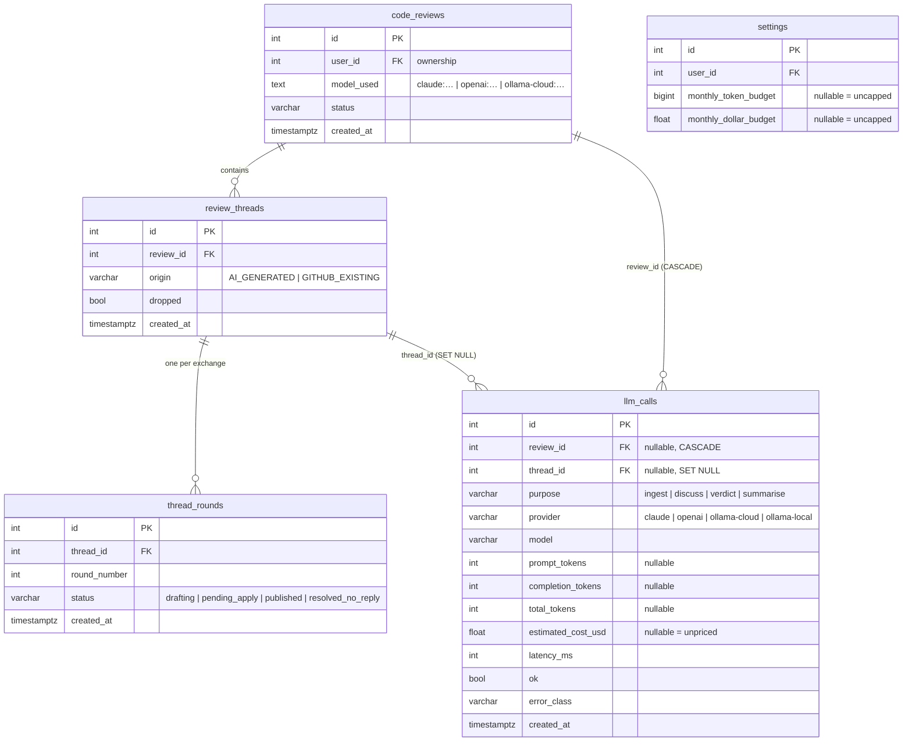
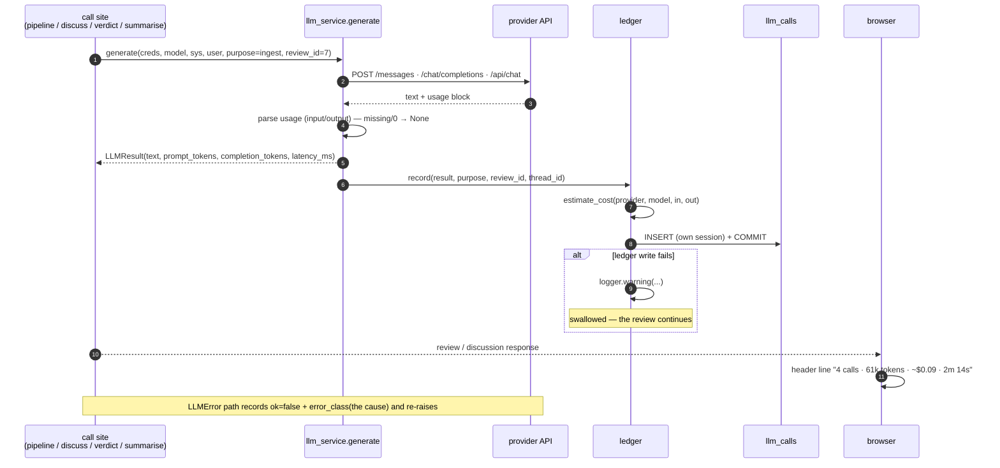

# Phase 22 — LLM call ledger, cost estimation and review-quality analytics

> Numbering: requested as `phase_10`, but `docs/plans/phase_10_plan.md` is already the provider
> credentials plan and the highest existing plan is 21, so this one takes 22 per `AGENTS.md` §1.
> `INITIATIVES.md` §4 is the backlog entry this implements; it differs in one place (it proposed a
> `llm_calls.user_id` column, this plan reaches ownership through `code_reviews` — see Decisions).

## 1. Objective & Scope

### Problem

The app cannot answer "what did this review cost?" or "which model is actually better?".
`llm_service.generate` sends `max_tokens` and throws the response's `usage` block away, so input
and output tokens are lost for all three provider families. Nothing records latency, nothing
records which purpose a call served, and nothing joins a finding to what the reviewer decided
about it. Provider choice is folklore.

### In scope

- **`llm_calls`** — one row per provider call: ids, `purpose`, `provider`, `model`, token counts,
  estimated cost, latency, `ok`, `error_class`, `created_at`. Counts only: **no prompt, no diff,
  no completion, no message text** ever reaches the table.
- **`LLMResult`** — `generate()` returns the dataclass instead of a bare string, so tokens and
  latency travel with the text. Token extraction is a pure function per provider, testable against
  recorded payloads without a network.
- **`core/pricing.py`** — USD-per-1M-token table, prefix-matched, every figure labelled
  *estimated*; an unknown model yields `None` cost, never an error.
- **`GET /api/analytics?days=30`** — spend and volume totals, per-provider/per-model/per-purpose
  breakdowns, median and P95 latency, acceptance and push-back rates per model, and current
  calendar-month budget utilisation.
- **Soft budget** — `settings.monthly_token_budget` / `monthly_dollar_budget`, utilisation with an
  80% warning and a 100% red state. Nothing is ever blocked.
- **UI** — a dedicated `/analytics` tab (KPI cards, model comparison, purpose breakdown, budget
  manager), a 30-day activity bar plus budget banner on `/reviews`, and a usage line in the review
  header.

### Out of scope

- Hard caps, per-call gating, or refusing a review because a budget is reached.
- Cost reconciliation against a provider invoice: prices are a static table, not billing data.
- Per-day time series charts and CSV export (`GET /api/analytics/daily` is a later phase).
- Token counting for prompts that were never sent (a failed key resolution logs no call).
- Streaming transports. No adapter streams today; the usage parsers accept the streaming payload
  shapes so the ledger keeps working when initiative 5 lands.
- Recording probes (`/api/settings/test-connection`, `/api/models`) — they are not review calls.

### Decisions

1. **No `user_id` on `llm_calls`.** The requested column list has none, and duplicating ownership
   invites the two copies disagreeing. Analytics joins `llm_calls → code_reviews` and filters on
   `code_reviews.user_id`, so every row is owned transitively; a row with `review_id IS NULL` is
   not attributable to an account and is excluded from the API (the index and the schema keep
   `NULL` legal because the column list asked for it).
2. **`provider` stores the model-id prefix**, i.e. `claude` · `openai` · `ollama-cloud` ·
   `ollama-local`, not `anthropic`/`ollama`. `code_reviews.model_used` already uses those prefixes
   (`rules/providers-and-keys.md`) and analytics merges ledger rows with per-review quality on
   `f"{provider}:{model}"`, so a second vocabulary would need a translation table for no benefit.
3. **Telemetry never joins the caller's transaction.** `ledger.record` opens its own
   `SessionLocal`, commits, and swallows every exception into a warning. A ledger write that fails
   cannot roll back a review, and a review that fails still leaves its call rows behind.
4. **Percentiles are computed from a sorted column, not `percentile_cont`.** PostgreSQL has
   `percentile_cont`, SQLite does not; a nearest-rank index into the sorted latencies is the same
   answer on both dialects, and the window is one column wide (a few thousand rows locally).
   SQL still does all counting, summing and averaging.
5. **Two independent quality ratios, not one score.** Acceptance ("the latest round of this
   finding ended `published`") and push-back ("the reviewer engaged: any user message, or an
   explicit `resolved_no_reply`") answer different questions; a finding can be both (published,
   then discussed again). Both are reported per model with the same denominator.
6. **Quality is attributed to `code_reviews.model_used`.** A finding belongs to the review that
   produced it, and that review records one model. A legacy `ollama:` prefix is normalised to
   `ollama-cloud` when building the key so it merges with ledger rows.
7. **The budget is soft and advisory.** `level` is `ok` / `warn` (≥80%) / `over` (≥100%); the UI
   shows a banner and never disables a button. A local tool that refuses to work because of its
   own estimate would be hostile.
8. **Migration `0013_llm_calls`.** Head is `0012`. `phase_21_plan.md` names `0013` for its own
   `skill_foundations` table, but that phase is a design record with no code; it takes the next
   free number when it is built. A revision cannot be inserted behind head — see `0012`'s note.

## 2. High-Level Design

### Lifecycle

```
call site (ingest | discuss | verdict | summarise)
  └─ llm_service.generate(..., purpose=, review_id=, thread_id=)
       ├─ resolve_endpoint / provider adapter            → HTTP
       │    └─ adapter returns LLMResult(text, prompt_tokens, completion_tokens, latency_ms)
       ├─ on exception  → LLMResult(ok=False, error_class=<cause class>)  → re-raise
       └─ ledger.record(result, purpose, review_id, thread_id)          [never raises]
            ├─ pricing.estimate_cost(provider, model, in, out) → float | None
            └─ own SessionLocal() → INSERT llm_calls → COMMIT
                 └─ failure → logger.warning, return
```

`GET /api/analytics` reads `llm_calls` (spend, volume, latency, grouped by provider/model/purpose),
`code_reviews` (ownership, `model_used`), `review_threads` + `thread_rounds` + `thread_messages`
(quality), and `settings` (budget caps). All per-account, all windowed by `days` or by the current
calendar month for the budget.

### ER



### One call, end to end



## 3. API Contracts & Schema

### `GET /api/analytics?days=30` (owned, signed-in only)

`days` is `1..365`, default 30. Response (`app/schemas/analytics.py`):

```json
{
  "window_days": 30,
  "generated_at": "2026-11-09T04:12:33Z",
  "totals": {
    "calls": 42, "failed_calls": 1, "priced_calls": 39,
    "prompt_tokens": 310400, "completion_tokens": 51100, "total_tokens": 361500,
    "estimated_cost_usd": 1.6932
  },
  "latency": { "median_ms": 8210, "p95_ms": 41200, "avg_ms": 12904 },
  "by_provider": [
    { "provider": "claude", "calls": 30, "total_tokens": 302000, "estimated_cost_usd": 1.61 }
  ],
  "by_model": [
    {
      "provider": "claude", "model": "claude-sonnet-4-5-20250929",
      "calls": 30, "prompt_tokens": 260000, "completion_tokens": 42000, "total_tokens": 302000,
      "estimated_cost_usd": 1.61, "avg_latency_ms": 11800,
      "findings": 12, "accepted": 9, "acceptance_rate": 75.0,
      "pushed_back": 3, "pushback_rate": 25.0
    }
  ],
  "by_purpose": [
    { "purpose": "ingest", "calls": 4, "total_tokens": 240000, "estimated_cost_usd": 1.20 }
  ],
  "quality": {
    "findings": 18, "accepted": 13, "acceptance_rate": 72.2,
    "pushed_back": 5, "pushback_rate": 27.8
  },
  "budget": {
    "month": "2026-11",
    "token_budget": 5000000, "dollar_budget": 20.0,
    "tokens_used": 402000, "dollars_used": 1.90,
    "token_pct": 8.0, "dollar_pct": 9.5,
    "level": "ok"
  }
}
```

Rules behind the numbers:

| Field | Definition |
|---|---|
| `totals.estimated_cost_usd` | sum of `llm_calls.estimated_cost_usd`, `None` when no row had a price |
| `totals.priced_calls` | rows with a non-NULL cost — the denominator behind any dollar figure |
| `latency.median_ms` / `p95_ms` | nearest-rank percentile over the window's `latency_ms`; `None` with no calls |
| `*.acceptance_rate` | `accepted / findings × 100`, `None` when `findings == 0` |
| `accepted` | AI-authored threads whose **latest** round status is `published` |
| `pushed_back` | AI-authored threads with any `user`-role message, or latest round `resolved_no_reply` |
| `findings` | AI-authored threads created in the window (imported GitHub threads excluded) |
| `budget.level` | `over` if any configured cap is ≥100%, else `warn` if ≥80%, else `ok`; `ok` when uncapped |
| `budget.dollars_used` | current **calendar** month, independent of `days`; `None` when nothing was priced |

### `settings` — new columns and wire shape

`PUT /api/settings` accepts the two caps (`null` clears a cap; an absent field is untouched):

```json
{ "monthly_token_budget": 5000000, "monthly_dollar_budget": 20.0 }
```

`GET /api/settings` adds `"monthly_token_budget": 5000000, "monthly_dollar_budget": 20.0`.

### Review usage line

`CodeReviewSummary` gains `"usage": {...}`; it is filled on the detail responses (`GET
/api/reviews/{id}` and the review/apply/sync/discuss/decision responses) and `null` in the list:

```json
"usage": { "calls": 4, "prompt_tokens": 58000, "completion_tokens": 3100,
           "total_tokens": 61100, "estimated_cost_usd": 0.09, "latency_ms": 134000 }
```

### Migration `0013_llm_calls` (`down_revision = "0012"`)

| Table | Column | Type | Notes |
|---|---|---|---|
| `llm_calls` | `id` | `Integer` PK | autoincrement |
| | `review_id` | `Integer` FK `code_reviews.id` `ON DELETE CASCADE` | nullable |
| | `thread_id` | `Integer` FK `review_threads.id` `ON DELETE SET NULL` | nullable |
| | `purpose` | `String(16)` NOT NULL | `ingest`/`discuss`/`verdict`/`summarise` |
| | `provider` | `String(16)` NOT NULL | model-id prefix |
| | `model` | `String(120)` NOT NULL | bare model name |
| | `prompt_tokens` | `Integer` NULL | NULL, never 0, when unreported |
| | `completion_tokens` | `Integer` NULL | as above |
| | `total_tokens` | `Integer` NULL | prompt+completion, NULL if either is |
| | `estimated_cost_usd` | `Float` NULL | NULL = unpriced model |
| | `latency_ms` | `Integer` NOT NULL | |
| | `ok` | `Boolean` NOT NULL, default true | |
| | `error_class` | `String(64)` NULL | cause exception class name |
| | `created_at` | `DateTime(timezone=True)` NOT NULL | `utcnow` |
| `settings` | `monthly_token_budget` | `BigInteger` NULL | `batch_alter_table` |
| | `monthly_dollar_budget` | `Float` NULL | `batch_alter_table` |

Indexes: `ix_llm_calls_review_id_created (review_id, created_at)`,
`ix_llm_calls_analytics (created_at, provider, model, purpose)`.

Downgrade drops both indexes and the table, then batch-drops the two `settings` columns. No data
migration and no destructive statement anywhere: the new table starts empty, and existing reviews
simply have no usage line until their next call.

### PII / secret classification (per `rules/privacy.md`)

| Column | Class | Why |
|---|---|---|
| `llm_calls.purpose` / `provider` / `model` | not PII | enumerations and a public model name |
| `llm_calls.prompt_tokens` / `completion_tokens` / `total_tokens` / `estimated_cost_usd` / `latency_ms` / `ok` / `error_class` | not PII | integers, a float and a class name |
| `llm_calls.review_id` / `thread_id` | internal id | same shape as every ownership column |
| **absent by design** | — | prompt, system prompt, diff, completion, reviewer message, exception text: nothing that could carry code or personal data is ever written |

`error_class` is a class *name* (`RateLimitError`), never `str(exc)`, so an upstream message cannot
leak a prompt fragment into the table.

## 4. Target File Map

New — backend:

| File | Purpose |
|---|---|
| `app/models/llm_call.py` | `LLMCall`, `LLMPurpose` |
| `app/core/pricing.py` | `MODEL_PRICES`, `price_for`, `estimate_cost` |
| `app/services/ledger.py` | `record()` — the resilient, own-session insert |
| `app/services/analytics.py` | `summarise()` aggregates, `review_usage()` |
| `app/schemas/analytics.py` | response models |
| `app/api/routes/analytics.py` | `GET /api/analytics` |
| `alembic/versions/0013_llm_calls.py` | the revision above |
| `tests/test_llm_usage.py` | usage parsers, pricing, NULL tolerance, ledger resilience, real ingest→row |
| `tests/test_analytics_api.py` | aggregates, p95, acceptance/push-back, budget, isolation |

Changed — backend:

| File | Change |
|---|---|
| `app/services/llm_service.py` | `LLMResult`, `claude_usage`/`openai_usage`/`ollama_usage`, adapters return it, `generate` records |
| `app/services/review_pipeline.py` | `outcome.text`, `purpose=ingest` |
| `app/services/discussion.py` | `purpose=discuss`, `thread_id` per call |
| `app/services/verdict.py` | `purpose=verdict` |
| `app/services/summarise.py` | `purpose=summarise`, `thread_id` where known |
| `app/models/settings.py` | the two budget columns |
| `app/models/__init__.py` | export `LLMCall`, `LLMPurpose` |
| `app/schemas/settings.py` | budget fields on read/update |
| `app/schemas/review.py` | `ReviewUsage`, `CodeReviewSummary.usage` |
| `app/api/routes/settings.py` | persist the caps |
| `app/api/routes/reviews.py` | `_detail()` attaches usage to every detail response |
| `app/api/router.py` | mount `/analytics` |
| `tests/fixtures.py` | `llm_result()` helper for stubs |

New — frontend: `src/pages/AnalyticsPage.tsx`.
Changed — frontend: `src/types/index.ts`, `src/services/api.ts`, `src/App.tsx`,
`src/components/Navbar.tsx`, `src/pages/DashboardPage.tsx`, `src/components/ReviewHeader.tsx`,
`src/lib/utils.ts` (compact number / cost / duration formatting).

Docs: `README.md` (analytics section, endpoints), `CHANGELOG.md`, `AGENTS.md` (§4 migration range,
§4 layout), `backend/rules/conventions.md` (service roster), this plan.

Left alone: `progress.py`, `apply_service.py`, `thread_sync.py`, the SSE bus, every migration
before `0012`, the review/discussion contracts.

### UI structure

`/analytics`

```
Analytics                                                  [ Refresh ]
Spend, volume and review quality across every model call.   All figures estimated.

┌ Estimated spend (30d) ┐┌ Tokens processed ┐┌ Median / P95 latency ┐┌ Acceptance rate ┐
│ ~$1.69  · 42 calls   ││ 361.5k           ││ 8.2s / 41.2s         ││ 72.2%           │
│ 3 unpriced calls     ││ in 310k · out 51k││ avg 12.9s            ││ 13 of 18 findings│
└──────────────────────┘└──────────────────┘└──────────────────────┘└─────────────────┘

┌ Model comparison ─────────────────────────────────────────────────────────────┐
│ Model            Provider  Calls  Tokens in/out  Est. cost  Avg  Accept  Push │
│ claude-sonnet-4… claude       30  260k / 42k     ~$1.61     11.8s  75.0%  25.0%│
│ llama3           ollama…       8   40k / 9k      ~$0.00      4.1s  62.5%  37.5%│
└───────────────────────────────────────────────────────────────────────────────┘

┌ Purpose breakdown ────────────────┐┌ Monthly budget ──────────────────────────┐
│ ingest    ███████████████  4 calls││ Tokens  5,000,000   [     ]  $20.00 [  ] │
│ discuss   ██████          12 calls││ Used    402,000  (8.0% of tokens)        │
│ verdict   ████             8 calls││         1.90 USD (9.5% of dollars)       │
│ summarise ██               3 calls││ Warn at 80% · red at 100% · never blocks │
└───────────────────────────────────┘└──────────────────────────────────────────┘
```

`/reviews` — between `NewReviewPanel` and the history card:

```
┌ 30-Day Activity  ~$1.69 est. spend · 361.5k tokens · 72.2% acceptance · 8.2s median latency
│                                                          View full analytics → ┐
└ (amber row appended at ≥80% of a cap, red at ≥100%: "78% of your monthly token budget used") ┘
```

`/reviews/:id` header — after the model chip:

```
GitHub · octo/example#123   abc123s   claude:claude-sonnet-4-5   4 calls · 61.1k tokens · ~$0.09 · 2m 14s
```

## 5. Ordered Steps

1. `app/core/pricing.py` + `app/models/llm_call.py` + `0013_llm_calls`, verified `upgrade` and
   `downgrade -1` on a scratch SQLite file.
2. `llm_service`: `LLMResult`, the three usage parsers, adapters return the result, `generate`
   records through `ledger` (built in step 3 — same turn).
3. `app/services/ledger.py`: own session, cost estimate, warning-only failure boundary.
4. Call sites: `outcome.text` and `purpose`/`review_id`/`thread_id` in pipeline, discussion,
   verdict, summarise; update the test stubs to return `LLMResult`.
5. `settings` budget columns + schema + route; `GET/PUT /api/settings` round-trip.
6. `app/services/analytics.py` + `app/schemas/analytics.py` + `app/api/routes/analytics.py`,
   mounted in `router.py`.
7. `usage` on review detail responses (`_detail` helper in `routes/reviews.py`).
8. Frontend: types → api → `AnalyticsPage` → nav/route → dashboard bar → header line →
   formatting helpers.
9. Tests: parsers/pricing/NULL/resilience/ingest-row; analytics aggregates, p95, rates, budget,
   isolation; settings round-trip.
10. Docs: README, CHANGELOG, AGENTS, conventions roster, this plan's evidence.

## 6. Verification

- `cd backend && pytest -q` — the 191 existing tests stay green plus the new modules.
- `alembic upgrade head` then `alembic downgrade -1` then `upgrade head` on
  `sqlite:////tmp/analytics_verify.db` (scratch file, never the configured database).
- `cd frontend && npm run build` (`tsc -b` + Vite) green.
- **Adapter parsers**: recorded Anthropic/OpenAI/Ollama payloads (including a `message_start` +
  `message_delta` pair and an Ollama body with no `prompt_eval_count`) produce the expected token
  pairs, and the Ollama case writes `NULL`, not `0`.
- **Ledger resilience**: with `ledger.SessionLocal` forced to raise, a full ingest still finishes
  `draft` with its threads, one `WARNING` is logged and no exception escapes.
- **Ledger is real**: a full ingest with the provider adapter stubbed returns one `llm_calls` row
  with `purpose='ingest'`, the review id, the model and non-NULL latency; the review detail then
  reports `usage.calls == 1`.
- **Aggregation**: fixed fixture rows give the expected totals, nearest-rank p95, acceptance and
  push-back ratios, and `GET /api/analytics` returns them; a second account's rows never appear.
- **Budget**: `PUT /api/settings {"monthly_token_budget": 1000}` then analytics reports
  `level: over` once usage passes 1000 tokens, and `warn` between 80% and 100%.
- Live check on a scratch database: seeded rows, `GET /api/analytics?days=30` printed with its
  real numbers, and a review header line from a real ingest.

### Observed

Run on a scratch SQLite database with the GitHub client and the Claude adapter stubbed (no network),
two findings, one discussion on finding #1, `accept` on it, then `apply`:

| Step | Result |
|---|---|
| migrations | `upgrade head` applies `0013`; `downgrade -1` then `upgrade` round-trips; `llm_calls` has both indexes and `CASCADE` / `SET NULL` |
| `POST /api/reviews` | `202`; after ingest `draft`, 2 threads, `usage = {calls: 1, total_tokens: 9880, estimated_cost_usd: 0.039, latency_ms: 1750}` |
| `POST /api/reviews/{id}/discuss` | `200`, `opinion_refreshed: true` (discuss + verdict calls recorded) |
| `POST .../rounds/{id}/decision` + `/apply` | `200` / `200`, 1 comment posted, round became `published` |
| `GET /api/analytics?days=30` | 3 calls, 3 priced, 16 260 tokens, `$0.0627` (ingest `$0.0390`, discuss `$0.0147`, verdict `$0.0090`), median 2 000 ms / p95 2 250 ms / avg 2 000 ms, acceptance 50.0% (1 of 2), push-back 50.0% |
| budget after `PUT /api/settings {token: 40000, dollar: 5.0}` | `tokens_used 16260 · 40.6%`, `dollars_used 0.0627 · 1.3%`, `level ok` |
| review header | `3 calls · 16.3k tokens · ~$0.06 · 6s total` |

Costs match the price table by hand: 9 100 × $3/1M + 780 × $15/1M = $0.039 for ingest.
`pytest -q` → 221 passed (191 before). `npm run build` → green.

`AGENTS.md` was not edited: it is a protected file and the write was not approved in this session,
so its `0001…0012` / `tests (191)` lines and the route list still need those two edits.
