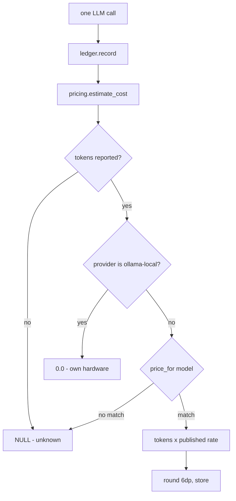
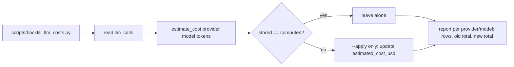

# Phase 24 — Ollama Cloud is metered, not free: correct the cost estimates

## Objective & Scope

**In:**

- Stop treating `ollama-cloud` as a free provider. `estimate_cost` now prices a cloud call from the
  model's published per-token rate, exactly as it already does for Claude and OpenAI.
- Add the published Ollama Cloud model catalogue to `app/core/pricing.py`, checked against
  `https://ollama.com/pricing` on 2026-11-10.
- One-off repair of the existing `llm_calls` rows, whose `estimated_cost_usd` is `0.0` because of
  the old policy: a `--dry-run`-by-default script recomputes them from the stored tokens and prices.
  This is a data repair recorded here, not an Alembic revision; `alembic_version` stays at head.

**Out:**

- Off-peak and cached-input discounts. Ollama publishes both (half price outside 12:00–18:00 UTC
  on weekdays and all weekend; a separate cached-input rate), but `llm_calls` stores neither cached
  tokens nor a billing tier, and deriving the tier from `created_at` would make a historical row mean
  something different depending on when it is read. Estimates stay at **standard published rates**,
  which is an upper bound.
- `gpt-5-codex`. It is in `OPENAI_FALLBACK` but has no verified published rate, so it keeps
  returning `None` and the UI keeps showing `—`. That is honest; a guessed price is not.
- No UI change, no API change, no new column.
- `ollama-local` stays free: it is the operator's own hardware with no per-token bill.

## High-Level Design



The only behavioural change is the `E` branch: `FREE_PROVIDERS` loses `ollama-cloud`, so cloud calls
fall through to `price_for`, and `deepseek-v4.1-flash:1017` matches by prefix like
`claude-sonnet-4-5-20250929` already does.



## API Contracts & Schema

No API shape change; `POST`/`GET` payloads and `AnalyticsRead` are untouched. No Alembic revision —
the table stays at `0013`, and the repair is a script.

The row-level change the backfill makes:

```sql
-- before
provider='ollama-cloud', model='deepseek-v4.1-flash:1017',
prompt_tokens=704959, completion_tokens=95885, estimated_cost_usd=0.0

-- after
estimated_cost_usd=0.32655   -- 704959/1e6*0.30 + 95885/1e6*1.20
```

Pricing rows added (`USD per 1M tokens`, input/output, standard rates):

```
deepseek-v4.1-flash 0.30/1.20   deepseek-v4-pro 1.32/3.96    gemma4 0.14/0.40
glm-5.3 1.40/4.40               glm-5.3-flash 0.15/0.50      glm-5.2 1.40/4.40
gpt-oss:120b 0.15/0.60          gpt-oss:20b 0.07/0.30        kimi-k3.1-pro 2.00/10.00
kimi-k3 3.00/15.00              kimi-k2.7-code 0.95/4.00     kimi-k2.6 0.95/4.00
mimo-v2.6-flash 0.14/0.28       mimo-v2.6-pro 0.435/0.87     minimax-m3.1-flash 0.15/0.60
minimax-m3 0.60/2.40            mistral-large-4 0.70/2.10    muse-spark-open 1.25/4.25
nemotron-3-super 0.015/0.60     nemotron-3-ultra 0.10/3.00   beam 0.125/0.40
```

`clef` is deliberately absent: the pricing page publishes an input rate and no output rate, so a
single `{input, output}` pair would misprice it.

## Target File Map

| File | Change |
| --- | --- |
| `backend/app/core/pricing.py` | `FREE_PROVIDERS` = `("ollama-local",)`; cloud catalogue added; docstring states the source and the standard-rate caveat. |
| `backend/scripts/backfill_llm_costs.py` | New: recompute `estimated_cost_usd`, `--dry-run` default, `--apply` writes, per-model before/after report. |
| `backend/tests/test_llm_usage.py` | `test_ollama_costs_nothing_rather_than_unknown` split: local is 0.0, cloud is priced, unknown cloud model is `None`. |
| `backend/tests/test_backfill_llm_costs.py` | New: the recompute function prices a zeroed row, leaves a correct row alone, and never touches failed calls with no tokens. |
| `backend/rules/conventions.md` | One line: the cost figures and the repair procedure live with the pricing module / script. |
| `README.md` | The "Ollama reports ~$0.00 because there is no per-token price" claim, plus the analytics and troubleshooting notes. |
| `CHANGELOG.md` | Phase 24 entry. |
| `docs/plans/phase_24_plan.md` | This file, including the repair record. |

Left alone: `llm_service.py`, `ledger.py`, `analytics.py`, schemas, migrations, the frontend
(`estimatedCost()` already renders `—` for unknown and `~$0.00` for a genuine zero).

## Ordered Steps

1. `pricing.py`: drop `ollama-cloud` from `FREE_PROVIDERS`, add the catalogue, rewrite the module
   docstring (published rates, standard tier only, source and check date).
2. Update the pricing tests: local free, cloud priced by prefix (`deepseek-v4.1-flash:1017`), cloud
   model without a price is `None`.
3. Add `scripts/backfill_llm_costs.py` with a `recompute(session) -> list[dict]` that is pure apart
   from the update, `--dry-run` (default) and `--apply`.
4. Test the script against the temp SQLite session.
5. Run `--dry-run` against `code_review`, read the report, then `--apply`.
6. Verify with SQL that no `ollama-cloud` row is left at `0.0` and the totals match the arithmetic.
7. Update README, CHANGELOG, `backend/rules/conventions.md`.
8. `cd backend && pytest -q`; `cd frontend && npm run build` (unchanged UI, kept green as the gate).

## Verification

- `pytest -q`: **228 passed, 1 failed**. The failure is the known pre-existing
  `test_serverless_mode.py::test_local_ollama_is_hidden_and_rejected` — a provider-id mismatch in
  `app/api/routes/models.py` (`"ollama-local"` vs the stored `"ollama_local"`), a file unmodified by
  this change. It belongs to its own change; it does not touch cost estimation.
- `npm run build` green (no frontend change; the gate is kept green).
- Backfill dry run reported `38 rows`, `changed 38`, `old 0.000000 → new 0.326547`.
- `--apply` reported `applied: 38 row(s) updated`; afterwards
  `select count(*), sum(estimated_cost_usd), count(*) filter (where estimated_cost_usd = 0) from
  llm_calls` returned `38 | 0.326547 | 0`.
- `analytics.summarise(db, user_id=5, days=30)` now returns `38 calls · 800844 tokens · 0.326547`
  where it returned `0.0`, split ingest `0.135618`, summarise `0.091536`, discuss `0.057808`,
  verdict `0.041585`. The dashboard renders that as `~$0.33`.
- The 0.000003 gap between the per-row sum (0.326547) and the aggregate arithmetic (0.326550) is
  per-call rounding to six decimals; the ledger stores per-call values, so 0.326547 is the figure
  the UI shows.

### Repair record

- Target: `DATABASE_URL` from `backend/.env` — `postgresql+psycopg://localhost:5432/code_review`.
- Pre-repair dump: `/Users/trungmai/.hermes/cache/scratch/llm_calls_before_phase24.sql`
  (`pg_dump -t llm_calls --data-only`).
- Command: `python scripts/backfill_llm_costs.py --apply`, 38 rows, all `ollama-cloud` /
  `deepseek-v4.1-flash:1017`, `0.0` → their published-rate value.
- Reversible by re-running the script (it is idempotent) or by restoring the dump; no rows were
  added or deleted.
