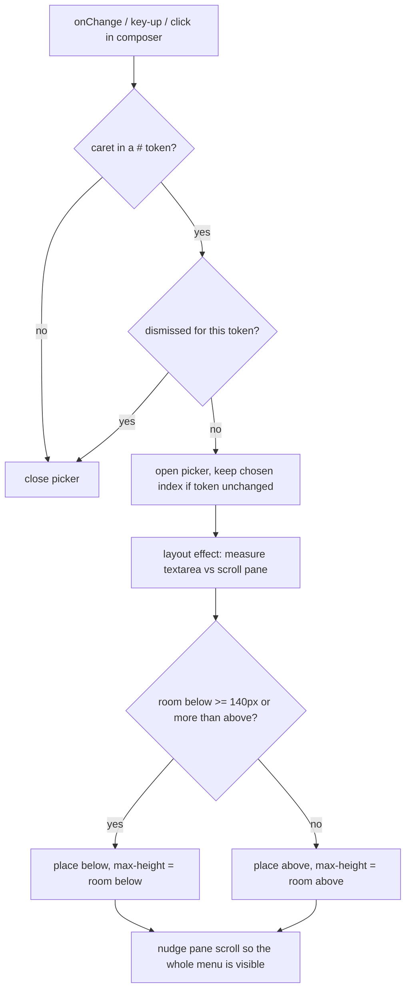
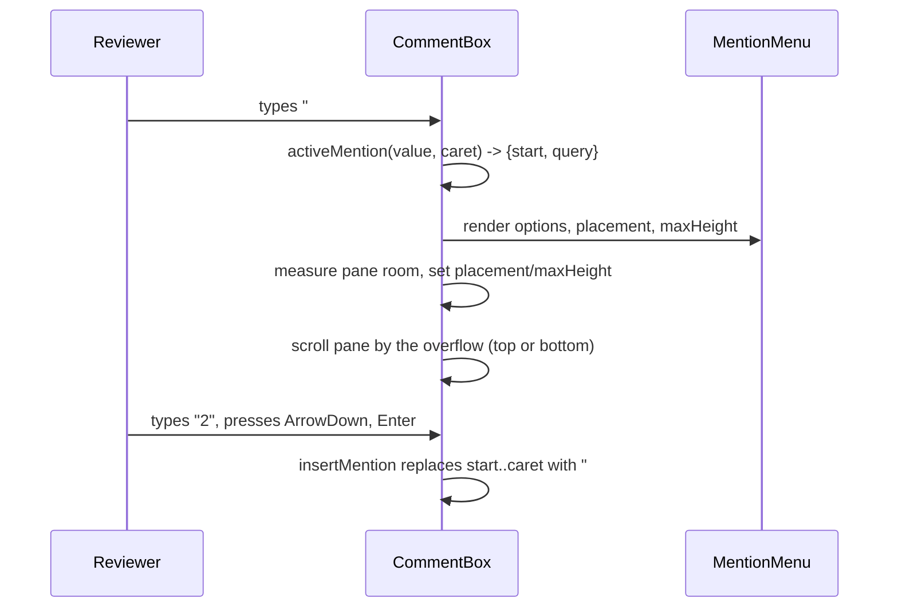

# Phase 25 — The `#` thread picker must be visible in the discussion pane

## Objective & Scope

**In:**

- The `#` typeahead in `CommentBox` renders where the reviewer can actually see it and pick from it.
  Today it is anchored to the composer's *outer* wrapper (`top-full` of the block that also holds
  the footer row), so it opens below the card, outside the discussion pane. The pane is
  `overflow-y-auto` and the next `CommentBox` wins the paint order, so only the first row (if any)
  is visible. Measured on the running app: the menu's box is `y=245…390` while the pane ends at
  `y=280`, and the card ends at `y=254`.
- The menu is placed inside the card that owns it: under the textarea when there is room, above it
  when there is not, with its height capped to the room that exists. Its scroll position is nudged
  so the whole list is inside the pane before the reviewer has to scroll to find it.
- The picker follows the caret. Moving the caret out of the `#` token (mouse click, arrow/Home/End)
  closes it instead of leaving it armed; today `#` at column 0 with the caret moved to the start
  still inserts at the old token start, producing `#3 #`.
- `Esc` keeps the menu closed while the caret stays in the token (it currently reopens on the
  key-up that follows the dismiss).

**Out:**

- No change to what a `#` token means, to `linkThreadRefs`, or to the backend reference resolver.
- No text search inside the picker beyond the digits it already accepts (ordinal prefix); paths and
  excerpts stay as context, not as a second search key.
- No picker in the `RoundPanel` summary editor: that text is posted verbatim as the round summary,
  not a discussion message, so a `#N` reference there is not resolved by the discussion service.
- No portal, no floating-ui dependency, no new API, no schema change.

## High-Level Design



Placement is measured against the nearest scrollable ancestor (the `SplitPane` discussion section),
not the window: that ancestor is what clips the menu, and it is what can scroll it into view. The
menu is absolutely positioned inside a wrapper that contains only the textarea, so its top/bottom
edge is the textarea's edge rather than the footer's.



## API Contracts & Schema

None. No endpoint, payload, column or Alembic revision changes; `alembic_version` stays at head.
`MentionMenu` gains two presentational props:

```ts
export interface MentionMenuProps {
  options: ThreadOption[];
  activeIndex: number;
  query: string;
  onPick: (ordinal: number) => void;
  placement?: "above" | "below"; // default "below"
  maxHeight?: number;            // px, default 224
}
```

## Target File Map

| File | Change |
| --- | --- |
| `frontend/src/components/MentionMenu.tsx` | `placement` / `maxHeight` props; anchor classes and `style.maxHeight` instead of the fixed `max-h-56`; docstring says the composer owns placement. |
| `frontend/src/components/CommentBox.tsx` | Relative wrapper around the textarea; measure the scroll pane in a layout effect; pick the side and cap height; nudge the pane scroll; caret re-sync on key-up/click/select; `Esc` dismissal remembered; card raised above its siblings while the picker is open. |
| `docs/plans/phase_25_plan.md` | This file. |
| `CHANGELOG.md` | Phase 25 entry. |
| `README.md` | One line: the `#` picker opens above or below the composer and never leaves the discussion pane. |

Left alone: `RoundPanel.tsx`, `ReviewDetailPage.tsx` (it already passes `threadOptions`),
`lib/utils.ts`, `types/index.ts`, the backend and every migration.

## Ordered Steps

1. `MentionMenu.tsx`: add the two props, swap `top-full` for `bottom-full` when `placement` is
   `above`, drive `maxHeight` from the prop, keep `overflow-y-auto`.
2. `CommentBox.tsx`: move the picker inside a new `relative` wrapper that contains only the
   `Textarea`.
3. Add the placement effect: nearest scrollable ancestor, room above/below, side choice, capped
   height, then a second effect that scrolls the pane by the overflow.
4. Add caret re-sync (`onKeyUp`, `onClick`, `onSelect`) that preserves the active index when the
   token is unchanged, and a `dismissedRef` so `Esc` survives the following key-up.
5. Raise the card (`relative z-30`) only while the picker is open so a downward menu paints over
   the next card instead of under it.
6. Exercise the real component in a browser at three positions (first card, last card, caret moves),
   then delete the throwaway probe page.

## Verification

- Probe page rendering two real `CommentBox`es in a `max-h-[62vh] overflow-y-auto` pane:
  the picker's bounding box sits fully inside the pane's box both for the first card (opens below)
  and the last card (opens above); no part of it is clipped.
- Typing `#`, `#2`, `↓`, `Enter` inserts `#2 ` at the caret; `Esc` leaves the menu closed while the
  caret stays put; moving the caret to column 0 closes the menu and a later pick can no longer
  insert at the stale start (the `#3 #` case).
- `cd frontend && npm run build` green. `cd backend && pytest -q`: 228 pass, 1 pre-existing
  `test_serverless_mode` failure that this frontend change cannot reach (see Evidence).

### Evidence

Measured on the running dev server, 1000×900 viewport, pane `24…582`:

```
opens below  menu 360…505  max-height 219.75px  inside pane: true  (hit test lands in the list)
opens above  menu  33…165  max-height 132px     inside pane: true
before fix   menu 245…390  pane ends 280       -> 110 of 145px clipped, next card painted over it
```

Interaction: `#` `↓` `↓` `Enter` inserted `#4 `; `#` + mouse pick inserted `#4 `; `#9` showed
"No thread matches #9"; `Esc` then `→` left the menu closed; typing `2` reopened it filtered to
`#2`; `Home` closed it, so the old `#3 #` stale-anchor insertion is unreachable.

`pytest -q`: 228 passed, 1 failed — `test_serverless_mode.py::test_local_ollama_is_hidden_and_rejected`,
which predates this phase and cannot be reached from the frontend: `app/api/routes/models.py:27`
compares `key.provider` (stored as `ollama_local`) to `llm_service.OLLAMA_LOCAL` (`"ollama-local"`),
so the local key is never skipped. Left for its own plan; no backend file is touched here.

