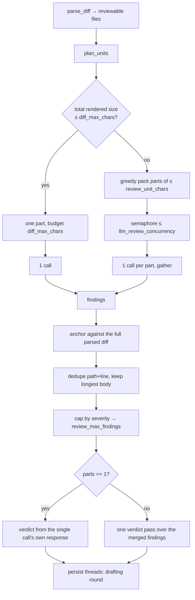
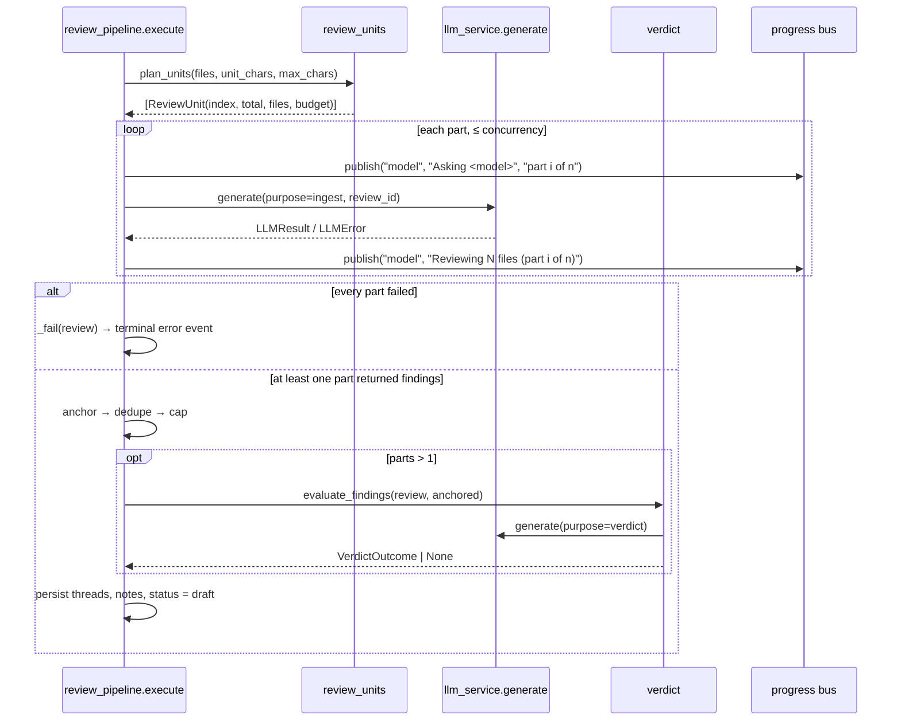

# Phase 26 — Multi-pass review: chunk a large diff instead of truncating it

Implements initiative #2 of `INITIATIVES.md` ("Multi-pass review for large diffs"). Filename number
comes from `AGENTS.md` §1: `docs/plans/` already holds `phase_25_plan.md` (an in-flight, uncommitted
frontend fix), so this is 26.

## Objective & Scope

**In:**

- Remove the effective 60 000-character review ceiling. When the rendered diff fits
  `diff_max_chars`, the review is exactly what it is today: **one** model call whose own response
  carries the verdict. Past that ceiling the changed files are greedily packed into parts of at most
  `review_unit_chars` (default 25 000), one call per part, at most `llm_review_concurrency`
  (default 3) in flight.
- Each part gets the same system prompt (skills + contract) and a user prompt that keeps the PR
  header, adds `part i of n` framing, and lists the only files it may report on.
- No hunk is ever split. A file whose own block exceeds the part budget becomes a one-file part and
  loses whole hunks from the end, with the count of omitted hunks stated in the prompt and in the
  review's notes. The single exception is a first hunk that alone overflows the budget: nothing else
  could be shown, so it is cut mid-hunk (as the old path did) and reported.
- Merge is one pass over every part's findings: anchor against the **full** parsed diff (as today),
  dedupe on `(path, anchored line)` keeping the longest body, then apply `review_max_findings`
  (default 60), highest severity first.
- Multi-part reviews get one extra call — a verdict pass over the merged findings, reusing the
  phase 11 `{verdict, confidence, rationale}` contract — so `suggested_verdict` still exists.
- Partial failure: some parts fail → the review is `draft` with the surviving findings and one note
  per failed part. All parts fail → the review fails, exactly as a single call does today.
- One `review_events` row per finished part ("Reviewed 2 file(s) (part 1 of 8)…"), on the existing bus.

**Out:**

- No change to anchoring rules (`review-flow.md` "Anchoring is mandatory"). Context, prompts and
  merged findings still cannot introduce an anchor that is not a RIGHT-side diff line.
- No change to discussion, apply, sync, summarise, or the rounds/decisions contract.
- No new finding field, no severity column, no schema change, no migration.
- No frontend change. The progress stream already renders arbitrary stages and labels; the notes
  array already renders warnings.
- No retry/backoff per part (initiative "provider retry and fallback" is a separate entry). A part
  that fails stays failed and is reported.
- No streaming, no per-part model override, no cross-part reasoning ("unit A calls into unit B" is
  still invisible — that is initiative #1's repository context, not this).

### Two corrections to the initiative's evidence

1. The initiative says "then apply the existing global finding cap". **There is no such cap.**
   `grep -rn 'MAX_FINDING\|finding_cap\|max_findings' --include=*.py backend/` returns nothing, and
   `anchor_findings` stores everything it can anchor. Multi-pass multiplies findings, so this phase
   introduces the cap (`review_max_findings`, default 60) and applies it to single-pass reviews too —
   one rule, not two.
2. The initiative says the diff cut is announced "the same way the diff cut is today"; today's cut
   is a raw character slice that can land mid-line, inside a hunk. This phase cuts on hunk
   boundaries instead (see Design), for both the single-part and multi-part paths.

## High-Level Design



The single-part path is the *existing* code path, unchanged in call count and prompt content apart
from the header gaining a truncation note when a single file is oversized. That keeps the invariant
the initiative asks a test for: a small PR still makes exactly one model call.

Splitting is triggered by the ceiling, not by the part size. A 40 000-character diff stays one call
even though it is larger than `review_unit_chars`, because nothing was being lost; only a diff that
would have been truncated is chunked. The parts are then packed at `review_unit_chars`, so a
150 000-character diff becomes ~6 parts rather than 3 oversized ones.



## API Contracts & Schema

No HTTP contract changes: no route, request body, or response schema is touched, and there is no
Alembic revision (`alembic_version` stays at `0013`). What changes is observable through existing
fields.

`GET /api/reviews/{id}` → `notes` / `warnings` (new lines only in the multi-part or oversized cases):

```
Part 2 of 3 was reviewed without app/services/billing.py (last 2 hunk(s)).
Part 2 of 3 could not be reviewed (Ollama returned HTTP 500); its files are not covered by this result.
Dropped 1 duplicate finding(s) raised more than once.
Kept the 60 highest-severity finding(s); 7 were dropped by the review cap.
```

The single-part truncation note keeps today's exact wording, `"The diff was truncated to fit the
model context."`, so existing docs and operator habit stay valid.

Progress rows (same `review_events` shape; `stage` is free text the UI already renders):

```json
{"seq": 9,  "stage": "prompt", "label": "Building the prompt", "detail": "228,278 characters across 8 parts", "progress": 50}
{"seq": 10, "stage": "model",  "label": "Asking llama3",        "detail": "8 parts, 3 at a time…", "progress": 55}
{"seq": 11, "stage": "model",  "label": "Reviewed 2 file(s) (part 1 of 8)", "detail": "2 finding(s)", "progress": 58}
{"seq": 12, "stage": "model",  "label": "Part 2 of 8 failed",   "detail": "RateLimitError", "level": "warn", "progress": 61}
{"seq": 13, "stage": "verdict","label": "Re-checking the verdict", "detail": "16 finding(s) from 7 part(s)", "progress": 90}
```

Every part call is recorded in `llm_calls` with `purpose="ingest"` and the review's id, and the merge
pass with `purpose="verdict"`, so `/api/analytics` splits fan-out spend from the opinion without a
schema change.

New configuration (all environment-settable, no database row):

| Setting | Default | Meaning |
| --- | --- | --- |
| `REVIEW_UNIT_CHARS` | `25000` | Maximum rendered characters per part once a diff exceeds `DIFF_MAX_CHARS`. |
| `LLM_REVIEW_CONCURRENCY` | `3` | Parts in flight at once. |
| `REVIEW_MAX_FINDINGS` | `60` | Findings kept per review after merge, highest severity first. |

Finding dedupe key, defined precisely because it is the only heuristic in the change:

```python
(path, anchored_line)   # longest initialComment wins
```

Parts own disjoint file sets, so a duplicate can only come from the model reporting the same line
twice — a defect the reviewer wants merged, because GitHub shows one comment per line anyway. The
cost is that two genuinely unrelated defects on one line keep only the longer text. A title-based key
(`path, line, normalised opening line`) was tried first and rejected: it only collapses findings
whose comments open identically, which is exactly the case a merge already handles, and it leaves
reworded duplicates behind.

## Target File Map

| File | Change |
| --- | --- |
| `backend/app/core/config.py` | Three settings: `review_unit_chars`, `llm_review_concurrency`, `review_max_findings`. |
| `backend/app/services/review_units.py` | New: `ReviewUnit`, `plan_units(files, unit_chars, max_chars)` — greedy packing, oversized-file detection, per-part budget. |
| `backend/app/services/prompts.py` | `render_file_block(item, max_chars)` (hunk-boundary truncation), `build_user_prompt(...) -> UserPrompt` (text + `truncated` + `omitted`, part framing), `build_findings_verdict_prompt(findings)` for the merge pass. |
| `backend/app/services/diff_parser.py` | `Hunk.render_numbered()`; `FileDiff.render_numbered()` joins the hunks. Same output, but a budget can now drop one hunk without reimplementing the renderer. |
| `backend/app/services/review_pipeline.py` | `run_part` (nested, one part per call), the semaphore fan-out, `dedupe_findings`/`cap_findings`, the verdict pass, per-part progress and warnings. |
| `backend/app/services/verdict.py` | `evaluate_findings(db, review, findings)`; the existing `evaluate` and the new one share one `_ask` helper. |
| `backend/tests/test_review_units.py` | New: packing, oversized file, single-part short-circuit. |
| `backend/tests/test_multi_pass_review.py` | New: fan-out end to end, dedupe, cap, partial failure, single-call guarantee. |
| `backend/tests/test_prompts.py` | New: hunk-boundary truncation and part framing (small, pure assertions). |
| `backend/rules/conventions.md` | `review_units` added to the services roster. |
| `backend/rules/review-flow.md` | One paragraph under ingest: large diffs are chunked, merged, deduped, capped, verdict pass. |
| `README.md` | "Large diffs are truncated, not chunked" limitation replaced; config table rows; pipeline table step 6. |
| `CHANGELOG.md` | Phase 26 entry. |
| `INITIATIVES.md` | #2 moved to shipped-in-phase-26. |
| `docs/plans/phase_26_plan.md` | This file, with executed evidence appended under Verification. |

Left alone: every route, every schema, every model, all of `frontend/`, `apply_service.py`,
`discussion.py`, `thread_sync.py`, `alembic/`, and the uncommitted phase-25 frontend work in the
working tree.

## Ordered Steps

1. `config.py`: add the three settings next to `diff_max_chars`, each with a one-line comment saying
   what it bounds.
2. `prompts.py`: extract `render_file_block(item, max_chars=None)` from `build_user_prompt`; make the
   overflow cut drop whole hunks and report `(block, truncated, omitted_hunks)`. Add
   `part`/`total` keyword-only framing to `build_user_prompt`. Verify by unit test before touching
   the pipeline.
3. `review_units.py`: `ReviewUnit` dataclass and `plan_units`. Pure function over `FileDiff` objects;
   unit-test it with synthetic diffs (small, exactly at cap, one oversized file, many files).
4. `prompts.build_findings_verdict_prompt` + `verdict.evaluate_findings` (with `_run_verdict`
   extracted so `evaluate` keeps its behaviour and its tests).
5. `review_pipeline.execute`: split the model-call block into `_review_unit(...)`; wire plan → fan-out
   → merge → dedupe → cap → verdict → persist, keeping every existing warning string.
6. Tests: single-call guarantee, ≥3 parts for a synthetic 150 000-char diff with every finding
   anchored, dedupe keeps the longer body, cap drops the low-severity tail, one part failing leaves
   the review `draft` with a warning, all parts failing leaves it `failed`.
7. Gates: `cd backend && pytest -q`; `cd frontend && npm run build` (unchanged, kept green).
8. Exercise it for real: a scratch review against a stub provider through the API, reading the
   progress rows and the stored threads back out of the database.
9. Docs: README, CHANGELOG, `INITIATIVES.md`, both `rules/*.md` files, `AGENTS.md` §4 if the layout
   block names services.

## Verification

Evidence from the executed run, 2026-11-11.

- **`pytest -q`: 246 passed, 1 failed.** The single failure is the pre-existing
  `test_serverless_mode.py::test_local_ollama_is_hidden_and_rejected`, already recorded by
  `phase_24_plan.md` as a provider-id mismatch in `app/api/routes/models.py` (`"ollama-local"` vs the
  stored `"ollama_local"`) and explicitly deferred to its own change. Baseline before this phase was
  228 passed / 1 failed; the same failure, 18 new tests. Files touched here do not include
  `app/api/routes/models.py`.
- **`npm run build` green** (`tsc -b` + vite, 1877 modules) — no frontend change.
- **New tests (18):** `tests/test_review_units.py` (4), `tests/test_prompts.py` (6),
  `tests/test_multi_pass_review.py` (8). The end-to-end ones stub `llm_service._generate_ollama`, not
  `generate`, so the wrapper, ledger and purpose recording run for real.
- **Live run**, real HTTP against a stdlib mock of GitHub + Ollama (`/tmp` scratch, separate SQLite
  database — the operator's PostgreSQL was not touched), 130 876-character diff over 16 files:
  - `prompt` stage: `228,278 characters across 8 parts`; `model` stage: `8 parts, 3 at a time…`
  - 8 progress rows, one per part, completing out of order (`part 3` before `part 2` — the
    concurrency is real, not a sequence): `Reviewed 2 file(s) (part N of 8) … 2 finding(s)`.
  - `anchoring`: `16 anchored, 0 dropped`; stored review: `status=draft`, `16` threads, every one on
    a real RIGHT-side line with a rebuilt hunk, `suggested_verdict=REQUEST_CHANGES`,
    `confidence=71` from the merge pass.
  - `llm_calls`: 8 rows `purpose=ingest` + 1 row `purpose=verdict`, each with reported prompt
    tokens (`24,950` per part) — one row per part, as designed.
  - No truncation warning: the change was chunked, not cut.
- The mock's `GET /repos/octo/big/pulls/1/comments` answered 404, which exercised the existing
  graceful path: `Existing PR comments could not be read: …` recorded as a note, the review still
  landed as `draft`.

### Deviations recorded after the build

- **Dedupe key is `(path, line)`, not `(path, line, title)`** — see API Contracts for why the title
  form was rejected after trying it.
- **`build_user_prompt` returns a `UserPrompt`** (`text`, `truncated`, `omitted`) instead of
  `(str, bool)`, so the pipeline can name the files a part lost rather than saying "truncated".
  One caller, updated in the same change.
- **A first hunk larger than the whole budget is cut mid-hunk**, with the marker
  `[… hunk truncated here …]`; keeping it whole (the first implementation) could send an unbounded
  prompt, which is the failure this phase exists to remove.
