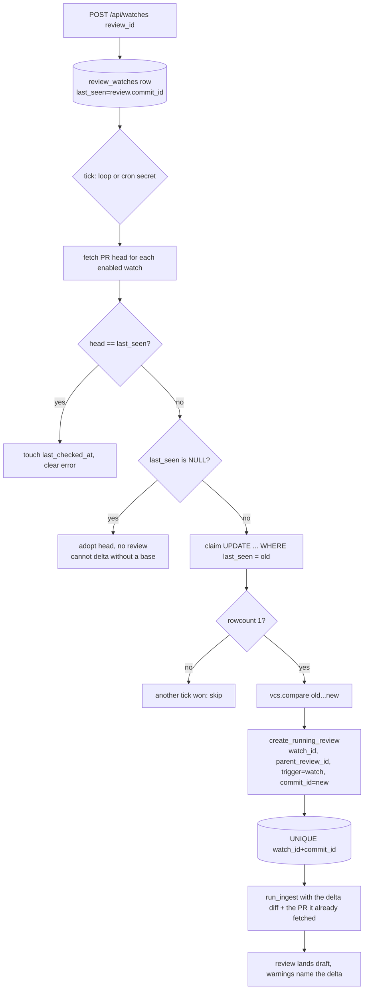
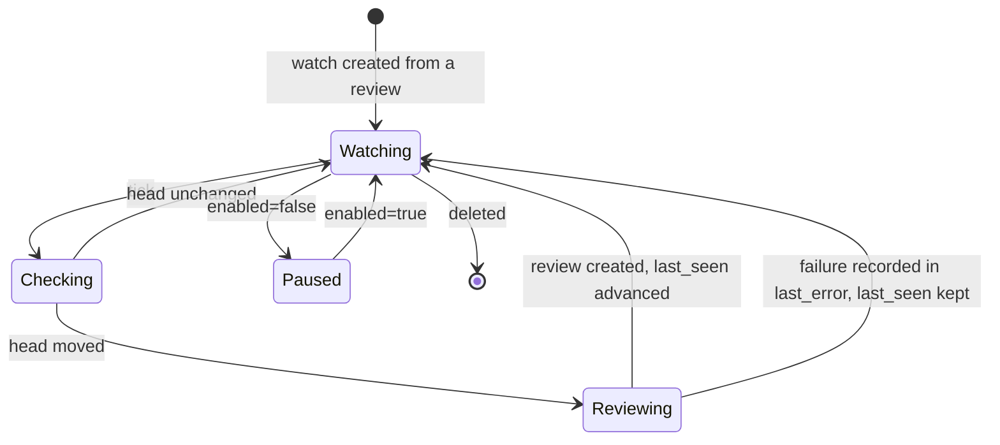

# Phase 27 — Watch a pull request and review new commits (delta reviews)

Implements initiative #3 of `INITIATIVES.md`. Next free number per `AGENTS.md` §1: plans run to
`phase_26_plan.md`, so this is 27.

## Summary (plain language)

A review used to be the whole story: paste a URL, argue with the model, publish — and the author's
next push needs a brand-new review that knows nothing about the last one.

Phase 27 closes that loop. **Watch for new commits** on a review, and every ten minutes the app
checks that pull request's head. When it has moved, it reviews *only the commits added since the
review you were looking at* and stores the result as a linked review saying "Continues review #N".
The new review is a normal review — same model, same foundation, same discussion, decisions and
apply — it simply covers a smaller diff, and says so in its notes.

Nothing new has to be learned to use it: one button in the review header, one panel on the
dashboard. What it deliberately is **not**: instant (a timer, not a webhook, so up to ten minutes
late), a merged conversation (threads are not copied forward), or a re-review of the whole pull
request (a finding that survived the push is not raised again). Those boundaries are what keep it a
review loop rather than a bot.

## Objective & Scope

**In:**

- **`review_watches`** — one row per (user, pull/merge request): the PR identity, the foundation and
  model to reuse, `last_seen_commit_id`, `last_review_id`, `enabled`, `last_checked_at`,
  `last_error`.
- **Create from a review.** `POST /api/watches {review_id}` watches that review's PR, copying
  `pr_url`, `vcs`, `repo_full_name`, `pr_number`, `skill_foundation`, `model_used` and the review's
  `commit_id` as the delta base. One watch per PR per account (`UNIQUE(user_id, pr_url)`), so the
  button is idempotent.
- **Change detection, two schedulers.** Locally/Docker an `asyncio` loop started by the lifespan
  ticks every `WATCH_INTERVAL_MINUTES` (default 10), ordered by `last_checked_at` so a large watch
  list is fair. Serverless starts no loop and exposes `POST /api/watches/tick`, authenticated by a
  shared secret (Vercel Cron), which runs the same service function.
- **Delta diff.** `vcs.compare(old, new)` — GitHub `GET /repos/{o}/{r}/compare/{old}...{new}` with
  the diff media type; GitLab `GET /projects/:id/repository/compare` re-rendered with the existing
  `gitlab_service._render_change`. The pipeline accepts a pre-fetched PR + diff instead of always
  fetching the full change.
- **Linked review.** New `code_reviews` row with `parent_review_id`, `watch_id`, `trigger='watch'`,
  a "Continues review #12" link in the workspace, and a note that only the delta was reviewed and
  older threads were not re-validated. Apply is unchanged: it posts that review's own pending
  rounds.
- **Idempotency, twice over.** A compare-and-set claim on `last_seen_commit_id` plus
  `UNIQUE(watch_id, commit_id)`, so two ticks racing produce one review.
- **Visibility.** A dashboard panel listing watches (PR, last check, last error, link to the latest
  review, disable), a toggle in the review workspace, and a "Continues #N" badge on linked reviews.

**Out:**

- No webhooks. Polling only, which is why a tick is cheap and rate-limited rather than instant.
- No email/Slack/notification of any kind beyond the dashboard panel and the linked review.
- No automatic watch on apply (a checkbox on the apply bar). Watching is an explicit button; the
  initiative's own risk list says "default the watch to off, require an explicit enable".
- No re-review of the *whole* PR on each push: the delta is `compare(old...new)`, so a finding that
  survived unchanged is not re-raised. The consequence — a delta review cannot comment on a line
  untouched by the delta — is handled by apply's existing stale-anchor pruning, not by new code.
- No cross-review thread merging: the old and delta reviews remain two workspaces, linked by
  `parent_review_id`. Threads are not copied forward (that is a data-model change of its own).
- No new model-provider field, no per-watch interval, no per-watch verdict default.
- GitLab delta reviews import no existing discussions — imported threads are GitHub-only, already.

## High-Level Design





The claim is a single `UPDATE … WHERE last_seen_commit_id = <old>`: atomic on PostgreSQL and SQLite
alike, with no `SELECT … FOR UPDATE` (SQLite ignores it) and no row lock held across the network
call. It is issued in the same transaction as the review insert, so a failed creation rolls the
claim back and the next tick retries that delta; `UNIQUE(watch_id, commit_id)` makes the retry safe
even if two processes get past the claim.

`last_seen_commit_id` advances when the review is **created**, not when it succeeds. A delta review
that fails stays visible in the dashboard as `failed`, the watch keeps moving with later pushes, and
the operator can re-run that URL by hand. The alternative — advancing on success — turns one flaky
model call into the same delta being re-reviewed on every tick until it works, which is exactly the
review spam this initiative warns about.

## API Contracts & Schema

### New table `review_watches` (Alembic `0014_linked_review_watches`)

| Column | Type | Null | Notes |
| --- | --- | --- | --- |
| `id` | Integer PK | no | |
| `user_id` | FK `users.id` ON DELETE CASCADE | no | owner; every query filters by it |
| `pr_url` | Text | no | the review's normalised `html_url` |
| `vcs` | String(16) | no | `github` \| `gitlab`, default `github` |
| `repo_full_name` | Text | yes | display only |
| `pr_number` | Integer | yes | display only |
| `skill_foundation` | Text | yes | reused for each delta review |
| `model_used` | Text | yes | reused for each delta review; must still parse |
| `last_seen_commit_id` | Text | yes | the delta base; `NULL` until the first check |
| `last_review_id` | FK `code_reviews.id` ON DELETE SET NULL | yes | the parent of the next delta review |
| `enabled` | Boolean | no | default `true` |
| `last_checked_at` | DateTime(tz) | yes | ordering key for a fair tick |
| `last_error` | Text | yes | first line of the last failure, never a prompt or a token |
| `created_at`, `updated_at` | DateTime(tz) | no | |

Indexes/constraints: `UNIQUE(user_id, pr_url)`, `ix_review_watches_user_id`,
`ix_review_watches_last_checked_at`.

### `code_reviews` additions (same revision)

| Column | Type | Null | Notes |
| --- | --- | --- | --- |
| `parent_review_id` | FK `code_reviews.id` ON DELETE SET NULL | yes | "Continues review #12" |
| `watch_id` | FK `review_watches.id` ON DELETE SET NULL | yes | which watch produced it |
| `trigger` | String(16) | yes | `watch` for delta reviews; `NULL` = started by hand |

Constraint `UNIQUE(watch_id, commit_id)` (`uq_code_reviews_watch_commit`). `NULL` watch ids are
distinct in both engines, so manual reviews are unaffected.

PII: **none of the new columns is PII.** `repo_full_name`, `pr_number` and commit shas are
repository metadata that `code_reviews` already stores; `last_error` carries a provider message, is
bounded to 200 characters, and is written through the same "first line only" rule as
`code_reviews.error` (`_short_error`).

### Endpoints

`GET /api/watches` → `ReviewWatchRead[]` (owner-scoped, newest first)

```json
[
  {
    "id": 4,
    "pr_url": "https://github.com/octo/example/pull/123",
    "vcs": "github",
    "repo_full_name": "octo/example",
    "pr_number": 123,
    "skill_foundation": "code-review",
    "model_used": "ollama-cloud:deepseek-v4.1-flash:1017",
    "last_seen_commit_id": "deadbeefcafe",
    "last_review_id": 31,
    "enabled": true,
    "last_checked_at": "2026-11-11T14:02:11Z",
    "last_error": null,
    "created_at": "2026-11-11T13:40:02Z"
  }
]
```

`POST /api/watches` — body `{"review_id": 31}` → `201` created / `200` when a watch for that PR
already exists (returns the existing row). `404` unknown or another account's review, `422` for a
missing body.

`PATCH /api/watches/{id}` — body `{"enabled": false}` → `200` with the row. `404` unknown/foreign.

`DELETE /api/watches/{id}` → `204`. `404` unknown/foreign.

`POST /api/watches/tick` — **public** (a cron cannot hold a session cookie), authenticated by a
shared secret in `Authorization: Bearer <secret>` (Vercel Cron's header) or `X-Watch-Secret`.

- `503` when `WATCH_TICK_SECRET` is unset — the endpoint fails closed rather than running unauthenticated.
- `401` when the header is missing or does not match (`hmac.compare_digest`).
- `200` with
  `{"checked": 3, "unchanged": 2, "adopted": 0, "skipped": 0, "started": [31], "failed": []}`
  (`adopted` counts a watch that had no base and took the current head without reviewing).

`GET /api/reviews/{id}` gains `parent_review_id`, `trigger` (both also on the list rows) and
`watch: ReviewWatchRead | null` — the last one only on the detail response, so the workspace can
render its toggle without a second call.

### Configuration

| Setting | Default | Meaning |
| --- | --- | --- |
| `WATCH_INTERVAL_MINUTES` | `10` | Local loop period. `0` disables the loop entirely. |
| `WATCH_TICK_SECRET` | unset | Shared secret for `POST /api/watches/tick`. Unset = the endpoint answers `503`. |
| `WATCH_MAX_CHECKS_PER_TICK` | `20` | Watches examined per tick, oldest `last_checked_at` first. |
| `WATCH_MAX_REVIEWS_PER_TICK` | `2` | Delta reviews started per tick, so one cron invocation stays inside `maxDuration`. |

`vercel.json` gains `{"crons": [{"path": "/api/watches/tick", "schedule": "*/10 * * * *"}]}`. On
Vercel, `CRON_SECRET` and `WATCH_TICK_SECRET` must hold the same value: the platform sends the
former as the bearer token.

## Target File Map

| File | Change |
| --- | --- |
| `backend/app/models/watch.py` | New: `ReviewWatch`, `ReviewTrigger`. |
| `backend/app/models/review.py` | `CodeReview.parent_review_id`, `.watch_id`, `.trigger`. |
| `backend/app/models/__init__.py` | Export `ReviewWatch`, `ReviewTrigger`. |
| `backend/alembic/versions/0014_linked_review_watches.py` | New: the table, the three columns, the two unique constraints, indexes. Downgrade drops all of it. |
| `backend/app/services/vcs.py` | `compare(key, ref, from_sha, to_sha) -> str` dispatch. |
| `backend/app/services/github_service.py` | `compare(...)` — `Accept: application/vnd.github.v3.diff`. |
| `backend/app/services/gitlab_service.py` | `compare(...)` — JSON `diffs` re-rendered via `_render_change`. |
| `backend/app/services/watch_service.py` | New: `create_watch`, `list_watches`, `owned_watch`, `tick`, `_check_watch`, `start_loop`, `stop_loop`. |
| `backend/app/services/review_pipeline.py` | `execute(..., pr=None, diff_text=None)`, `run_ingest(..., pr=None, diff_text=None)`, delta note, `create_running_review(..., commit_id/watch_id/parent_review_id/trigger)`. |
| `backend/app/services/apply_service.py` | No change — verified that it already posts only this review's `pending_apply` rounds. |
| `backend/app/api/routes/watches.py` | New: list/create/patch/delete + the secret-authenticated tick. |
| `backend/app/api/router.py` | Mount `watches.router` guarded; mount `tick` outside the guard. |
| `backend/app/schemas/watch.py` | New: `ReviewWatchRead`, `CreateWatchRequest`, `UpdateWatchRequest`, `TickResult`. |
| `backend/app/schemas/review.py` | `parent_review_id`, `trigger`, `watch` fields. |
| `backend/app/api/routes/reviews.py` | Fill `watch` on detail. |
| `backend/app/main.py` | Start/stop the watch loop in the lifespan (never in serverless). |
| `backend/app/core/config.py` | The four settings above. |
| `backend/rules/conventions.md` | `watch_service` in the service roster; the public tick route is the second exception after `/api/auth/*`. |
| `backend/rules/review-flow.md` | A "watches" section: claim, delta, last_seen semantics, serverless tick. |
| `frontend/src/types/index.ts` | `ReviewWatch`, `parent_review_id`, `trigger`, `watch`. |
| `frontend/src/services/api.ts` | `listWatches`, `createWatch`, `updateWatch`, `deleteWatch`. |
| `frontend/src/components/WatchToggle.tsx` | New: the workspace toggle; owns its fetch. |
| `frontend/src/components/ReviewHeader.tsx` | "Continues review #N" link, "Delta review" badge, the toggle. |
| `frontend/src/components/WatchesPanel.tsx` | New: dashboard list — PR, last check, last error, link to the latest review, disable. |
| `frontend/src/pages/DashboardPage.tsx` | Render `WatchesPanel`, and a "Continues #N" badge on linked rows. |
| `vercel.json` | The cron entry. |
| `backend/tests/test_watch_service.py` | New: claim, no-op tick, delta review, failure, disabled, adoption. |
| `backend/tests/test_watches_api.py` | New: CRUD, ownership, idempotent create, tick auth, no loop in serverless. |
| `backend/tests/test_gitlab_service.py` | `compare` fixture rendering. |
| `README.md`, `CHANGELOG.md`, `INITIATIVES.md` | Docs; #3 moves to shipped. |

Left alone: `discussion.py`, `thread_sync.py`, `summarise.py`, `analytics.py`, `ledger.py`, the
skill library, and the uncommitted phase-25/26 work in the tree.

## Ordered Steps

1. Plan (this file).
2. `models/watch.py`, the three `code_reviews` columns, `models/__init__.py`.
3. Migration `0014`; verify `upgrade` → `downgrade -1` → `upgrade` on a scratch SQLite file and, if
   a local PostgreSQL scratch database can be created, there too.
4. `vcs.compare` + the two adapters; unit tests with recorded payloads before any wiring.
5. `review_pipeline`: pre-fetched `pr`/`diff_text` path, `create_running_review` keywords, the delta
   note. Existing pipeline tests must stay green (no behaviour change for a manual review).
6. `watch_service`: `create_watch`, `owned_watch`, `tick`, `_check_watch`, loop. Tests first for the
   claim/ no-op / delta cases, then the loop.
7. Schemas + `routes/watches.py` + router mounting (guarded CRUD, public tick) + `review` fields.
8. `main.py` lifespan hook; serverless guard.
9. Frontend: types → api → `WatchToggle` → header → `WatchesPanel` → dashboard badge.
10. Gates: `cd backend && pytest -q`; `cd frontend && npm run build`; migration round-trip.
11. Live run: real API against a local mock GitHub whose head moves between ticks, asserting the
    linked review, its delta-only diff and the no-op second tick.
12. Docs: README, CHANGELOG, `INITIATIVES.md`, `rules/*.md`, `vercel.json`.

## Verification

Evidence from the executed run, 2026-11-11.

- **`pytest -q`: 276 passed, 0 failed** when this phase's work landed. The one failure the suite had
  carried since phase 22 — `test_serverless_mode.py::test_local_ollama_is_hidden_and_rejected` — is
  fixed in this change (see *In passing*); baseline before it was 246 passed / 1 failed, and the 29
  new tests bring the total to 276.
  A concurrent session's phase 28 (a GitHub inbox with a `polish` ledger purpose) now adds its own
  red tests, none of them in this phase's files: `test_analytics_api.py::test_totals_volume_and_cost`
  asserts the four-item purpose list from before `polish` existed, and its new `tests/test_inbox.py`
  leaves state behind that makes `test_isolation.py::test_keys_do_not_leak_between_accounts` fail
  only in a full-suite run. Verified by exclusion: `pytest -q --ignore=tests/test_inbox.py
  --ignore=tests/test_analytics_api.py` → **266 passed, 0 failed**. `analytics.py`,
  `models/llm_call.py`, `test_analytics_api.py` and `test_inbox.py` are outside this phase and were
  left to that change.
- **New tests (29):** `tests/test_watch_service.py` (11), `tests/test_watches_api.py` (13),
  `tests/test_vcs_compare.py` (5).
- **`npm run build` green** (`tsc -b` + vite, 1879 modules).
- **Migration `0014` round trip**, both engines, on scratch databases:
  - SQLite (`sqlite:///…/scratch/phase27/mig.db`): `upgrade head` created `review_watches` with its
    two indexes and added `parent_review_id`, `watch_id`, `trigger` plus
    `uq_code_reviews_watch_commit` and both FKs; `downgrade -1` removed the table and all three
    columns (0 rows in `pragma_table_info`), `upgrade head` restored `0014`.
  - PostgreSQL (`createdb code_review_check`): same `upgrade` / `downgrade -1` / `upgrade`, with
    `information_schema.columns` and `pg_constraint` confirming the columns and
    `uq_code_reviews_watch_commit` / `fk_code_reviews_watch_id`. Scratch database dropped
    afterwards; the operator's `code_review` database was not touched.
- **Live run** (real HTTP, stdlib mock of GitHub + Ollama whose head is mutable, separate SQLite
  database, `WATCH_INTERVAL_MINUTES=0` so the loop did not race the driver):
  - parent review: `draft`, commit `aaa111`, 1 thread.
  - `POST /api/watches {review_id}` → `201`, `last_seen_commit_id=aaa111`, `last_review_id=1`;
    the same call again → `200` with the same id.
  - tick with an unchanged head → `{"checked":1,"unchanged":1,"started":[]}`.
  - `POST /__head {"sha":"bbb222"}` then a tick → `{"started":[2]}`, and the mock recorded exactly
    one `compare` (`aaa111 → bbb222`) and **zero** full-diff fetches during the delta ingest.
  - delta review #2: `status=draft`, `trigger=watch`, `parent_review_id=1`, `commit_id=bbb222`,
    1 thread on `src/services/billing.py`, and the note "Delta review: only commits pushed since
    review #1 were reviewed, and that review's threads were not re-validated."
  - the next tick → `{"unchanged":1,"started":[]}`; a tick without the secret → `401`.
  - `code_reviews` afterwards: `(1, None, None, None, aaa111, draft)` and
    `(2, 1, 1, 'watch', bbb222, draft)`.
- **Browser** (served `frontend/dist` from the same origin, real mouse events):
  - `/reviews/2` renders "Continues review #1", the **Delta review** badge, the toggle reading
    "Watching" with "Checks for new commits every 10 minutes · last check 08:25Z", and the delta
    note in the ingestion notes.
  - clicking the toggle flipped it to "Paused" (the `PATCH /api/watches/1` is in the server log) and
    a **reload** still showed "Paused" — the state is the server's, not React's.
  - `/` rendered the **Watched pull requests** panel ("0 of 1 watching for new commits",
    `octo/billing#1`, Paused, head `bbb222`, review #2 link) and a real click on **Resume** changed
    it to "1 of 1 watching" with the Watching badge. The review history row shows
    "Continues #1". (The first click on that button was outside the 413 px viewport and did
    nothing; it was re-driven after `scrollIntoView` and `elementFromPoint` confirmed the target.)

### Deviations recorded after the build

- **A review stores both `parent_review_id` and `watch_id`**, with `UNIQUE(watch_id, commit_id)`.
  The initiative named only the parent link; idempotency needs the watch on the row, and the DB
  constraint is what makes a racing tick safe even if the claim logic were wrong.
- **`last_seen_commit_id` advances at review creation, not at success** — see High-Level Design.
- **The tick runs its reviews inline** (loop locally, cron request on Vercel) instead of spawning
  tasks: `asyncio.create_task` does not survive a serverless response, and the per-tick caps keep
  the request inside `maxDuration`.
- **`POST /api/watches` answers `200` for an existing watch** instead of `409`: the button's only
  sensible meaning is "this PR is watched", and a paused watch is resumed by the same call.
- **The loop remembers its owning event loop.** `stop_loop` only cancels and awaits a task created
  by the *current* loop; without that, a second app lifespan in one process (tests, or a reload)
  awaited a foreign task and raised `RuntimeError: … attached to a different loop`.
- **`tests/conftest.py::reset_settings` also clears `review_watches`** (before `code_reviews`, which
  it references), or a watch from one test would be checked by the next test's tick.
- **A duplicate-review rejection advances the watch past that commit** (`_advance`) instead of
  rolling the claim back: retrying a delta the database has already refused would park the watch on
  the same commit for every future tick, which is the "silently stops firing" failure the
  initiative warns about. The retry path is kept for *failures* (compare, credentials), where the
  next tick can genuinely succeed.
- **`tests/test_review_pipeline.py`'s `explode` stub takes `**_snapshot`** because `execute` gained
  keyword arguments; the stub's job is to raise, not to pin the signature.
- `watch_max_checks_per_tick` / `watch_max_reviews_per_tick` are the two caps the sketch's "batch
  and back off" needed; both are config, not constants in the service.

### In passing (same change)

`app/api/routes/models.py` compared a stored credential's `key.provider` (`ollama_local`, database
form) with the model-id prefix (`ollama-local`, hyphen). The comparison never matched, so the
serverless rule "hide local Ollama from the model catalogue" silently never fired — a deployed app
offered a model it would then reject with `422`, while `review_pipeline`'s guard (which reads the
model id) worked. `test_serverless_mode.py::test_local_ollama_is_hidden_and_rejected` had been red
since phase 22; `phase_24_plan.md` and `phase_26_plan.md` recorded it and deferred it to "its own
change", which is this one. One comparison now uses `llm_service.DB_PROVIDER[...]`, the reason is a
comment at the site and a gotcha in `AGENTS.md` §12, and the whole suite passed:

```
$ cd backend && pytest -q
276 passed, 1 warning in 6.45s        # at the time of this change
```
