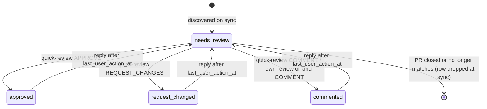
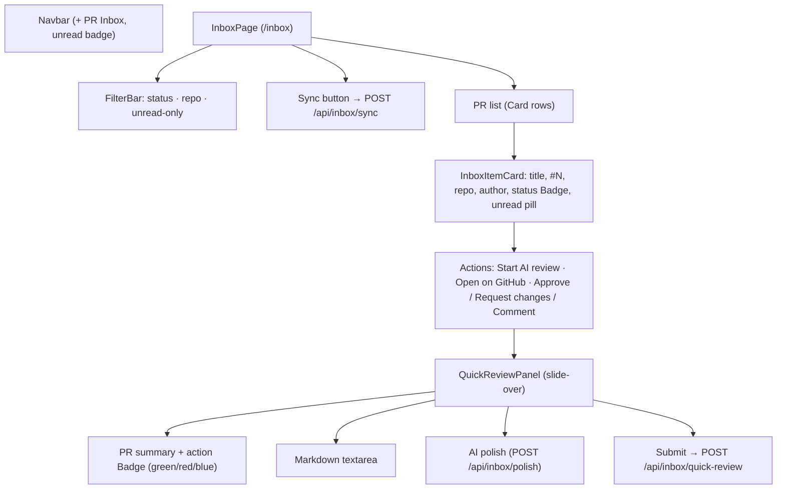

# Phase 28 — PR Inbox & Review Queue

> Filed under 28, not 11: the request arrived named "Phase 11 / `phase_11_plan.md`", but that plan
> is already shipped (re-evaluated verdict & `#` autocomplete). `docs/plans/` runs to 27, so this
> work takes the next free number.

## 1. Objective & Scope

A dedicated **PR Inbox** (`/inbox`) tab that aggregates every open GitHub pull request where the
signed-in user — or one of their GitHub teams — is requested for review, or where they already
commented. It tracks review status (`needs_review`, `approved`, `request_changed`, `commented`),
detects turn-taking (an author or teammate replying after the user's last action re-arms the item
to `needs_review` with an unread count), offers one-click AI review initialization, and hosts a
right-hand slide-over panel for quick triage actions (Approve / Request changes / Comment).

**In scope**

- `cached_prs` table (migration `0015_cached_prs`) holding the per-account local cache so page
  switches never hit the GitHub API.
- `github_inbox_service`: team discovery, three targeted search queries, per-PR status and
  turn-taking detection, `linked_review_id` reconciliation against `code_reviews.pr_url`.
- Routes `POST /api/inbox/sync`, `GET /api/inbox`, `POST /api/inbox/quick-review`,
  `POST /api/inbox/polish` — all owner-scoped behind the session dependency.
- Frontend: `/inbox` page (list, filter bar, per-item actions), a slide-over quick-review panel,
  a navbar `PR Inbox` entry with an unread-replies badge.
- One-click "Start AI review" on an inbox item: posts to the existing `POST /api/reviews` and
  stamps `linked_review_id` on the cached row.

**Out of scope**

- GitLab merge requests (search and team-review-requested have no GitLab analogue in this phase).
- Background/scheduled sync: syncing is deliberate (`POST /api/inbox/sync`), so no new loop and no
  cron route.
- Inline-diff review inside the slide-over; the slide-over posts a top-level review only.
- Notification persistence, email, or push — the unread state lives on the cached row only.
- The task text shipped truncated after "Show an unread notification badge on the `PR …`"; the
  badge count is implemented as "rows with `has_unread_replies` for this account", the only
  defensible reading.

## 2. High-Level Design

### Aggregation & sync flow

```mermaid
sequenceDiagram
    autonumber
    participant UI as /inbox page
    participant API as POST /api/inbox/sync
    participant S as github_inbox_service
    participant G as GitHub API
    participant DB as Postgres/SQLite

    UI->>API: sync (session cookie)
    API->>S: sync_inbox(db, user_id)
    S->>DB: resolve GitHub key (owner-scoped)
    S->>G: GET /user → login
    S->>G: GET /user/teams → [{org, slug}]
    par three search queries, deduped on PR URL
        S->>G: search is:pr is:open review-requested:{login}
        S->>G: search team-review-requested:{org}/{slug} (per team)
        S->>G: search is:pr is:open commenter:{login}
    end
    loop per distinct open PR
        S->>G: GET /repos/{o}/{r}/pulls/{n}/reviews
        S->>S: latest review by login → base status
        alt user has acted before
            S->>G: GET …/pulls/{n}/comments + …/issues/{n}/comments
            S->>S: replies after last_user_action_at → needs_review + unread count
        end
        S->>DB: upsert cached_prs; link code_reviews.pr_url match
    end
    S-->>API: refreshed rows
    API-->>UI: CachedPR[] (status, unread, linked_review_id)
```

### PR item lifecycle



`last_user_action_at` is recomputed on each sync from GitHub truth (latest own review
`submitted_at` or own comment timestamp): an action taken on GitHub itself moves the clock too,
so the re-trigger rule never depends on which surface wrote the comment.

### Component hierarchy



## 3. API Contracts & Schema

### Migration `0015_cached_prs` (revises `0014`)

The task names the unique index `(repo_owner, repo_name, pr_number)`; this deployment is
multi-account, so the cache keys on `(user_id, repo_owner, repo_name, pr_number)` — the plan-first
rule's ownership invariant beats the letter of the brief. All other columns follow the brief
(integer PK per `code_reviews`; the UUID alternative is declined for consistency).

```python
op.create_table(
    "cached_prs",
    sa.Column("id", sa.Integer(), primary_key=True, autoincrement=True),
    sa.Column("user_id", sa.Integer(), sa.ForeignKey("users.id", ondelete="CASCADE"),
              nullable=False, index=True),
    sa.Column("github_pr_id", sa.BigInteger(), nullable=False),
    sa.Column("repo_owner", sa.Text(), nullable=False),
    sa.Column("repo_name", sa.Text(), nullable=False),
    sa.Column("pr_number", sa.Integer(), nullable=False),
    sa.Column("pr_url", sa.Text(), nullable=False),
    sa.Column("title", sa.Text(), nullable=False),
    sa.Column("author_username", sa.Text(), nullable=False),
    sa.Column("author_avatar_url", sa.Text(), nullable=True),
    sa.Column("status", sa.String(24), nullable=False, server_default="needs_review"),
    sa.Column("has_unread_replies", sa.Boolean(), nullable=False, server_default=sa.false()),
    sa.Column("unread_replies_count", sa.Integer(), nullable=False, server_default="0"),
    sa.Column("last_user_action_at", sa.DateTime(timezone=True), nullable=True),
    sa.Column("last_github_activity_at", sa.DateTime(timezone=True), nullable=False),
    sa.Column("linked_review_id", sa.Integer(),
              sa.ForeignKey("code_reviews.id", ondelete="SET NULL"), nullable=True),
    sa.Column("last_synced_at", sa.DateTime(timezone=True), nullable=False),
    sa.UniqueConstraint("user_id", "repo_owner", "repo_name", "pr_number",
                        name="uq_cached_prs_user_pr"),
)
op.create_index("ix_cached_prs_status", "cached_prs", ["user_id", "status"])
op.create_index("ix_cached_prs_github_pr_id", "cached_prs", ["user_id", "github_pr_id"])
```

Downgrade drops the indexes and the table. `github_pr_id` is indexed per user, not globally
unique: two accounts can cache the same PR.

### Endpoints

**`POST /api/inbox/sync`** → runs aggregation, upserts, deletes rows for PRs no longer open and
matching. Response `200`:

```json
{
  "items": [ /* CachedPR[] as below */ ],
  "disappeared": 0,
  "warnings": []
}
```

`warnings` carries a plain sentence per PR whose status could not be determined (rate limit,
deleted repo) — sync is best-effort per PR, like summarisation.

**`GET /api/inbox?status=needs_review&repo=octo/app&unread=true`** → `200 CachedPR[]`, newest
`last_github_activity_at` first. Unknown ids are impossible (no id in the query).

```json
{
  "id": 3,
  "pr_url": "https://github.com/octo/app/pull/42",
  "repo_owner": "octo",
  "repo_name": "app",
  "pr_number": 42,
  "title": "Add retry policy to the ingest worker",
  "author_username": "alice",
  "author_avatar_url": "https://avatars.githubusercontent.com/u/1",
  "status": "needs_review",
  "has_unread_replies": true,
  "unread_replies_count": 2,
  "last_user_action_at": "2026-11-10T14:22:00Z",
  "last_github_activity_at": "2026-11-11T03:05:00Z",
  "linked_review_id": null,
  "last_synced_at": "2026-11-11T04:00:00Z"
}
```

**`POST /api/inbox/quick-review`** body `{ "cached_pr_id": 3, "event": "APPROVE" |
"REQUEST_CHANGES" | "COMMENT", "body": "…" }`. `body` is required for `REQUEST_CHANGES` and
`COMMENT` (`422` when missing), optional for `APPROVE`. Dispatches
`POST /repos/{owner}/{repo}/pulls/{n}/reviews`. On success the row's `status`,
`last_user_action_at`, `has_unread_replies=false`, `unread_replies_count=0` are updated and the
fresh `CachedPR` is returned (`200`). Another account's `cached_pr_id` is a `404`; a malformed or
unknown event is `422`.

**`POST /api/inbox/polish`** body `{ "text": "…" }` → `{ "text": "polished" }`. One LLM call with
the account's active key, purpose `polish` in the ledger; `422` when no key is configured
("Add a key in Settings"), provider failure surfaces as-is. The LLM never sees secrets.

Error mapping (per `backend/rules/conventions.md`): `GitHubError` status passthrough —
`401` bad token, `403` rate limit, `404` unknown row, `422` malformed/unusable request, `502`
upstream. No GitHub key → `422` with "Add a key in Settings."

## 4. Target File Map

**New**

- `docs/plans/phase_28_plan.md` — this plan.
- `backend/alembic/versions/0015_cached_prs.py` — the table (up and down verified).
- `backend/app/models/cached_pr.py` — `CachedPR`, `InboxStatus`.
- `backend/app/services/github_inbox_service.py` — discovery, turn-taking, upserts, quick review.
- `backend/app/api/routes/inbox.py` — the four endpoints.
- `backend/app/schemas/inbox.py` — `CachedPRRead`, `SyncResponse`, `QuickReviewRequest`, `PolishRequest`.
- `backend/tests/test_inbox.py` — service-boundary-stubbed API tests.
- `frontend/src/pages/InboxPage.tsx` — list, filter bar, sync.
- `frontend/src/components/QuickReviewPanel.tsx` — the slide-over.

**Changed**

- `backend/app/models/__init__.py` — export the new model.
- `backend/app/api/router.py` — mount `inbox.router` behind the session dependency.
- `backend/app/services/github_service.py` — add `search_prs`, `fetch_teams`, `fetch_pull_reviews`,
  `fetch_issue_comments` next to the existing fetchers.
- `backend/app/services/llm_service.py` — `LLMPurpose.POLISH` for ledger accounting.
- `backend/rules/conventions.md` — add `github_inbox_service` to the service roster.
- `backend/tests/conftest.py` — the reset fixture deletes `CachedPR` before `CodeReview`.
- `frontend/src/types/index.ts`, `frontend/src/services/api.ts` — inbox types and calls first.
- `frontend/src/App.tsx`, `frontend/src/components/Navbar.tsx` — route and nav entry + badge.
- `README.md`, `CHANGELOG.md` — the feature record.

**Left alone** — apply/discussion/watch flows; the gitlab adapter; settings routes.

## 5. Ordered Steps

1. Plan (this file), then migration `0015`, verified up and down on a scratch database.
2. `CachedPR` model + `__init__` export; conftest reset updated in the same change (per-test bleed
   otherwise).
3. `github_service` fetchers + `github_inbox_service` (pure sync orchestration, no FastAPI).
4. Schemas + routes + router mount.
5. Backend tests: happy-path sync with stubbed GitHub, turn-taking re-trigger, quick-review
   dispatch + status update, ownership 404, `422` guards, polish with and without a key.
6. Frontend types + api, then `InboxPage`, `QuickReviewPanel`, navbar + route.
7. Gates: `pytest -q`, `npm run build`, migration round-trip; live exercise of the endpoints via
   TestClient with the GitHub boundary stubbed; README/CHANGELOG.

## 6. Verification

- `cd backend && pytest -q` — green, including the new `test_inbox.py`.
- `alembic upgrade head && alembic downgrade -1 && alembic upgrade head` on a scratch SQLite —
  `cached_prs` appears and disappears cleanly, `alembic_version` returns to `0014` mid-trip.
- `cd frontend && npm run build` — `tsc -b` clean.
- Real-flow evidence: sync with a scripted GitHub stub returns rows with recomputed statuses;
  a reply newer than `last_user_action_at` flips the row back to `needs_review` with an unread
  count; quick-review POSTs exactly `{event, body}` to the stub; `/inbox` filters compose; a
  second account's id answers `404`.
- No token, diff body, or secret in any log line or committed fixture (privacy rules); the GitHub
  stub records only paths it was called with.

### Executed evidence (2026-11-11)

- `cd backend && .venv/bin/python -m pytest -q` — **293 passed** (17 new `test_inbox.py` cases;
  `test_analytics_api` gained `polish` in the purpose list; the isolation suite required the
  ownership test to leave no keys on the second account).
- Scratch-SQLite round trip: `upgrade head` → `cached_prs` present (17 columns, `alembic_version`
  `0015`); `downgrade -1` → table gone, version `0014`; `upgrade head` again → OK.
- `cd frontend && npm run build` — clean (`tsc -b` + vite, 1881 modules).
- Live run on an isolated stack (`:8011` backend + vite proxy temporarily repointed, then
  restored): signup 201, `/inbox` rendered, **Sync with GitHub** with no key bannered "No GitHub
  token configured. Add one in Settings."; a seeded cache row rendered the card, the unread nav
  badge (`1`), and the slide-over (badge, PR header, textarea, Polish, submit); submitting without
  a key surfaced the same 422 in the panel (`POST /api/inbox/quick-review → 422` in the server
  log). Payload-shape happy path is covered by `test_quick_review_*` against a recording stub:
  `POST /repos/octo/example/pull/123/reviews` with exactly `{"event", "body"}`.
- Happy-path posting to the real GitHub (and a real PAT) was not exercised — no credentials
  available in this environment.
