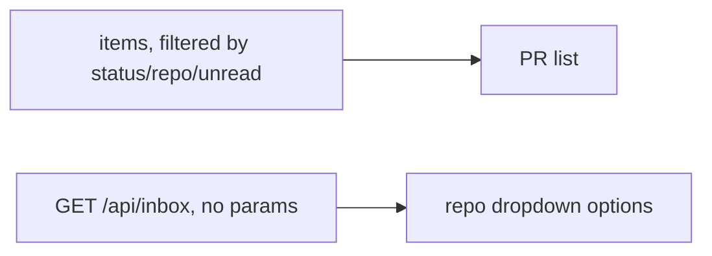

# Phase 29 — Inbox filter fixes

## 1. Objective & Scope

Two corrections to `/inbox` reported after Phase 28 landed:

- **Default the status filter to `needs_review`.** The inbox is a triage surface; the landed page
  opened on "Every status", showing items the user already approved or actioned.
- **The repository filter must list every repository in the cache, not just the visible ones.**
  Phase 28 derived the dropdown from `items` — the *filtered* list — so selecting a repo reduced
  the dropdown to that repo alone, and a status filter silently dropped repos whose items were
  all in another state. Repos are now derived from an unfiltered `GET /api/inbox` fetched
  alongside the filtered one (cache reads; zero GitHub calls).

**Out of scope** — the answer to "why only 3 repos" beyond the dropdown bug: absence of a repo
means the last sync found no open PR in it matching discovery, which is product behavior, not a
bug. No API or schema change.

## 2. High-Level Design

## 3. API Contracts & Schema

None — no route, payload or schema changes.

## 4. Target File Map

- `frontend/src/pages/InboxPage.tsx` — default filter and the unfiltered repo-option fetch.

## 5. Ordered Steps

1. `statusFilter` initialises to `"needs_review"`.
2. `repos` become state filled from an unfiltered `api.listInbox()` inside `load()`; the
   `useMemo` derivation is removed.
3. `npm run build`.

## 6. Verification

- `cd frontend && npm run build` — clean.
- Dropdown behavior: with a status filter active, every cached repo remains selectable.
