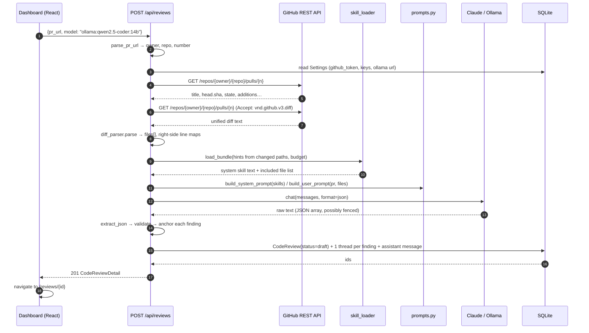
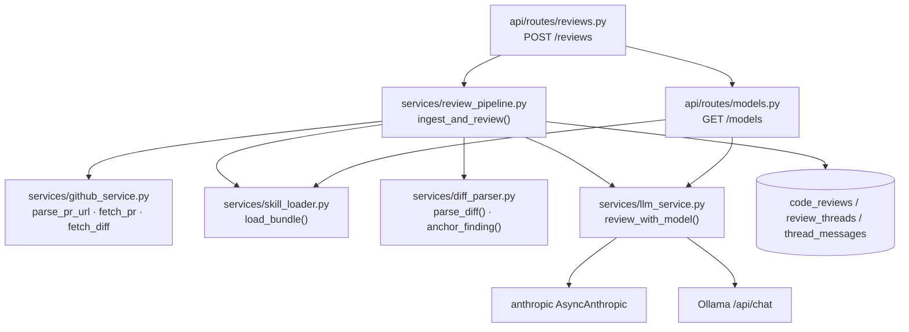

# Phase 2 — Ingestion, Local Skill Reader & GitHub Integration

## Objective & Scope

Turn a pasted GitHub pull-request URL into a persisted, structured review: fetch the PR and
its diff, inject the local review skills from `./code-review`, call the chosen model once for
a JSON findings array, anchor every finding to a real line in the diff, and store the result
as `ReviewThread` + first `assistant` `ThreadMessage` rows.

**In scope**

- `parse_pr_url` → `(owner, repo, number)` with strict validation.
- GitHub REST: PR metadata (title, HEAD SHA, additions/deletions, state, draft flag) and the
  unified diff (`Accept: application/vnd.github.v3.diff`).
- Unified-diff parser producing per-file hunks with new-file line numbers, binary/minified
  skipping, and a truncation budget.
- Skill loader: discover `.md`/`.txt` under the skill root, always include the entry file,
  rank the rest by relevance to the changed file set, and stay inside a character budget.
- Prompt construction (system = skills + output contract, user = PR metadata + numbered diff).
- Provider adapters: Anthropic Messages API and Ollama `/api/chat` with `format=json`.
- Strict JSON parsing: fence stripping, schema validation, per-finding line anchoring,
  drop-and-report for unknown paths.
- Model catalog endpoint for the dashboard dropdown: Claude models from `/v1/models`
  (static fallback), Ollama models from `/api/tags`.
- Persistence of `CodeReview` + threads, with `error` captured when the model call fails.
- Frontend "New code review" panel: PR URL, dynamic model dropdown, Start Review, progress
  and error states.

**Out of scope**

- Split-pane workspace (Phase 3); the review is stored, the detail page still shows a stub.
- Discussion turns (Phase 4) and any GitHub write (Phase 5).
- Streaming model output — one request, one response. Local 14B models simply take a while.
- Chunked multi-call review of very large diffs; the diff is truncated with an explicit note
  to the model and to the operator.

## High-Level Design

### Ingestion sequence



### Module map



## API Contracts & Data Schemas

### `GET /api/models`

```json
{
  "models": [
    { "id": "claude:claude-sonnet-4-5-20250929", "label": "Claude Sonnet 4.5", "provider": "claude", "available": true, "note": null },
    { "id": "ollama:qwen2.5-coder:14b", "label": "qwen2.5-coder:14b", "provider": "ollama", "available": true, "note": "local" },
    { "id": "ollama:llama3", "label": "llama3 (default)", "provider": "ollama", "available": false, "note": "not installed locally" }
  ],
  "skills": ["SKILL.md", "references/review-rubric.md", "…"]
}
```

`skills` is the full discovered manifest (relative paths). `models` is empty when neither
provider is configured — the UI then explains what to configure.

### `POST /api/reviews`

Request

```json
{ "pr_url": "https://github.com/owner/repo/pull/123", "model": "ollama:qwen2.5-coder:14b" }
```

`201 Created` → `CodeReviewDetail` (same shape as `GET /api/reviews/{id}`):

```json
{
  "id": 7,
  "pr_url": "https://github.com/owner/repo/pull/123",
  "pr_title": "Harden JWT verification",
  "pr_number": 123,
  "repo_full_name": "owner/repo",
  "commit_id": "9f1c…",
  "model_used": "ollama:qwen2.5-coder:14b",
  "status": "draft",
  "verdict": null,
  "error": null,
  "github_review_url": null,
  "thread_count": 2,
  "threads": [
    {
      "id": 21,
      "review_id": 7,
      "file_path": "src/services/auth.py",
      "line_number": 42,
      "diff_hunk": "@@ -40,7 +40,7 @@\n def verify_token(token):\n-    return jwt.decode(token, verify=False)\n+    return jwt.decode(token, key=SECRET, algorithms=['HS256'])",
      "side": "RIGHT",
      "messages": [
        { "id": 55, "role": "assistant", "content": "Critical: disabling signature verification…", "created_at": "2026-11-07T05:31:00Z" }
      ]
    }
  ]
}
```

Error matrix

| Status | When | `detail` |
|---|---|---|
| 400 | URL is not a GitHub PR URL | `"Not a GitHub pull request URL: …"` |
| 400 | No GitHub token stored | `"No GitHub token configured. Add one in Settings."` |
| 404 | GitHub says the PR is gone | `"Pull request owner/repo#123 not found"` |
| 422 | Unknown/unavailable model id | `"Unknown model: …"` |
| 502 | Model call or JSON parse failed | `"Model returned no parsable JSON: …"`; body also carries `review_id` when a row was created |

### Model id grammar

`claude:<anthropic-model-name>` | `ollama:<tag>`. Parsed by
`llm_service.parse_model_id` into `ModelRef(provider, name)`; anything else is a 422.

### Finding contract (model → backend)

```json
[
  { "filePath": "src/services/auth.py", "lineNumber": 42,
    "diffHunk": "@@ -40,7 +40,7 @@\n def verify_token(token):\n-    return jwt.decode(token, verify=False)\n+    return jwt.decode(token, key=SECRET, algorithms=['HS256'])",
    "initialComment": "**Critical** — signature verification disabled…" }
]
```

Anchoring rules applied after parsing:

1. `filePath` must match a parsed file exactly; a unique basename match is accepted, a
   leading `a/` or `./` is stripped.
2. `lineNumber` must exist on the RIGHT side of that file's diff (added or context line).
   Otherwise the nearest RIGHT-side line wins; ties break downward.
3. If the file has no RIGHT-side lines (pure deletion file) the finding is dropped.
4. `diffHunk` is replaced with a reconstructed snippet (±2 lines around the anchor, with
   `+`/`-`/` ` prefixes) whenever the model's quote is missing or does not contain the
   anchored line — GitHub rejects comments whose hunk doesn't match.

Dropped findings and the count of skipped files are recorded on the review row (`error`
column is left for hard failures; the response includes a `warnings` list in the detail
payload for the UI).

## Target File Map

### Backend — new

| File | Responsibility |
|---|---|
| `app/services/diff_parser.py` | `parse_diff`, `FileDiff`, `Hunk`, `Line`, `anchor_finding`, `render_numbered`, `rebuild_snippet` |
| `app/services/prompts.py` | `SYSTEM_CONTRACT`, `build_system_prompt`, `build_user_prompt` |
| `app/services/review_pipeline.py` | `ingest_and_review(db, pr_url, model_id)` — the orchestration above |
| `app/api/routes/models.py` | `GET /api/models` |
| `backend/tests/test_diff_parser.py` | parsing, numbering, anchoring, binary/minified skips |
| `backend/tests/test_skill_loader.py` | discovery, entry-file priority, budget, hints |
| `backend/tests/test_review_pipeline.py` | end-to-end with stubbed GitHub + LLM |

### Backend — modified

| File | Change |
|---|---|
| `app/core/config.py` | `skills_max_chars`, `diff_max_chars`, `llm_max_tokens`, `github_timeout_s` |
| `app/services/github_service.py` | `parse_pr_url`, `fetch_pr`, `fetch_diff`, `create_review` (Phase 5) |
| `app/services/llm_service.py` | `list_claude_models`, `list_ollama_models`, `review_with_model`, `parse_model_id` |
| `app/services/skill_loader.py` | `load_bundle(hints, max_chars)` with relevance ranking |
| `app/schemas/review.py` | `CreateReviewRequest`, `RawFinding`, `warnings` on detail |
| `app/models/review.py` | `notes` (Text) for ingestion warnings |
| `app/api/routes/reviews.py` | `POST ""` |
| `app/api/router.py` | register models router |
| `alembic/versions/0002_review_notes.py` | adds `code_reviews.notes` |

### Frontend — modified

| File | Change |
|---|---|
| `src/pages/DashboardPage.tsx` | New review panel: URL, model select, start, error/progress |
| `src/services/api.ts` | `createReview`, `listModels` (already declared) |
| `src/types/index.ts` | `CreateReviewRequest`, `warnings` |

## Step-by-Step Implementation Steps

1. `diff_parser.py` — tokenize a unified diff into `FileDiff{hunks[Line{kind, old_no, new_no, text}]}`;
   skip binary (`Binary files … differ`), lockfiles, `node_modules`, minified bundles,
   images, and `.DS_Store`; expose `right_lines()` and `render_numbered()`.
2. `config.py` budgets; `skill_loader.load_bundle` with entry-file-first ranking and hints
   derived from changed extensions/paths.
3. `prompts.py` — system prompt carrying the aggregated skills and the JSON-only contract;
   user prompt with PR metadata and the numbered diff, plus a truncation notice.
4. `github_service` — URL parsing, metadata + diff fetches with typed errors
   (`GitHubError`), 401/404/huge-diff handling.
5. `llm_service` — `parse_model_id`, provider adapters, JSON extraction helper, catalog
   listing with graceful degradation when a provider is down.
6. `review_pipeline` — orchestrate, anchor findings, persist review + threads atomically.
7. Routes: `POST /api/reviews`, `GET /api/models`; register them.
8. Migration `0002` for `code_reviews.notes` (ingestion warnings) + model field.
9. Tests: parser unit cases, skill budget, pipeline with monkeypatched GitHub/LLM, and the
   route contract (201 shape, 400/404/422/502 paths).
10. Frontend: new-review panel with model loading, submit, inline error, navigation to the
    detail page on success.
11. Verify manually against a real public PR URL if a token is available; otherwise verify
    against a recorded fixture through the test suite and state the limitation.

## Verification & Acceptance Criteria

1. `pytest` covers and passes: URL parsing (valid/invalid), diff numbering (adds, deletes,
   context, multiple hunks, `\ No newline at end of file`), anchoring (exact, nearest,
   unknown file dropped), skill budget truncation, pipeline 201 + persistence, and 502 when
   the model returns prose instead of JSON.
2. `GET /api/models` lists Ollama tags when a daemon is running and returns `[]` models with
   a configured-but-empty provider otherwise, never a 5xx.
3. `POST /api/reviews` with a bad URL returns 400 without touching GitHub; with no token
   returns 400 naming Settings; with an unknown model returns 422.
4. A successful ingest stores one `ReviewThread` per anchored finding with the assistant
   message, `commit_id` = PR HEAD SHA, `model_used` = the model id, `status = draft`.
5. Dashboard shows the model dropdown populated from `/api/models`, blocks submit until a
   URL and model are present, and surfaces backend `detail` messages verbatim.
6. Every stored `diff_hunk` contains the anchored line — verified by the anchoring test and
   by an assertion over the persisted rows in the pipeline test.
