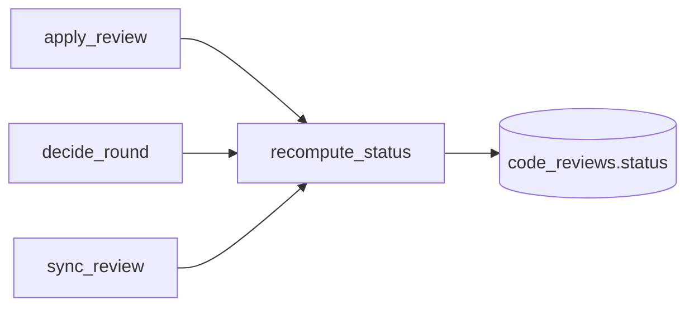

# Phase 30 — Review status derived from threads/rounds

## 1. Objective & Scope

**In** — change `code_reviews.status` from a "last action" marker into a value computed from the
review's threads and rounds, so that already-published reviews are not left stuck in
`in_discussion` when later discussion happens.

**Out** — no schema migration; no change to `ThreadStatus` (it remains per-thread and not derived);
no automatic recompute of historical data outside the one-off repair listed in §7.

## 2. High-Level Design



`recompute_status` answers three questions:
1. Is there any pending work (`pending_round_count(review) > 0`)?
   - Yes → `in_discussion` if the review already has a GitHub review URL or any published
     finding; otherwise `draft`.
2. Has round 1 of an AI-generated thread been published, or does the review have a
   `github_review_url`?
   - Yes → `applied`.
3. Otherwise → `draft`.

`discuss_threads` only sets `in_discussion` when the review is not already applied.

## 3. API Contracts & Schema

None — no route, payload or table changes.

## 4. Target File Map

- `backend/app/services/apply_service.py` — add `recompute_status`, call it after every
  `apply_review` (success path) and from `decide_round`; keep `review.status` writes explicit.
- `backend/app/services/discussion.py` — make the `review.status = IN_DISCUSSION` write
  conditional on the review not already being applied.
- `backend/app/services/thread_sync.py` — call `recompute_status` after `sync_review`
  commits.
- `backend/app/services/review_pipeline.py` — import and call `recompute_status` at the
  end of successful ingest, before the terminal event is published.

## 5. Ordered Steps

1. Add `recompute_status(review: CodeReview) -> str` in `apply_service.py`, plus a tiny helper
   `_is_published(review)`.
2. Update `apply_review` to call `recompute_status(review)` instead of the unconditional
   `review.status = APPLIED`, then set `review.verdict` only when applying something.
3. Update `decide_round` to call `recompute_status(review)` before `db.commit()`.
4. Update `discuss_threads` to only write `IN_DISCUSSION` when the review is not already applied.
5. Update `thread_sync.sync_review` to call `recompute_status(review)` after `db.commit()`.
6. Update `review_pipeline` final success path to call `recompute_status` after all threads are
   stored.
7. Run `pytest -q`.
8. Apply one-off data repair from §7 against `code_review`.

## 6. Verification

- `cd backend && pytest -q` green.
- Reproduce the stuck state: build a review with published round 1 and a later drafting round 2;
  status must become `applied`, not stay `in_discussion`.
- Existing tests for apply/discuss/sync must still pass.

## 7. Data repair

```sql
-- Reviews whose round-1 findings are on GitHub but status was overwritten to in_discussion.
UPDATE code_reviews
SET status = 'applied', updated_at = now()
WHERE id IN (17, 19);
```

#18 is left alone because it has an open drafting round 2 (thread 68 round 2) with no inbound
comment, which is still an active discussion under the new rules.

### Executed evidence

- 2026-11-11: Adjusted `discuss_threads` to only call `recompute_status` when the review was
  already `applied`; otherwise the discuss write is trusted, so a fresh draft review that receives
  a successful response stays `in_discussion` instead of being recomputed back to `draft`.
- 2026-11-11: `cd backend && pytest -q` — 296 passed, 1 warning.
- 2026-11-11: Applied the repair above against `postgresql://localhost:5432/code_review`;
  verified `id IN (17, 19)` now show `status = 'applied'` while `id = 18` remains
  `in_discussion`.
