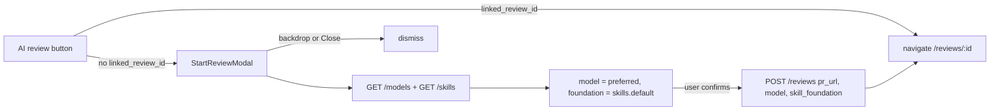

# Phase 32 — Inbox: model and skill picker before starting a review

## 1. Objective & Scope

The **AI review** button on the PR inbox page starts a review immediately with the preferred model
and the default skill foundation — the user cannot choose. Clicking it should open a modal that asks
for the LLM model and the code-review foundation, pre-filled with those same defaults, and start the
review only on confirm.

**In scope**

- A modal (feature component `StartReviewModal`) opened by the **AI review** button for a cached PR
  with no `linked_review_id`.
- Two selects in the modal: model (from `GET /models`, default `catalog.preferred`, else first
  available) and skill foundation (from `GET /skills`, default `skills.default`), mirroring the
  selects and copy of `NewReviewPanel`.
- Start posts `POST /reviews` with the chosen `model` and `skill_foundation`, then navigates to
  `/reviews/:id`.
- Errors render inside the modal; the backdrop and an explicit Close dismiss it.

**Out of scope**

- The **Open review** case (a PR with `linked_review_id` keeps navigating straight to the existing
  review — there is nothing to configure).
- Any backend change: `POST /reviews` already accepts `skill_foundation`, and both catalog endpoints
  already exist.
- Persisting a remembered choice; each open starts from the server defaults.

## 2. High-Level Design



The modal owns the catalog fetch and the `createReview` call (pages/components that own a fetch call
`api`, per frontend rules); the page only owns open/close state. The busy spinner moves from the row
button into the modal, so `startingId` in `InboxPage` goes away.

## 3. API Contracts & Schema

No new endpoints, no schema change, **no Alembic revision**. The modal reuses, unchanged:

- `GET /models` → `ModelCatalog { models: ModelOption[]; preferred: string | null; skills: string[] }`
- `GET /skills` → `SkillsResponse { default: string; uploads_enabled: boolean; foundations: Foundation[] }`
- `POST /reviews` with

```json
{ "pr_url": "https://github.com/owner/repo/pull/123", "model": "claude:claude-sonnet-4-5", "skill_foundation": "code-review" }
```

## 4. Target File Map

- **New** `frontend/src/components/StartReviewModal.tsx` — the picker dialog (catalog fetch, two
  selects, start button, inline error).
- **Changed** `frontend/src/pages/InboxPage.tsx` — "AI review" opens the modal instead of
  auto-starting; `startReview` and `startingId` removed.
- **Left alone** `frontend/src/services/api.ts` and `frontend/src/types/index.ts` (`createReview`
  already takes `skillFoundation?`; `ModelCatalog`/`SkillsResponse` already exist) and all backend
  code.

## 5. Ordered Steps

1. Add `StartReviewModal.tsx`: overlay + centered dialog (same backdrop pattern as
   `QuickReviewPanel`), loads both catalogs in parallel on mount, defaults as above, Start disabled
   until a model and a foundation are chosen and the model is `available`.
2. Rewire `InboxPage`: replace `startReview(pr)` with `setStartTarget(pr)`; render the modal when a
   target is set; keep direct navigation for `linked_review_id`.
3. `cd frontend && npm run build` (`tsc -b` strict) — the only gate for this package.
4. CHANGELOG entry.

## 6. Verification

- `npm run build` green.
- The built app renders the modal on "AI review" with the preferred model and default foundation
  preselected; the row button no longer fires a review directly; a linked row still navigates
  straight through.

### Executed evidence (2026-11-11)

- `npm run build` (`tsc -b` strict) green — 1882 modules, no type errors.
- `cd backend && pytest -q` — **297 passed** (backend untouched; gate run anyway).
- No migration this phase: `alembic_version` stays at `0016`.
