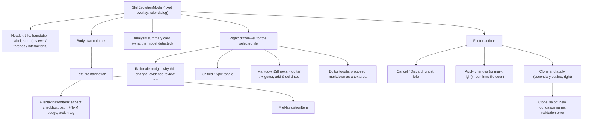
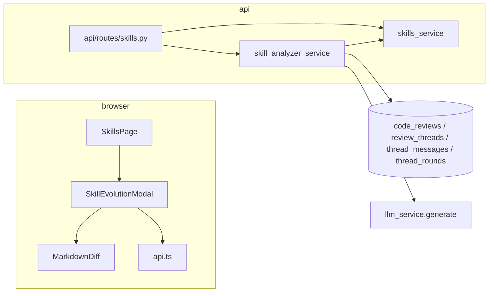

# Phase 34 — Skill Evolution & Meta-Learning Engine (review-driven guideline optimisation)

## Plan number

The task asked for `docs/plans/phase_12_plan.md`. That file already exists and is a **shipped**
phase — *User Accounts (email + password) and per-user credentials* — and `CHANGELOG.md:623`
points at it. Overwriting it would destroy the design record of a released feature and break that
link.

`AGENTS.md` §1 fixes the rule: *"N is the highest existing plan + 1"*. The highest plan in
`docs/plans/` is `phase_33_plan.md`, so this phase is **34**. The precedent for exactly this
situation is `phase_33_plan.md`, which was also numbered past an already-taken slot.

No application code is written before this file exists. Sections follow `AGENTS.md` §1:
Objective & Scope · High-Level Design · API Contracts & Schema · Target File Map ·
Ordered Steps · Verification.

---

## 1. Objective & Scope

Today a Core Skill Foundation is written by hand and never learns. When the reviewer pushes back
on a finding, the friction is recorded in `thread_messages` / `thread_rounds` and then never read
again by anything except the quality counters in `/api/analytics`. The guidelines that caused the
pushback stay exactly as they were, so the same false positive is raised tomorrow.

This phase turns that record into **edits to the guideline files themselves**:

- The operator picks a skill foundation and a model on the Skills tab, presses
  **Evolve from review history**, and the backend reads the last N days (default 30) of that
  account's review sessions.
- High-signal threads — reviewer push-back, multi-round debates, withdrawn findings, and
  findings the reviewer rewrote before publishing — are condensed into structured interaction
  summaries and paired with the foundation's current rules.
- One meta-model call ("principal engineer and rule curator") proposes **concrete file-level
  edits**: ambiguous rules, outdated guidance, false-positive generators and missing team
  conventions, each tied to the review ids that motivated it.
- The proposals come back as a **GitHub-style diff workbench**: every proposed file is listed with
  its rationale and evidence, rendered as a unified or split diff, individually acceptable or
  rejectable, and editable before saving.
- **Apply** writes the accepted files into the foundation in place (after a timestamped backup).
  **Clone and Apply** copies the foundation to a brand-new foundation folder and writes the
  accepted files there, leaving the original untouched.

**In scope**

- `skill_analyzer_service`: history aggregation, meta-prompt construction, structured proposal
  parsing and validation, server-side unified diffs.
- `skills_service`: path sanitisation for writes, atomic file writes, timestamped backups,
  foundation cloning.
- Three endpoints under `/api/skills/{foundation_id}/…`: `analyze-history`, `apply`,
  `clone-and-apply`.
- The Skills tab: an optimisation control bar (foundation select, model select, trigger button)
  and the **Skill Evolution Workbench** modal.
- A new ledger purpose (`evolve`) so the meta-call is attributable in `llm_calls`.

**Out of scope**

- **No schema change, no Alembic revision.** The analysis is derived entirely from existing
  tables; nothing is persisted between the analysis and the apply (the proposals live in the
  browser until they are accepted).
- No automatic applying. Every proposal is human-accepted, one file at a time.
- No git integration: the foundation is a folder of files on disk, and the backup is a folder
  copy, not a commit. `code-review/` is version-controlled by the repository that holds it.
- No cross-foundation learning: the analysis reads one foundation's own rules and one account's
  own reviews.
- Not a general "edit any text" agent: only the guideline files of the selected foundation.
- No serverless support for the write paths — a serverless deployment has no writable skill
  directory, so `require_writable()` refuses with `403` (the existing rule, `backend/rules/
  conventions.md`).
- The bundled `code-review/` library is not auto-modified by a *clone*; a clone always lands in
  the uploaded-foundations root.

---

## 2. High-Level Design

### 2.1 System architecture & data flow

```
┌────────────────────────────────────────────────────────────────────────────┐
│ 1. AGGREGATE            2. CONDENSE            3. CURATE                  │
│                                                                            │
│ code_reviews ─┐        [File: auth.py:42]      meta-model call             │
│ review_threads├─► friction score ─► interaction  ─► JSON proposal         │
│ thread_messages┘        per thread   summaries      (file + rationale +     │
│ thread_rounds ─┘                       + evidence     original/proposed)    │
│                                                                            │
│ 4. DIFF        5. REVIEW (browser)          6. APPLY                     │
│ difflib ─► unified diff ─► accept / reject / edit ─► backup + write        │
└────────────────────────────────────────────────────────────────────────────┘
```

**Aggregation** (`skill_analyzer_service.aggregate_history`)

- Reviews are scoped to the signed-in account (`code_reviews.user_id`) and to the window
  (`created_at >= now - days`). Reviews are matched to the selected foundation by
  `code_reviews.skill_foundation`; for the built-in foundation, rows with a NULL foundation are
  included too, because those reviews ran against the same rules.
- Only `AI_GENERATED` threads carry a signal about *our* rules. Imported PR threads
  (`GITHUB_EXISTING`) are somebody else's discussion and are ignored.
- Every thread is scored for friction:

  | Signal | Score | Why it matters |
  |---|---|---|
  | a round with status `resolved_no_reply` | +3 | the reviewer pushed back — the finding was wrong or irrelevant |
  | `thread.dropped` (an AI round 1 was withdrawn) | +2 | the proposal was rejected outright |
  | the reviewer sent a message | +2 | the reviewer disagreed, questioned or corrected |
  | more than one round | +2 | a debate, not a single click |
  | the published text differs from the model's last message | +2 | the reviewer rewrote the critique — the wording was wrong |

  Only *friction* scores. A finding that was accepted without a word of disagreement scores zero
  and is dropped: it teaches nothing about the rules. (An earlier draft of this plan gave a plain
  "published" round +1 as a useful contrast; that kept exactly the threads the rule was meant to
  exclude, so the point was removed during the build.)
- The surviving threads are rendered as one line each, in the shape the task describes:

  ```
  [PR #12 · src/services/auth.py:42] AI raised: "unbounded query …" -> Reviewer pushed back:
  "staging mock does not sign keys" -> Outcome: do not flag staging mock keys
  ```

  Excerpts are truncated (240 characters) and the whole block is capped by
  `evolution_history_max_chars`.

**Prompting** (`skill_analyzer_service.build_meta_prompt`)

The model is asked to behave as a rule curator and to answer with JSON only. It receives:

1. the foundation's current files, each with its path and full content, capped by
   `evolution_skill_max_chars`;
2. the condensed interaction summaries, each carrying its review id;
3. the output contract.

The contract fixes the shape (`analysisSummary`, `fileModifications[]` with `filePath`, `action`,
`rationale`, `evidenceReviewIds`, `originalContent`, `proposedContent`) and the rules: only
propose a change when the history shows friction, never invent a file path, copy
`originalContent` verbatim, and return an empty `fileModifications` array when the guidelines
are already working — that is a legitimate, expected answer, not a failure.

**Structured output and validation**

The raw text is parsed with `llm_service.extract_json_document` (fences and surrounding prose
tolerated), then every proposal is validated *server-side* against the real filesystem:

- `filePath` is sanitised — no `..`, not absolute, extension in the whitelist. A path that fails
  is dropped with a warning.
- `modify`/`delete` require the file to exist; `create` requires it not to exist.
- `originalContent` from the model is compared with the file on disk. The **disk copy wins** — the
  diff is always computed against reality, and a mismatch is reported as a warning ("the file
  changed since the analysis").
- A proposal whose `proposedContent` equals the current content is a no-op and is dropped.
- `evidenceReviewIds` are filtered to review ids that are actually in the analysed window and
  owned by the caller, so the workbench cannot cite a review the operator cannot open.

The unified diff is produced with `difflib.unified_diff` — the standard library, no new
dependency — and returned with the proposal, so the browser renders exactly what the server will
write.

**Filesystem management**

| Concern | Decision |
|---|---|
| Path sanitisation | One validator, `skills_service.sanitize_relative_path`: rejects `..` anywhere in the path, rejects absolute paths (`/…`, `C:\…`), rejects backslashes, rejects anything whose extension is not `.md` / `.txt` / `.yml`. It raises `SkillError(..., 400)`. |
| Whitelist | `.md`, `.txt`, `.yml` — the same set `skills_service` already accepts for foundations, extended with `.yml` so a written file is actually loaded back into prompts (`skill_loader.SKILL_SUFFIXES`). |
| Backups | Before any in-place mutation the foundation's files are copied to `<backups_dir>/<foundation>_<UTC timestamp>/`, preserving relative paths. `backups_dir` defaults to `<foundations_dir>/.backups`, which is outside every foundation root and therefore never loaded into a prompt, and inside the git-ignored uploaded-foundations directory. |
| Atomic writes | Each file is written to a temporary sibling (`.<name>.tmp-<uuid>`) and moved into place with `os.replace`, so a crash never leaves a half-written rule file. Deletions unlink after the backup. |
| Clone | The source foundation's `.md`/`.txt`/`.yml` files are copied into `<foundations_dir>/<new name>/` (a fresh staging directory, renamed into place — the same technique `create_foundation_from_zip` uses), then the accepted edits are applied *inside the clone*. The source foundation is never opened for writing. |
| Registration | The filesystem is the source of truth for foundations (`skills_service.list_foundations` scans the directory), so a clone appears in every skill selector immediately — there is no table to update. |
| Serverless | `require_writable()` refuses all write paths with `403` on a read-only deployment. |

### 2.2 Sequence diagram — trigger to filesystem

```mermaid
sequenceDiagram
    autonumber
    actor U as Operator
    participant UI as Skills tab / Workbench modal
    participant API as FastAPI /api/skills
    participant SVC as skill_analyzer_service
    participant FS as skills_service (filesystem)
    participant DB as PostgreSQL
    participant LLM as Selected model

    U->>UI: pick foundation + model, press "Evolve from review history"
    UI->>API: POST /api/skills/{id}/analyze-history {days: 30, model}
    API->>SVC: analyse(db, user_id, foundation_id, days, model_id)
    SVC->>DB: reviews in window for this account + foundation
    SVC->>SVC: score every AI thread for friction
    SVC->>FS: read the foundation's .md/.txt/.yml files
    FS-->>SVC: {path: content}
    SVC->>SVC: condense to interaction summaries (with review ids)
    SVC->>LLM: meta-prompt (rules + summaries + JSON contract)
    LLM-->>SVC: {analysisSummary, fileModifications[]}
    SVC->>FS: validate each path; read the on-disk original
    SVC->>SVC: difflib.unified_diff(original, proposed)
    SVC-->>API: analysis + per-file diff + rationale + evidence ids
    API-->>UI: 200 {analysis_summary, file_modifications[], history{}}
    UI->>U: workbench: file list, rationale, unified/split diff

    U->>UI: accept, reject or edit the proposed text
    alt Apply in place
        U->>UI: "Apply changes" -> confirm "updates N files in <foundation>"
        UI->>API: POST /api/skills/{id}/apply {files: [{file_path, action, content}]}
        API->>FS: copy the foundation to <backups>/<name>_<ts>/
        API->>FS: write each file atomically (tmp + os.replace)
        FS-->>API: applied paths
        API-->>UI: 200 {foundation, applied[], backup_path}
    else Clone and apply
        U->>UI: "Clone and apply" -> name prompt
        UI->>API: POST /api/skills/{id}/clone-and-apply {new_foundation_name, files}
        API->>FS: validate name (kebab-case, not existing)
        API->>FS: copy source files into <foundations>/<new>/ (staging + rename)
        API->>FS: apply the accepted edits inside the clone
        API-->>UI: 200 {foundation, applied[]} -> success toast
    end
```

### 2.3 Component hierarchy — the workbench modal



### 2.4 Where the pieces live



---

## 3. API Contracts & Schema

### 3.1 Database

**No schema change. No Alembic revision.** The analysis reads existing tables and writes nothing.

The one model-level addition is a ledger purpose constant — `llm_calls.purpose` is a
`String(16)` column with no enum constraint, so `evolve` needs no migration:

```python
class LLMPurpose:
    INGEST = "ingest"
    DISCUSS = "discuss"
    VERDICT = "verdict"
    SUMMARISE = "summarise"
    POLISH = "polish"
    EVOLVE = "evolve"   # the skill-evolution meta-analysis call
```

The call is recorded with `review_id = NULL` (it belongs to no single review), exactly like the
existing `polish` call. Per `backend/app/models/llm_call.py` such rows are not attributable to an
account and `analytics` does not count them — that is the established behaviour, not a new gap.

### 3.2 Configuration (`backend/app/core/config.py`)

| Setting | Default | Meaning |
|---|---|---|
| `evolution_skill_max_chars` | `60_000` | budget for the current rules in the meta-prompt |
| `evolution_history_max_chars` | `24_000` | budget for the condensed interaction summaries |
| `backups_dir` | `None` → `<foundations_dir>/.backups` | where foundation backups are written |

### 3.3 `POST /api/skills/{foundation_id}/analyze-history`

Request body:

```json
{ "days": 30, "model": "claude:claude-sonnet-4-5-20250929" }
```

- `days` — integer, 1–365, default 30.
- `model` — a model id (`claude:…`, `openai:…`, `ollama-cloud:…`, `ollama-local:…`). The
  credentials come from the **calling account's** own keys, so an analysis can never spend
  another account's money.

Response `200`:

```json
{
  "analysis_summary": "Over the past 30 days the AI repeatedly flagged inline test fixtures and strict return types in internal script directories, leading to 8 pushbacks. The proposed changes add explicit exemptions.",
  "file_modifications": [
    {
      "file_path": "references/testing.md",
      "action": "modify",
      "rationale": "Clarify that unit tests using mock factories do not require strict interface typing.",
      "evidence_review_ids": [14, 22],
      "original_content": "# Testing Guidelines\n…",
      "proposed_content": "# Testing Guidelines\n…\n## Exemption: Mock Factories\n…",
      "unified_diff": "--- a/references/testing.md\n+++ b/references/testing.md\n@@ -1,3 +1,9 @@\n …"
    }
  ],
  "history": { "days": 30, "reviews": 7, "threads": 42, "interactions": 11 },
  "warnings": []
}
```

`action` is `"modify" | "create" | "delete"`. An empty `file_modifications` array with a filled
`analysis_summary` is a **success**, not an error: it means the rules are working.

Errors: `404` unknown foundation · `422` bad `model` id, missing key for that provider, or no
model configured · `502` the provider failed · `400` the foundation id is not a legal slug.

> **Deviation from the first draft.** An unknown foundation was first mapped to `422` (the status
> `skills_service.get_foundation` has always used for a bad id). The three evolution endpoints
> address a *resource* by name, so an unknown one is a `404` there: a new
> `skills_service.require_foundation` raises `404` while `get_foundation` keeps its `422` for the
> callers that already expect it.

### 3.4 `POST /api/skills/{foundation_id}/apply`

Request body:

```json
{
  "files": [
    { "file_path": "references/testing.md", "action": "modify", "content": "# Testing Guidelines\n…" }
  ]
}
```

- `files` — 1–50 entries. `content` is the **approved** text (the operator may have edited the
  proposal in the browser); for `delete` it is ignored.
- Every path is re-sanitised server-side. `../../etc/main.py`, `/etc/passwd` and
  `rules.exe` are all rejected with `400`.

Response `200`:

```json
{
  "foundation": "code-review",
  "applied": ["references/testing.md"],
  "backup_path": "code-review-foundations/.backups/code-review_20261111-081530",
  "warnings": []
}
```

Errors: `400` illegal path or extension · `404` unknown foundation · `403` read-only deployment
(serverless) · `409` the foundation was deleted while the workbench was open.

### 3.5 `POST /api/skills/{foundation_id}/clone-and-apply`

Request body:

```json
{
  "new_foundation_name": "team-standards-v2",
  "files": [
    { "file_path": "references/testing.md", "action": "modify", "content": "# Testing Guidelines\n…" }
  ]
}
```

- `new_foundation_name` — kebab-case (`^[a-z0-9]+(-[a-z0-9]+)*$`), 1–50 characters, and it must
  not already exist. It may not be the reserved `code-review`.
- The source foundation is **copied**, then the accepted edits are applied inside the copy. The
  source is never written to.

Response `200`:

```json
{
  "foundation": {
    "id": "team-standards-v2",
    "label": "team-standards-v2",
    "is_default": false,
    "file_count": 18,
    "total_chars": 481_233,
    "files": ["SKILL.md", "references/testing.md", "…"]
  },
  "applied": ["references/testing.md"],
  "warnings": []
}
```

Errors: `400` illegal name or path · `404` unknown source foundation · `409` the name already
exists · `403` read-only deployment.

### 3.6 Ownership

All three endpoints sit behind `Depends(get_current_user)` (the `skills` router is already
mounted with the guard in `app/api/router.py`) and take `user: CurrentUser`. The analysis reads
only `code_reviews.user_id == user.id`; the foundation folders themselves are a shared,
on-disk library — the same deliberate sharing decision `phase_12_plan.md` recorded for
`code-review/` and `code-review-foundations/`.

---

## 4. Target File Map

### New — backend

| File | Purpose |
|---|---|
| `backend/app/services/skill_analyzer_service.py` | history aggregation, friction scoring, interaction condensation, meta-prompt, proposal validation, unified diffs |
| `backend/tests/test_skill_evolution.py` | aggregation, structured output, filesystem isolation, path-injection tests |

### Changed — backend

| File | Change |
|---|---|
| `backend/app/api/routes/skills.py` | three new endpoints; `user: CurrentUser` + `db` on the analysis route |
| `backend/app/schemas/skills.py` | request/response models for the three endpoints |
| `backend/app/services/skills_service.py` | `sanitize_relative_path`, `read_foundation_files`, `backup_foundation`, `apply_file_changes`, `clone_foundation`; `.yml` added to `ALLOWED_SUFFIXES` |
| `backend/app/services/skill_loader.py` | `.yml` added to `SKILL_SUFFIXES` so a written `.yml` rule file is loaded into prompts |
| `backend/app/models/llm_call.py` | `LLMPurpose.EVOLVE` |
| `backend/app/core/config.py` | `evolution_skill_max_chars`, `evolution_history_max_chars`, `backups_dir` |
| `backend/rules/conventions.md` | `skill_analyzer_service` added to the service roster |

### New — frontend

| File | Purpose |
|---|---|
| `frontend/src/components/SkillEvolutionModal.tsx` | the workbench: file navigation, rationale cards, diff viewer, accept/edit, apply & clone actions |
| `frontend/src/components/MarkdownDiff.tsx` | unified/split diff renderer with `+`/`-` gutters |
| `frontend/src/lib/diff.ts` | unified-diff parser and the del/add pairing used by the split view |

### Changed — frontend

| File | Change |
|---|---|
| `frontend/src/types/index.ts` | `SkillEvolutionAnalysis`, `SkillFileModification`, `SkillEvolutionHistory`, request/response types, `LLMPurpose` gains `"evolve"` |
| `frontend/src/services/api.ts` | `analyzeSkillHistory`, `applySkillEvolution`, `cloneSkillEvolution` |
| `frontend/src/pages/SkillsPage.tsx` | optimisation control bar (foundation select, model select, trigger), analysis progress overlay, modal wiring |

### Docs

`docs/plans/phase_34_plan.md` (this file) · `CHANGELOG.md` · `README.md` ·
`backend/rules/conventions.md`.

**Left alone**: every review-flow service, the ingest pipeline, the ledger schema, the
`llm_calls` table, `frontend/src/pages/InboxPage.tsx` and `frontend/src/components/
StartReviewModal.tsx` (in-flight phase 32 work), and the `code-review/` library itself — this
phase never edits a foundation unless the operator explicitly applies a change.

---

## 5. Ordered Steps

1. **Config + ledger purpose.** `evolution_skill_max_chars`, `evolution_history_max_chars`,
   `backups_dir` (+ the `resolved_backups_dir` property); `LLMPurpose.EVOLVE`.
2. **`skills_service` write primitives.**
   - `sanitize_relative_path(raw)` → sanitised relative path or `SkillError(..., 400)`.
   - `read_foundation_files(foundation_id)` → `{relative path: text}` for `.md`/`.txt`/`.yml`.
   - `backup_foundation(foundation_id)` → copies the foundation's files to
     `<backups>/<name>_<UTC ts>/`, returns the path.
   - `apply_file_changes(foundation_id, changes)` → backup, then atomic writes / deletions;
     returns the applied paths.
   - `clone_foundation(source_id, new_name, changes)` → staging copy + rename + edits applied
     inside the clone.
   - Extend `ALLOWED_SUFFIXES` with `.yml`; mirror it in `skill_loader.SKILL_SUFFIXES`.
3. **`skill_analyzer_service`.**
   - `aggregate_history(db, user_id, foundation_id, days)` → `HistoryDigest`
     (reviews, threads, interactions, condensed text).
   - `build_meta_prompt(files, digest)` → `(system_prompt, user_prompt)`.
   - `parse_proposals(document, foundation_files, review_ids)` → validated proposals with
     `difflib` unified diffs and warnings.
   - `analyse(db, user_id, foundation_id, days, model_id)` → the whole thing, including the
     `llm_service.generate` call with `purpose=LLMPurpose.EVOLVE`.
4. **Schemas + routes.** The three pydantic models and the three endpoints; `SkillError` →
   HTTP status mapping exactly as the existing routes do it.
5. **Backend tests** (§6) and `cd backend && pytest -q`.
6. **Frontend.** `types/index.ts` → `api.ts` → `lib/diff.ts` + `MarkdownDiff.tsx` →
   `SkillEvolutionModal.tsx` → `SkillsPage.tsx` (control bar + progress overlay). `npm run build`.
7. **Live verification.** A seeded review history, a stubbed model, a real run of all three
   endpoints, a real browser pass over the workbench (accept, reject, edit, apply, clone).
8. **Docs.** README section, CHANGELOG entry, `backend/rules/conventions.md` roster.

---

## 6. Verification

### 6.1 Backend tests (`backend/tests/test_skill_evolution.py`)

**History parsing.** Seed reviews in the last 30 days with: an accepted finding (published, no
push-back), a thread with a reviewer message that was pushed back (`resolved_no_reply`,
`dropped = True`), a multi-round debate, and a finding the reviewer rewrote before publishing.
Assert that the aggregator keeps the three friction threads and drops the clean one, that the
condensed text names the file and the reviewer's words, and that the review ids in the evidence
list are the seeded ones.

**Diff generation.** Stub `llm_service.generate` with a JSON answer containing one `modify`,
one `create` and one `delete`. Assert that the response is valid against the schema, that each
proposal carries a unified diff containing the expected `+`/`-` lines, that `original_content`
equals the **on-disk** file (not the model's copy) when the model returned a stale original, that
a proposal with an illegal path is dropped with a warning, that a `modify` of a non-existent file
is dropped, and that a proposal whose proposed content equals the current content is dropped as a
no-op.

**Filesystem isolation — Apply.** Assert the file on disk changed, the untouched sibling file is
unchanged, the backup directory exists and contains the **previous** content of the changed file,
and that a second apply creates a second, distinct backup.

**Filesystem isolation — Clone and Apply.** Assert the source foundation is byte-for-byte
unchanged, the new directory exists with the base files *and* the accepted edit, the new
foundation appears in `GET /api/skills`, and applying to a name that already exists is `409`.

**Path injection.** `POST …/apply` with `filePath: "../../../main.py"` → `400`, and nothing
written outside the foundation. Also `"/etc/passwd"` → `400`, `"rules.exe"` → `400`.

**Empty analysis.** A model answer with `analysisSummary` and an empty `fileModifications` →
`200`, empty list, and the summary intact (the "no adjustments needed" state).

**Gates**: `cd backend && pytest -q` green; `cd frontend && npm run build` green.

### 6.2 Live run (plain evidence)

1. Seed three reviews (one clean, two with push-back) and run `POST /api/skills/code-review/
   analyze-history` with a stubbed model; print the response's `history` counters and the
   `unified_diff` of the first proposal.
2. `POST /api/skills/code-review/apply` with the accepted file; show the file's new content on
   disk and the backup directory listing with the old content.
3. `POST /api/skills/code-review/clone-and-apply` with `new_foundation_name: team-standards-v2`;
   show the source file unchanged and the clone's file changed, and the new foundation in
   `GET /api/skills`.
4. `POST /api/skills/code-review/apply` with `filePath: "../../../main.py"`; show the `400`.
5. Browser: the Skills tab shows the control bar; pressing **Evolve from review history** shows
   the staged overlay; the workbench lists the proposed file with its rationale and evidence
   badge, renders the unified diff, toggles to the split view, lets the operator edit the
   proposed markdown, and **Apply changes** confirms "updates 1 file in code-review" and then
   reports the backup path.

### 6.3 Browser verification — recorded

The plan's browser pass was run against a scratch backend (its own SQLite file, a seeded
pushed-back review, and a stubbed meta-model) with Vite proxying `/api` at it. The committed
`vite.config.ts` was left untouched: a throwaway config outside the repo pointed the proxy at
the scratch port, because another agent's server already held `:8000`. Both throwaway files were
deleted afterwards.

| Step | Observed |
|---|---|
| Skills tab | the control bar renders: `code-review (default) · 2 file(s)` preselected, the model dropdown listing the real catalogue (`glm-4.7:cloud`, `llama3:8b`, `mistral-small:24b`, `nomic-embed-text:latest`) |
| Trigger | the analysis ran; the workbench opened with *"code-review · 1 review(s), 1 pushback(s) in the last 30 days"* and the model's summary |
| File list | both proposals listed with their action badge and *"triggered by 1 pushback"* |
| Unified diff | `+4 / −0 line(s)`, the `@@` hunk header and the added `## Exemption: Mock Factories` block, `+` gutter, green tint |
| Split view | context lines on both sides, additions only on the right (4 tinted rows, 13 gutters) |
| Accept toggle | unchecking a file moved the counter from `PROPOSED FILES (2/2 SELECTED)` to `(1/2 SELECTED)` |
| File selection | clicking `references/new-rules.md` swapped the right pane to that file's `@@ -0,0 +1,3 @@` diff and its own rationale |
| Edit text | the proposed markdown became a textarea; a typed line survived to disk |
| Apply | the footer asked *"This will update 2 file(s) in code-review."* before writing; on confirm the modal closed with *"Updated 2 file(s) in code-review. The previous version is in …/.backups/code-review_20261111-123439."* |
| Files on disk | `references/testing.md` and the new `references/new-rules.md` both written, the operator's typed line included; the backup held the previous `testing.md` |
| Re-analysis | with the files already matching the proposals, the engine proposed nothing and the apply buttons were disabled — the engine is idempotent |
| Clone and apply | the name prompt opened; `team-standards-v2` was created with *"Created “team-standards-v2” with 2 changed file(s). The original code-review is untouched."* |
| Clone on disk | the source foundation was byte-identical and gained no `new-rules.md`; the clone held `SKILL.md` plus both changed files |
| Registration | the picker immediately listed `team-standards-v2 · 3 file(s)` next to `code-review (default) · 2 file(s)` |

**Gates**: `cd backend && pytest -q` → 338 passed · `cd frontend && npm run build` → green.
