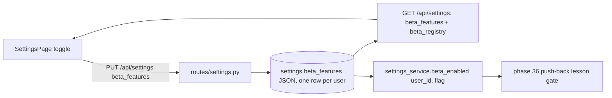

# Phase 35 — Beta features section in Settings

## 1. Objective & Scope

A per-user **Beta features** section on the Settings page: a registry of known beta flags, a
toggle for each, stored server-side on the user's settings row. The first flag is
`push_back_lessons` — consumed by phase 36 (push-back lessons, initiative 6); this phase ships
the toggle and the storage only, no behaviour behind the flag.

**In scope**

- `settings.beta_features` JSON column (migration `0017_beta_features`, revises `0016`).
- A single backend registry of known flags with label + description.
- `GET /api/settings` returns the user's `beta_features` and the `beta_registry`.
- `PUT /api/settings` accepts `beta_features` (full-dict replace; unknown ids are a `422`).
- `settings_service.beta_enabled(db, user_id, flag)` for services (phase 36's gate).
- Settings page section: one card, one toggle per registry entry, "beta" framing, off by default.

**Out of scope**

- Any behaviour behind `push_back_lessons` — phase 36.
- Per-flag configuration beyond a boolean, global (non-user) flags, flag expiry, analytics on flag
  usage.

## 2. High-Level Design



The registry lives in one place — `settings_service` — so the Settings page renders from data
(`beta_registry`) and never hardcodes flag ids in the UI. Flags are server-side per user: no
localStorage, no URL params.

## 3. API Contracts & Schema

Migration `0017_beta_features` (revises `0016_inbox_involvement`):

```python
def upgrade() -> None:
    with op.batch_alter_table("settings") as batch:
        batch.add_column(
            sa.Column("beta_features", sa.JSON(), nullable=False, server_default="{}")
        )


def downgrade() -> None:
    with op.batch_alter_table("settings") as batch:
        batch.drop_column("beta_features")
```

`GET /api/settings` (excerpt — existing fields unchanged):

```json
{
  "version_control_key_id": 1,
  "llm_key_id": 2,
  "needs_setup": false,
  "beta_features": { "push_back_lessons": false },
  "beta_registry": [
    {
      "id": "push_back_lessons",
      "label": "Push-back lessons",
      "description": "When you push back on a finding, offer to record the lesson as a rule in a skill foundation."
    }
  ]
}
```

`PUT /api/settings` (excerpt): `{"beta_features": {"push_back_lessons": true}}` — full-dict
replace; an id not in the registry is a `422`; an absent or `null` `beta_features` field leaves
the current flags untouched (same semantics as the soft-cap fields). Unknown flags never persist.

## 4. Target File Map

- **New** `backend/alembic/versions/0017_beta_features.py`, `backend/tests/test_beta_features.py`.
- **Changed** `backend/app/models/settings.py` (`beta_features` column),
  `backend/app/services/settings_service.py` (`BETA_FEATURES` registry, `beta_enabled`),
  `backend/app/schemas/settings.py` (`SettingsUpdate.beta_features`,
  `SettingsRead.beta_features` + `beta_registry`), `backend/app/api/routes/settings.py` (PUT
  branch), `frontend/src/pages/SettingsPage.tsx` (Beta features card),
  `frontend/src/services/api.ts`, `frontend/src/types/index.ts`, `README.md`, `CHANGELOG.md`.
- **Left alone** everything else — in particular `INITIATIVES.md`, `docs/plans/` (the coordinating
  agent owns both), all review/skill/inbox/keys services and routes, and every file not named
  above. Another agent starts phase 36 immediately after this phase completes; do not create or
  modify files outside this map.

## 5. Ordered Steps

1. Migration `0017` and the model column; verify `upgrade`/`downgrade -1` on a scratch database.
2. Registry + `beta_enabled` in `settings_service`; defaults false for unknown or unset flags.
3. Schemas and the PUT branch (validate ids against the registry); backend tests.
4. Frontend: types + `api.ts`, then the Settings page section rendering from `beta_registry`.
5. Gates: `cd backend && pytest -q` green (baseline before this phase: 331 passed);
   `cd frontend && npm run build` green.

## 6. Verification

- New tests: a fresh account reads `push_back_lessons: false`; PUT persists per user; two accounts'
  flags are isolated; an unknown flag id is `422` and persists nothing; omitting `beta_features`
  leaves flags unchanged; `beta_enabled` is false by default and true after the toggle.
- `pytest -q` green; `npm run build` green; scratch-database `upgrade`/`downgrade -1` round trip.
- Manual: the Settings page shows the Beta features card with one toggle, and reloading the page
  keeps the choice.
