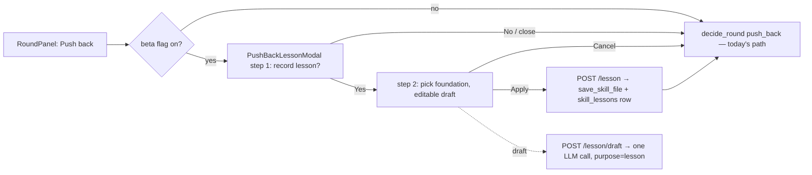

# Phase 36 — Push-back lessons: record a rejected finding as a skill rule

Initiative 6 (INITIATIVES.md §6), revised 2026-11-11 with the operator: the question is asked
inline at the push back, and the feature is beta-gated by phase 35's `push_back_lessons` flag.

## 1. Objective & Scope

With the beta flag on, clicking **Push back** on an AI finding opens a two-step modal before the
round resolves: (1) "Record the lesson from this push back in a skill foundation?" — **No**
dismisses and the push back proceeds exactly as today; (2) **Yes** shows the foundation picker and
a model-drafted, editable lesson; **Apply** writes the lesson into the chosen foundation as one
markdown file, records attribution, and the push back proceeds. Flag off: Push back is unchanged —
no modal, no model call.

**In scope**

- The two-step modal (`PushBackLessonModal`), wired between `RoundPanel`'s Push back button and
  `decide_round`.
- One draft model call per opened step two (`purpose="lesson"` in the `llm_calls` ledger), using
  the review's model; title and body editable.
- `POST /api/reviews/{review_id}/threads/{thread_id}/lesson/draft` and `.../lesson` (flag-checked;
  another account's thread is a `404`).
- The lesson file: `lessons/<filetype>-<slug>.md` inside the chosen foundation, header citing
  review and thread, written via the existing `skills_service.save_skill_file`.
- Attribution table `skill_lessons` (migration `0018_skill_lessons`, revises `0017_beta_features`).
- Serverless: no write (existing `require_writable` guard); the modal falls back to
  copy-to-clipboard using the existing `SkillsResponse.uploads_enabled` signal.

**Out of scope**

- The proposal queue and `decision`/`decision_note` columns from the original initiative sketch —
  superseded by the inline modal.
- Batch evolution of guidelines from review history — phase 34 owns that.
- Editing existing skill files, lesson analytics, lesson deletion (delete the file by hand for now).

## 2. High-Level Design



The lesson lands **before** the push-back decision is sent — `apply_service.decide_round` is
untouched; a failed lesson never blocks the push back (the modal can be dismissed and the decision
sent anyway).

## 3. API Contracts & Schema

Migration `0018_skill_lessons` (revises `0017_beta_features`; table names follow `models/review.py`):

```python
op.create_table(
    "skill_lessons",
    sa.Column("id", sa.Integer(), primary_key=True, autoincrement=True),
    sa.Column("user_id", sa.Integer(), nullable=False, index=True),
    sa.Column("review_id", sa.Integer(), nullable=False, index=True),
    sa.Column("thread_id", sa.Integer(), nullable=False, index=True),
    sa.Column("foundation", sa.String(64), nullable=False),
    sa.Column("path", sa.String(255), nullable=False),
    sa.Column("title", sa.Text(), nullable=False),
    sa.Column("created_at", sa.DateTime(timezone=True), nullable=False, server_default=sa.func.now()),
)
for col in ("user_id", "review_id", "thread_id"):
    op.create_foreign_key(f"fk_skill_lessons_{col}", "skill_lessons", col_target_table(col), [col], ["id"], ondelete="CASCADE")
```

(with the real FK targets spelled out in code — `users`, the reviews table, `review_threads` —
and a matching `drop_table` downgrade; `batch_alter_table` where SQLite needs it.)

`POST /api/reviews/{review_id}/threads/{thread_id}/lesson/draft` → `200 {"title": "...", "body": "..."}`
— `422` when the beta flag is off, `404` when the review or thread is not the caller's.

`POST /api/reviews/{review_id}/threads/{thread_id}/lesson`
body `{"foundation_id": "code-review", "title": "…", "body": "…"}` →

```json
{ "path": "lessons/python-n-plus-one-query.md", "foundation": "code-review", "lesson_id": 1 }
```

The file written (title and body are the reviewer-approved text, header added by the service):

```markdown
<!-- Lesson from review #12, thread #4 — pushed back 2026-11-11 -->
# Avoid flagging N+1 queries in background jobs

<reviewer-approved body, including a scope line: which file types/paths the rule applies to>
```

The `lessons/<filetype>-…` path is what makes `skill_loader._score` select the file for future
reviews of the same file type; the slug comes from `skills_service.slugify_filename`.

## 4. Target File Map

- **New** `backend/alembic/versions/0018_skill_lessons.py`, `backend/app/models/lesson.py`,
  `backend/app/services/lessons_service.py` (draft prompt, write, attribution row),
  `frontend/src/components/PushBackLessonModal.tsx`, `backend/tests/test_lessons_api.py`.
- **Changed** `backend/app/api/routes/reviews.py` (two endpoints, flag-gated),
  `backend/app/schemas/review.py` (lesson schemas), `backend/app/models/__init__.py`,
  `frontend/src/components/RoundPanel.tsx` (Push back routes through the modal when the flag is on),
  `frontend/src/pages/ReviewDetailPage.tsx` (owns modal state, sends the decision after the modal),
  `frontend/src/services/api.ts`, `frontend/src/types/index.ts`, `README.md`, `CHANGELOG.md`,
  `INITIATIVES.md` (§6 moves to shipped with deviations).
- **Left alone** phase 35's settings work (`settings_service`, `routes/settings.py`,
  `SettingsPage.tsx` — read via `beta_enabled` and the existing settings API only),
  `apply_service.py`, `skills_service.py` (used as-is), phase 34's skill-evolution files.

## 5. Ordered Steps

1. Migration `0018` + `SkillLesson` model; scratch-database `upgrade`/`downgrade -1` round trip.
2. `lessons_service`: `draft_lesson` (one LLM call over the finding + thread messages; demands a
   scope line) and `apply_lesson` (validate foundation, `save_skill_file`, attribution row).
3. Routes + schemas with flag checks and ownership `404`s; backend tests against stubbed LLM.
4. Frontend: types + `api.ts`, the two-step modal, `RoundPanel`/`ReviewDetailPage` wiring (the
   decision is sent only after the modal resolves), beta flag from the settings API.
5. Gates: `cd backend && pytest -q` green; `cd frontend && npm run build` green.

## 6. Verification

- Flag off: Push back resolves the round with no modal and no lesson endpoints called; calling the
  endpoints directly is a `422`.
- Flag on, "No": round outcome identical to today's push back (`RESOLVED_NO_REPLY`, finding
  dropped for an AI round-1 thread).
- Flag on, "Yes" → foundation → Apply: the foundation contains
  `lessons/<filetype>-<slug>.md`, the `skill_lessons` row cites the thread, and the next review's
  loaded bundle includes the lesson (assert on the built prompt). Cancel writes no file and no row.
- Draft failure (LLM error) leaves the modal usable — dismiss and push back still works.
- Another account's thread is a `404`. Serverless: clipboard mode, nothing written.
- `pytest -q` green; `npm run build` green; migration round trip on a scratch database.

### Deviations from the plan (found during implementation)

- `lessons_service` raises a local `LessonError` (same `detail`/`status_code` shape) instead of
  importing `PipelineError`: a module-level import from the new service trips a pre-existing cycle
  (`review_pipeline → thread_sync → apply_service → review_pipeline`) that the routes' import
  order exposes. The routes map `LessonError` the same way they map `PipelineError`.
- `models/llm_call.py` was not in the target file map but needed `LLMPurpose.LESSON` — the ledger's
  purpose enum is the only registry of call kinds, and the draft call belongs in it.
- `tests/conftest.py` was not in the map either: its autouse `reset_settings` deletes rows with
  raw `query().delete()` (bypassing ORM cascade), so `skill_lessons` joined its cleanup list.
- `RoundPanel` needed no change: the page intercepts the decision in `handleDecide` before it
  reaches `decideRound`, so the component contract is untouched.

### Executed evidence (2026-11-11)

- `pytest -q` — **347 passed** (338 baseline + 9 in `tests/test_lessons_api.py`): flag off → 422 on
  both endpoints; draft returns the editable rule and records `purpose="lesson"` with the thread
  id; draft failure → 502 with "Push back anyway"; apply writes
  `lessons/py-unbounded-query-check-the-caller-first.md` with the review/thread header and the next
  `load_bundle({"py"})` contains it; blank text 422, unknown foundation 404, foreign thread 404,
  flag re-disable closes the endpoints.
- `npm run build` (`tsc -b` strict) green.
- Scratch-database round trip (2026-11-11): `upgrade head` creates `skill_lessons` with all 8
  columns; `downgrade -1` drops the table and returns `alembic_version` to `0017`; a re-upgrade
  succeeds. Scratch file removed afterwards.
