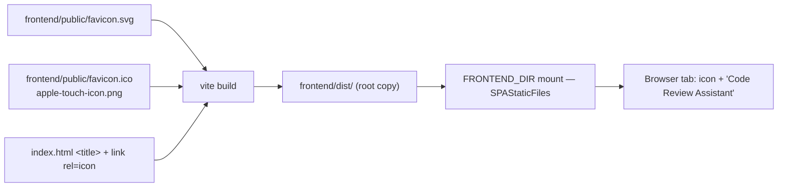

# Phase 38 — Tab title and site icon

## Summary (plain language)

The browser tab still reads "AI Code Review Assistant" and has no icon at all — every tab shows the
browser's generic blank page glyph. After this phase the tab reads **Code Review Assistant** (the
name already on the navbar) and carries a dedicated mark: accent-gradient rounded square, diff
bars above, a bold check below — "reviewed code". What it deliberately is not: a logo redesign, a
PWA manifest, a themeable SVG that swaps with the app's light/dark toggle, or a new asset
pipeline.

## 1. Objective & Scope

**In scope**

- `<title>` becomes `Code Review Assistant`.
- One icon design shipped in the three forms a browser and a phone actually ask for:
  - `favicon.svg` — the canonical vector, `image/svg+xml` (Chrome, Firefox, Edge, Safari 15+).
  - `favicon.ico` — 16/32/48 PNG-in-ICO fallback for legacy surfaces, legacy bookmarks, and any
    client that requests `/favicon.ico` by convention.
  - `apple-touch-icon.png` — 180 px full-bleed square (no rounded corners; iOS applies its own
    mask).
- Assets live in `frontend/public/`, which Vite copies verbatim to `dist/`, so both the dev server
  and the Docker/single-container `FRONTEND_DIR` path serve them with no backend change.

**Out of scope**

- Backend, API, schema, database — **no Alembic revision**, no new route. `/favicon.*` is served
  by the existing `SPAStaticFiles` mount (extension-bearing paths 404 rather than falling through
  to `index.html`, so files are served correctly).
- Navbar brand mark stays `Sparkles` (`frontend/src/components/Navbar.tsx`); this phase adds the
  site icon only.
- No web app manifest, no service worker, no per-theme icon swap, no `.icns`/desktop icon.

## 2. High-Level Design

## 3. API Contracts & Schema

None. No endpoints, no columns, **no Alembic revision**. Only two browser conventions are
exercised: `/favicon.ico` (implicit request) and the `<link rel="icon">` hints in `index.html`.

Icon geometry (64-unit artboard, so it stays crisp from 16 px up):

| Element | Value |
|---|---|
| Plate | `rect 0 0 64 64`, `rx 15`, gradient `#7c8bff → #5867f0` (app `accent` → `accentStrong`) |
| Diff bars | `x16 y15 w30 h6 r3` and `x16 y26 w17 h6 r3`, white at 50% |
| Check | path `M19 42 L27.5 50.5 L45 31`, stroke white 6.5, round caps/joins |

## 4. Target File Map

- **New** `frontend/public/favicon.svg` — canonical icon.
- **New** `frontend/public/favicon.ico` — 16/32/48.
- **New** `frontend/public/apple-touch-icon.png` — 180 px, full-bleed.
- **Changed** `frontend/index.html` — title, `link rel="icon"` (SVG + ICO), apple-touch-icon.
- **Changed** `CHANGELOG.md` — phase entry.
- **Left alone** backend, `vite.config.ts` (`publicDir` default already applies), Navbar.

## 5. Ordered Steps

1. Write this plan.
2. `frontend/public/favicon.svg`; render candidates at 16/20/24/32/48/64 px on light and dark tab
   chrome and pick the legible one.
3. Rasterise `favicon-16/32/48.png` + `apple-touch-icon.png` (180, full-bleed) from the final
   artwork; wrap the three small ones into `favicon.ico`.
4. `frontend/index.html`: title + icon links.
5. `npm run build`; assert `dist/favicon.svg`, `dist/favicon.ico`, `dist/apple-touch-icon.png`
   exist in the build output (not only in `public/`).
6. Serve `dist` through the real backend (`FRONTEND_DIR`) on a scratch SQLite DB and curl each
   asset: 200 + correct content type; `/favicon.ico` must not return `index.html`.
7. CHANGELOG entry.

## 6. Verification

- `cd frontend && npm run build` green (`tsc -b` + vite).
- Build output contains the three assets at the dist root; `frontend/public` untouched afterwards.
- Over HTTP from the built app: `GET /favicon.svg` → 200 `image/svg+xml`, `GET /favicon.ico` → 200
  `image/x-icon` (16/32/48 sizes present in the ICO directory), `GET /apple-touch-icon.png` → 200
  `image/png` 180×180, and `GET /` → `200` whose HTML carries
  `<title>Code Review Assistant</title>` plus the two icon links.
- Visual: the SVG at 16 px is legible on light and dark tab chrome (screenshots), and the
  apple-touch-icon is a square-edged full-bleed plate.

## 7. Execution record

Executed 2026-11-11.

- Candidate comparison rendered in a real browser at 16/20/24/32/48/64 px on light and dark tab
  chrome: a bare check read as a to-do list, `</>` chevrons muddied at 16 px, the speech-bubble
  and sparkle variants went mushy or generic. Diff bars + check stayed legible at 16 px, so that
  is the shipped artwork.
- Assets written to `frontend/public/` (`favicon.svg`, `favicon.ico` with 16/32/48 entries,
  `apple-touch-icon.png` 180×180). `favicon.ico` was assembled as PNG-in-ICO; verified by parsing
  the directory back (3 entries, widths 16/32/48).
- `npm run build` green; `dist/` root holds `favicon.svg`, `favicon.ico`, `apple-touch-icon.png`.
- Served through the real backend with `FRONTEND_DIR=frontend/dist` on a scratch SQLite DB: all
  three assets returned 200 with the expected content types, `/favicon.ico` returned the ICO (not
  the SPA fallback), `/` returned the HTML with the new title, and a client route
  (`/reviews/1`) still fell back to `index.html`.
