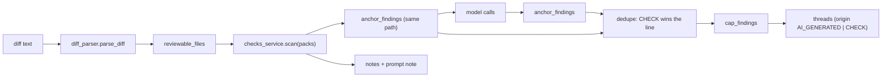

# Phase 39 — Deterministic pre-pass checks before the model

## Summary (plain language)

A review now catches the things a regex knows for certain before it spends a token: a committed
provider token, a private-key header, a conflict marker, a debugger statement, a `console.log`, an
accidental `.only(`/`.skip(` in a test. Those findings appear beside the model's own, are
discussable and publishable like any other, and the model is told they already exist so it does
not repeat them. What it deliberately is not: a lint engine, a style checker, an entropy detector
that flags every long string, a per-repository ignore list, or a replacement for the model.

## 1. Objective & Scope

**In scope** (initiative 7)

- A data-driven check pack service (`services/checks_service.py`): two packs, `secrets` and
  `hygiene`, each a list of rules (id, regex, severity, message, path hints). Packs are **off by
  default** and enabled per account in Settings, stored on `settings.check_packs`.
- Checks run after `parse_diff`/`reviewable_files` and before the model call, over the added lines
  of the same parsed hunks. Findings are anchored through the existing `anchor_findings` path, so a
  check can never introduce an anchor the diff does not have.
- `ThreadOrigin.CHECK` (`String(16)`, no schema change); the comment leads with the pack's
  severity so the existing severity cap and UI badges keep working.
- Per-pack cap (`max_per_review`) and a per-line dedupe: a model finding on a line a check already
  reported is dropped in favour of the deterministic one.
- One ingestion note ("Deterministic checks: 2 secrets, 1 hygiene issue") and one progress row; the
  user prompt carries a "already reported at path:line — do not repeat" note.

**Out of scope**

- Per-review override of the enabled packs. The ingest job reads the review row after the request
  has closed, so a per-review toggle needs a `code_reviews` column; the account-level switch is
  enough for v1 and the initiative says "per review **or** globally".
- A repository-level "ignore this pattern" list (initiative 6's proposal queue does not exist yet).
  Test/fixture/mock path hints are the v1 false-positive control.
- High-entropy detection. Long random strings occur in fixtures, hashes and minified code; the
  pack ships only known prefixes and structured markers, which is the "reviewer would block a PR
  for this" cut-off.
- TODO/FIXME notes: they are style, not merge-blocking, and would flood a real diff.
- No Alembic revision for `origin` (existing `String(16)` column). `settings.check_packs` **does**
  need a revision (`0019`).

## 2. High-Level Design



## 3. API Contracts & Schema

`settings.check_packs` — Alembic `0019_check_packs`:

| column | type | default | PII |
|---|---|---|---|
| `check_packs` | `JSON` NOT NULL | `[]` | not PII (pack ids) |

`GET /api/settings` gains:

```json
{
  "check_packs": ["secrets"],
  "check_pack_registry": [
    {"id": "secrets", "label": "Secrets", "description": "Known token prefixes and private-key headers."},
    {"id": "hygiene", "label": "Hygiene", "description": "Conflict markers, debugger statements and focused tests."}
  ]
}
```

`PUT /api/settings` accepts `"check_packs": ["secrets", "hygiene"]`; `null` clears every pack; an
unknown id is `422`. Absent leaves the current value.

Pack data (the only place a pattern lives):

| pack | rule | pattern | severity | path hints |
|---|---|---|---|---|
| secrets | `github-token` | `gh[pousr]_[A-Za-z0-9]{20,}` or `github_pat_…` | Critical | skip test/fixture/mock/spec paths |
| secrets | `aws-access-key` | `AKIA[0-9A-Z]{16}` | Critical | skip fixture paths |
| secrets | `private-key` | `-----BEGIN … PRIVATE KEY-----` | Critical | — |
| secrets | `openai-key` | `sk-[A-Za-z0-9_-]{20,}` | Critical | skip fixture paths |
| hygiene | `conflict-marker` | `^(<<<<<<< \|>>>>>>> \|=======$)` | High | — |
| hygiene | `debugger` | `\bdebugger\b` / `breakpoint()` / `binding.pry` / `byebug` | Medium | — |
| hygiene | `console-log` | `console.log(` | Low | — |
| hygiene | `focused-test` | `\.(only\|skip)\(` | Medium | only paths matching test/spec |

## 4. Target File Map

- **New** `backend/app/services/checks_service.py` — pack data, scan, comment text, per-pack caps.
- **Changed** `backend/app/models/review.py` — `ThreadOrigin.CHECK`.
- **Changed** `backend/app/models/settings.py` — `check_packs` JSON column.
- **Changed** `backend/alembic/versions/0019_check_packs.py` — the column.
- **Changed** `backend/app/services/review_pipeline.py` — scan stage, CHECK origin, prompt note,
  dedupe priority.
- **Changed** `backend/app/services/prompts.py` — `already_reported` header note.
- **Changed** `backend/app/schemas/settings.py`, `backend/app/api/routes/settings.py` — read/update.
- **Changed** `backend/app/services/settings_service.py` — pack registry helper.
- **Changed** `backend/rules/conventions.md`, `backend/rules/review-flow.md` — roster and flow.
- **Changed** `frontend/src/types/index.ts`, `services/api.ts`, `pages/SettingsPage.tsx` — toggles.
- **New** `backend/tests/test_checks_service.py`, **changed** `backend/tests/conftest.py`
  (no new table; reset already covers settings), `test_settings_api.py` additions.
- **Left alone** anchoring, apply, publishing: a CHECK thread is a normal thread.

## 5. Ordered Steps

1. Migration `0019`, model column, registry in `settings_service`, settings schema + route.
2. `checks_service`: `PACKS`, `enabled_packs`, `scan(files, packs)` → anchored check findings,
   `summary`, `comment_text`; regexes compiled once at import.
3. Pipeline: read `settings_row.check_packs`, scan after `parse_diff`, add the note to the prompt,
   merge check findings into the anchored list with CHECK origin, drop model duplicates on a
   check line, persist origin per finding, publish the progress row and note.
4. Settings UI checkboxes driven by `check_pack_registry`.
5. Tests: a `ghp_…` token yields one CHECK thread and zero `llm_calls`; a disabled pack yields none;
   fixture paths are skipped; a model duplicate on the same line is dropped; the prompt carries the
   "already reported" note; settings validation (`422` on an unknown id).
6. Docs: rules roster + flow, README feature line, CHANGELOG, INITIATIVES shipped note.

## 6. Verification

- `cd backend && pytest -q` green, including `test_checks_service.py`.
- A 40-character `ghp_…` token in a diff with the `secrets` pack enabled produces exactly one
  `CHECK` thread with a Critical comment; the model stub is called once for the diff and no extra
  call is made for the checks; the stored note names the pack, and the prompt lists the line.
- With the pack disabled the review has no CHECK thread, and the stub model is still called.
- `alembic upgrade head` + `downgrade -1` round-trip on a scratch SQLite file; `alembic heads`
  prints one head.
- `cd frontend && npm run build` green; Settings renders both packs and PUT persists the selection.

## 7. Execution record

Executed 2026-11-12.

- Migration `0019_check_packs` round-tripped on scratch SQLite (`upgrade head` → `downgrade -1` →
  `upgrade head`); `alembic heads` printed one head (`0021`, after phases 40–41).
- `pytest -q`: 381 passed. `test_checks_service.py` covers: a `ghp_…` token anchors one Critical
  `CHECK` finding with zero extra model calls (the stub is called once for the diff and the prompt
  carries `src/config.py:2` plus "Do not repeat them"); fixture paths are skipped; the per-pack cap
  warns; a check wins a shared line in `dedupe_findings`; packs are off until enabled; unknown pack
  ids are `422`; the registry is exposed.
- Live run (scratch SQLite, built frontend, real HTTP): Settings rendered both packs and toggling
  *Secrets* persisted `["secrets"]` on `GET /api/settings`; toggling back stored `[]`. A seeded
  CHECK thread rendered as "Deterministic check" and the thread filter counted it under AI
  findings (the filter was widened from `origin === AI_GENERATED` to "not GitHub" in this phase,
  because a third origin otherwise disappeared from every tab).
