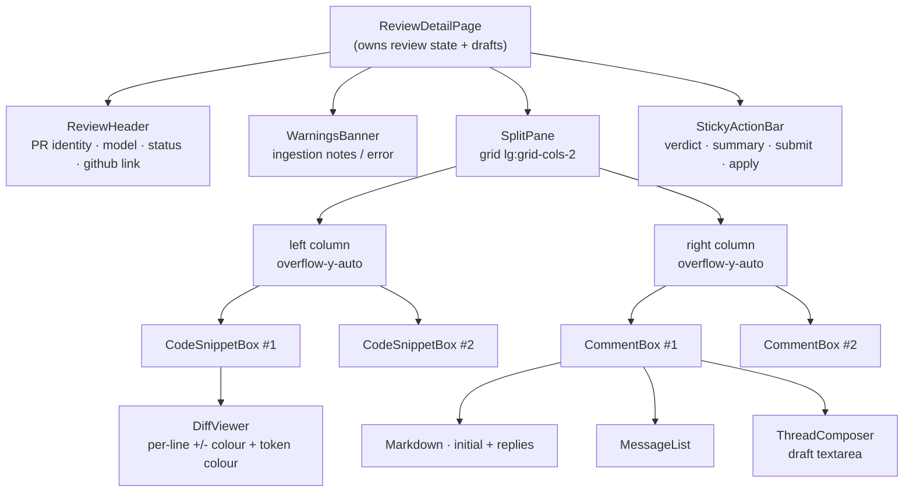
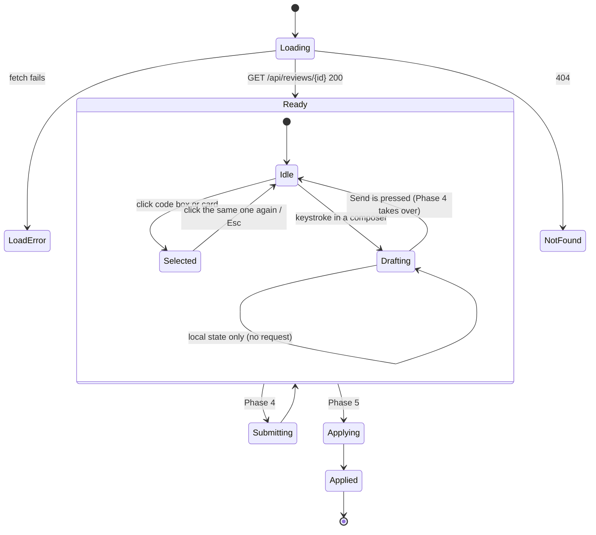
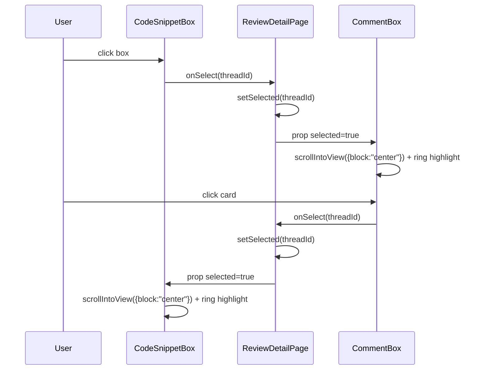

# Phase 3 — Dual-Panel Interactive Workspace UI

## Objective & Scope

Replace the review stub with the working surface the whole product exists for: a 50/50
split-pane page where every AI finding appears twice — as a code box on the left and as a
discussion card on the right — with linked selection, syntax-aware diff rendering, and
draft-only typing that never calls the API.

**In scope**

- `/reviews/:id` data loading with loading, 404, error, and stale-review states.
- Review header: PR title/repo/number, model, HEAD SHA, status badge, GitHub link, created
  time, ingestion warnings.
- Left pane: one code box per thread — file path, line badge, colored unified-diff lines,
  lightweight syntax highlighting, horizontal scroll for long lines.
- Right pane: one comment card per thread — markdown initial comment, full conversation
  history, composer textarea.
- Cross-pane linking: selecting a code box highlights and scrolls to its card (and back),
  each pair carries the same ordinal anchor (`#1`, `#2`…).
- Draft state: per-thread unsent drafts held in React state only; footer shows how many
  threads have unsent text.
- Sticky footer shell with verdict selector + summary box (wired in Phase 5) and Submit
  Responses (wired in Phase 4), both disabled with an explanatory state until then.
- Responsive: two columns ≥1024px, stacked panes below that.
- Empty state when the model found nothing.

**Out of scope**

- Sending drafts anywhere (Phase 4), GitHub submission (Phase 5).
- Editing/removing AI findings, adding new threads manually, resizable panes, collapse-all.
- Virtualised lists — a PR review is tens of threads, not thousands.

## High-Level Design

### Component hierarchy



### State flow



Selection is a single `selectedThreadId: number | null` on the page, shared by both panes;
drafts live in `Record<number, string>` keyed by thread id. Neither is persisted — a reload
discards unsent text by design, because the server is the source of truth for conversations.

### Scroll / selection contract



## API Contracts & Data Schemas

Phase 3 adds no endpoints. It consumes `GET /api/reviews/{id}`:

```json
{
  "id": 7, "pr_url": "…", "pr_title": "Harden JWT verification", "pr_number": 123,
  "repo_full_name": "owner/repo", "commit_id": "9f1c…", "model_used": "ollama:qwen2.5-coder:14b",
  "status": "draft", "verdict": null, "error": null, "notes": "Skipped 2 generated files",
  "github_review_url": null, "thread_count": 2,
  "threads": [ { "id": 21, "file_path": "src/services/auth.py", "line_number": 42,
                 "diff_hunk": "@@ -40,7 +40,7 @@ …", "side": "RIGHT",
                 "messages": [ {"id": 55, "role": "assistant", "content": "**Critical** — …"} ] } ]
}
```

### Component contracts

| Component | Props | Behaviour |
|---|---|---|
| `DiffViewer` | `{ hunk: string; filePath: string }` | Splits on newlines; classifies `@@` header, `+`, `-`, context; tokenises strings/comments/keywords/numbers per line; renders gutters |
| `CodeSnippetBox` | `{ index, thread, selected, onSelect }` | Sticky file header with path + `L{line}` badge + ordinal; body is `DiffViewer`; ring when selected |
| `CommentBox` | `{ index, thread, selected, onSelect, draft, onDraftChange, disabled }` | Markdown comment history, composer, footer hint; ring when selected; scrolls into view on selection |
| `SplitPane` | `{ left, right }` | `grid min-h-0 flex-1 lg:grid-cols-2` with independent scroll areas and a divider |
| `ReviewHeader` | `{ review }` | Identity, status badge, model, SHA (short), external link |
| `StickyActionBar` | `{ pendingCount, verdict, onVerdict, summary, onSummary, onSubmit, onApply, busy, disabledReason }` | Sticky bottom bar, always visible |

## Target File Map

### Frontend — new

| File | Responsibility |
|---|---|
| `src/components/DiffViewer.tsx` | diff line classification + token highlighting |
| `src/components/CodeSnippetBox.tsx` | left-pane code card |
| `src/components/CommentBox.tsx` | right-pane discussion card with composer |
| `src/components/SplitPane.tsx` | layout primitive with independent scroll |
| `src/components/ReviewHeader.tsx` | review identity header |
| `src/components/StickyActionBar.tsx` | verdict/summary/submit/apply shell |
| `src/components/WarningsBanner.tsx` | notes and hard-error rendering |
| `src/hooks/useReviewDrafts.ts` | draft map + pending count + clear |

### Frontend — modified

| File | Change |
|---|---|
| `src/pages/ReviewDetailPage.tsx` | full workspace: fetch, select, drafts, panes, footer |
| `src/lib/utils.ts` | `shortSha`, `shortPath` helpers |
| `src/index.css` | diff gutter/code-line styles, thin scrollbars |

## Step-by-Step Implementation Steps

1. `useReviewDrafts` hook: `drafts`, `setDraft(id, text)`, `clearDrafts(ids)`, `pendingIds`.
2. `DiffViewer`: line classification, `@@` header row, token spans, line numbers carried from
   the hunk where present; graceful fallback when the hunk has no numbers.
3. `SplitPane`, `CodeSnippetBox` (sticky header, ordinal badge, selected ring, click).
4. `CommentBox`: markdown history via `react-markdown` + `remark-gfm`, role styling, composer
   with ⌘/Ctrl+Enter, textarea grows, selection ring + `scrollIntoView`.
5. `ReviewHeader`, `WarningsBanner`, `StickyActionBar` (buttons disabled with a reason tooltip
   until Phases 4/5 wire them).
6. `ReviewDetailPage`: fetch + error states, selected id, drafts, keyboard Escape to clear
   selection, empty state, refresh button.
7. Responsive pass and a visual check in the browser at 1440px and 900px widths.

## Verification & Acceptance Criteria

1. `npm run build` passes with no TypeScript errors.
2. Loading `/reviews/{id}` for a seeded review renders exactly one code box and one comment
   card per thread, in the same order, with matching ordinals.
3. Clicking the 3rd code box scrolls the right pane to the 3rd card and both show a ring;
   clicking the 3rd card does the reverse.
4. Typing in a composer updates only React state: no network request is issued while typing
   (verified in the browser network panel), and the footer shows "N unsent".
5. Every `diff_hunk` line appears with the correct `+`/`-`/context styling; `@@` rows render
   as dim headers, not as code.
6. A review with `threads: []` shows the "no findings" empty state instead of an empty grid.
7. A review id that does not exist shows a 404 message with a link back to Reviews.
8. Layout is two columns at ≥1024px and stacked at phone width, with each pane scrolling
   independently.
