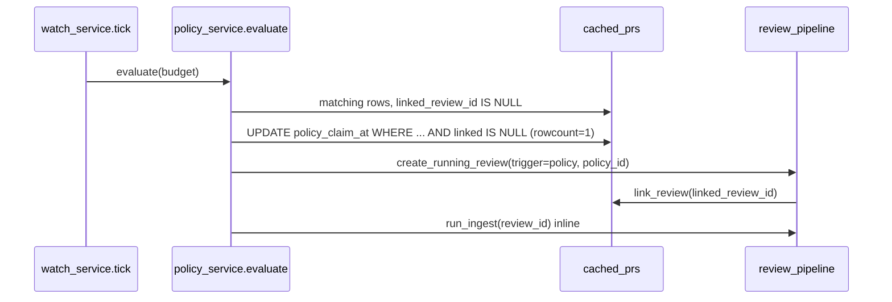

# Phase 40 — Standing review policies on the inbox

## Summary (plain language)

A policy says "review every PR in this repo that is waiting on me, with this model and this
foundation, at most N at a time". It runs on the tick the watch loop already uses, against the
inbox cache, so the first review of a PR no longer needs a human to notice the row and click.
What it deliberately is not: a webhook, an email notifier, a second scheduler, an auto-watch, or a
hard spend block.

## 1. Objective & Scope

**In scope** (initiative 8)

- `review_policies`: one row per standing instruction — repo glob, involvement, model, foundation,
  `max_active`, enabled.
- `code_reviews.policy_id` and `trigger='policy'`, so a review can say it was started
  automatically and the per-policy concurrency cap is a real count rather than a guess.
- `cached_prs.policy_claim_at`: a compare-and-set claim per PR row, taken in the same short
  transaction as the review insert, so two ticks cannot start two reviews for one PR.
- Evaluation on the existing ticks: `watch_service.tick` calls `policy_service.evaluate` after the
  watches; the serverless `POST /api/watches/tick` therefore evaluates policies too, with no new
  endpoint and no second scheduler.
- A `GET/POST/PATCH/DELETE /api/policies` CRUD surface and a Settings panel.

**Out of scope**

- **Auto-created watches.** Decision: a policy starts the review but does **not** create a watch.
  A watch keeps spending on every later push and is not bounded by `max_active`, which is the only
  spend control this phase adds; the workspace's existing one-click watch is the deliberate second
  step. Stated here because the initiative asked the plan to decide.
- GitLab: the inbox cache is GitHub-only, so policies are GitHub-only in v1. A policy that tries a
  GitLab URL cannot arise (rows come from the cache).
- A hard monthly ceiling. The phase 22 ledger's soft budget warns; nothing blocks.
- Notifications beyond the review card's `trigger` badge.
- `involvement="any"` is supported, but the Settings form defaults to one explicit repo and a
  reviewer/assignee choice.

## 2. High-Level Design



`max_active` counts that policy's reviews in `running | draft | in_discussion`. The claim is the
same pattern as a watch's `last_seen_commit_id` claim: one compare-and-set, checked by rowcount,
with a stale window (`policy_claim_stale_minutes`) so a crashed tick cannot park a PR forever.

## 3. API Contracts & Schema

Alembic `0020_review_policies`:

| table / column | type | notes |
|---|---|---|
| `review_policies.id` | int PK | |
| `review_policies.user_id` | FK users CASCADE, index | owner; another account's policy is a 404 |
| `review_policies.repo_pattern` | Text | `fnmatch` glob on `owner/repo`, case-insensitive |
| `review_policies.involvement` | String(24) default `reviewer` | `reviewer｜assignee｜author｜any` |
| `review_policies.model_used` | Text NULL | resolved at creation; NULL = active key's default is **not** allowed — the route requires it |
| `review_policies.skill_foundation` | Text NULL | defaults to the built-in foundation at creation |
| `review_policies.max_active` | Integer default 1 | concurrent non-terminal reviews |
| `review_policies.enabled` | Boolean default true | |
| `review_policies.last_run_at` | DateTime NULL | tick ordering |
| `review_policies.last_error` | Text NULL | first line only |
| `code_reviews.policy_id` | FK `review_policies` SET NULL, index | attribution + cap count |
| `cached_prs.policy_claim_at` | DateTime NULL | the claim marker |

PII: none of these are personal data. `repo_pattern` is a repository name; `last_error` is a first
line that never contains a prompt, diff or credential (same rule as a watch).

Endpoints (all owner-scoped, `/api/policies`):

```json
POST /api/policies
{"repo_pattern": "octo/example", "involvement": "reviewer",
 "model": "ollama-local:llama3", "skill_foundation": "code-review",
 "max_active": 1, "enabled": true}

201 {"id": 3, "repo_pattern": "octo/example", "involvement": "reviewer",
     "model_used": "ollama-local:llama3", "skill_foundation": "code-review",
     "max_active": 1, "enabled": true, "last_run_at": null, "last_error": null,
     "created_at": "…"}

PATCH /api/policies/3   (any subset of the create fields)
DELETE /api/policies/3  → 204
```

Errors: unknown/invalid model `422`, missing foundation `404`, unknown policy or another
account's policy `404`, invalid involvement `422`.

`POST /api/watches/tick` response gains `policy_started: [ids]`, `policy_skipped: n`,
`policy_failed: [{policy_id, error}]`.

## 4. Target File Map

- **New** `backend/app/models/policy.py`, `services/policy_service.py`, `api/routes/policies.py`,
  `schemas/policy.py`, `alembic/versions/0020_review_policies.py`.
- **Changed** `models/review.py` (`policy_id`), `models/watch.py` (`ReviewTrigger.POLICY`),
  `models/cached_pr.py` (`policy_claim_at`), `models/__init__.py`.
- **Changed** `review_pipeline.create_running_review` (`policy_id`).
- **Changed** `watch_service.tick` (policy evaluation + result fields), `schemas/watch.py`,
  `api/router.py`, `core/config.py`.
- **Changed** `frontend/src/types/index.ts`, `services/api.ts`, `components/PoliciesPanel.tsx`
  (new), `pages/SettingsPage.tsx`, dashboard trigger badge.
- **New** `backend/tests/test_policies.py`, **changed** `tests/conftest.py` reset list,
  `tests/test_watches_api.py` tick shape.
- **Left alone** `github_inbox_service` (policies read the cache), `review_pipeline.execute`.

## 5. Ordered Steps

1. Plan (this file), migration `0020`, models, `ReviewTrigger.POLICY`, reset fixture.
2. `policy_service`: CRUD + `evaluate`; claim → create → link → inline ingest; per-policy error.
3. `create_running_review(..., policy_id=...)`; tick integration + schema/config.
4. Routes + router mount.
5. Frontend: policy CRUD panel on Settings, trigger badge on review cards, watch tick types.
6. Tests: match/non-match, linked row untouched, `max_active=1` with two matches starts one,
   two sequential ticks start one review, disabled policy does nothing, ownership 404, bad model
   422, claim is cleared when creation fails.
7. Docs: rules roster, README, CHANGELOG, INITIATIVES.

## 6. Verification

- `pytest -q` green with `test_policies.py`.
- A cached `needs_review` row matching `octo/*` gets exactly one review with
  `trigger="policy"`, `policy_id` set, and the cached row's `linked_review_id` pointing at it; a
  second tick starts nothing.
- A row for another repo, a linked row, and a disabled policy each produce zero reviews.
- `max_active=1` with two matching rows starts one per tick.
- The tick response reports `policy_started`; serverless mode still has no loop (unchanged).
- `alembic upgrade head` / `downgrade -1` round-trip on scratch SQLite; one head.
- `npm run build` green.

## 7. Execution record

Executed 2026-11-12.

- Migration `0020_review_policies` round-tripped on scratch SQLite; one head (`0021`).
- `pytest -q`: 381 passed, including 11 in `test_policies.py`: a matching cached row starts exactly
  one review (`trigger='policy'`, `policy_id`, cached row linked); a second tick starts none; a
  non-matching repo, a linked row, an `approved` row, a disabled policy and a filtered involvement
  each start none; `max_active=1` starts one and queues the other until the first becomes
  terminal; a failed creation releases `policy_claim_at` and records the first error line; another
  account's policy is a `404`; unknown model/involvement is `422`; the public tick endpoint reports
  `policy_started`.
- The tick response gained `policy_started`/`policy_skipped`/`policy_failed`, and the existing
  exact-shape tick test was updated in the same change.
- Live UI: `PoliciesPanel` listed the seeded `octo/example` policy with its model, foundation and
  cap; creating `other/lib` added a row and the trash control removed it (both re-read from the
  API). No review was started from the UI during verification (that would have reached GitHub).
