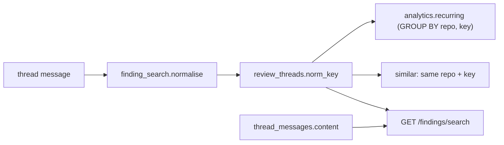

# Phase 41 — Cross-review finding search and recurring issues

## Summary (plain language)

Every AI finding now carries a normalised key, so the tool can answer "have we flagged this
before?". A search box on the dashboard finds findings across reviews by words, repository, path
or date; opening a finding shows prior matches in the same repository ("same pattern as review #8,
thread #3 — accepted then"); Analytics gains a "top recurring findings" panel, grouped by
repository and key. What it deliberately is not: a full-text engine with stemming and ranking, an
LLM "duplicate detector", a claim that a match *is* the same bug, or a prompt input — the index
never leaves the database.

## 1. Objective & Scope

**In scope** (initiative 9)

- `review_threads.norm_key` (`String(255)`, indexed, nullable): a severity-stripped, lower-cased,
  12-word key computed by one function at ingest. Indexed for equality ("seen before") and prefix
  match (search).
- A backfill of existing AI threads in the revision's `upgrade()`, using a copy of the same
  normaliser (a migration may not import application code that can change under it).
- `GET /api/findings/search?q=&repo=&path=&since=&limit=`: owner-scoped search over the normalised
  key plus the assistant message text.
- `GET /api/findings/similar/{review_id}/{thread_id}`: prior threads in the same repository with
  the same key, each with an `accepted` flag read from its rounds. (The plan originally sketched
  this under `/reviews/...`; the findings router keeps every read of the index in one module.)
- `GET /api/analytics` gains `recurring`: repository + normalised key, distinct reviews, findings,
  last seen — grouped in SQL, only keys seen in more than one review.
- Dashboard search panel, workspace "seen before" panel, Analytics recurring panel.

**Out of scope**

- **SQLite FTS5 / PostgreSQL `tsvector`.** The plan chooses the lowest common denominator — a
  stored normalised key plus `LIKE` — because the two engines tokenise and rank differently and a
  single portable index is worth more here than stemming. The corpus is one reviewer's history, not
  a search engine; the cost is that a reworded finding only matches if its first twelve normalised
  words agree.
- Fuzzy matching, embeddings, or a model call to decide similarity.
- Searching review-level prose (summaries, verdict notes) or external GitHub comments.
- Index text in any prompt. Search is a database read.
- A repository selector built from filtered results (the options come from the unfiltered list).

## 2. High-Level Design



## 3. API Contracts & Schema

Alembic `0021_thread_norm_key`:

| column | type | notes |
|---|---|---|
| `review_threads.norm_key` | `String(255)` NULL, indexed | normalised finding key; PII: not personal data (source code prose, never a prompt) |

Backfill: one pass over existing `AI_GENERATED`/`CHECK` threads' first assistant message, updating
`norm_key`; threads without an assistant message stay NULL. `downgrade()` drops index and column.

```json
GET /api/findings/search?q=unbounded+query&repo=octo/example&since=2026-01-01&limit=20

{"items": [{
  "review_id": 8, "thread_id": 31, "repo_full_name": "octo/example",
  "file_path": "src/auth.py", "line_number": 11, "origin": "AI_GENERATED",
  "snippet": "High — the query is unbounded…", "accepted": true,
  "created_at": "2026-11-02T09:00:00Z"
}], "total": 1}
```

`GET /api/findings/similar/{review_id}/{thread_id}` → `{"items": [...same shape...]}` (no `total`;
the limit is 5). Errors: unknown review/thread or another account's row `404`; a request with no
filter at all `422` ("add a search term or a repository").

`GET /api/analytics?days=90` gains:

```json
"recurring": [{"repo_full_name": "octo/example", "key": "high the query is unbounded",
               "reviews": 5, "findings": 12, "last_seen": "2026-11-02T09:00:00Z"}]
```

## 4. Target File Map

- **New** `backend/app/services/finding_search.py`, `backend/app/api/routes/findings.py`,
  `backend/app/schemas/findings.py`, `backend/alembic/versions/0021_thread_norm_key.py`.
- **Changed** `backend/app/models/review.py` (`norm_key`), `review_pipeline.py` (set it),
  `schemas/analytics.py` + `services/analytics.py` (recurring), `api/router.py` (mount).
- **Changed** `frontend/src/types/index.ts`, `services/api.ts`,
  `components/FindingSearch.tsx` (new), `components/SeenBefore.tsx` (new),
  `pages/DashboardPage.tsx`, `pages/ReviewDetailPage.tsx`, `pages/AnalyticsPage.tsx`.
- **New** `backend/tests/test_finding_search.py`.
- **Left alone** apply/discussion/publishing, watches, policies.

## 5. Ordered Steps

1. Plan + migration + model column; backfill helper inside the revision.
2. `finding_search`: `normalise`, `search`, `similar`, `recurring`; schemas.
3. Pipeline: compute `norm_key` on every persisted AI/CHECK thread.
4. Routes + analytics field; ownership first (`404`, never `403`).
5. Tests: same text in two reviews in one repo links; another repo only surfaces when `repo` is
   unset; a reworded title sharing the normalised key matches; another account is a 404; `upgrade`
   backfills an existing row; recurring groups in SQL.
6. Frontend panels.
7. Docs.

## 6. Verification

- `pytest -q` green with `test_finding_search.py`.
- Two reviews in `octo/example` with the same finding text: search by three words returns both;
  `similar` on one returns the other with `accepted=true` after its round is accepted; the same
  text in `other/lib` is absent from the repo-scoped response.
- `alembic upgrade head` + `downgrade -1` on scratch SQLite; the upgrade backfills a thread inserted
  before it (verified by a temp table/row in the round-trip test); one head.
- `npm run build` green; the dashboard search returns linked rows, and Analytics renders the
  recurring panel from a fixture response.

## 7. Execution record

Executed 2026-11-12.

- Migration `0021_thread_norm_key` round-tripped on scratch SQLite, and the backfill was exercised
  with real data: a thread inserted with `norm_key = NULL`, then `downgrade -1` → `upgrade head`,
  came back with `the query is unbounded` read from its first assistant message.
- `pytest -q`: 381 passed, including 8 in `test_finding_search.py`: normalisation; two reviews in
  one repo both match; `repo=` scopes and unset `repo` widens; path-only and empty-request (`422`)
  behaviour; `similar` returns the prior thread with `accepted=true`; another account is `404`;
  recurring groups by repo+key (`2 reviews, 2 findings`); the pipeline writes the key for a new
  finding.
- Live run: dashboard search for "unbounded query" returned `2 matches` linking reviews #1 and #2;
  selecting finding #1 in review #1 rendered "Seen before in this repository — Review #2 ·
  src/services/auth.py:13"; Analytics rendered "octo/example · unbounded query · 2 reviews · 2
  findings".
- Deviation recorded above: the similar endpoint lives at `/api/findings/similar/...`.
