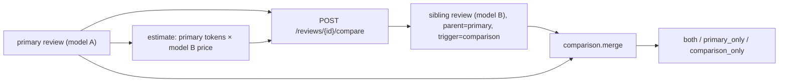

# Phase 42 — Side-by-side model comparison

## Summary (plain language)

Any review can be re-run against a second model with one button, priced before it starts. The two
results are then shown as one merge view — findings both models raised, and findings only one of
them did — so "which model is better on this diff?" stops being folklore. What it deliberately is
not: a benchmark, a winner-from-one-PR claim, a second review you can publish (the primary review
still owns apply), or a stored copy of the diff.

## 1. Objective & Scope

**In scope** (initiative 10)

- `POST /api/reviews/{id}/compare` with `{model}`: creates a sibling review of the same PR with
  `parent_review_id` = the primary, `trigger="comparison"`, the primary's foundation and
  `commit_id`. Ingest runs like any other review; both runs write `llm_calls` under their own model.
- `GET /api/reviews/{id}/comparison/estimate?model=`: the estimated cost of the second run, from
  the primary's measured token counts and the phase 22 price table, labelled as an estimate.
- `GET /api/reviews/{id}/comparison`: the merge view for either side of the pair — `both`,
  `primary_only`, `comparison_only`, each item carrying its review id, thread id and provenance.
- Matching is `(path, ±2 lines)` plus the phase 41 normalised key when available (or the same line
  when not). The tolerance is a small window, chosen in this plan, because two models anchor the
  same defect at neighbouring lines.
- An apply guard: a comparison review cannot publish (`409`). Discussion and apply flow through the
  primary review, as the initiative requires.
- UI: a "Compare with…" control under the review header (model picker, estimate, start) and a merge
  panel when the review is one side of a comparison.

**Out of scope**

- Re-fetching the diff at the pinned commit. The diff endpoint returns the PR's current head; the
  review stores the primary's `commit_id` and the pipeline **keeps** it, warning when the head has
  moved, so anchors stay comparable but the fetched text may be newer. Storing diffs is a larger
  change (size, retention, privacy) and is not attempted here.
- A comparison checkbox in the inbox picker (the workspace button is enough for v1).
- Any "winner" copy, statistical claim, or automatic model recommendation.
- Importing GitHub comments into the comparison review: it is findings-only, so the second run
  does not duplicate the PR's threads or spend a comments call.
- Publishing from the comparison review.

## 2. High-Level Design



## 3. API Contracts & Schema

**No Alembic revision.** The phase 27 columns are reused: `parent_review_id`, `trigger`, and
`commit_id`. `ReviewTrigger` gains `COMPARISON` (a Python constant on a `String(16)` column).

```json
POST /api/reviews/8/compare   {"model": "ollama-cloud:deepseek-v4-pro"}
202 {"id": 9, "status": "running", "skill_foundation": "code-review"}

GET /api/reviews/8/comparison/estimate?model=ollama-cloud:deepseek-v4-pro
{"model": "ollama-cloud:deepseek-v4-pro", "prompt_tokens": 1200, "completion_tokens": 300,
 "estimated_cost_usd": 0.002, "note": "Estimated from review #8's measured usage."}

GET /api/reviews/9/comparison
{"primary": {"id": 8, "model_used": "ollama-local:llama3", "thread_count": 4},
 "comparison": {"id": 9, "model_used": "ollama-cloud:deepseek-v4-pro", "thread_count": 3},
 "both": [{"primary_thread_id": 31, "comparison_thread_id": 44,
           "file_path": "src/auth.py", "primary_line": 11, "comparison_line": 12,
           "snippet": "High — the query is unbounded"}],
 "primary_only": [{"review_id": 8, "thread_id": 32, "file_path": "src/api.py",
                   "line_number": 40, "origin": "AI_GENERATED", "snippet": "…"}],
 "comparison_only": [{"review_id": 9, "thread_id": 45, "file_path": "src/api.py",
                      "line_number": 41, "origin": "AI_GENERATED", "snippet": "…"}],
 "line_tolerance": 2}
```

Errors: unknown primary/model `404`/`422`, primary still `running` `409`, no comparison exists
`404`, comparison apply `409`, another account's review `404`.

## 4. Target File Map

- **New** `backend/app/services/comparison.py`, `backend/app/schemas/comparison.py`,
  `backend/tests/test_comparison.py`.
- **Changed** `backend/app/api/routes/reviews.py` (compare, estimate, merge routes),
  `backend/app/models/watch.py` (`COMPARISON`), `review_pipeline.execute` (pin the commit, skip
  comment import), `apply_service.apply_review` (409 guard).
- **Changed** `frontend/src/types/index.ts`, `services/api.ts`, new
  `components/ComparisonPanel.tsx`, `pages/ReviewDetailPage.tsx`.
- **Left alone** the ledger, pricing, dashboard, watches, policies, search.

## 5. Ordered Steps

1. Plan, `ReviewTrigger.COMPARISON`, pipeline pin/skip, apply guard.
2. `comparison.py`: `merge`, `find_pair`, `estimate`; schemas.
3. Routes: `POST /{id}/compare`, `GET /{id}/comparison`, `GET /{id}/comparison/estimate`.
4. Tests: disjoint findings → three buckets; a shared finding at ±2 lines merges into `both`;
   both reviews appear in `llm_calls` with their models (stubbed adapters); the sibling links to
   the primary; apply on the sibling is `409`; estimate uses the primary's tokens and the target
   price; ownership 404.
5. Frontend: compare control + merge panel.
6. Docs.

## 6. Verification

- `pytest -q` green with `test_comparison.py`.
- Two stubbed model outputs over one diff produce `both`/`primary_only`/`comparison_only` counts
  that match the fixtures; a finding at `line 11` and `line 13` with the same key lands in `both`.
- The sibling row has `parent_review_id`, `trigger="comparison"`, the same `commit_id`; both
  reviews have `llm_calls` rows naming their model.
- `POST /api/reviews/{sibling}/apply` is `409`.
- `npm run build` green; the merge panel renders three labelled buckets and the estimate before
  starting.
- No migration added: `alembic heads` still prints `0021`.

## 7. Execution record

Executed 2026-11-12.

- No migration; `alembic heads` stayed `0021`.
- `pytest -q`: 381 passed, including 6 in `test_comparison.py`: a shared finding at lines 11/13
  lands in `both` while distinct neighbours split into `primary_only`/`comparison_only`; the same
  line without a shared key still merges; no comparison is a `404`; the estimate uses the primary's
  measured tokens and the price table (1000/500 tokens on `deepseek-v4-pro` → `$0.0033`); unknown
  model is `422`; `POST /compare` creates a sibling with the parent, trigger and pinned commit, and
  apply on it is `409`; a real ingest of both reviews (provider adapter stubbed, so the wrapper and
  ledger run) writes one `llm_calls` row per review naming `llama3`.
- Live run: review #2 (the comparison) rendered one `both` match at 11/13, two `primary_only` and
  one `comparison_only`; review #3 offered "Compare with…" with "~$0.00 · 11k est. tokens" and the
  note "Estimated from review #3's measured usage (11,000 tokens) at list prices."; the comparison
  review had no apply bar.
