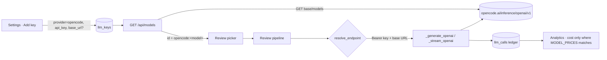

# Phase 43 — OpenCode as a model provider

## Objective & Scope

**In.** Add `opencode` as a fifth model provider, next to `claude`, `openai`, `ollama-cloud` and
`ollama-local`. A stored key's provider id is `opencode`; a model id is `opencode:<model>`; calls use
the OpenAI Chat Completions transport against `https://opencode.ai/inference/openai/v1` with a
`Bearer` API key. The Settings provider picker, the model catalog and the review picker offer it
alongside the existing providers, and the key Test button probes it.

Why one transport and not four: OpenCode Console serves OpenAI, Anthropic and Gemini shapes from
`https://opencode.ai/inference`, and its own docs state every text model also works through the other
APIs, which Console translates. Reusing the existing OpenAI adapter keeps the change to a dispatch
branch instead of a fourth adapter.

**Out.** A separate Anthropic-shaped or Gemini-shaped OpenCode transport; the Responses API
(`/inference/openai/v1/responses`); OIDC/service-account auth (a static key only); per-model price
entries invented for OpenCode; retrying a call with `max_completion_tokens` when a model rejects
`max_tokens`; OpenCode Go as a distinct provider id (the base URL is editable, so
`https://opencode.ai/inference/go/openai/v1` works without a new id).

**Assumption.** "OpenCode API" means the OpenCode Console / Zen inference API (an API key from
`https://opencode.ai/console`), not the local OpenCode CLI process.

## High-Level Design



Provider identity stays a prefix rule: `opencode:` in a model id, `opencode` in `llm_keys.provider`.
The two are tied by `llm_service.DB_PROVIDER`, exactly like `ollama-cloud` ↔ `ollama_cloud`.

## API Contracts & Schema

No Alembic revision. `llm_keys.provider` is `String(16)`, `opencode` is 8 characters, and existing
rows are untouched — `alembic_version` stays at head.

```http
POST /api/keys/llm
{"provider": "opencode", "api_key": "oc_...", "base_url": null, "default_model": "kimi-k2.6"}
→ 201 {"id": 4, "provider": "opencode", "base_url": null, "default_model": "kimi-k2.6",
       "api_key_masked": "oc_••••••••cd12", "is_active": false}
```

```json
GET /api/models
{"models": [
   {"id": "opencode:kimi-k2.6", "label": "kimi-k2.6", "provider": "opencode",
    "available": true, "note": "OpenCode"}],
 "preferred": null, "skills": ["code-review"]}
```

An invalid or unreachable key does not hide the entry: the same ids come back with
`available: false` and the reason as `note` (`"OpenCode rejected the API key"`), which is what the
picker shows instead of a silent empty list.

```http
POST /api/reviews
{"pr_url": "https://github.com/acme/web/pull/7", "model": "opencode:kimi-k2.6"}

POST /api/keys/llm/4/test
→ {"ok": true, "detail": "85 model(s) available", "metadata": {"models": ["..."]}}
```

Outbound call shape (unchanged adapter):

```http
POST https://opencode.ai/inference/openai/v1/chat/completions
Authorization: Bearer <key>
{"model": "kimi-k2.6", "temperature": 0, "max_tokens": 4096,
 "messages": [{"role": "system", "content": "..."}, {"role": "user", "content": "..."}]}
```

Model discovery is the key probe: `GET https://opencode.ai/inference/openai/v1/models` with the
bearer key — verified live (2026-11-12: HTTP 200 and 85 models with a valid key, HTTP 401 with a
bogus one, so the catalogue is not public). The probe therefore doubles as the listing: it reports
the models *and* why they are missing. With no models and no `default_model` the catalog offers the
static `OPENCODE_FALLBACK` pair, marked unavailable, so the reason stays visible.

## Target File Map

New:
- `backend/tests/test_opencode_transport.py` — parse/resolve/catalog/generate/stream/probe tests.
- `docs/plans/phase_43_plan.md` — this file.

Changed:
- `backend/app/models/keys.py` — `LLM_OPENCODE`, added to `LLM_PROVIDERS` and `LLM_DEFAULT_BASE_URLS`.
- `backend/app/schemas/keys.py` — `LLMProvider` literal gains `opencode`.
- `backend/app/services/llm_service.py` — `OPENCODE` constant, `MODEL_PROVIDERS`, `DB_PROVIDER`,
  `MODEL_ID_HINT`, `OPENCODE_FALLBACK`, `resolve_endpoint`, `generate`/`stream` dispatch,
  provider/label parameters on `_generate_openai`/`_stream_openai`/`probe_openai`.
- `backend/app/api/routes/models.py` — catalog branch for `opencode`, built from the probe.
- `backend/app/services/keys_service.py` — missing-key label, `test_llm` branch, docstring.
- `backend/app/models/llm_call.py` — provider-prefix comment.
- `backend/rules/providers-and-keys.md` — provider id roster.
- `frontend/src/types/index.ts` — `LLMProvider` and `ModelOption["provider"]` unions.
- `frontend/src/components/KeyManager.tsx` — option, badge label, key/base-URL placeholders.
- `frontend/src/components/StartReviewModal.tsx`, `NewReviewPanel.tsx` — provider label.
- `frontend/src/pages/SettingsPage.tsx` — section description names OpenCode.
- `README.md`, `CHANGELOG.md` — provider list.

Left alone: `llm_calls`/`analytics` (no schema change), `core/pricing.py` (OpenCode ids that already
exist in the table get an estimate; the rest stay `NULL`), ingest/publish/watch flows.

## Ordered Steps

1. Backend identity: constants, provider roster, base-URL default, schema literal.
2. Adapters: `resolve_endpoint` branch; label-parameterise the OpenAI blocking/streaming adapters and
   the probe; add the fallback parameter to `list_openai_models`.
3. Dispatch: `generate`/`stream` route `opencode` to the OpenAI adapters and record provider
   `opencode` in the ledger.
4. Catalog + probe: `/api/models` branch, `keys_service.test_llm` branch, missing-key copy.
5. Frontend: unions, provider option, labels, placeholders, Settings copy.
6. Tests: `backend/tests/test_opencode_transport.py`.
7. Docs: rules, README, CHANGELOG.

## Verification

- `cd backend && pytest -q` — 396 passed, including the new file:
  - `parse_model_id("opencode:kimi-k2.6")` resolves, `opencode:` alone is rejected.
  - `resolve_endpoint` returns the OpenCode base URL + `Authorization: Bearer ...`, honours a
    per-key base URL (OpenCode Go), and raises `LLMError` with no key.
  - `GET /api/models` with an `opencode` key lists `opencode:<id>` entries (`provider:
    "opencode"`, `available: true`, `note: "OpenCode"`), and a rejected key lists the fallback pair
    with `available: false` plus the probe's reason.
  - Blocking and streaming calls route through the OpenAI adapter and the `llm_calls` row records
    provider `opencode` (httpx `MockTransport`).
  - `POST /api/keys/llm/{id}/test` reports the OpenCode probe result, key masked unless revealed.
- Live evidence (scratch SQLite DB, throwaway server on 127.0.0.1:8291):
  - `GET /api/models` against the real OpenCode endpoint with a bogus key → two `opencode:` entries
    with `available: false`, `note: "OpenCode rejected the API key"`; `POST /api/keys/llm/1/test` →
    `{"ok": false, "detail": "OpenCode rejected the API key"}`.
  - With the key's base URL pointed at a local stand-in for the inference API, the same catalog
    listed both models `available: true`, and `llm_service.generate` returned provider `opencode`,
    1200/34 tokens, with an `llm_calls` row `opencode / kimi-k2.6 / ingest / ok`.
- `cd frontend && npm run build` — `tsc -b` green with the widened unions.
- No schema change: `alembic_version` unchanged; no migration file added.
