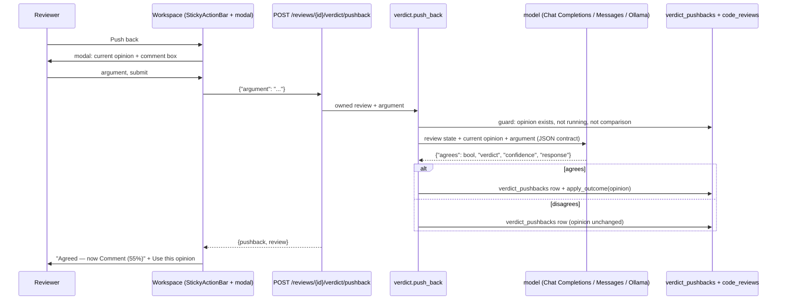

# Phase 44 — Push back on the AI verdict, and let it re-evaluate

## Objective & Scope

**In.** A "Push back" action beside the AI opinion in the review action bar. It opens a modal with a
comment box: the reviewer writes why they disagree with the suggested verdict, the model re-reads
the review state plus that argument, and answers whether it agrees. An agreeing answer replaces
`suggested_verdict` / `confidence_percentage` / `suggested_verdict_note`; a disagreeing answer keeps
the opinion and records why. Every exchange is persisted so the modal can show the history and the
loop is auditable.

**Out.** Publishing on the reviewer's behalf (the apply gate is unchanged — the reviewer still picks
and applies the event); writing a skill lesson from a verdict push-back (that stays phase 36's
finding-level, beta-gated flow); re-running ingest or the diff; streaming the re-evaluation (one
blocking call; the modal's spinner covers it); editing or deleting a past push-back.

**Assumption.** "Push back" is the verdict-level equivalent of the existing per-finding `push_back`
round decision: the model is asked to change its mind, not to obey. The reviewer's chosen event for
GitHub remains theirs alone.

## High-Level Design



The call is advisory and total in one direction only: a provider failure writes nothing and leaves
the opinion as it was (502 to the caller), exactly like `verdict.evaluate`'s best-effort pass.

## API Contracts & Schema

### New table `verdict_pushbacks` — Alembic revision `0022`

| column | type | notes |
| --- | --- | --- |
| `id` | `INTEGER` PK | autoincrement |
| `review_id` | `INTEGER` FK `code_reviews.id` ON DELETE CASCADE, indexed | one row per push-back |
| `argument` | `TEXT` NOT NULL | the reviewer's words, ≤ 2000 chars |
| `previous_verdict` | `VARCHAR(32)` NULL | the opinion being contested |
| `previous_confidence` | `INTEGER` NULL | its confidence at that moment |
| `agrees` | `BOOLEAN` NOT NULL | what the model decided |
| `verdict` | `VARCHAR(32)` NOT NULL | the verdict it now proposes |
| `confidence` | `INTEGER` NULL | 0–100 |
| `response` | `TEXT` NOT NULL | its answer, ≤ 600 chars |
| `created_at` | `TIMESTAMPTZ` NOT NULL | |

No backfill: the table starts empty. `alembic upgrade head` / `downgrade -1` both verified on a
scratch database.

### Endpoints

```http
POST /api/reviews/23/verdict/pushback
{"argument": "The migration is additive and the flag is already off in production; a blocked deploy is not justified."}

200
{"pushback": {"id": 1, "argument": "…", "previous_verdict": "REQUEST_CHANGES",
              "previous_confidence": 78, "agrees": true, "verdict": "COMMENT",
              "confidence": 55, "response": "The additive migration… I withdraw the block.",
              "created_at": "2026-11-12T14:02:11Z"},
 "review": {"id": 23, "suggested_verdict": "COMMENT", "confidence_percentage": 55,
            "suggested_verdict_note": "…", "threads": [], "…": "CodeReviewDetail"}}
```

```http
GET /api/reviews/23/verdict/pushbacks
→ [{"id": 1, "agrees": true, "verdict": "COMMENT", "…": "…"}]   # newest first
```

Errors: `404` unknown or another account's review · `409` comparison review, review still
`running`, or no AI opinion recorded yet · `422` blank/over-long argument, missing key for the
review's provider · `502` the provider failed or returned an unparsable answer (nothing written).

Model contract (`prompts.PUSHBACK_CONTRACT`):

```json
{"agrees": true, "verdict": "APPROVE | COMMENT | REQUEST_CHANGES", "confidence": 0,
 "response": "two or three sentences, no markdown"}
```

Ledger: the call records `llm_calls.purpose = "pushback"`, a new `LLMPurpose` value (analytics
zero-fills every purpose from `LLMPurpose.ALL`).

## Target File Map

New:
- `backend/app/models/verdict_pushback.py`
- `backend/alembic/versions/0022_verdict_pushbacks.py`
- `backend/tests/test_verdict_pushback.py`
- `frontend/src/components/VerdictPushBackModal.tsx`
- `docs/plans/phase_44_plan.md` (this file)

Changed:
- `backend/app/models/review.py` — `CodeReview.pushbacks` relationship.
- `backend/app/models/__init__.py`, `backend/app/models/llm_call.py` — export, `LLMPurpose.PUSHBACK`.
- `backend/app/services/prompts.py` — `_review_state_block` extracted from `build_verdict_prompt`,
  `PUSHBACK_CONTRACT`, `build_verdict_pushback_prompt`.
- `backend/app/services/verdict.py` — `VerdictError`, `PushbackOutcome`, `parse_pushback`,
  `push_back`, and a `_ask_document` split so both passes share the credentials/system prompt.
- `backend/app/schemas/review.py` — `VerdictPushbackRequest`, `VerdictPushbackRead`,
  `VerdictPushbackResponse`.
- `backend/app/api/routes/reviews.py` — the two routes.
- `backend/rules/review-flow.md` — the push-back loop in the product contract.
- `frontend/src/types/index.ts`, `frontend/src/services/api.ts` — types and calls.
- `frontend/src/components/StickyActionBar.tsx` — `onPushBack` prop and the button.
- `frontend/src/pages/ReviewDetailPage.tsx` — modal state, refresh, adopt-verdict wiring.
- `README.md`, `CHANGELOG.md` — behaviour.

Left alone: apply/publish, ingest, watches, policies, the finding-level push-back and lesson flow.

## Ordered Steps

1. Schema: model, relationship, exports, revision `0022`.
2. Prompt: extract the shared review-state block, add the push-back contract and builder.
3. Service: parse + `push_back` with its guards, persistence, adopt-on-agreement.
4. Routes + schemas, with `VerdictError` → status mapping.
5. Frontend: types, api, modal, action-bar button, page wiring.
6. Tests: service, route, guards, ownership, ledger purpose, provider failure.
7. Docs: rules, README, CHANGELOG; verify migration up/down on a scratch DB.

## Verification

- `cd backend && pytest -q` — 415 passed, including `tests/test_verdict_pushback.py` (19 cases):
  - an agreeing answer rewrites the opinion and stores `agrees=true`, `previous_verdict`,
    `previous_confidence`, the response and `created_at`;
  - a disagreeing answer leaves `suggested_verdict`, the confidence and the note untouched and stores
    `agrees=false`;
  - `422` on a blank or over-long argument, `409` on comparison / running / no-opinion reviews, `404`
    for another account's review;
  - a provider failure or a wrong-shaped answer is `502`, writes no row and changes no opinion;
  - the ledger gains exactly one `pushback` call for the review;
  - `GET …/verdict/pushbacks` returns newest first, and the prompt carries the opinion, the state,
    the argument and the push-back contract (and not the verdict pass' `rationale` contract).
- Scratch-DB migration check on a throwaway SQLite file: `alembic upgrade head` created
  `verdict_pushbacks` (`0022`, columns id/review_id/argument/previous_* /agrees/verdict/confidence/
  response/created_at), and `alembic downgrade -1` dropped it back to `0021`. The operator's database
  was not touched.
- `cd frontend && npm run build` — `tsc -b` + vite green.
- Real run: throwaway server on 127.0.0.1:8291 over a scratch SQLite DB, with Ollama replaced by a
  local HTTP stub. `POST /api/reviews/1/verdict/pushback` returned `200`; `GET /api/reviews/1` then
  reported `suggested_verdict: COMMENT`, `confidence_percentage: 55` and the model's note;
  `GET …/verdict/pushbacks` returned the one row
  (`agrees true`, `REQUEST_CHANGES → COMMENT`, 55); `llm_calls` recorded
  `pushback / ollama-local / llama3 / ok / 1490 tokens`. A blank argument returned `422`.
