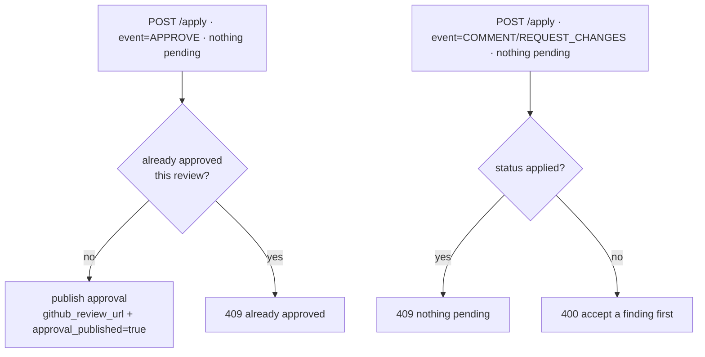

# Phase 45 — Approving a review that already published something

## Objective & Scope

**In.** Let an applied review publish a **bare approval** when it has not approved this pull request
yet. Review 23 is the case: it went out as a `COMMENT` review at 13:28, the discussion later moved
the AI opinion to `APPROVE` (two push-backs at 21:59), and the reviewer cannot send the approval
because phase 23 treats `status = applied` as "nothing left to publish".

The rule becomes: **an approval is a state change on the pull request, not pending content**, so it is
blocked only when this review has already approved that PR — never merely because findings went out
before.

**Out.** Publishing on the reviewer's behalf, a "reopen" that rewinds `applied`, approving a
*comparison* review (still read-only), GitLab approval semantics beyond recording that an approval was
attempted (it stays best-effort), and any change to how findings or replies are published.

**Assumption.** A PR can carry several reviews from the same account, and approving after commenting
is legitimate — GitHub allows it, and this is exactly what the reviewer asked for.

## High-Level Design



`approval_published` is new state on `code_reviews`, because `verdict` alone cannot answer the
question: `verdict` records the event of the **last apply**, and a replies-only apply sets it without
publishing any review. The column records that this row put an approving review on the pull request.

## API Contracts & Schema

### `code_reviews.approval_published` — Alembic revision `0023`

| column | type | notes |
| --- | --- | --- |
| `approval_published` | `BOOLEAN NOT NULL DEFAULT false` | set when this review's publish call carried `event = APPROVE` |

Backfill: rows that already carry the phase-23 empty-approval signature — `github_review_url` set,
`verdict = 'APPROVE'`, and no published AI round 1 — are marked `true`. That is the only shape the
old code could have approved in, so no other row is guessed at. `alembic upgrade head` /
`downgrade -1` verified on a scratch database.

### Behaviour

```http
POST /api/reviews/23/apply {"event": "APPROVE"}      # status applied, verdict COMMENT, nothing pending
→ 200 {"review": {"status": "applied", "verdict": "APPROVE", "approval_published": true},
       "comments_posted": 0, "replies_posted": 0}
```

| case | before | after |
| --- | --- | --- |
| `APPROVE`, nothing pending, review not applied | `200` | `200` (unchanged) |
| `APPROVE`, nothing pending, applied by findings | `409` | `200` — the fix |
| `APPROVE`, nothing pending, **already approved** | `409` | `409`, "This review already approved the pull request." |
| `COMMENT` / `REQUEST_CHANGES`, nothing pending, applied | `409` | `409` (unchanged) |
| `COMMENT`, nothing pending, not applied | `400` | `400` (unchanged) |

`CodeReviewDetail` gains `approval_published: bool`, which the workspace needs to decide whether the
button says "Approve on GitHub" or is disabled as already approved.

## Target File Map

New:
- `backend/alembic/versions/0023_approval_published.py`
- `docs/plans/phase_45_plan.md` (this file)

Changed:
- `backend/app/models/review.py` — `approval_published` column.
- `backend/app/services/apply_service.py` — set it on an approving publish; new guard order.
- `backend/app/schemas/review.py` — `CodeReviewDetail.approval_published`.
- `backend/tests/test_apply.py` — the new case, plus assertions on the flag.
- `frontend/src/types/index.ts`, `frontend/src/pages/ReviewDetailPage.tsx` — empty-approval condition
  and the disabled reason.
- `backend/rules/review-flow.md`, `README.md`, `CHANGELOG.md` — the revised rule.

Left alone: `vcs.py`, both VCS adapters, discussion, push-back, watches, policies, ingest.

## Ordered Steps

1. Column + migration `0023` with the narrow backfill.
2. `apply_review`: mark `approval_published` on an approving publish, and reorder the nothing-pending
   guard so an unapproved review may approve.
3. Schema + detail mapping.
4. Frontend: `emptyApproval` no longer looks at `status`; it looks at `approval_published`, and the
   disabled reason distinguishes "already approved" from "already on the pull request".
5. Tests, docs, gates.

## Verification

- `cd backend && pytest -q` — green, with new coverage: an applied `COMMENT` review approves and the
  flag flips; a second approval is `409` with the new message; `COMMENT` with nothing pending on an
  applied review is still `409`; the phase-23 empty approval sets the flag.
- Scratch-DB migration check: `upgrade head` adds the column and backfills only the empty-approval
  shape, `downgrade -1` removes it. The operator's database is not touched by the check.
- `cd frontend && npm run build` green.
- Real run: throwaway server on 127.0.0.1:8293 over a scratch SQLite DB seeded with review 23's shape
  (applied, last event `COMMENT`, opinion `APPROVE 70`, one published AI finding), GitHub replaced by a
  local stub:
  - before the change the apply button read "Everything applied" and was disabled;
  - after it, selecting Approve showed an enabled **"Approve on GitHub"**, the click posted
    `POST /repos/oi/web/pulls/9/reviews` with `event=APPROVE` and `comments=[]`, the review's header
    chip showed the approval link, and the row became `verdict APPROVE`, `approval_published true`,
    status still `applied`;
  - a second `POST /apply {"event": "APPROVE"}` returned `409`
    ("This review already approved the pull request. Nothing else is pending.").
