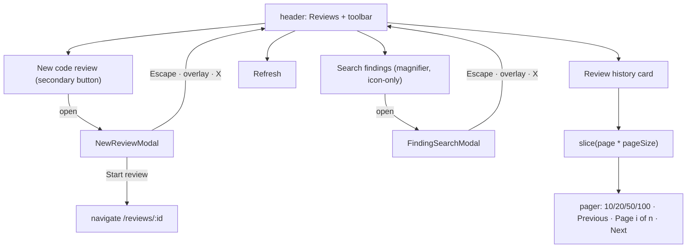

# Phase 46 — A quieter reviews page: two dialogs and a paged history

## Objective & Scope

**In.** Make the reviews page (`/`, `DashboardPage`) read as one screen of history instead of a stack
of forms:

- The **new code review** form stops occupying a card above the list and becomes a modal, opened by a
  "New code review" button in the page header, immediately left of **Refresh**.
- **Search findings** stops occupying a card too and becomes a modal, opened by a magnifier icon
  button in the same header row. The magnifier carries its own accessible name and tooltip.
- The **review history** table paginates client-side: 10 rows by default, page-size options
  10 / 20 / 50 / 100, previous/next plus a "showing a–b of n" range that survives the last page being
  short.

**Out.** Any server change: `GET /api/reviews` still returns every row for the account and the list
is sliced in the browser, so there is no new query parameter, no `LIMIT`/`OFFSET`, and no schema
change. Also out: restyling the table, the watches panel, the analytics strip, the review workspace,
and refactoring the three existing dialogs (`StartReviewModal`, `PushBackLessonModal`,
`SkillEvolutionModal`).

**Assumption.** The page's own `load()` already fetches the full review list in one call, and one
account's history is small enough (hundreds of rows) that filtering pages in memory is honest. If the
operator's list ever reaches the point where this matters, pagination moves to the route in its own
phase.

## High-Level Design



Both dialogs share one primitive, `ui/Modal`, which owns the overlay, `role="dialog"`,
`aria-modal`, the Escape listener and the close button. The form and the search field each keep
their own request state and unmount on close, which is exactly the reset we want: reopening the
search dialog starts empty rather than showing a stale result set.

Pagination is derived, never stored twice: `page` and `pageSize` are state, `pageCount` is
`max(1, ceil(reviews.length / pageSize))`, and the page actually rendered is
`Math.min(page, pageCount - 1)` — so deleting the last row of the last page, or shrinking the page
size, cannot strand the reader on an empty slice.

## API Contracts & Schema

**No API change and no Alembic revision.** The dashboard continues to call:

```http
GET  /api/reviews          -> 200 [CodeReviewSummary, ...]      # unchanged, whole list
GET  /api/findings/search  -> 200 {"items": [FindingHit, ...], "total": n}   # limit raised 20 -> 50
POST /api/reviews          -> 202 {"id": int, ...}              # unchanged, from the modal
```

The only wire difference is the `limit` the search dialog asks for: `limit: 50` instead of `20`, so a
hit remembered from an older review is more likely to be inside the returned window; the existing
"n matches · showing the m most recent" line still states the truncation when `total` exceeds it.

## Target File Map

New:
- `frontend/src/components/ui/Modal.tsx` — overlay, panel, Escape, close button.
- `docs/plans/phase_46_plan.md` (this file).

Changed:
- `frontend/src/components/NewReviewPanel.tsx` → `NewReviewModal.tsx` (git mv): renders inside `Modal`,
  keeps the URL/model/foundation fields and the catalog load; drop the card chrome.
- `frontend/src/components/FindingSearch.tsx` → `FindingSearchModal.tsx` (git mv): same search form,
  results in a scrolling region, unmount-on-close reset, `limit: 50`.
- `frontend/src/pages/DashboardPage.tsx` — header toolbar (new review, magnifier, refresh), dialog
  open state, pagination state and pager, empty-state copy that no longer points at a form "above".
- `README.md`, `CHANGELOG.md` — the reviews page now leads with history; the two actions are dialogs.

Left alone: `src/services/api.ts`, `src/types/index.ts`, the backend, the other dialogs, the table
markup.

## Ordered Steps

1. `ui/Modal.tsx`: overlay button + panel, title/description header, close button, Escape listener
   (`keydown` on `window`, removed on unmount), optional `footer` and `width` class.
2. Move the two components (`NewReviewPanel.tsx` was tracked, `FindingSearch.tsx` was not) and
   reshape them into dialogs driven by `onClose`; keep every existing guard (empty query message,
   unavailable-model option, catalog error text).
3. `DashboardPage`: toolbar with `New code review` (Sparkles), icon-only magnifier (`aria-label` +
   `title`), refresh; two `open...` flags; empty state rewritten ("Use New code review…" .
4. Pagination: `page`, `pageSize`, derived clamp, `slice`, pager row under the table with range text,
   `Select` of 10/20/50/100 and Previous/Next disabled at the ends; reset `page` to 0 on refresh and
   on page-size change.
5. Docs: README/CHANGELOG lines.

## Verification

- `cd frontend && npm run build` (tsc -b) green — the only gate this package has.
- Browser check on a throwaway instance (scratch SQLite DB, temp dist build, dummy credentials —
  deleted afterwards; the operator's database was never touched): 42 seeded reviews show 10 rows on
  page 1, "Showing 1–10 of 42", "Page 1 of 5"; 20 rows at size 20 with page 2 starting at 21; 42 rows
  at size 100 with the arrows gone; last page reads "Showing 41–42 of 42" with Next disabled; and a
  refresh after the list shrank to 39 rows while on page 5 clamped to "Page 4 of 4", 9 rows.
- Both dialogs opened from the header, Escape and the close button dismissed them, and the search
  dialog returned 15 hits for "unbounded query" with snippets and repo/time badges.
- `pytest -q` not required (no backend change; none was made).
