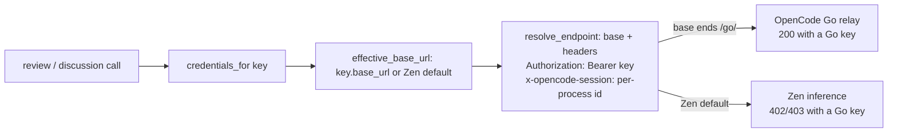

# Phase 47 — OpenCode Go keys: route to the Go relay, and identify the client

## Objective & Scope

**In.** Make an OpenCode **Go** subscription key work end to end, without a second provider id:

- Send the OpenCode-required `x-opencode-session` request header on every OpenCode Chat Completions
  call. The Go relay rejects requests without it (`HTTP 400 MissingSessionID: Request is missing
  x-opencode-session and cannot be routed efficiently`), and a Go key cannot call the Zen host —
  that is the `HTTP 402 Insufficient balance` the operator is seeing, because the key's base URL
  still resolves to the Zen endpoint.
- On this instance, store the Go base URL (`https://opencode.ai/inference/go/openai/v1`) in the
  existing `llm_keys.base_url` of the OpenCode key — the per-key override the Phase 43 plan already
  specified. That is a one-off data repair, not a schema change.
- Document both facts in `backend/rules/providers-and-keys.md`, so the next OpenCode key is wired
  the same way.

**Out.** No new provider id (`opencode_go` stays a base-URL override, as the repo rule says), no
change to the Zen path (its default base URL and probe stay as they are), no frontend change (the
Settings form already renders an optional base-URL field for `opencode`), no model-list or pricing
work, and no Alembic revision — the schema already carries `llm_keys.base_url`.

## High-Level Design



Zen accepts the extra header and ignores it, so the header is sent on every OpenCode call rather
than being conditional on the host — one code path, no host string matching. The session id is one
UUID per process (`uuid4().hex`): it is stable for every call a worker makes, which is what the
relay's affinity wants, and it carries no account or prompt data.

## API Contracts & Schema

**No API change and no Alembic revision.** `POST /api/reviews`, `GET /api/models` and the settings
endpoints keep their shapes; `llm_keys.base_url` already exists (`text`, nullable) and is already
returned and writable through `keys_service`. The only wire-visible change is the outgoing request
to OpenCode:

```http
POST {base_url}/chat/completions
Authorization: Bearer <key>
x-opencode-session: <32 hex chars, stable per process>
Content-Type: application/json
```

**Data repair (this instance only, recorded here as required):**

```sql
UPDATE llm_keys SET base_url = 'https://opencode.ai/inference/go/openai/v1' WHERE id = 7;
```

Row 7 is the operator's single `opencode` key, used by `settings.llm_key_id = 7`. `alembic_version`
stays at head.

## Target File Map

New:
- `docs/plans/phase_47_plan.md` (this file).

Changed:
- `backend/app/services/llm_service.py` — module-level session id; `x-opencode-session` in the
  OpenCode branch of `resolve_endpoint`.
- `backend/tests/test_opencode_transport.py` — the existing OpenCode suite gains the session header
  in its `resolve_endpoint` and wire-level assertions (a separate test file would have duplicated
  it).
- `backend/rules/providers-and-keys.md` — the Go relay needs the session header; Go keys use the
  `/inference/go/openai/v1` base URL.
- `README.md`, `CHANGELOG.md` — provider note and the Phase 47 entry.

Left alone: `backend/app/models/keys.py` (its comment already names the Go base URL), the models
route, the keys service, the frontend, and every other provider's adapters.

## Ordered Steps

1. `llm_service.py`: `import uuid`, module constant `OPENCODE_SESSION_ID = uuid.uuid4().hex`, and
   the header on the `OPENCODE` branch of `resolve_endpoint`.
2. Extend `tests/test_opencode_transport.py`: base URL honoured from credentials; default stays
   Zen; header present on `resolve_endpoint` and on the wire, with a stable value across calls.
3. Apply the `llm_keys` data repair on this instance.
4. Rules doc, README, CHANGELOG.
5. Run the gates; prove a real Go call through the app's own adapter.

## Verification

- `cd backend && pytest -q` — green, including the extended OpenCode transport tests.
- `resolve_endpoint` unit evidence: base `https://opencode.ai/inference/go/openai/v1`, headers
  include a 32-char `x-opencode-session`, same value on repeat calls.
- Real evidence through the app's code and the stored key: load `llm_keys.id = 7`, decrypt it
  through the app, call `llm_service._generate_openai` with the resolved base/headers — expect
  `HTTP 200` and a non-empty completion; the same key against the Zen host returns the operator's
  `402 Insufficient balance`, which is the bug this closes. (The local uv venv's OpenSSL does not
  trust Aikido Device Protection's TLS interception, so that one-off script ran with
  `SSL_CERT_FILE` pointing at Aikido's combined bundle — a script-only env var, no app change.)
- Schema quiet: `alembic_version` unchanged at head.
