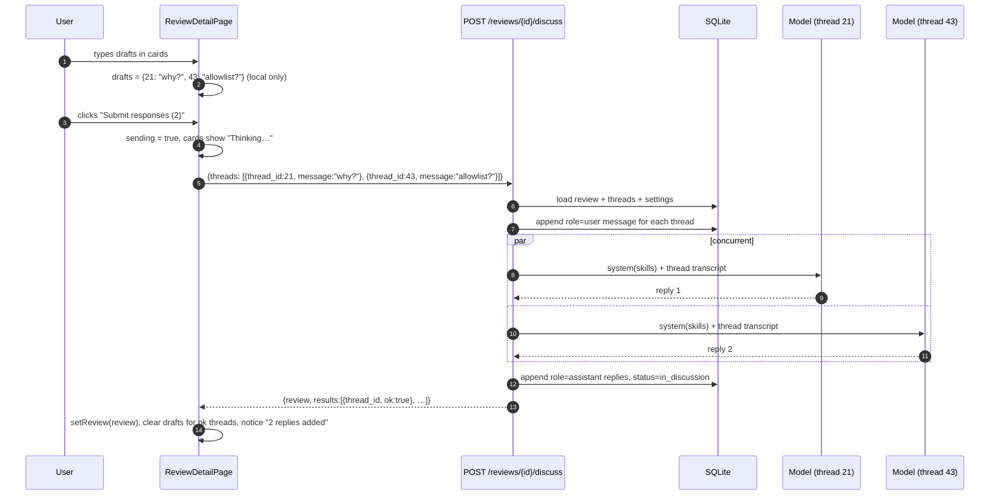
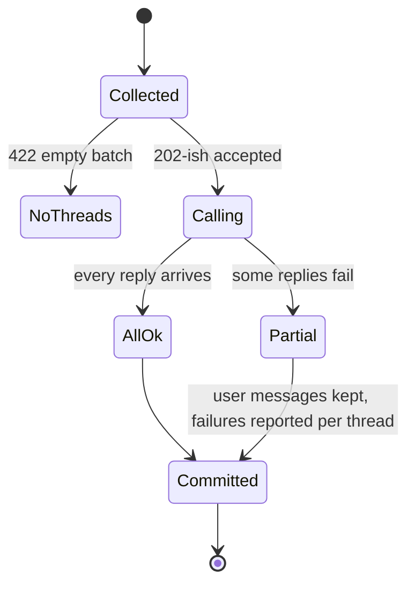

# Phase 4 — Discussion Loop & Bulk Submit

## Objective & Scope

Make the review a conversation: collect every unsent draft from the workspace in one action,
answer each question with the model concurrently, persist the exchange, and hand the updated
threads back so the UI renders replies where they belong.

**In scope**

- `POST /api/reviews/{id}/discuss` accepting a batch of `{thread_id, message}`.
- Per-thread prompt carrying the skill standard, PR identity, the anchored diff snippet, and
  the complete thread history.
- Concurrent model calls (`asyncio.gather`) with per-thread isolation: one failure must not
  lose the other replies.
- Persistence: the user message and the assistant reply for each thread, in order.
- Review status transition `draft → in_discussion` on the first successful exchange.
- Frontend: bulk submit from the sticky footer, per-card "thinking" state, draft clearing for
  successful threads only, notices for partial failure.

**Out of scope**

- Streaming replies, per-thread submit buttons hitting the API individually (the composer's
  button queues a draft; the footer submits them), retry of a single failed thread (re-typing
  the draft and submitting again is the retry).
- RAG over the repository; the model only sees the anchored hunk and the conversation.
- Editing/deleting stored messages.

## High-Level Design

### Bulk discussion sequence



### Failure isolation



A failed thread keeps its user message (it is real content the operator typed) and gets
`ok:false` with the error string; the frontend keeps that draft so the operator can retry,
and shows the error inline on the card.

## API Contracts & Data Schemas

### `POST /api/reviews/{id}/discuss`

Request

```json
{
  "threads": [
    { "thread_id": 21, "message": "Can we use an allowlist here instead?" },
    { "thread_id": 43, "message": "Why is this synchronous?" }
  ]
}
```

Validation: 1–20 entries; `message` 1–4000 chars; every `thread_id` must belong to the review.
400 if a thread id is foreign to the review; 404 if the review does not exist; 422 if the batch
is empty or oversized.

`200`

```json
{
  "review": { "...CodeReviewDetail with updated threads and status in_discussion..." },
  "results": [
    { "thread_id": 21, "ok": true, "error": null },
    { "thread_id": 43, "ok": false, "error": "Ollama does not have the model 'nope'." }
  ]
}
```

### Discussion prompt contract

System: the aggregated skill standard plus

```
You are continuing a review conversation about one finding. Answer the reviewer's question
in at most 150 words of Markdown. Concede when they are right and say what the corrected
recommendation is. Do not restate the whole finding. Do not use JSON.
```

User: PR identity (`repo#number`, title), `file_path:line`, the anchored hunk, then the
transcript rendered as `### Reviewer` / `### Assistant` blocks in order.

### Frontend contracts

- `api.discuss(reviewId, threads)` → `DiscussResponse`.
- `useReviewDrafts` gains nothing new; the page clears only ids whose `results[].ok` is true.
- Per-card sending state: `Set<number>` of in-flight thread ids, so each card can render
  "Thinking…" independently.

## Target File Map

### Backend — new

| File | Responsibility |
|---|---|
| `app/services/discussion.py` | `build_discussion_prompt`, `discuss_threads` |
| `backend/tests/test_discussion.py` | batch contract, concurrency, partial failure, status |

### Backend — modified

| File | Change |
|---|---|
| `app/schemas/review.py` | `DiscussThread`, `DiscussRequest`, `DiscussResult`, `DiscussResponse` |
| `app/api/routes/reviews.py` | `POST /{id}/discuss` |
| `app/services/prompts.py` | `build_discussion_system_prompt`, `build_discussion_user_prompt` |

### Frontend — modified

| File | Change |
|---|---|
| `src/services/api.ts` | `discuss` |
| `src/pages/ReviewDetailPage.tsx` | submit handler, per-thread sending state, notices |
| `src/components/CommentBox.tsx` | `sending` state rendering |
| `src/components/StickyActionBar.tsx` | submitting state, notice/error rendering |

## Step-by-Step Implementation Steps

1. Schemas: `DiscussThread{thread_id, message}`, `DiscussRequest{threads}`, `DiscussResult`,
   `DiscussResponse{review, results}`.
2. Prompt builders for the discussion turn (system + transcript).
3. `discussion.discuss_threads(db, review, entries)`:
   - resolve threads and validate ownership,
   - append user messages and commit (so they survive a model failure),
   - `asyncio.gather` over one call per thread with `return_exceptions=True`,
   - append assistant replies for successes, collect errors,
   - set `status = in_discussion` when at least one reply landed,
   - reload the review for the response.
4. Route with 404/400/422 handling.
5. Frontend: `api.discuss`, page submit handler, per-thread sending set, notice text,
   clear drafts only on `ok`, keep the failing draft with the error shown.
6. Tests: happy path (2 threads → 2 user + 2 assistant messages, status change), partial
   failure (one raises → other persists, `ok:false`), foreign thread id → 400, empty batch →
   422, unknown review → 404.

## Verification & Acceptance Criteria

1. `pytest` passes including the new discussion tests.
2. Submitting two drafts results in exactly two new `user` and two new `assistant` rows, and
   the response's threads show them in order.
3. With one model call failing, the successful thread still gets its reply and its draft is
   cleared; the failed thread keeps its textarea content and shows the error.
4. `status` flips to `in_discussion` after the first successful exchange and is reflected in
   the dashboard badge on the next load.
5. No request is issued while typing; exactly one `POST …/discuss` per footer click
   (verified in the browser network panel).
6. A thread id from another review returns 400 and changes nothing.
