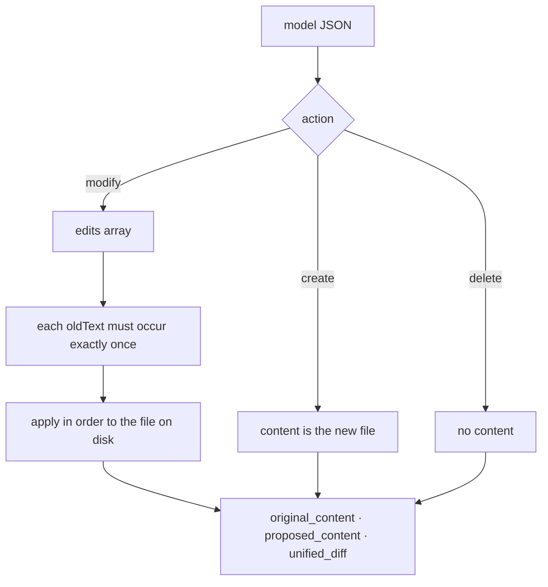

# Phase 50 — Evolve hits its output limit: name the cause, give it room, ask for edits

## Objective & Scope

**In.**

- **Stop reporting a truncated model answer as "Model returned an empty response".** Every blocking
  and streaming adapter (Claude, OpenAI/OpenCode, Ollama ×2) reads the provider's stop reason and
  raises an actionable `LLMError` when the answer was cut off by the output limit.
- **Give one model call its own output budget.** `llm_service.generate()` / `stream()` accept an
  optional `max_tokens`, and the skill-evolution call uses a new `LLM_EVOLVE_MAX_TOKENS`
  (default `8192`) instead of the shared `LLM_MAX_TOKENS=4096`.
- **Keep the output budget for the answer.** The evolve call sends `reasoning_effort: "none"` on the
  OpenCode relay (verified there) so a reasoning model does not spend the whole budget before
  emitting JSON. The value is configurable (`LLM_EVOLVE_REASONING_EFFORT`) and is only applied to
  the OpenCode transport; other providers keep their defaults.
- **Ask for edits, not whole files.** The evolve JSON contract changes from
  `originalContent` + `proposedContent` to a small `edits: [{oldText, newText}]` list for `modify`,
  `content` only for `create`, and nothing for `delete`. The server applies each edit against the
  file on disk, validates that every `oldText` occurs exactly once, and still computes
  `original_content` / `proposed_content` / `unified_diff` for the workbench. Legacy
  `proposedContent` responses remain accepted.
- Config, environment example, `DOCS.md`, `README.md` and `CHANGELOG.md` describe the new knobs and
  the new contract.

**Out.**

- No frontend change: `EvolutionFileModification` keeps the same response fields, and the
  workbench continues to render the server-computed diff and full proposed text.
- No Alembic revision: no table or column changes.
- No change to history aggregation, prompt budgets (`EVOLUTION_SKILL_MAX_CHARS`,
  `EVOLUTION_HISTORY_MAX_CHARS`), apply/clone, or the agent-session backend.
- No per-provider reasoning matrix beyond OpenCode: Claude receives no `thinking` parameter and
  OpenAI receives no `reasoning_effort`; those need their own verified settings if ever added.

## High-Level Design

```mermaid
flowchart LR
  UI[Skills · Evolve] -->|POST analyze-history| R[skills route]
  R --> A[skill_analyzer_service.analyse]
  A -->|max_tokens=LLM_EVOLVE_MAX_TOKENS<br/>reasoning_effort=none on OpenCode| G[llm_service.generate]
  G --> T{transport}
  T -->|OpenAI / OpenCode| O[Chat Completions]
  T -->|Ollama| L[/api/chat]
  T -->|Claude| C[Messages API]
  O --> S{stop reason}
  L --> S
  C --> S
  S -->|length / max_tokens| E[LLMError: output limit reached<br/>raise the budget or shorten the prompt]
  S -->|stop| A
  A --> P[parse_proposals]
  P -->|edits oldText→newText| F[(foundation files)]
  P -->|full content| W[workbench: diff + edit box]
```



## API Contracts & Schema

**Public API unchanged.** `POST /api/skills/{foundation_id}/analyze-history` returns the same shape:

```json
{
  "analysis_summary": "…",
  "file_modifications": [
    {
      "file_path": "references/testing.md",
      "action": "modify",
      "rationale": "…",
      "evidence_review_ids": [14],
      "original_content": "…",
      "proposed_content": "…",
      "unified_diff": "@@ …"
    }
  ],
  "history": { "days": 30, "reviews": 12, "threads": 40, "interactions": 7 },
  "warnings": []
}
```

**Model-facing contract (internal, sent in the prompt):**

```json
{
  "analysisSummary": "one paragraph",
  "fileModifications": [
    {
      "filePath": "references/testing.md",
      "action": "modify",
      "rationale": "why this change",
      "evidenceReviewIds": [14, 22],
      "edits": [
        {
          "oldText": "an exact sentence copied from the current file",
          "newText": "the replacement text"
        }
      ]
    },
    {
      "filePath": "references/new.md",
      "action": "create",
      "rationale": "why this file",
      "evidenceReviewIds": [],
      "content": "the complete new file"
    },
    {
      "filePath": "references/old.md",
      "action": "delete",
      "rationale": "why it should go",
      "evidenceReviewIds": [22]
    }
  ]
}
```

Validation rules: `modify` requires a non-empty `edits` list and every `oldText` must appear exactly
once in the current file; `create` requires non-empty `content`; `delete` ignores content. A
proposal that fails validation is dropped with a warning, never partially applied. At most 40 edits
are accepted per proposal. Two `modify` proposals for the same path are merged into one, applying
the second edit list to the first proposal's result, because the workbench keys files by path and
apply writes one file at a time. Files the prompt left out for size are named as untouchable, so the
model does not propose edits it cannot ground. A legacy `proposedContent` string is still accepted
as a whole-file replacement (used by existing clients and tests).

**No Alembic revision.**

## Target File Map

New:

- `docs/plans/phase_50_plan.md` — this file.
- `backend/tests/test_llm_truncation.py` — adapter stop-reason, budget and effort coverage.

Changed:

- `backend/app/core/config.py` — `llm_evolve_max_tokens: int = 8192` and
  `llm_evolve_reasoning_effort: str = "none"`, beside `llm_max_tokens` and the evolution budgets.
- `backend/app/services/llm_service.py` — optional `max_tokens` / `reasoning_effort` on `generate`
  and `stream`; the same on the four adapters; stop-reason detection (`finish_reason`,
  `done_reason`, `stop_reason`) in both blocking and streaming paths; a shared
  `_truncation_error()` helper; a clearer empty-response message.
- `backend/app/services/skill_analyzer_service.py` — pass the evolve budget and OpenCode reasoning
  effort; `META_CONTRACT` asks for `edits` / `content`; `_apply_edits()` plus the modified
  `parse_proposals()`.
- `backend/tests/test_skill_evolution.py` — capture `max_tokens` / `reasoning_effort`; edit-based
  modify, ambiguous `oldText`, non-matching `oldText`, create-from-`content`, and the legacy
  `proposedContent` fallback.
- `backend/.env.example` — the two new variables.
- `DOCS.md` — the environment table rows.
- `README.md` — one sentence in the Skills section about the dedicated budget and edit contract.
- `CHANGELOG.md` — a Phase 50 entry.

Left alone:

- `frontend/src/**` — the response shape is unchanged.
- `backend/app/api/routes/skills.py`, `backend/app/schemas/skills.py` — no public contract change.
- `backend/app/models/**`, `backend/alembic/**` — no persistence change.

## Ordered Steps

1. **Config.** Add the two settings with comments; add them to `backend/.env.example` and the
   `DOCS.md` environment table. Verify `python -c "from app.core.config import get_settings;
   print(get_settings().llm_evolve_max_tokens)"` prints `8192`.
2. **Transport plumbing.** Add `max_tokens` / `reasoning_effort` to `generate` and `stream`; resolve
   `max_tokens or config.llm_max_tokens`; pass resolved values to `_generate_claude`,
   `_generate_openai`, `_generate_ollama` and the stream adapters (Ollama ignores the cap, as today).
   Verify existing transport tests still pass.
3. **Stop reasons.** Add `_truncation_error()` and check `finish_reason == "length"` (OpenAI /
   OpenCode, blocking + SSE), `done_reason == "length"` (Ollama, blocking + NDJSON) and
   `stop_reason == "max_tokens"` (Claude, blocking + stream). Improve the empty-response message.
   Verify with `backend/tests/test_llm_truncation.py`.
4. **Evolve call.** Pass `max_tokens=get_settings().llm_evolve_max_tokens`; pass
   `reasoning_effort=get_settings().llm_evolve_reasoning_effort` only when the model provider is
   `opencode` and the setting is non-empty.
5. **Edit contract.** Rewrite `META_CONTRACT`; add `_apply_edits()`; extend `parse_proposals()` to
   prefer `edits`, accept `content` for create, keep `proposedContent` as the legacy fallback,
   merge duplicate `modify` proposals for one path, and emit the existing full-content proposal.
   Verify with the new cases in `tests/test_skill_evolution.py`.
6. **Docs.** Update `README.md`, `CHANGELOG.md` and `DOCS.md`; confirm the plan matches the code.
7. **Gates.** `cd backend && pytest -q`; no frontend build is required (no UI change), but run
   `cd frontend && npm run build` once to prove the unchanged API types still compile.
8. **Live proof.** Run one real evolve analysis against the configured OpenCode Go key with the
   default foundation and user 5, printing only counts: prompt/completion tokens, reasoning tokens,
   proposal count and warning count. Do **not** apply or clone the result.

## Verification

- `cd backend && pytest -q` is green, including the new truncation cases and the edit-contract
  cases.
- `tests/test_llm_truncation.py` proves each transport raises `LLMError` containing
  `output limit` when the provider reports truncation, and that `generate(max_tokens=…,
  reasoning_effort="none")` reaches the OpenCode payload.
- `tests/test_skill_evolution.py` proves: an `edits` proposal produces the expected
  `proposed_content` and `unified_diff`; an `oldText` that appears twice or not at all drops the
  proposal with a warning; a `create` from `content` works; a legacy `proposedContent` response
  still produces a proposal; and the evolve call receives `max_tokens=8192` (plus
  `reasoning_effort="none"` for OpenCode).
- Live run: the analysis returns at least one proposal (or a legitimate empty result) with
  `completion_tokens < LLM_EVOLVE_MAX_TOKENS`, and the old failure mode no longer reproduces.
  Before the fix the same call was `prompt_tokens=17894, completion_tokens=4096,
  reasoning_tokens=4096, finish_reason=length, content=""`.
- `git grep -n "Model returned an empty response"` finds only the improved message in
  `llm_service.py`; no caller depends on the old wording.

## Verification result

- `cd backend && pytest -q` → **443 passed** (430 before phase 50; the new `test_llm_truncation.py`
  cases and the edit-contract cases in `test_skill_evolution.py` account for the difference).
- `cd frontend && npm run build` → green (1895 modules, `dist/assets/index-BPCgmI0T.js` unchanged);
  no UI file was touched.
- Live evolve run against `opencode:deepseek-v4.1-flash`, user 5, `code-review`, 30 days, with the
  real key: `prompt_tokens=18152`, `completion_tokens=1096`, `ok=true`, 2 proposals, 0 warnings.
  Before the change the same call was `prompt_tokens=17894`, `completion_tokens=4096`,
  `reasoning_tokens=4096`, `finish_reason=length`, `content=""`.
- An earlier live run with the first prompt draft returned two proposals for files that had been
  left out of the prompt; the prompt now names those files as untouchable, and the next run
  produced no such warning.
- A live run produced two proposals for `references/frontend-review.md`; the parser now merges
  them, and a repeat run returned one proposal per path.
- Nothing was applied or cloned during verification; the foundation on disk is unchanged.
