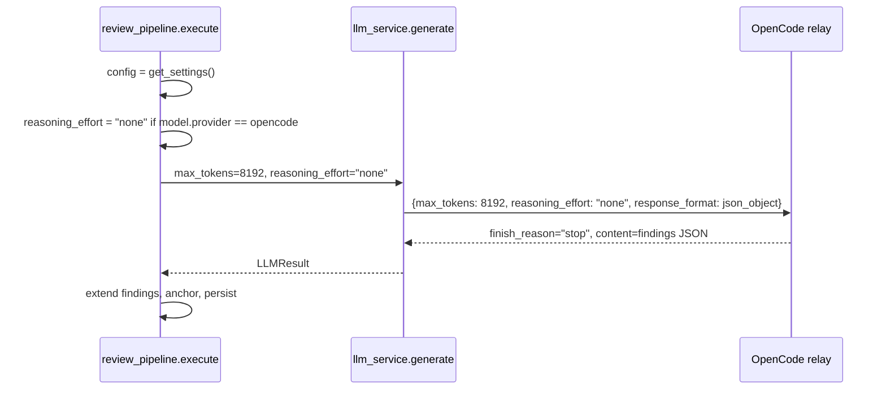

# Phase 51 — A review ingest gets an output budget a reasoning model cannot exhaust

## Objective & Scope

**In.**

- **Give review ingestion its own output budget.** Every `ingest` call — one call for a small diff,
  every part of a large one — passes `max_tokens = LLM_REVIEW_MAX_TOKENS` (default `8192`) instead
  of inheriting the shared `LLM_MAX_TOKENS=4096`.
- **Keep that budget for the findings.** On the OpenCode relay, ingest sends
  `reasoning_effort: "none"` (configurable as `LLM_REVIEW_REASONING_EFFORT`, default `none`), so a
  reasoning model cannot spend the whole completion budget before writing the JSON findings. The
  value is only sent to OpenCode; other providers keep their defaults (phase 50 established that
  the OpenCode relay accepts `"none"` and that Claude/OpenAI need their own verified knob).
- **Pin the wiring with tests.** The pipeline test captures the `generate()` kwargs for an OpenCode
  ingest and an Ollama ingest: the budget is always the review budget, and `reasoning_effort` is
  present only for OpenCode.
- Config, environment example, `DOCS.md`, `README.md` and `CHANGELOG.md` describe the two knobs.

**Why.** Review 24 (`Thinkei/employment-hero#84559`, `opencode:deepseek-v4.1-flash`) failed with
`OpenCode stopped at its 4096-token output limit … (4096 tokens went to reasoning)`. The prompt was
one part (15,427-char diff, 99,330-char prompt); the provider never ran out of context — the
reasoning model consumed the entire 4096-token completion budget and returned empty `content` with
`finish_reason: "length"`. Phase 50 fixed exactly this for skill evolution but left review ingest on
the shared 4096 budget.

**Out.**

- No change to the evolve, discussion, summarise, verdict, lesson or comment-polish call sites —
  each keeps the shared budget. A multi-part review's merged-findings verdict pass stays on
  `LLM_MAX_TOKENS`; if it truncates, the review is still published as `draft` with its opinion
  empty (a warning, not a failed review).
- No automatic retry of a failed review. Review 24 stays `failed`; the operator starts a new review
  of the same URL after the fix, because there is no retry endpoint and re-running a row in place
  would reuse its stale prompt snapshot.
- No frontend change, no public API change, no Alembic revision.

## High-Level Design

```mermaid
flowchart LR
  R[POST /api/reviews] --> P[review_pipeline.execute]
  P --> U{review_units.plan_units}
  U -->|one part| G[llm_service.generate<br/>purpose=ingest]
  U -->|n parts| G
  G -->|max_tokens=LLM_REVIEW_MAX_TOKENS| T{transport}
  T -->|OpenCode| O[Chat Completions<br/>+ reasoning_effort=none]
  T -->|OpenAI| A[Chat Completions<br/>provider default effort]
  T -->|Claude| C[Messages API]
  T -->|Ollama| L[/api/chat<br/>cap ignored]
  O --> S{finish_reason}
  S -->|length| E[LLMError: output limit reached<br/>name the budget and reasoning tokens]
  S -->|stop| F[anchored findings]
  A --> S
  C --> S
  L --> S
```



## API Contracts & Schema

**Public API unchanged.** No request/response shape changes and **no Alembic revision**: the two new
settings are environment-only.

| Setting | Default | Effect |
|---|---|---|
| `LLM_REVIEW_MAX_TOKENS` | `8192` | `max_tokens` for every `purpose=ingest` call. |
| `LLM_REVIEW_REASONING_EFFORT` | `none` | `reasoning_effort` sent to the OpenCode relay for ingest. Empty omits the field; unused for every other provider. |

Failure contract unchanged: a truncated ingest is still an `LLMError`, the review is still stored
`failed` with the message in `code_reviews.error`, and a partial failure of a multi-part review is
still a `draft` with one note per failed part.

## Target File Map

New:

- `docs/plans/phase_51_plan.md` — this file.

Changed:

- `backend/app/core/config.py` — `llm_review_max_tokens: int = 8192` and
  `llm_review_reasoning_effort: str = "none"`, beside `llm_max_tokens` and the evolve budget.
- `backend/app/services/review_pipeline.py` — resolve `reasoning_effort` once in `execute()` from
  the parsed model provider; pass `max_tokens` and `reasoning_effort` from `run_part()`.
- `backend/tests/test_review_pipeline.py` — capture `generate()` kwargs on an OpenCode ingest and an
  Ollama ingest.
- `backend/.env.example` — the two new variables.
- `DOCS.md` — the environment table rows.
- `README.md` — one sentence in the review flow about the dedicated ingest budget.
- `CHANGELOG.md` — a Phase 51 entry.

Left alone:

- `frontend/src/**` — no response-shape or behaviour change.
- `backend/app/services/llm_service.py` — `generate()` already accepts `max_tokens` and
  `reasoning_effort` (phase 50); no transport change is needed.
- `backend/app/services/skill_analyzer_service.py` — its own evolve budget is untouched.
- `backend/app/models/**`, `backend/alembic/**` — no persistence change.

## Ordered Steps

1. **Config.** Add the two settings with comments; add them to `backend/.env.example` and the
   `DOCS.md` environment table. Verify
   `python -c "from app.core.config import get_settings; print(get_settings().llm_review_max_tokens, get_settings().llm_review_reasoning_effort)"`
   prints `8192 none`.
2. **Pipeline wiring.** In `review_pipeline.execute()`, resolve
   `reasoning_effort = config.llm_review_reasoning_effort.strip() or None` only when
   `model.provider == llm_service.OPENCODE`; in `run_part()`, pass
   `max_tokens=config.llm_review_max_tokens` and `reasoning_effort=reasoning_effort` to
   `llm_service.generate()`.
3. **Tests.** Capture the kwargs in `backend/tests/test_review_pipeline.py`: an OpenCode model gets
   `llm_review_max_tokens` and `reasoning_effort == "none"`; an Ollama model gets the same budget
   and `reasoning_effort is None`. Verify with
   `cd backend && pytest -q tests/test_review_pipeline.py`.
4. **Docs.** Update `README.md` and `CHANGELOG.md`; confirm the plan matches the code.
5. **Gates.** `cd backend && pytest -q`.

## Verification

- `cd backend && pytest -q` is green, including the two new pipeline cases.
- The OpenCode ingest test proves `generate()` receives
  `max_tokens=get_settings().llm_review_max_tokens` and `reasoning_effort="none"`; the Ollama test
  proves the budget is used but no `reasoning_effort` key is sent.
- `git grep -n "reasoning_effort" backend/app/services/review_pipeline.py` shows the provider guard,
  so Ollama/Claude/OpenAI are unaffected.
- The live failure mode is the same call phase 50 already verified on this relay: the evolve run
  with `reasoning_effort="none"` returned `completion_tokens=1096`, `ok=true` on
  `opencode:deepseek-v4.1-flash`. Re-running review 24's PR from the dashboard after this change
  should reach `draft`; review 24 itself stays `failed` and is not mutated.

## Verification result

- `cd backend && pytest -q` → **445 passed** (443 after phase 50; two pipeline cases added).
- `python -c "... get_settings()"` → `8192 none`.
- Live ingest of review 24's PR (`Thinkei/employment-hero#84559`) through the new path, with the
  real OpenCode key and `opencode:deepseek-v4.1-flash`: **review 25 → `draft`**, 4 threads, verdict
  `REQUEST_CHANGES` at 72%, and one `ingest` call `ok=True`, `prompt_tokens=22327`,
  `completion_tokens=884`. Review 24 was `completion_tokens=4096` with all 4096 in reasoning and
  empty content. `LLM_REVIEW_MAX_TOKENS`/`LLM_REVIEW_REASONING_EFFORT` are therefore both effective
  end to end.
- Review 24 itself is untouched and still `failed`; review 25 is the working re-run of the same PR.
  Nothing was posted to GitHub and there is no migration.
