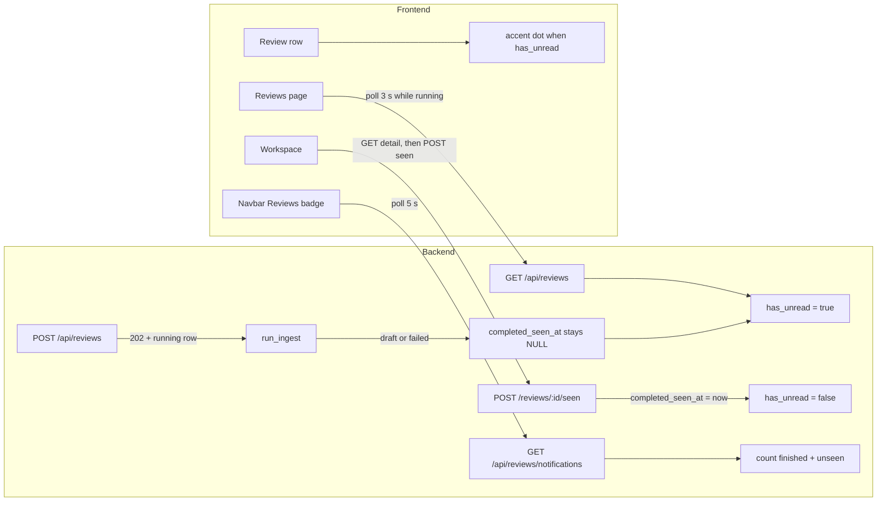
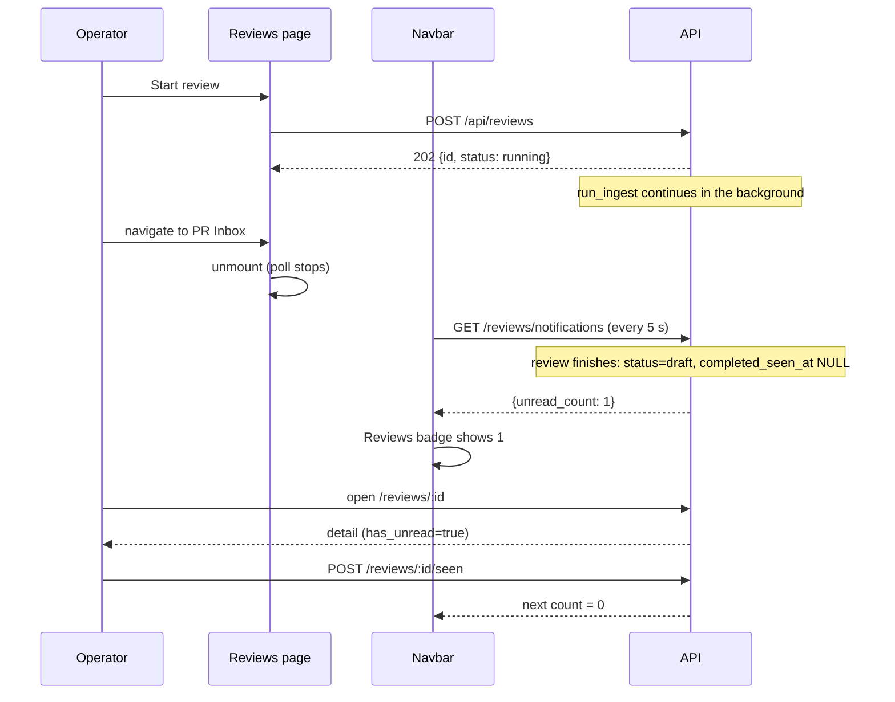

# Phase 52 — A review keeps running when you leave, and the list tells you when it lands

## Objective & Scope

**In.**

- **Make the background job visible from anywhere.** Ingest is already an async job
  (`POST /api/reviews` → `202` → `run_ingest`), but the dashboard reads its list once and never
  again, so a review that finishes while the operator is on another page looks stuck at `Running`.
  The Reviews list now polls itself while at least one review is `running` and refreshes when the
  tab becomes visible again.
- **One notification per finished review, like the PR inbox.** A review that leaves `running`
  (`draft` or `failed`) is *unread* until the operator opens it. `GET /api/reviews` reports
  `has_unread`, the row shows a dot, and the **Reviews** nav item carries the same count badge the
  **PR Inbox** item already has.
- **Acknowledgement is explicit.** Opening the workspace (`GET /api/reviews/{id}` from the detail
  page) posts `POST /api/reviews/{id}/seen`; the route clears the notification. A review that
  finishes while its workspace is open is acknowledged on the next refresh, so watching a review
  does not leave an unread dot behind.
- **A running banner on the Reviews page** says the work continues elsewhere, which is the
  behaviour the operator asked for and could not previously see.

**Out.**

- No change to the ingest mechanism itself: still `asyncio.create_task` locally and a Starlette
  background task on serverless (`review-flow.md`). No queue, no worker process, no new dependency.
- No websocket/global event stream. The dashboard polls `GET /api/reviews` every 3 s only while
  something is running; the navbar polls the notification count every 5 s while the tab is visible.
- No per-stage progress on the list row (the workspace already replays SSE). No desktop/browser
  notifications, no emails.
- No "mark all read" endpoint and no notification history table: one nullable timestamp on
  `code_reviews` is the whole state.
- No change to watch/policy/comparison scheduling; their finished reviews simply become unread too.

## High-Level Design





## API Contracts & Schema

### New column — Alembic revision `0024`

`code_reviews.completed_seen_at` (`TIMESTAMP WITH TIME ZONE NULL`, SQLite: `DATETIME`).

- `NULL` means the review's finished state has not been looked at. Every new review starts `NULL`;
  it becomes a notification the moment `run_ingest` leaves it `draft` or `failed`.
- Non-`NULL` is the timestamp the operator acknowledged it.
- `running` rows are never notifications, so the column is only read together with `status`.
- Upgrade backfills `completed_seen_at = updated_at` for every row whose `status <> 'running'`:
  existing history is not news. Downgrade drops the column.

No index: the list is already per-user and ordered; `unread_count` scans one account's small set.

### `CodeReviewSummary` gains one field

```json
{
  "id": 25,
  "pr_url": "https://github.com/Thinkei/employment-hero/pull/84559",
  "status": "draft",
  "has_unread": true,
  "created_at": "2026-11-17T04:12:09Z",
  "updated_at": "2026-11-17T04:13:41Z"
}
```

`has_unread` is `status != "running" and completed_seen_at is null`, computed by a model property so
the rule lives in one place.

### New routes (both session-owned)

`GET /api/reviews/notifications` → `200`

```json
{ "unread_count": 1 }
```

`POST /api/reviews/{review_id}/seen` → `200 CodeReviewSummary`

```json
{
  "id": 25,
  "status": "draft",
  "has_unread": false
}
```

- Another account's review is `404`, never `403`.
- A `running` review is returned unchanged (`has_unread: false`); acknowledging it early must not
  swallow the notification it will produce when it finishes.
- Idempotent: a second call leaves the stored timestamp alone.

`GET /api/reviews/notifications` is declared **before** `GET /api/reviews/{review_id}` so the literal
path is not parsed as a review id.

## Target File Map

New:

- `docs/plans/phase_52_plan.md` — this file.
- `backend/alembic/versions/0024_review_completed_seen.py` — the column, backfill and downgrade.
- `backend/app/services/review_notifications.py` — `unread_count`, `mark_seen`, and the unread rule.
- `backend/tests/test_review_notifications.py` — contract, idempotency, running row, isolation.

Changed:

- `backend/app/models/review.py` — `completed_seen_at` column + `has_unread` property.
- `backend/app/schemas/review.py` — `has_unread` on `CodeReviewSummary`, `ReviewNotifications` model.
- `backend/app/api/routes/reviews.py` — the two routes; `_owned_review` reused for ownership.
- `backend/rules/conventions.md` — service roster entry.
- `frontend/src/types/index.ts` — `has_unread` on `CodeReviewSummary`; `ReviewNotifications`.
- `frontend/src/services/api.ts` — `reviewNotifications()`, `markReviewSeen(id)`.
- `frontend/src/components/Navbar.tsx` — Reviews badge next to the inbox badge, 5 s poll.
- `frontend/src/pages/DashboardPage.tsx` — running poll, visibility refresh, running banner, unread
  dot on the row.
- `frontend/src/pages/ReviewDetailPage.tsx` — acknowledge the notification after loading the detail.
- `backend/tests/test_isolation.py` — the second account sees neither the count nor the route.
- `DOCS.md` — the endpoint table and the notification paragraph.
- `README.md`, `CHANGELOG.md` — behaviour note and phase entry.

Left alone:

- `backend/app/services/review_pipeline.py`, `watch_service.py`, `policy_service.py`,
  `app/db/init_db.py` — the job and its failure paths already write a terminal status; the
  notification is derived from that status, not a second signal to maintain.
- `frontend/src/components/IngestProgress.tsx`, the SSE route — unchanged; live progress stays on the
  workspace.
- `frontend/src/pages/InboxPage.tsx` and the inbox unread mechanism — it is recomputed from GitHub
  on sync; reviews use their own timestamp.

## Ordered Steps

1. **Migration.** Add `0024_review_completed_seen.py`; run `alembic upgrade head` and
   `alembic downgrade -1` against a scratch database and confirm the column exists/disappears and
   the backfill set `completed_seen_at` on finished rows only.
2. **Model + schema.** Add the column and `has_unread` property; expose `has_unread` on
   `CodeReviewSummary.from_row` and add `ReviewNotifications`. Verify the OpenAPI shape with
   `curl /openapi.json`.
3. **Service + routes.** `review_notifications.unread_count/mark_seen`; mount
   `GET /reviews/notifications` before `GET /reviews/{id}` and `POST /reviews/{id}/seen`. Add the
   module to the roster in `backend/rules/conventions.md`.
4. **Backend tests.** A finished review is unread until `POST …/seen` and the count returns to 0; a
   second `seen` is a no-op; a `running` review is not counted; another account sees neither the
   count nor the route. Gate: `cd backend && pytest -q`.
5. **Frontend API + types.** Add the two calls and their types; no component reaches `fetch`.
6. **Dashboard.** Poll `listReviews` every 3 s while any row is `running`, refresh on
   `visibilitychange`, show the running banner, and render the unread dot on a row. Gate:
   `cd frontend && npm run build`.
7. **Navbar + detail acknowledgement.** Poll the notification count and render the Reviews badge;
   the detail page posts `seen` when the loaded review reports `has_unread`.
8. **Docs.** Update `README.md` (what the dot and badge mean) and `CHANGELOG.md` (Phase 52 entry);
   re-read this plan and correct it if the build diverged.
9. **Exercise it.** Start a review with the real backend, navigate away, watch the row flip from
   `Running` to `Draft` with the dot and the badge incrementing, open it, and confirm both clear.

## Verification

- `cd backend && pytest -q` is green, including the four new notification cases.
- Scratch-database round trip: `alembic upgrade head` then `alembic downgrade -1` then `upgrade head`
  succeeds; `SELECT id, status, completed_seen_at FROM code_reviews` shows a timestamp on every
  pre-existing finished row and `NULL` on none of them.
- Live evidence: `POST /api/reviews` returns `202`; `GET /api/reviews/notifications` goes `0 → 1`
  when the job finishes; `GET /api/reviews` shows `has_unread: true`; `POST /api/reviews/{id}/seen`
  returns `has_unread: false` and the count drops to `0`.
- `cd frontend && npm run build` is green (`tsc -b`).
- Browser check: the Reviews list keeps updating while a review runs after navigating back to it,
  the navbar badge increments when it finishes on another page, the dot sits on that row, and both
  disappear after opening the review.

## Verification result

- Scratch-database migration round trip: `alembic upgrade 0023` → seeded one `draft` and one
  `running` row → `alembic upgrade head` printed
  `('draft', '2026-01-02 03:04:05')` (backfilled) and `('running', None)` (kept), then
  `alembic downgrade -1` dropped the column and `upgrade head` re-added it.
- `cd backend && pytest -q` → **448 passed** (445 before; three notification cases plus the
  isolation assertions).
- Live uvicorn on a scratch SQLite database (real migrations, real cookie session):
  `GET /api/reviews` → `[(2, 'running', False), (1, 'draft', True)]`; notifications → `1`;
  `POST /reviews/1/seen` → `has_unread: false`; notifications → `0`; `POST /reviews/2/seen` on the
  running row returned unchanged with **no write**; flipping that row to `draft` made the count
  `1` again (the early acknowledgement did not swallow it); accepting it brought the count to `0`;
  an anonymous request got `401`.
- `cd frontend && npm run build` → green (`tsc -b` + Vite).

