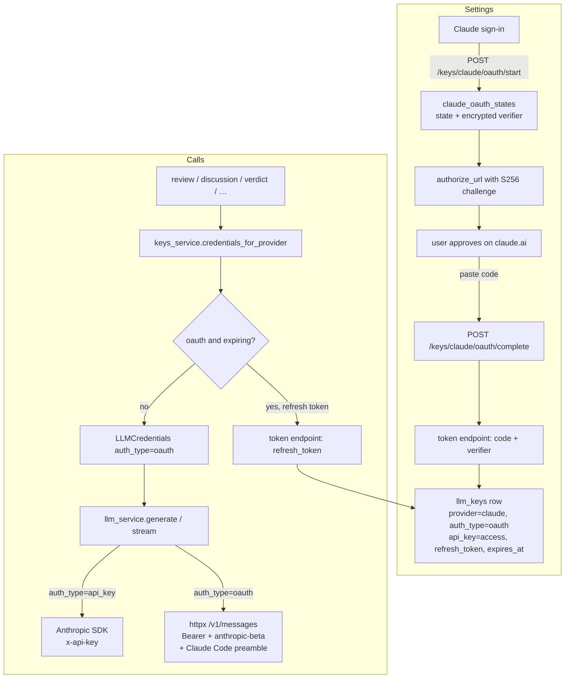
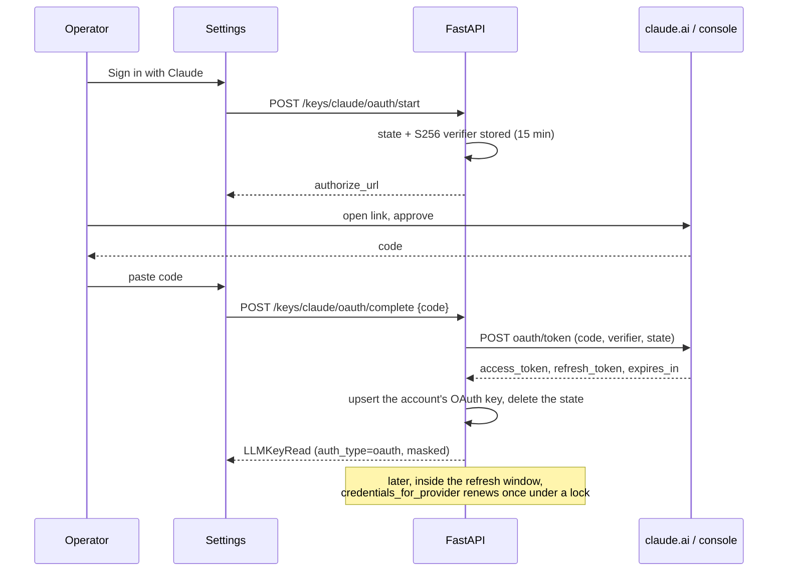

# Phase 53 — Claude sign-in as a second way to pay for Claude

## Objective & Scope

**In.**

- **A "Sign in with Claude" credential beside the Claude API key.** The Settings page keeps the
  existing API-key form and adds a Claude sign-in flow: start it, approve on claude.ai, paste the
  code the page shows. The backend exchanges that code with PKCE, stores the access and refresh
  tokens encrypted, and the resulting key lives in the same `llm_keys` table as every other
  credential — one provider (`claude`), two auth types.
- **Automatic token refresh.** An OAuth access token expires (typically hours). Every call path
  resolves credentials through `keys_service`, so that is where a token inside the refresh window
  is renewed once, under a per-key lock, and written back. A failed refresh is a `422` that says to
  reconnect in Settings — never a silent 401 from the model.
- **A Claude transport for bearer tokens.** The Anthropic SDK path (API key, `x-api-key`) stays
  untouched; OAuth calls use a small httpx transport that sends
  `Authorization: Bearer …`, `anthropic-beta: oauth-2025-04-20` and the Claude Code system-prompt
  preamble, for both `generate` and `stream` (discussion SSE). Usage, truncation and ledger
  behaviour stay identical.
- **The model list, test and reveal contracts follow the auth type.** OAuth keys still list Claude
  models (falling back to the static pair when `/v1/models` refuses a bearer token), the test
  probe does one real `messages` call, and `?reveal=true` never exposes a refresh token.
- **Tests, docs and rules**: PKCE URL, code exchange, upsert, refresh, refresh failure, and the
  bearer transport's headers/preamble; `README`, `DOCS`, `CHANGELOG`, the service roster and
  `providers-and-keys.md`.
- **The new secrets join the encryption maintenance pass.** `refresh_token` and the PKCE verifier
  are `EncryptedText` columns, so key rotation and the plaintext scan must know them; the
  `counts` map becomes `table.column` (one table now holds two secrets) and revision `0011`
  pins the two columns that existed at its revision so an old database still downgrades through
  it.

**Out.**

- No device-code flow, no local callback server, no popup window. The flow is the one Claude Code
  uses: open the authorize page, approve, paste the code; the sign-in tab is a plain link so a
  popup blocker cannot break it.
- No Claude Code **credentials file** import (`~/.claude/.credentials.json`) and no reading of local
  CLI sessions for tokens. Sign-in is explicit and account-scoped.
- No second provider id (`claude_oauth:<model>`): model ids stay `claude:<model>`, so existing
  reviews, watches, policies and comparisons keep working and the model picker gains no duplicate
  catalogue.
- No change to how non-Claude providers authenticate, and no OAuth for any other provider.
- No automatic retry when Claude answers `401` mid-call. The token is refreshed *before* the call;
  a 401 afterwards is surfaced as a reconnect message, because a refresh-then-retry loop would mask
  revoked credentials.

**Terms.** The sign-in reuses the public Claude Code OAuth client (`client_id` is the one Claude
Code ships with); Anthropic has no separate OAuth app for third-party tools. The UI says so, and
the client id, endpoints, redirect URI and scopes are settings so a different registration can be
dropped in without a code change.

## High-Level Design





## API Contracts & Schema

### Alembic revision `0025`

`llm_keys` gains three columns:

| Column | Type | Default | Meaning |
|---|---|---|---|
| `auth_type` | `VARCHAR(16)` NOT NULL | `'api_key'` | `api_key` or `oauth`. Existing rows backfill to `api_key`. |
| `refresh_token` | `TEXT` NULL | `NULL` | Encrypted at rest by `EncryptedText`; only OAuth rows set it. |
| `expires_at` | `TIMESTAMP WITH TIME ZONE` NULL | `NULL` | When the access token stops working; refreshed 120 s early. |

New table `claude_oauth_states` — one pending sign-in per account:
`id` PK · `user_id` FK `users.id` `ON DELETE CASCADE` (indexed) · `state` `VARCHAR(64)` unique ·
`verifier` `TEXT` (encrypted) · `created_at` · `expires_at`. Rows older than 15 minutes are purged
on the next start; a completed flow deletes its row.

Downgrade drops the table and the three columns.

### Endpoints

`POST /api/keys/claude/oauth/start` → `200`

```json
{
  "authorize_url": "https://claude.ai/oauth/authorize?code=true&client_id=…&response_type=code&redirect_uri=…&scope=org%3Acreate_api_key+user%3Aprofile+user%3Ainference&code_challenge=…&code_challenge_method=S256&state=…",
  "expires_at": "2026-11-17T06:15:00Z"
}
```

`POST /api/keys/claude/oauth/complete` → `200 LLMKeyRead`

```json
{ "code": "ac_123…#<state>" }
```

- The code is the value claude.ai shows. `code#state` and a bare code are both accepted; if a
  state is present it must match the pending row (a mismatch is `422`: the user started two
  sign-ins in different tabs).
- No pending/expired state is `422` — start again.
- A rejected code is `422` ("The sign-in code was not accepted. Start the sign-in again."); an
  unreachable or 5xx token endpoint is `502`.
- Repeating the flow **updates the account's existing OAuth key** (one per account), so a reconnect
  never leaves a stale duplicate behind.
- The flow does not activate the key; the UI activates it when the account has no active model key,
  exactly like adding an API key.

`LLMKeyRead` (list, create, update, complete) gains:

```json
{
  "id": 7,
  "provider": "claude",
  "auth_type": "oauth",
  "has_refresh_token": true,
  "expires_at": "2026-11-17T14:02:11Z",
  "api_key_masked": "…",
  "is_active": true
}
```

`refresh_token` and the stored verifier never appear in any response; `?reveal=true` reveals the
access token only.

New settings (environment, defaults in the plan's design): `CLAUDE_OAUTH_CLIENT_ID`,
`CLAUDE_OAUTH_AUTHORIZE_URL`, `CLAUDE_OAUTH_TOKEN_URL`, `CLAUDE_OAUTH_REDIRECT_URI`,
`CLAUDE_OAUTH_SCOPES`.

## Target File Map

New:

- `docs/plans/phase_53_plan.md` — this file.
- `backend/alembic/versions/0025_claude_oauth.py` — columns and the state table.
- `backend/app/models/claude_oauth_state.py` — the pending sign-in row.
- `backend/app/services/claude_oauth_service.py` — PKCE, authorize URL, exchange, refresh, payload.
- `backend/tests/test_claude_oauth.py` — the flow, refresh and transport contracts.

Changed:

- `backend/app/models/keys.py` — `auth_type`, `refresh_token`, `expires_at`, `AUTH_*` constants.
- `backend/app/schemas/keys.py` — `ClaudeOAuthStart`, `ClaudeOAuthComplete`, three read fields.
- `backend/app/api/routes/keys.py` — `start` and `complete`; pass the session to `test_llm`.
- `backend/app/api/routes/settings.py` — `test_llm(db, key)`.
- `backend/app/services/keys_service.py` — `require_llm_key` (sync validation), async
  `credentials_for_provider` with refresh, `access_token_for`, auth-aware `test_llm`.
- `backend/app/services/llm_service.py` — `auth_type` on credentials; bearer/preamble transport for
  `generate` and `stream`; OAuth probe; bearer model listing.
- `backend/app/services/review_pipeline.py` — sync validation uses `require_llm_key`; the model call
  awaits credentials.
- `backend/app/services/{policy,summarise,discussion,verdict,lessons,skill_analyzer,github_inbox}_service.py`
  (`.py`) — the same one-line await/validation change at each call site.
- `backend/app/api/routes/models.py` — refresh before listing, include the key's default model.
- `backend/app/core/config.py` — the five OAuth settings.
- `backend/app/db/encryption.py` — `CREDENTIAL_COLUMNS` gains the two new secrets; counts are
  keyed by `table.column`.
- `backend/alembic/versions/0011_encrypt_credentials.py` — pin the columns that existed there.
- `backend/scripts/rotate_credentials_key.py` — print one line per column.
- `backend/tests/test_credentials_encryption.py` — the new count keys.
- `backend/rules/conventions.md` — service roster.
- `backend/rules/providers-and-keys.md` — OAuth storage, refresh and transport rules.
- `backend/rules/privacy.md` — the new secret columns and the maintenance-list rule.
- `frontend/src/types/index.ts`, `frontend/src/services/api.ts` — the new fields and two calls.
- `frontend/src/components/KeyManager.tsx` — API key / Claude sign-in switch and the paste-code step.
- `frontend/src/pages/SettingsPage.tsx` — activate a first signed-in key and reload settings.
- `README.md`, `DOCS.md`, `backend/.env.example`, `CHANGELOG.md`.

Left alone:

- `backend/app/services/github_service.py`, `gitlab_service.py`, `vcs.py` — version control has no
  OAuth change.
- `backend/app/db/encryption.py` — the existing re-encryption pass already walks `llm_keys`, and
  `refresh_token` is the same column type as the tokens it already handles.
- The Anthropic SDK path, prompts, anchoring, apply and publishing — unchanged for API keys.

## Ordered Steps

1. **Schema.** Write revision `0025`; run `alembic upgrade head` and `alembic downgrade -1` on a
   scratch database, confirming the three columns and the table appear/disappear and existing
   `llm_keys` rows read `auth_type='api_key'`.
2. **Model + service.** Add the columns/constants; implement `claude_oauth_service` (PKCE, start,
   complete with a stubbed `_post_token`, refresh under a lock). Unit-test before wiring routes.
3. **Schemas + routes.** Add the two route contracts and the read fields; `KeyError`/`ClaudeOAuthError`
   map to `422`/`502`. Verify `POST start → complete` with a stubbed token endpoint through
   `TestClient`.
4. **Transport.** Add `auth_type` to `LLMCredentials`; implement the bearer `generate`/`stream`,
   probe and model list. Pin the headers and preamble in a test that captures the request.
5. **Resolution.** Make `credentials_for_provider` async with the refresh step; add
   `require_llm_key` for sync validation; update every call site. Gate: `cd backend && pytest -q`.
6. **Frontend.** Types and API calls; the sign-in switch, link and code box; activation of a first
   key. Gate: `cd frontend && npm run build`.
7. **Docs and rules.** `.env.example`, the DOCS endpoint table, README, CHANGELOG, roster and
   `providers-and-keys.md`.
8. **Exercise it.** Start and complete a sign-in against the real token endpoint if an account is
   available; otherwise record the stubbed-contract evidence plainly and say so. Then a review,
   a discussion reply and a probe using the OAuth key, and a forced refresh (expired token).

## Verification

- `cd backend && pytest -q` green, including: the authorize URL carries S256 + state; the verifier
  hashes to the challenge; a code exchange stores encrypted tokens and masks them; a second flow
  updates the same row; an unknown state is `422`; an expired key refreshes once and persists the
  new token; a failed refresh is a `422` naming Settings; the bearer request carries
  `Authorization`, `anthropic-beta` and the Claude Code preamble; `?reveal=true` never returns the
  refresh token; key rotation rewrites both the refresh token and a pending verifier.
- Scratch-database round trip for `0025` (upgrade → downgrade → upgrade).
- `cd frontend && npm run build` green.
- End-to-end evidence: the sign-in link and paste step produce a key with
  `auth_type=oauth`, a model call succeeds through the bearer transport, and the token row is
  refreshed after `expires_at` passes. If a real Claude subscription is unavailable in this
  environment, the report says exactly which parts were proven with stubs and which were not.

## Verification result

- `cd backend && pytest -q` → **461 passed** (448 before; 13 Claude sign-in cases).
- Scratch-database migration round trip: `alembic upgrade 0024` → seeded a plain `llm_keys` row →
  `upgrade head` added `auth_type` (backfilled `api_key`), `refresh_token`, `expires_at` and
  `claude_oauth_states`; `downgrade -1` removed all four; `upgrade head` re-added them. A full
  `downgrade 0009` (which runs `0011`'s decrypt pass) also succeeded after the historical
  migration was pinned to its own column set.
- Live run: real uvicorn + migrations + encrypted DB, with the token endpoint pointed at a local
  stand-in for Anthropic (`CLAUDE_OAUTH_TOKEN_URL`). `start` returned a `claude.ai` URL with
  `S256`, the configured scopes and a state; `complete` stored an `oauth` key with
  `has_refresh_token: true`; the probe succeeded (the stand-in verified the bearer token, the
  `oauth-2025-04-20` beta header and the Claude Code preamble); `/api/models` listed the
  stand-in's model; after forcing `expires_at` into the past the next probe sent a
  `refresh_token` grant, used the new access token and the row held `live-access-2`; the code
  exchange carried the stored `code_verifier` and matching `state`; `?reveal=true` returned the
  access token and **no** `refresh_token`.
- **Not exercised against Anthropic itself.** No Claude subscription/credentials were available in
  this environment, so the real `console.anthropic.com` token exchange and a real Messages call
  remain unproven here. The client id, endpoints, redirect URI and scopes are settings, and the
  failure messages surface Anthropic's response text, so the first real sign-in is diagnosable
  without a code change.
- `cd frontend && npm run build` green (`tsc -b` + Vite).

### Follow-up: the connection probe pinned a model (fixed)

After the first real sign-in in the operator environment, **Test connection** returned
`Claude returned HTTP 404` while the sign-in itself was healthy. The stored credential had no base
URL, the token had refreshed, and the probe's URL was correct; the 404 was Anthropic's
`not_found_error: model: claude-sonnet-4-5-20250929` for the probe's hardcoded model. The account's
`/v1/models` lists that id but Messages refuses it, while `claude-fable-5-2` answered `200` on the
same token.

The probe now tries the key's `default_model`, then up to six ids from the account's live
catalogue, and a 404 names the model. Re-run against the operator's stored credential:
`ok: true`, detail `Claude sign-in accepted (claude-fable-5-2)`. `cd backend && pytest -q` →
**465 passed** (four probe cases added).

### Follow-up: review 28 failed every part on `temperature` (fixed)

Review 28 (`Thinkei/eh-mobile-pro#14115`, `claude:claude-opus-5-5`) is stored `failed` with
`400 invalid_request_error: temperature is deprecated for this model`; its nine `ingest` rows all
failed in about 0.6 s with no tokens, so no part reached inference.

`claude-opus-5-5` — the Claude 5 family — deprecates `temperature`, and `/v1/models` exposes no
capability flag for it (the entries carry `capabilities`, `lifecycle`, `deprecated_at`, but nothing
about sampling parameters). A one-shot retry without the field was implemented first and hit the
subscription's `429` rate limit on the immediate second request, so the retry was removed: **every
Claude request now omits `temperature`** (API key and sign-in, single and streaming), the API
default applies, and the other providers keep temperature 0. The catalogue now drops entries with
`lifecycle: deprecated` / `deprecated_at` (4.5 is deprecated and messages refuses it), and the
static fallback moved to current ids. Review 28 stays `failed` by design — there is no retry
endpoint; start a new review of the same PR after the restart.

Removing `temperature` uncovered the next gate, which the same live checks found: with the preamble
and the app prompt in one system **string**, `claude-opus-5-5` answered `429 rate_limit_error:
Error`; the bare preamble answered `200`. Sending the preamble as its own first system block and
the app prompt as a second block answered `200` for both a short and a long prompt, which is the
shape Claude Code uses. Single calls, streaming and the probe now all send that shape. Live evidence
on `claude-opus-5-5` through the real functions: payload `temperature sent: False`,
`generate` → `'ok'`, `stream` → `'ok'` with one delta, and the catalogue no longer offers the
deprecated 4.5. `cd backend && pytest -q` → **467 passed**; `npm run build` green.

