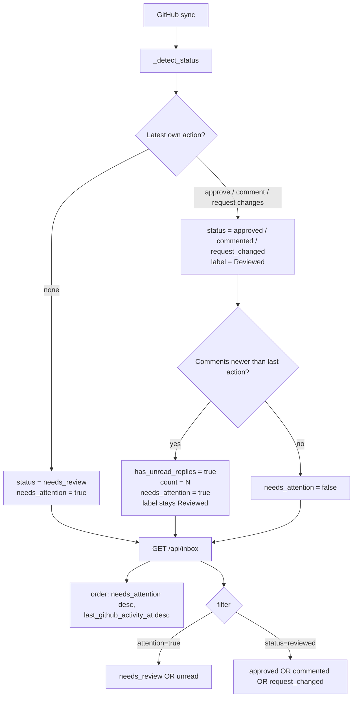

# Phase 54 — Inbox: reviewed items, unread replies and "needs attention"

## Objective & Scope

**In.**

- **A reviewed PR keeps its reviewed state.** Today `_detect_status` rewrites any
  `approved`/`request_changed`/`commented` row back to `needs_review` as soon as someone replies.
  That makes every active PR look like it needs a first review. The stored status stays the user's
  latest action; an inbound reply no longer overwrites it.
- **The inbox shows two user-facing states.** `needs_review` renders as **Needs review**; the three
  reviewed statuses (`approved`, `request_changed`, `commented`) render as **Reviewed**. The exact
  action is still stored, but the card label collapses it.
- **Unread replies are a badge, not a status.** A reviewed row with comments newer than
  `last_user_action_at` shows **`<n> unread reply` / `<n> unread replies`**. It remains *Reviewed*.
- **Ordering puts attention first.** Rows that need attention (status `needs_review`, or any
  unread reply) sort to the top; reviewed rows with no unread replies move to the bottom. Within
  each group, newest GitHub activity wins, as before.
- **"Unread replies only" becomes "Needs attention only".** The filter returns
  `status = needs_review OR has_unread_replies`. The navbar badge counts exactly that set.
- **The status filter offers Every status / Needs review / Reviewed.** The default is **Every
  status** so reviewed rows are visible at the bottom. `status=reviewed` is a filter-only token that
  matches any of the three reviewed statuses.
- **`needs_attention` is explicit in the API** (`CachedPRRead.needs_attention`) so the UI, badge and
  tests share one definition instead of re-deriving it.
- **Tests, README and CHANGELOG** describe the new turn-taking contract.

**Out.**

- No schema change or Alembic revision: the database already stores the four statuses, the unread
  flag/count and the action timestamp. This is presentation plus query semantics.
- No change to what counts as a reply (inline review comments and issue comments newer than the
  last own review/comment), and no "mark read" action: an unread reply clears on the next own action
  or when the sync recalculates it.
- No change to quick-review posting, AI review linking, policies or watches. A policy still starts
  only from a `needs_review` row with no linked review.
- No new inbox screen, route or status value stored in PostgreSQL/SQLite. Rows written by the old
  behavior (`needs_review` with an unread count) keep that label until the next sync recomputes
  them from GitHub; there is no data migration.

**Terms.** *Needs attention* = the user has not reviewed the PR yet, or someone replied after the
user's last review/comment. *Reviewed* = the user approved it, commented on it, or requested changes.

## High-Level Design



```mermaid
sequenceDiagram
  participant U as Operator
  participant UI as PR Inbox
  participant API as FastAPI
  participant GH as GitHub
  U->>UI: Sync with GitHub
  UI->>API: POST /api/inbox/sync
  API->>GH: reviews + comments per PR
  GH-->>API: latest own review/comment + later replies
  API-->>UI: rows (needs_attention, unread count, reviewed status)
  UI->>UI: attention rows first; reviewed rows at bottom
  UI->>API: GET /api/inbox?attention=true
  API-->>UI: needs_review OR has_unread_replies
  Note over UI: navbar badge = that same count
```

## API Contracts & Schema

**No migration.** `cached_prs` already has `status`, `has_unread_replies`, `unread_replies_count` and
`last_user_action_at`.

`GET /api/inbox` query parameters:

| Param | Type | Default | Meaning |
|---|---|---|---|
| `status` | string | none | `needs_review`, `reviewed`, or one exact stored status (`approved`, `request_changed`, `commented`). `reviewed` matches the last three. |
| `repo` | string | none | `owner/name`. |
| `attention` | bool | `false` | Only rows with `status = needs_review` or `has_unread_replies = true`. Replaces `unread`. |

An unknown status is still `422`; the message lists the accepted values.

`CachedPRRead` gains one field (the rest are unchanged):

```json
{
  "id": 12,
  "pr_url": "https://github.com/octo/example/pull/123",
  "repo_owner": "octo",
  "repo_name": "example",
  "pr_number": 123,
  "title": "Add retries",
  "author_username": "bob",
  "status": "approved",
  "needs_attention": true,
  "has_unread_replies": true,
  "unread_replies_count": 2,
  "last_user_action_at": "2026-11-01T10:00:00Z",
  "involvement": "reviewer",
  "last_github_activity_at": "2026-11-10T10:00:00Z",
  "linked_review_id": null,
  "last_synced_at": "2026-11-17T09:00:00Z"
}
```

Ordering rule in SQL: `CASE WHEN status = 'needs_review' OR has_unread_replies THEN 0 ELSE 1 END`,
then `last_github_activity_at DESC`, then `id DESC`.

## Target File Map

New:

- `docs/plans/phase_54_plan.md` — this file.

Changed:

- `backend/app/models/cached_pr.py` — status constants (`REVIEWED_STATUSES`, `FILTERS`), a
  `needs_attention` property, and a docstring that no longer claims replies re-arm the status.
- `backend/app/services/github_inbox_service.py` — stop rewriting the status on unread replies;
  add the attention filter, the `reviewed` status filter and attention-first ordering.
- `backend/app/schemas/inbox.py` — `needs_attention` field.
- `backend/app/api/routes/inbox.py` — `attention` query parameter replaces `unread`.
- `backend/tests/test_inbox.py` — invert the reply cases, add reviewed/attention filtering and
  ordering coverage.
- `backend/rules/review-flow.md` — the inbox turn-taking contract: reviewed statuses survive
  replies, and `needs_attention` is the one definition.
- `frontend/src/types/index.ts` — `needs_attention`, `InboxStatusFilter`, `attention` filter.
- `frontend/src/services/api.ts` — send `attention=true`.
- `frontend/src/components/Navbar.tsx` — badge counts needs-attention rows.
- `frontend/src/pages/InboxPage.tsx` — Reviewed label, attention toggle, filter options, default
  filter, empty-state copy, reload after a quick action so the row re-sorts.
- `README.md` — the PR Inbox badge counts items needing attention.
- `CHANGELOG.md` — phase 54 entry.

Left alone:

- `backend/alembic/` — no schema change.
- `backend/app/services/policy_service.py` — policies keep matching `needs_review` only.
- `backend/app/services/watch_service.py` — no watch behaviour change.
- `frontend/src/components/QuickReviewPanel.tsx` — the slide-over and its events are unchanged.

## Ordered Steps

1. **Plan.** Land this file before application code.
2. **Model contract.** Add `REVIEWED_STATUSES`, `FILTERS`, and `needs_attention` to `CachedPR`; update
   the module docstring. Verify in a shell: a reviewed row with unread replies is `needs_attention`,
   a reviewed clean row is not.
3. **Detection.** In `_detect_status`, keep the reviewed status when replies arrive; only set
   `has_unread_replies`/`unread_replies_count`. Verify with the updated
   `test_inbound_reply_keeps_reviewed_and_counts_unread`.
4. **List contract.** Add `attention` filtering, `status=reviewed`, and attention-first ordering to
   `list_inbox`; expose `needs_attention` in `CachedPRRead`; rename the route parameter. Verify the
   new ordering test returns attention rows (newest first) and then reviewed rows.
5. **Frontend types and API.** Add the new field/type and send `attention`. Gate: `npm run build`.
6. **Inbox UI.** Two-state badges, unread badge, every-status default, Reviewed filter option,
   Needs-attention-only button, attention-aware empty state, reload after quick review.
7. **Navbar.** Count `listInbox({ attention: true }).length` and label the badge accordingly.
8. **Tests and docs.** Update the inbox suite, README and CHANGELOG; run the full backend suite.

## Verification

- `cd backend && pytest -q` green, including:
  - an inbound reply keeps `status=approved` and sets `needs_attention=true`, `unread_replies_count=2`;
  - an own reply after a review stays approved with no unread;
  - an authored PR comment + reply is `commented`, with one unread reply;
  - `attention=true` returns needs-review rows and reviewed rows with unread replies, and excludes
    reviewed clean rows;
  - `status=reviewed` returns all three reviewed statuses;
  - ordering puts a needs-review row ahead of a newer reviewed row, and a reviewed row with unread
    replies in the attention group;
  - an unknown status is still `422`.
- `cd frontend && npm run build` green.
- Manual evidence from the API against the test client: the JSON above, the attention-only URL
  returning the expected ids, and the navbar count equal to that list length.

## Verification result

- `cd backend && pytest -q` → **468 passed** (one warning, the pre-existing Starlette portal
  deprecation).
- `cd frontend && npm run build` → green (`tsc -b` and Vite).
- Manual API evidence through `TestClient` with GitHub stubbed at the service boundary, one PR
  approved at `2026-11-01T10:00:00Z` and two later replies:

```json
{
  "status": "approved",
  "needs_attention": true,
  "has_unread_replies": true,
  "unread_replies_count": 2,
  "last_user_action_at": "2026-11-01T10:00:00Z"
}
```

  `GET /api/inbox?attention=true` returned that PR, `GET /api/inbox?status=reviewed` returned it
  too, and the badge count (`len(attention)`) was `1`. The ordering test also proves a reviewed row
  with newer GitHub activity sorts below a needs-review row, while a reviewed row with unread
  replies joins the attention group.
- No migration was written or needed; the model already carried every stored field.
