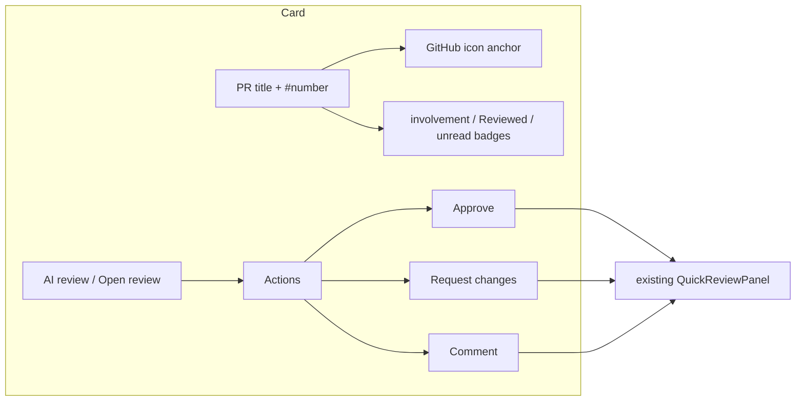

# Phase 55 — Inbox: compact card actions and pagination

## Objective & Scope

**In.**

- **One GitHub link, as an icon.** The per-card `GitHub` text link at the bottom right becomes an
  icon-only anchor beside the PR title. It keeps its URL, opens in a new tab, and carries an
  `aria-label`/`title` so the icon is not the only accessible name.
- **One Actions dropdown for the quick reviews.** `Approve`, `Request changes` and `Comment` leave
  the button row and become items in an **Actions** menu. Selecting an item opens the existing
  `QuickReviewPanel` for that PR and event; no request shape changes.
- **AI review stays a first-class button.** `AI review` / `Open review` keeps its position, label,
  variant, tooltip and behaviour.
- **Client-side pagination.** The inbox shows **10** cards per page by default with a
  **10 / 20 / 50 / 100** selector, a `Showing X–Y of N` line, and Previous/Next controls when there
  is more than one page — the same pattern the Reviews page already uses.
- **Page state follows the list.** Changing a status/repo/attention filter or the page size returns
  to page 1; a shrinking list (sync, quick review, filter) clamps the current page so the reader
  can never land on an empty page.
- **Docs.** README and CHANGELOG mention the compact card actions and the page sizes.

**Out.**

- No backend, API, schema or turn-taking change. `GET /api/inbox` already returns the full filtered
  cache; pagination is presentation only, so no new endpoint or query parameter.
- No change to `QuickReviewPanel`, the confirm/polish flow, the status labels, attention ordering,
  the navbar badge or the filter semantics from phase 54.
- No new global dropdown primitive for other screens. The actions menu is an inbox feature
  component in `src/components/`; a second consumer can promote it later.
- No keyboard command palette or per-item shortcut. The menu supports open/close, Escape and
  outside-click, and each item is a normal button.

## High-Level Design

```mermaid
flowchart TD
  P[InboxPage state] --> F[filters: status / repo / attention]
  P --> S[page size: 10 default]
  P --> N[page index]
  I[items from GET /api/inbox] --> C[pageCount = ceil(items / pageSize)]
  F --> R[page = 0]
  S --> R
  C --> D[currentPage = min(page, pageCount - 1)]
  D --> V[visibleItems = slice(first, first + pageSize)]
  V --> L[card list]
  L --> G[GitHub icon beside title]
  L --> A[AI review button]
  L --> M[Actions dropdown]
  M -->|Approve / Request changes / Comment| Q[QuickReviewPanel]
```



## API Contracts & Schema

None. The phase is presentation-only; no route, request/response field or migration changes.

Existing pagination copy pattern to mirror (Reviews page):

```text
Showing 1–10 of 37
Items per page  [10 v]
Page 1 of 4   [Previous] [Next]
```

## Target File Map

New:

- `docs/plans/phase_55_plan.md` — this file.
- `frontend/src/components/InboxActionsMenu.tsx` — the Actions trigger, menu, outside-click and
  Escape handling.

Changed:

- `frontend/src/pages/InboxPage.tsx` — icon-only GitHub link, `InboxActionsMenu` wiring, page state,
  derived slice, page-size selector and page navigation.
- `README.md` — the inbox cards page at 10/20/50/100 and quick reviews live under **Actions**.
- `CHANGELOG.md` — phase 55 entry.

Left alone:

- `backend/**` — no contract, service or model change.
- `frontend/src/components/QuickReviewPanel.tsx` — same events, same panel.
- `frontend/src/components/Navbar.tsx`, `frontend/src/services/api.ts`, `frontend/src/types/**` —
  no data-shape change.
- `frontend/src/pages/DashboardPage.tsx` — its pagination is the reference, not refactored into a
  shared component in this phase.

## Ordered Steps

1. **Plan.** Land this file before application code.
2. **Menu component.** Add `InboxActionsMenu` with an **Actions** trigger (`aria-haspopup="menu"`,
   `aria-expanded`), three `menuitem` buttons, outside-click and Escape close, and one `onSelect`
   callback. Verify it renders and emits each `QuickReviewEvent`.
3. **Card layout.** Move the GitHub link to the title row as an icon-only anchor; keep the AI review
   button; replace the three quick-review buttons with `InboxActionsMenu`.
4. **Pagination.** Add `page`/`pageSize` state, the 10/20/50/100 selector, `Showing X–Y of N`, and
   Previous/Next. Reset to page 1 on filter or page-size changes; clamp the current page when the
   list shrinks.
5. **Docs.** Update README and CHANGELOG, then append the verification result to this plan.
6. **Gate.** `cd frontend && npm run build`.

## Verification

- `cd frontend && npm run build` green (`tsc -b` and Vite).
- Static checks: no remaining per-card `Approve` / `Request changes` / `Comment` buttons in the
  button row; exactly one `GitHub` anchor per card and it is icon-only; the page-size options are
  exactly `10, 20, 50, 100`; the default is `10`.
- Behaviour evidence (code-level, since this package has no test runner):
  - `items = 37`, default size `10` → 4 pages, page 1 shows rows 1–10;
  - switching to `50` resets to page 1 and shows 1–37 with Previous/Next disabled;
  - changing any filter resets to page 1;
  - after a quick review shrinks the filtered list, `currentPage` clamps instead of showing an
    empty page;
  - selecting each Actions item passes the same `QuickReviewEvent` the old buttons passed.

## Verification result

- `cd frontend && npm run build` → green (`tsc -b` and Vite; 1,896 modules, existing chunk-size
  warning only).
- Static checks: `InboxPage.tsx` has `PAGE_SIZES = [10, 20, 50, 100]` and
  `DEFAULT_PAGE_SIZE = 10`; the only quick-review action labels now live in
  `InboxActionsMenu.tsx`; the card's GitHub anchor is icon-only in the title row.
- No backend or API files changed in this phase. This package still has no frontend test runner,
  so pagination and menu interaction are verified by the type/build gate and the code-level cases
  above rather than an automated browser test.
