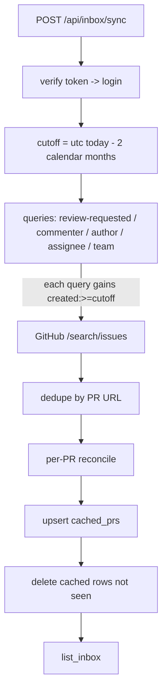
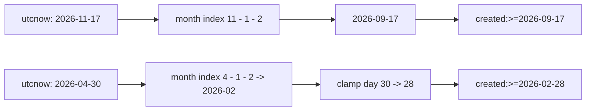

# Phase 56 — Inbox sync only discovers PRs created in the last two months

## Objective & Scope

**In.**

- **A creation window on discovery.** Every GitHub search query issued by
  `POST /api/inbox/sync` gains `created:>=<YYYY-MM-DD>`, where the date is two calendar months
  before the sync's UTC day. A PR opened earlier is no longer discovered, refreshed or re-added to
  `cached_prs`.
- **Calendar months, not 60 days.** `2026-04-30` minus two months is `2026-02-28`; the day is
  clamped to the target month's length rather than spilling into March.
- **Existing cache rows outside the window leave the inbox.** Sync already deletes rows it did not
  see; those rows now count as removed rather than "closed", so the post-sync notice says
  `N removed` instead of claiming GitHub closed them.
- **Docs.** README and CHANGELOG describe the two-month window.

**Out.**

- No change to the search result cap (`MAX_SEARCH_PAGES`), turn-taking detection, status mapping,
  quick reviews, filters, pagination or attention ordering.
- No change to `GET /api/inbox`, request/response schemas, or the database schema. `cached_prs`
  already stores `last_github_activity_at`; this window is a discovery concern, not a query filter.
- No watcher change: watches are explicitly configured per PR URL and keep reviewing them even when
  the PR is older than the inbox window.
- No configurable window setting; two months is a constant on the service.

## High-Level Design





## API Contracts & Schema

No HTTP contract or schema change. The only observable change is which PRs the sync discovers.

GitHub search qualifiers after this phase, for a login `alice` syncing on `2026-11-17`:

```text
is:pr is:open review-requested:alice archived:false created:>=2026-09-17
is:pr is:open commenter:alice archived:false created:>=2026-09-17
is:pr is:open author:alice archived:false created:>=2026-09-17
is:pr is:open assignee:alice archived:false created:>=2026-09-17
is:pr is:open team-review-requested:acme/apex archived:false created:>=2026-09-17
```

No Alembic revision.

## Target File Map

New:

- `docs/plans/phase_56_plan.md` — this file.

Changed:

- `backend/app/services/github_inbox_service.py` — `DISCOVERY_WINDOW_MONTHS`, `_months_ago`,
  `_queries` gains the `created:>=` qualifier, `_discover` passes the cutoff, module docstring.
- `backend/tests/test_inbox.py` — fixed-clock assertion that every query carries the cutoff and a
  month-end clamp case.
- `backend/rules/review-flow.md` — the inbox contract records the discovery window.
- `frontend/src/pages/InboxPage.tsx` — post-sync notice counts `removed` (closed or out of window).
- `README.md` — inbox paragraph names the two-month creation window.
- `CHANGELOG.md` — phase 56 entry.

Left alone:

- `backend/app/api/routes/inbox.py` and `backend/app/schemas/inbox.py` — same request/response.
- `backend/app/models/cached_pr.py` — no column or index change.
- `backend/app/services/watch_service.py` — watches are per PR URL, unaffected by discovery.
- `backend/app/services/github_service.py` — `search_open_prs` already takes an arbitrary query.

## Ordered Steps

1. **Plan.** Land this file before application code.
2. **Window helper.** Add `DISCOVERY_WINDOW_MONTHS = 2` and `_months_ago(now, months)` that clamps
   the day with `calendar.monthrange`.
3. **Queries.** Extend `_queries(login, teams, created_since)` so every query ends with
   `created:>=<cutoff>`; have `_discover` compute the cutoff from `utcnow()`.
4. **Tests.** Fixed-clock sync test asserts every recorded query carries
   `created:>=2026-09-17`; helper test covers `2026-04-30 → 2026-02-28`.
5. **Copy.** Change the inbox notice to `N removed`; document the window in README/CHANGELOG.
6. **Gate.** `cd backend && pytest -q`; `cd frontend && npm run build`.

## Verification

- `cd backend && pytest -q` green, including the two new tests.
- Fixed-clock evidence: sync on `2026-11-17` records only queries containing
  `created:>=2026-09-17` for review-requested, commenter, author, assignee and team queries.
- Helper evidence: `_months_ago(2026-04-30, 2) == date(2026, 2, 28)`.
- Existing inbox tests still pass unchanged (dedupe, turn-taking, quick reviews, ownership).
- `cd frontend && npm run build` green for the notice copy change.

## Verification result

- `cd backend && .venv/bin/python -m pytest tests/test_inbox.py -q` → **24 passed**;
  `cd backend && .venv/bin/python -m pytest -q` → **470 passed**.
- `test_sync_only_discovers_prs_created_in_last_two_months` pins `utcnow` to `2026-11-17` and
  asserts every recorded query (review-requested, commenter, author, assignee and team) contains
  `created:>=2026-09-17`.
- `test_months_ago_clamps_month_end` proves `2026-04-30 → 2026-02-28` and
  `2026-11-17 → 2026-09-17`.
- Existing inbox fixtures still pass unchanged (dedupe, team queries, turn-taking, quick reviews,
  ownership), so the window narrows discovery without altering anything downstream.
- `cd frontend && npm run build` → green (`tsc -b` and Vite; existing chunk-size warning only).
