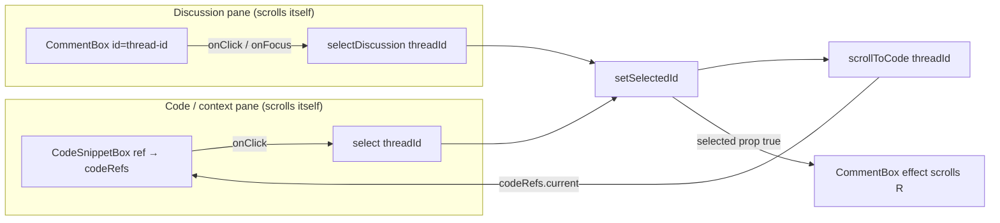

# Phase 57 — Selecting a discussion thread scrolls the code pane to its pair

## Objective & Scope

**In.**

- **Selection is symmetric.** In the review workspace the split pane shows a code/context card on the
  left and its discussion thread on the right. Selecting a thread from the **left** already scrolls
  the matching discussion card into view (the card's own `selected` effect). Selecting from the
  **right** must now scroll the matching code card into view inside its own pane, so whichever side
  the operator clicks, the other side follows.
- **One helper for the code pane.** The page owns the code-card refs, so the scroll lives in
  `ReviewDetailPage`: a small `scrollToCode(threadId, block)` helper used by the left selection and
  by the new right selection. No new state, no API, no schema.
- **No change to toggle semantics.** Clicking the left card still toggles the selection off (Escape
  clears it); clicking the discussion card still selects without toggling.

**Out.**

- No linked scrolling (the two panes keep independent scroll positions), no auto-scroll while
  typing, and no change to the ordinal `#n` jump, the filters, `SplitPane` layout or the mobile
  stacking.
- No change to how selection is drawn (ring/border styles stay as they are).

**Terms.** "Pair" means the code card and the discussion card that render from the same
`ReviewThread`: both panes are built from `visibleThreads`, so a filtered-out thread is out of both
panes and can never be scrolled to on one side only.

## High-Level Design

## API Contracts & Schema

None. Frontend-only: no HTTP contract, no column, no Alembic revision.

## Target File Map

New:

- `docs/plans/phase_57_plan.md` — this file.

Changed:

- `frontend/src/pages/ReviewDetailPage.tsx` — `scrollToCode` helper; `select` uses it; new
  `selectDiscussion` used by the `CommentBox` `onSelect`.
- `CHANGELOG.md` — a Phase 57 **Fixed** entry.

Left alone:

- `frontend/src/components/CommentBox.tsx` — its existing `selected` effect keeps the
  left→right direction; the right card is still reached by `id="thread-<id>"` for the ordinal jump.
- `frontend/src/components/SplitPane.tsx`, `CodeSnippetBox.tsx` — presentational, no new props.
- `backend/` — untouched.

## Ordered Steps

1. **Plan.** Write this file (rule zero).
2. **Helper + handlers.** Add `scrollToCode`; route `select` through it; add `selectDiscussion`
   and pass it as the `CommentBox` `onSelect`.
3. **Docs.** Add the CHANGELOG entry under a new Phase 57 heading.
4. **Gate.** `cd frontend && npm run build` (`tsc -b` + Vite).

## Verification

- `cd frontend && npm run build` green.
- Manual, in `npm run dev` on a review with several threads: clicking a discussion card scrolls the
  code pane so that thread's code card is in view and highlighted; clicking a code card still
  scrolls the discussion pane to its pair; Escape still clears the selection; the ordinal jump and
  the filters behave as before.
- No backend change, so `pytest` is unaffected; recorded as not run for this frontend-only phase.

## Verification result

- `cd frontend && npm run build` → green (`tsc -b` + Vite, 1896 modules).
- The running Vite dev server (`127.0.0.1:5173`) transforms the changed module without error and
  serves the new handlers (`scrollToCode`, `selectDiscussion`, and the `CommentBox` `onSelect`
  wiring at `ReviewDetailPage.tsx`).
- Browser click-through (right card → code card) not exercised by a script here: there is no
  frontend test runner and no headless browser in this environment. The left→right direction is
  unchanged (`CommentBox`'s `selected` effect).
