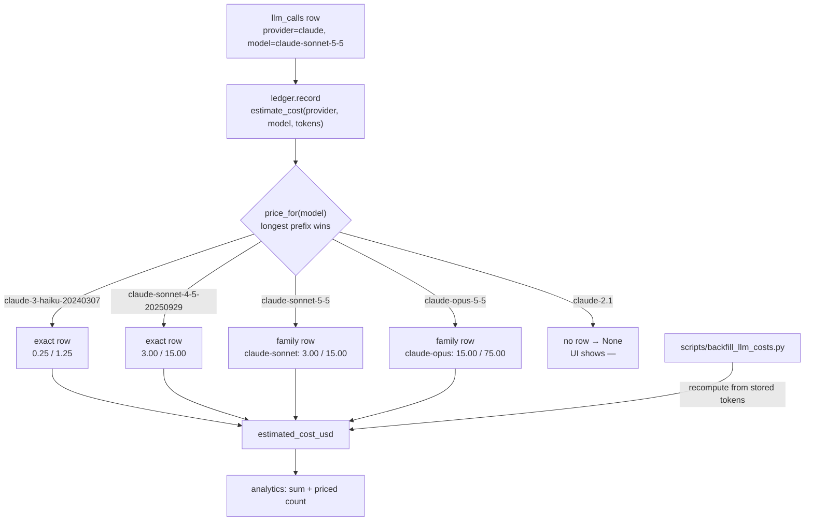

# Phase 58 — Claude calls are priced: family defaults, a guard test and a backfill

## Objective & Scope

**In.**

- **Why.** `estimated_cost_usd` is written once, at call time, from `core/pricing.py`. That table's
  Anthropic section stops at `claude-3-x` / `claude-4-5`, while the app offers and the operator
  runs `claude-sonnet-5-5` and `claude-opus-5-5`. Prefix matching has no row that covers them, so
  `estimate_cost` returns `None` and Analytics renders `—` for both models (`analytics.py:63-65`
  and `frontend/src/lib/utils.ts:42-46`). Measured on `code_review` before this phase: **194 of 194
  Claude calls unpriced**, 6.20M input / 0.37M completion tokens contributing tokens, latency and
  quality but zero dollars to spend and to the monthly budget.
- **Family rows.** Add three Anthropic *family* rows — `claude-opus`, `claude-sonnet`,
  `claude-haiku` — so every `<family>-<any generation>` id (dated snapshots included) resolves.
  This is the prefix mechanism the table already uses (`pricing.py:73-84`, longest prefix wins), so
  the existing exact rows keep priority and no lookup code changes.
- **A ceiling, not a quote.** A family row is the highest standard rate the table can cite for that
  family. An unpriced generation is therefore *over*-estimated, never under-estimated: a budget cap
  that errs high is safe, and the UI already labels every figure `~$…` / "estimated".
- **Guard test.** Assert every id in `CLAUDE_FALLBACK` resolves, so the next catalogue bump (the
  event that caused this drift) fails loudly instead of silently going unpriced.
- **One-off backfill.** The existing `scripts/backfill_llm_costs.py` already recomputes cost from
  stored tokens. It is tightened so a `NULL` row that recomputes to `0.0` (a free local call) is
  written as `0.0` instead of being skipped, then run dry-run-then-apply against `code_review`.

**Out.**

- No wildcard `claude-` row. Haiku, Sonnet and Opus differ ~20× in list price; one number for all
  three is a *wrong* figure that looks exact — exactly what the module docstring forbids.
- No exact row invented per generation. A generation priced differently from its family ceiling gets
  its own exact row when its published rate is known; the family row is the fallback otherwise.
- No change to `analytics.py`, the API schemas, the frontend, the ledger or how cost is written at
  call time.
- No Alembic revision: `llm_calls.estimated_cost_usd` already exists and the repair is data, not
  schema (`backend/rules/conventions.md` § Costs, `database.md` § Drift).
- Legacy `claude-2` / `claude-3-opus` ids stay unpriced on purpose: they are retired, not offered,
  and the negative test pins that the family rows are not a catch-all.

**Terms.** "Family" is the second token of the id (`claude-`**`sonnet`**`-5-5`). "Exact row" is a
`MODEL_PRICES` key with a generation in it (`claude-3-haiku`). "Ceiling" is the highest standard
rate published for any generation of the family that this table can cite.

## High-Level Design



The backfill reads the same `estimate_cost`, so it inherits the new rows and is idempotent: a second
`--apply` reports `changed 0`.

## API Contracts & Schema

**No HTTP contract change, no column, no Alembic revision.** The only persistent effect is values in
`llm_calls.estimated_cost_usd` (`Float`, nullable — `app/models/llm_call.py:72`).

The price table gains these keys (USD per 1,000,000 tokens, standard tier):

```python
"claude-opus":   {"input": 15.00, "output": 75.00},   # family ceiling
"claude-sonnet": {"input": 3.00,  "output": 15.00},
"claude-haiku":  {"input": 0.80,  "output": 4.00},
```

Resolution for the ids in use and for the neighbouring ones:

| model id | matched row | input / output |
| --- | --- | --- |
| `claude-sonnet-5-5` | `claude-sonnet` (family) | 3.00 / 15.00 |
| `claude-opus-5-5` | `claude-opus` (family) | 15.00 / 75.00 |
| `claude-haiku-5-5` | `claude-haiku` (family) | 0.80 / 4.00 |
| `claude-sonnet-4-5-20250929` | `claude-sonnet-4-5` (exact) | 3.00 / 15.00 |
| `claude-3-haiku-20240307` | `claude-3-haiku` (exact) | 0.25 / 1.25 |
| `claude-2.1` | none | `None` → `—` |

The script contract is unchanged (`backend/scripts/backfill_llm_costs.py`):

```text
python scripts/backfill_llm_costs.py           # dry run: report only, writes nothing
python scripts/backfill_llm_costs.py --apply   # write the recomputed values
```

## Target File Map

New:

- `docs/plans/phase_58_plan.md` — this file.

Changed:

- `backend/app/core/pricing.py` — three family rows, plus a docstring paragraph stating the
  exact-row-wins / family-ceiling policy.
- `backend/tests/test_llm_usage.py` — four tests: offered Claude ids are priced, a future
  generation resolves, an exact row still beats the family row, and `claude-` is not a catch-all.
- `backend/scripts/backfill_llm_costs.py` — compare against the stored value by identity rather than
  `or 0.0`, so `NULL → 0.0` is written for a free provider; docstring notes the `NULL` case.
- `backend/tests/test_backfill_llm_costs.py` — one test for that `NULL → 0.0` repair.
- `backend/rules/conventions.md` — one clause in § Costs: a model with no exact row inherits its
  family row, which is a ceiling.
- `CHANGELOG.md` — Phase 58 **Fixed** entry.

Left alone:

- `backend/app/services/analytics.py`, `schemas/analytics.py`, `services/ledger.py` — aggregation
  already reports `None` honestly; the fix is upstream.
- `frontend/` — `estimatedCost` already renders `—` for unknown and `~$` for estimates.
- `backend/alembic/` — no revision.
- Existing exact rows — `claude-3-5-sonnet`, `claude-sonnet-4-5`, `claude-3-5-haiku`,
  `claude-3-haiku` keep their cited rates and their priority.

## Ordered Steps

1. **Plan.** Write this file (rule zero).
2. **Table.** Add the three family rows and the policy paragraph in `core/pricing.py`.
3. **Guard tests.** Add the four cases to `tests/test_llm_usage.py`; run them alone.
4. **Backfill `NULL` case.** Change the equality check in `scripts/backfill_llm_costs.py` from
   `abs(cost - (row.estimated_cost_usd or 0.0))` to an explicit `None` check; add its test.
5. **Gate.** `cd backend && pytest -q`.
6. **Dry run.** `python scripts/backfill_llm_costs.py` — report only; record the Claude line and the
   TOTAL.
7. **Apply.** `python scripts/backfill_llm_costs.py --apply` — expect the Claude rows that reported
   tokens to change (the failed calls without counts stay `NULL`) and `changed 0` on a second run.
8. **Verify the product surface.** Re-query `llm_calls`, then call
   `analytics.summarise(db, user_id, 30)` and check the Claude model rows now carry
   `estimated_cost_usd` and that `totals.priced_calls` equals `totals.calls` for that account.
9. **Docs.** CHANGELOG entry; `rules/conventions.md` clause.

## Verification

- `cd backend && pytest -q` green, including the four new pricing tests and the new backfill test.
- \(O(1)\) proof the guard fails on drift: temporarily removing `claude-sonnet` makes
  `test_every_offered_claude_model_has_a_price` fail; restoring it passes.
- Dry run prints a `claude` line with `changed 194`, `unpriced 0`, and a non-zero `new $`; the TOTAL
  `new $` exceeds the old by the Claude estimate. Re-running shows the same `new $`.
- After `--apply`, `psql -d code_review -c "select count(*) from llm_calls where provider='claude'
  and estimated_cost_usd is null"` returns `0`, and the total matches the dry run's `new $` to 6 dp.
- Per-model cost after the backfill, at the family ceilings (measured in the result section below):
  `claude-sonnet-5-5` ≈ $20.00 and `claude-opus-5-5` ≈ $23.86. These are the numbers the Analytics
  page and the monthly budget show.
- `GET /api/analytics` for the account reports `priced_calls == calls`, non-null
  `estimated_cost_usd` on both Claude rows, and a `budget.dollars_used` that now includes them.
- **Rate caveat, stated in the table.** The ceilings are the highest standard rate this table can
  cite per family (Opus 4/4.1 = 15/75; Sonnet 4.5 = 3/15; Haiku 3.5 = 0.80/4). If Anthropic's 5.x
  list price differs, the correction is one line in `pricing.py` plus a re-run of the backfill —
  which is the point of keeping the repair a script.

## Verification result

- `cd backend && pytest -q` → **476 passed** (was 470; four pricing tests and two backfill tests
  added, none removed). The focused run of `tests/test_llm_usage.py tests/test_backfill_llm_costs.py`
  is 30 passed.
- Dry run, `python scripts/backfill_llm_costs.py` (all 290 rows in `code_review`):

  ```text
  provider       model                           rows  changed        old $        new $  unpriced
  claude         claude-opus-5-5                   51       42     0.000000    23.863830         9
  claude         claude-sonnet-5-5                147      144     0.000000    19.997430         3
  ...
  TOTAL                                           290      186     2.212413    46.073673
  ```

  `unpriced` is the 12 Claude calls that failed before reporting usage (no token counts), which stay
  `NULL` — correct, there is nothing to price.
- `--apply` → `applied: 186 row(s) updated`. A second `--apply` → `changed 0`, total unchanged at
  `46.073673`, so the repair is idempotent.
- Per-model cost after the backfill (matches the family ceilings):

  | model | rows | priced | est. cost |
  | --- | --- | --- | --- |
  | `claude-opus-5-5` | 51 | 42 | $23.863830 |
  | `claude-sonnet-5-5` | 147 | 144 | $19.997430 |

- `select count(*) from llm_calls where estimated_cost_usd is null and prompt_tokens is not null` →
  **0**: no priced-token row is left unknown.
- `analytics.summarise(db, user_id, 30)` for the local account: `calls=280`, `priced=260`,
  `estimated_cost_usd=46.010675` (the 10 excluded rows predate the window), `by_provider` now lists
  `claude: 43.861260`, and `budget.dollars_used` moved from unpriced to `46.010675` for 2026-11.
- **Rate caveat stands.** The ceilings are the highest standard rate this table can cite per family
  (Opus 15/75; Sonnet 3/15; Haiku 0.80/4). If Anthropic's 5.x list price differs, change the three
  rows in `pricing.py` and re-run `--apply`; nothing else needs to move.

