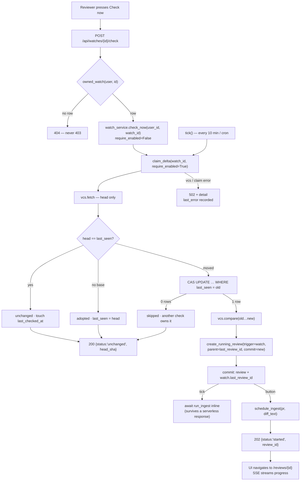

# Phase 59 — Check now: a watch the operator can trigger by hand

## Objective & Scope

**In.**

- **The gap.** A watch is only ever checked by the scheduler: an asyncio loop every
  `WATCH_INTERVAL_MINUTES` (default 10) locally/Docker, `POST /api/watches/tick` from the Vercel cron
  in serverless. After pushing a fix the reviewer has no way to say "review that push now" — they
  wait up to ten minutes, or start a whole new review of the PR and pay for a full diff instead of the
  delta (`watch_service.py:146-183`, `_check_watch`).
- **A button next to "Watch for new commits".** `WatchToggle` gains **Check now**, which calls the
  new `POST /api/watches/{watch_id}/check`. It runs exactly the same claim a tick runs, for one
  watch, and starts the same linked delta review.
- **One claim implementation.** `_check_watch` is split into `claim_delta` (fetch head → no-op /
  adopt / compare-and-set claim → commit the review row) and the ingest dispatch. The tick keeps
  awaiting ingest inline; the new route schedules it like every other review, so the click answers
  immediately and progress streams from `GET /api/reviews/{id}/events`.
- **`enabled` means "poll me", not "may I be checked".** The scheduled tick still skips a paused
  watch (`_check_watch` → `skipped`, unchanged). A manual check runs on an enabled **or** paused
  watch: pausing is how an operator turns a poll-heavy deployment into a click-driven one, and that
  is the point of this button. `last_checked_at` / `last_error` / `last_seen_commit_id` update the
  same way either way, so the tick queue stays fair.
- **No new spend lever.** The claim is still a single compare-and-set `UPDATE … WHERE
  last_seen_commit_id = <old>` in the same transaction as the review insert, with
  `UNIQUE(watch_id, commit_id)` behind it. A double click on one head therefore creates one review:
  the first claims it and the second answers `unchanged` (head never moved) or `skipped` (lost the
  claim).

**Out.**

- No change to the scheduler, the tick budget (`watch_max_checks_per_tick` /
  `watch_max_reviews_per_tick`), the cron interval, or `WATCH_TICK_SECRET`. A manual check is one
  review per click by construction, so it needs no budget.
- No "check all watches now" button. `POST /api/watches/tick` already is that, and it is
  secret-gated because it is the public path.
- No background job, no queue, no new table, no **Alembic revision** — the state a manual check
  needs (`last_seen_commit_id`, `last_review_id`, `last_checked_at`, `last_error`) already exists on
  `review_watches`.
- No change to the dashboard `WatchesPanel`. It keeps Pause / Delete; the button lives where the
  user asked (the review header, beside Watch).
- No force-check of an already-reviewed commit: pressing Check now with an unchanged head is a
  no-op that costs nothing, never a second review of the same diff.

## High-Level Design



**Ordering that matters.** The claim commits before ingest runs, exactly as today: a manual check
never holds a transaction across a model call, and `run_ingest` opens its own session
(`review_pipeline.py:328-347`). `last_seen_commit_id` still advances at *creation*, so a failed
manual delta review stays visible as `failed` and does not park the watch on one commit.

## API Contracts & Schema

`POST /api/watches/{watch_id}/check` — session cookie (owned route, `CurrentUser`). No request body.

Started (the only `202`; decorator-default, like `POST /api/reviews`):

```json
{
  "status": "started",
  "review_id": 412,
  "head_sha": "9f1c2ab7d3e4f5a6b7c8d9e0f1a2b3c4d5e6f7a8",
  "detail": null
}
```

Nothing to review (`200`; `status` is one of `unchanged`, `adopted`, `skipped`):

```json
{ "status": "unchanged", "review_id": null, "head_sha": "aaa111", "detail": null }
```

- `unchanged` — the head is the commit this watch already accounted for.
- `adopted` — the watch had no base; it now tracks `head_sha` and reviews the next push.
- `skipped` — another check (a tick or a previous click) claimed this delta first; `detail` says so.

Failures:

```json
{ "detail": "GitHub cannot compare those commits — the branch was force-pushed." }
```

- `404` — no watch with that id for this account (foreign row is a `404`, never a `403`).
- `502` — the head/compare could not be read; `watch.last_error` carries the first line.
- `503`/`401` do **not** apply: this route is session-authenticated and is not the cron tick.

Schema additions (`backend/app/schemas/watch.py`):

```python
class WatchCheckRead(BaseModel):
    status: str                 # started | unchanged | adopted | skipped
    review_id: int | None = None
    head_sha: str | None = None
    detail: str | None = None
```

No database change: `review_watches` already has every column the manual path touches, so no
Alembic revision and `alembic_version` stays at head.

`schedule_ingest` gains keyword-only `pr` / `diff_text` (`None` = fetch it, the current behaviour):

```python
def schedule_ingest(
    review_id: int,
    background: BackgroundScheduler | None = None,
    *,
    pr: PullRequestInfo | None = None,
    diff_text: str | None = None,
) -> None
```

## Target File Map

**Changed**

| File | Change |
| --- | --- |
| `backend/app/services/watch_service.py` | `DeltaClaim` / `DeltaCheck` dataclasses; `claim_delta` extracted from `_check_watch`; `check_now(user_id, watch_id)`; `__all__`. Tick results unchanged. |
| `backend/app/services/review_pipeline.py` | `schedule_ingest` passes `pr` / `diff_text` through to `run_ingest` (both the serverless background task and the local `create_task`). |
| `backend/app/schemas/watch.py` | `WatchCheckRead`. |
| `backend/app/api/routes/watches.py` | `POST /{watch_id}/check` (`202` started, `200` no-op, `404`, `502`). |
| `frontend/src/types/index.ts` | `WatchCheck` interface (mirrors `WatchCheckRead`). |
| `frontend/src/services/api.ts` | `checkWatch(watchId)`. |
| `frontend/src/components/WatchToggle.tsx` | **Check now** button, inline no-op copy, refresh of the watch row, navigate to the new review. |
| `backend/rules/review-flow.md` | One paragraph: the manual check shares the claim, and `enabled` gates only the tick. |
| `README.md` | The watch step mentions Check now; the feature bullet says "or on demand". |
| `CHANGELOG.md` | Phase 59 entry. |

**New**

| File | Purpose |
| --- | --- |
| `docs/plans/phase_59_plan.md` | This plan. |
| Tests in `backend/tests/test_watches_api.py` | The route: started, unchanged, paused watch, foreign account, double click, VCS failure. |
| Tests in `backend/tests/test_watch_service.py` | `claim_delta` returns the delta without running ingest; `check_now` is `None` for a foreign watch. |

**Left alone**

`policy_service` (same tick, unaffected) · the scheduler and `config.py` · `WatchesPanel` ·
`review_watches` schema and every migration · `POST /api/watches/tick` and its secret gate.

## Ordered Steps

1. **Service split.** Add `DeltaClaim` (review id, PR, delta text) and `DeltaCheck` (status,
   `head_sha`, claim, detail). Move the body of `_check_watch` into
   `claim_delta(watch_id, *, require_enabled: bool = True)`; keep `_check_watch` as
   `claim_delta` → `await run_ingest`. Verify: `pytest -q tests/test_watch_service.py` still green
   before anything else changes.
2. **Manual entry point.** `check_now(user_id, watch_id)` — ownership through `owned_watch` (returns
   `None` for a foreign/unknown row) then `claim_delta(..., require_enabled=False)`.
3. **Pipeline plumbing.** `schedule_ingest(..., pr=, diff_text=)`; `POST /api/reviews` behaviour is
   byte-identical when the keywords are omitted.
4. **Schema + route.** `WatchCheckRead`; `POST /api/watches/{watch_id}/check` maps
   `None → 404`, `failed → 502`, claim → `schedule_ingest` + `202`, anything else → `200`.
5. **Backend tests.** Six route cases and two service cases (below). Run the full suite.
6. **Frontend.** Type → `api.checkWatch` → button and copy in `WatchToggle`; `npm run build`.
7. **Docs.** `backend/rules/review-flow.md`, `README.md`, `CHANGELOG.md`.
8. **Manual proof.** Start the app, watch a PR, press Check now with an unchanged head (`200`
   `unchanged`), then with a moved head (`202` + a review that streams to `draft`); press twice
   quickly and confirm one review row.

## Verification

- `cd backend && pytest -q` — green, including the new cases:
  - started: `POST …/check` with a moved head answers `202`, `status=started`, and the review is
    `trigger=watch`, `parent_review_id=<the reviewed one>`, `commit_id=<new head>`, and reaches
    `draft` (only the delta file has a thread — the full diff is never fetched);
  - unchanged: `200`, `status=unchanged`, no new `code_reviews` row, `last_checked_at` moved;
  - paused: `enabled=false` → the tick still skips it, the click still starts a review;
  - isolation: a second account gets `404` and the watch is untouched;
  - double click: two calls, one review (`statuses` `started` then `unchanged`; second row count 1);
  - failure: `compare` raises `VCSError` → `502`, `last_error` recorded, the delta is retried on the
    next check.
- `cd frontend && npm run build` — `tsc -b` clean.
- `alembic downgrade -1 && alembic upgrade head` — not applicable (no revision); state that plainly
  rather than running it.
- Live check with real output pasted into the phase summary: status codes, `status` values, the
  review id the button opened.
