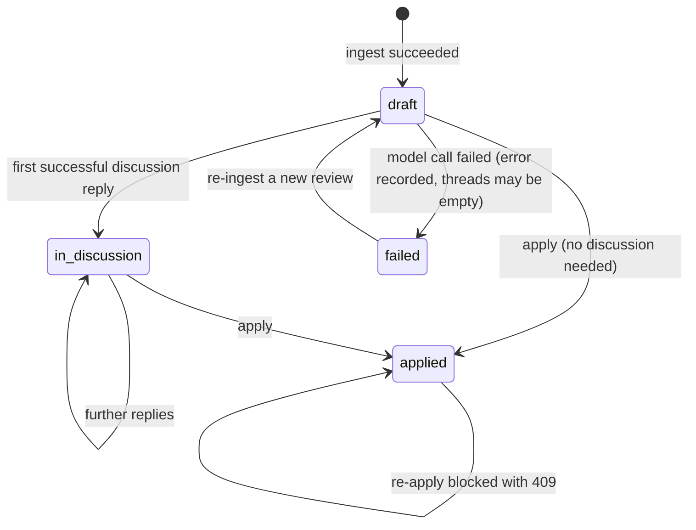

# Phase 5 — GitHub Application & Export Review

## Objective & Scope

Publish the reviewed, discussed thread state to GitHub as a single pull-request review with
inline comments and a verdict, then record that the local review was applied.

**In scope**

- `POST /api/reviews/{id}/apply` with `{event, body, thread_ids?}`.
- Collation: one inline comment per thread, built from the last assistant message, prefixed
  with `**AI Review Conclusion:**` when the thread was actually discussed.
- Anchor re-validation against the *current* PR diff before posting: the PR may have moved
  since ingest, and GitHub rejects the whole review for one stale `(path, line)`.
- Single call to `POST /repos/{owner}/{repo}/pulls/{n}/reviews` with `commit_id`, `event`,
  `body`, `comments[{path, line, side:"RIGHT", body}]`.
- Error recovery: on GitHub 422 with inline comments, retry once without comments and report
  the degraded outcome instead of failing the whole action.
- State transition to `applied`, `verdict`, and `github_review_url` persisted; response
  carries the direct link.
- Frontend: verdict selector + summary already in the action bar; wire Apply with busy state,
  success link, and readable failures.

**Out of scope**

- Editing a submitted GitHub review (GitHub does not allow it; dismissing/hiding is manual).
- Posting individual thread replies as PR conversation comments; one review, one payload.
- Multi-commit / stacked-PR reviews; the review targets the HEAD SHA recorded at ingest.
- Retrying a partially-applied review automatically — the operator decides.

## High-Level Design

### End-to-end application sequence

```mermaid
sequenceDiagram
    autonumber
    participant U as User
    participant P as StickyActionBar
    participant A as POST /reviews/{id}/apply
    participant DB as SQLite
    participant GH as GitHub API

    U->>P: choose REQUEST_CHANGES, write summary, click Apply
    P->>A: {event, body}
    A->>DB: load review + threads + settings token
    A->>A: guard status != applied, commit_id present
    A->>GH: GET pulls/{n} diff (current head)
    GH-->>A: diff
    A->>A: validate each (path, line) on RIGHT side; drop stale ones
    A->>GH: POST pulls/{n}/reviews {commit_id, event, body, comments[]}
    alt 201 created
        GH-->>A: {id, html_url}
        A->>DB: status=applied, verdict=event, github_review_url=html_url
        A-->>P: {review, github_review_url, comments_posted, warnings[]}
        P->>U: "Applied · View on GitHub"
    else 422 invalid comment
        A->>GH: POST same review, comments=[]
        GH-->>A: {html_url}
        A->>DB: status=applied + warning "inline comments dropped"
        A-->>P: warnings explain the degradation
    else network / auth error
        A-->>P: 502 with detail (status unchanged)
    end
```

### Review status state machine



`applied` is terminal for this local review: GitHub reviews are immutable, so a second apply
is refused with 409 rather than silently posting a duplicate.

## API Contracts & Data Schemas

### `POST /api/reviews/{id}/apply`

Request

```json
{
  "event": "REQUEST_CHANGES",
  "body": "Overall automated review completed with interactive human oversight.",
  "thread_ids": [21, 22]
}
```

- `event` ∈ `APPROVE | REQUEST_CHANGES | COMMENT` (default `COMMENT`).
- `body` optional; a default summary is used when absent.
- `thread_ids` optional — when present only those threads are exported (lets the operator
  publish a subset); unknown ids are a 400.

`200`

```json
{
  "review": { "...CodeReviewDetail with status applied, verdict, github_review_url..." },
  "github_review_url": "https://github.com/owner/repo/pull/123#pullrequestreview-456",
  "comments_posted": 2,
  "warnings": []
}
```

Errors

| Status | When | Body |
|---|---|---|
| 400 | No GitHub token | `{"detail": "No GitHub token configured. Add one in Settings."}` |
| 400 | `thread_ids` references another review | `{"detail": "Thread 43 does not belong to this review."}` |
| 404 | Review missing | `{"detail": "Review not found"}` |
| 409 | Already applied | `{"detail": "This review was already applied to GitHub."}` |
| 422 | Review has no `commit_id` | `{"detail": "This review has no recorded HEAD commit."}` |
| 502 | GitHub rejected / unreachable | `{"detail": "GitHub rejected the review: …"}` |

### GitHub payload (exact shape sent)

```json
{
  "commit_id": "9f1c…",
  "event": "REQUEST_CHANGES",
  "body": "**Automated review** — 2 findings, discussed and confirmed by the reviewer.",
  "comments": [
    {
      "path": "src/services/auth.py",
      "line": 42,
      "side": "RIGHT",
      "body": "**AI Review Conclusion:** An allowlist is the right fix here."
    }
  ]
}
```

### Collation rule

| Thread state | Comment body |
|---|---|
| single assistant message (never discussed) | that message verbatim |
| assistant → user → assistant | `**AI Review Conclusion:** ` + last assistant message |
| assistant → user (no reply yet) | `**AI Review Conclusion:** ` + last assistant message, and a warning notes the unanswered question |
| no assistant message at all | thread skipped, warning recorded |

## Target File Map

### Backend — new

| File | Responsibility |
|---|---|
| `app/services/apply_service.py` | `collate_comments`, `revalidate_anchors`, `apply_review` |
| `backend/tests/test_apply.py` | payload shape, validation, fallback, state transitions |

### Backend — modified

| File | Change |
|---|---|
| `app/schemas/review.py` | `ApplyRequest`, `ApplyResponse` |
| `app/api/routes/reviews.py` | `POST /{id}/apply` |
| `app/services/github_service.py` | `post_review` (already present, used here) |

### Frontend — modified

| File | Change |
|---|---|
| `src/services/api.ts` | `applyReview` |
| `src/pages/ReviewDetailPage.tsx` | apply handler, applied state, link, errors |
| `src/components/StickyActionBar.tsx` | applied/busy wiring (props already exist) |

## Step-by-Step Implementation Steps

1. Schemas for the request/response.
2. `collate_comments(review, thread_ids)` → `(comments, warnings)` using the collation rule.
3. `revalidate_anchors(token, review, comments)` → keeps only comments whose `(path, line)`
   still exist on the RIGHT side of the current diff; warns for each drop.
4. `apply_review(db, review, payload)`:
   - guards (token, status, commit_id, thread ownership),
   - collate → revalidate → post via `github_service.post_review`,
   - on 422 with comments: retry body-only, add warning,
   - persist `status/verdict/github_review_url`, commit, return payload.
5. Route `POST /{review_id}/apply` with error mapping.
6. Frontend: `applyReview`, page handler, disable bar while applying, show link + warnings,
   refresh review state.
7. Tests: happy path payload assertions, subset export, stale anchor dropped, 422 fallback,
   double apply 409, missing token 400.

## Verification & Acceptance Criteria

1. `pytest` passes with the apply tests included (payload shape asserted field by field).
2. The posted payload carries the review's `commit_id`, the chosen `event`, the summary body,
   and one comment per exported thread with `side: "RIGHT"`.
3. A thread anchored on a line that no longer exists in the current diff is dropped, a warning
   explains it, and the remaining comments still post.
4. A 422 from GitHub triggers exactly one retry without comments, and the review is marked
   applied with a warning instead of failing.
5. Re-applying an applied review returns 409 and does not call GitHub.
6. On success the UI shows the GitHub review link, the status badge flips to "Applied to
   GitHub", and reloading the page keeps both.
7. Failure paths leave the local review untouched (`status`, `verdict`, `github_review_url`).
