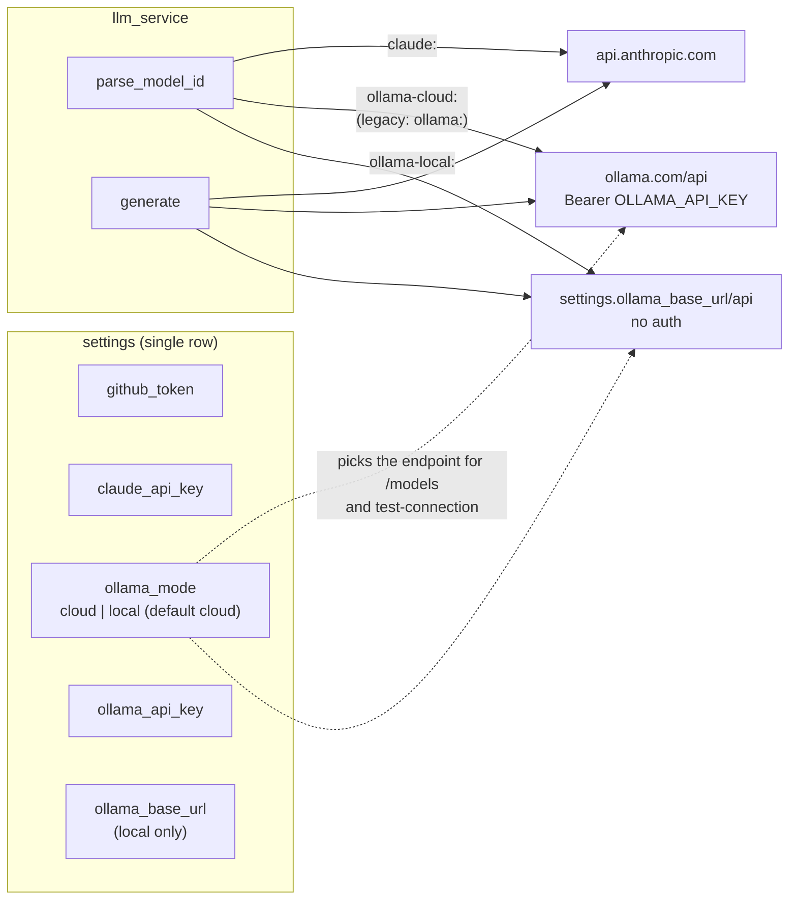
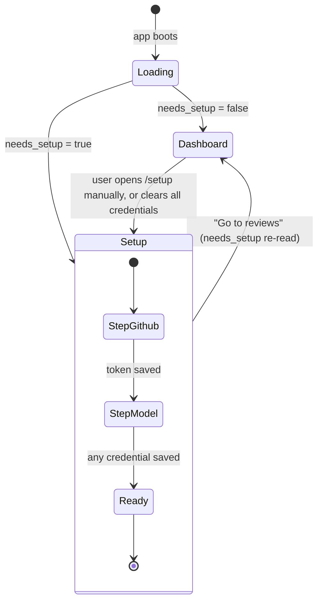

# Phase 6 — Ollama Cloud as a First-Class Provider & First-Run Setup Guide

## Objective & Scope

Two corrections to the product, both about the moment before anything works:

1. **Ollama is not only a local daemon.** It also runs as a hosted API (`https://ollama.com/api`)
   authenticated with a bearer API key — the same shape as the Claude integration. Ollama Cloud
   becomes the **default** Ollama mode, with the local daemon kept as the alternative.
2. **An unconfigured app must not pretend to work.** With no GitHub token and no model
   credential, `/` currently renders a dashboard whose only possible outcome is an error. It
   must land on a **setup guide** that walks the user to a working configuration, and release
   them to the dashboard once they have one.

**In scope**

- `ollama_mode` (`cloud` default | `local`) and `ollama_api_key` on the settings singleton, plus
  migration `0003`.
- Cloud transport: `POST {ollama_cloud_url}/api/chat` with `Authorization: Bearer <key>`;
  `GET /api/tags` for the model list. Local transport unchanged (no auth header).
- Model ids `ollama-cloud:<name>` (default) and `ollama-local:<name>`; legacy `ollama:<name>`
  stays valid and resolves to cloud.
- Mode-aware connection test and model catalogue; `needs_setup` computed server-side.
- Settings UI: an Ollama card with a Cloud / Local switch, Cloud first, cloud key field masked
  like the Claude key.
- New `/setup` guide: GitHub token, provider choice (Ollama Cloud default, Claude, Local
  Ollama), test buttons, and a CTA that unlocks once `needs_setup` is false.
- Dashboard route redirects to `/setup` while `needs_setup` is true.

**Out of scope**

- OAuth/`ollama signin` flows, per-model provider pinning inside a single review.
- Storing multiple accounts or rotating keys; a single key per provider stays the model.
- Onboarding for anything other than credentials (no sample PR, no tour).
- Encrypting secrets (still a documented local-first limitation).

## High-Level Design

### Provider topology



### First-run gate



`needs_setup = not (has_github_token and (has_claude_api_key or has_ollama_api_key or ollama_mode == "local"))`

Local mode counts as an LLM configuration because a local daemon needs no credential; if the
daemon is down the dashboard already says so and the review fails with a readable message.

Only the dashboard route is gated. A directly-opened review (`/reviews/:id`) and `/settings`
always render, so a bookmarked review does not bounce.

## API Contracts & Data Schemas

### Settings payload (extended)

```json
{
  "has_github_token": true,
  "github_token_masked": "ghp_••••••••a1b2",
  "has_claude_api_key": false,
  "claude_api_key_masked": null,
  "has_ollama_api_key": true,
  "ollama_api_key_masked": "e3f1••••••••9c2d",
  "ollama_mode": "cloud",
  "ollama_base_url": "http://localhost:11434",
  "ollama_model": "llama3",
  "needs_setup": false,
  "updated_at": "2026-11-07T06:10:00Z"
}
```

`?reveal=true` additionally returns `github_token`, `claude_api_key`, `ollama_api_key`.

`PUT /api/settings` accepts the new fields with the same patch semantics: absent or `null` =
unchanged, `""` clears a secret. `ollama_mode` ∈ `cloud | local` (422 otherwise). When the mode
is `cloud`, `ollama_base_url` is ignored by the transport but still stored for a later switch.

### `POST /api/settings/test-connection`

`{"targets": ["github", "ollama", "claude"]}` — `ollama` is resolved by mode:

| Mode | Request | Success detail |
|---|---|---|
| cloud | `GET https://ollama.com/api/tags` + bearer key | `"N cloud model(s) available"` |
| local | `GET {ollama_base_url}/api/tags`, no auth | `"N model(s) available"` |

Missing key in cloud mode short-circuits to `ok:false, detail:"No Ollama API key configured"`.
A 401 from ollama.com returns `"Ollama Cloud rejected the API key"` — never a 5xx.

### `GET /api/models`

```json
{
  "models": [
    { "id": "claude:claude-sonnet-4-5-20250929", "label": "Claude Sonnet 4.5", "provider": "claude", "available": true, "note": "cloud" },
    { "id": "ollama-cloud:gpt-oss:20b", "label": "gpt-oss:20b", "provider": "ollama-cloud", "available": true, "note": "Ollama Cloud" },
    { "id": "ollama-local:llama3:8b", "label": "llama3:8b", "provider": "ollama-local", "available": true, "note": "local" }
  ],
  "ollama_mode": "cloud",
  "skills": ["SKILL.md", "…"]
}
```

Both Ollama transports are listed when both are reachable, so switching mode never empties the
dropdown. An unreachable provider contributes one `available:false` entry carrying its reason,
so the UI can explain the gap instead of showing an empty select.

### Model id grammar

`claude:<model>` · `ollama-cloud:<tag>` · `ollama-local:<tag>` · legacy `ollama:<tag>` → cloud.

The provider prefix is stored in `code_reviews.model_used`, so a review keeps calling the same
endpoint during discussion and apply even after the settings mode is switched.

### Errors

| Status | When |
|---|---|
| 422 | `ollama_mode` not in `cloud/local`; unknown model id |
| 422 | Claude model selected with no Claude key; **cloud** model with no Ollama key |
| 502 | Provider unreachable / non-200 / unparsable output |

## Target File Map

### Backend — modified

| File | Change |
|---|---|
| `app/models/settings.py` | `ollama_mode`, `ollama_api_key` columns |
| `alembic/versions/0003_ollama_cloud.py` | add both columns; existing rows → `local` |
| `app/core/config.py` | `ollama_cloud_url` (default `https://ollama.com`) |
| `app/services/llm_service.py` | three providers, `resolve_endpoint`, cloud bearer auth, mode-aware listing/probe |
| `app/services/settings_service.py` | no change (singleton unchanged) |
| `app/schemas/settings.py` | new fields, masking, `needs_setup` |
| `app/schemas/review.py` | `ModelCatalog.ollama_mode` |
| `app/api/routes/settings.py` | accept/validate new fields; mode-aware `ollama` target |
| `app/api/routes/models.py` | list cloud + local, unavailable placeholders |
| `app/services/review_pipeline.py` | credential guard by provider |
| `backend/tests/test_settings_api.py` | key masking, mode validation, `needs_setup` matrix |
| `backend/tests/test_llm_parsing.py` | id grammar incl. legacy alias |
| `backend/tests/test_ollama_transport.py` (new) | endpoint/headers per mode |

### Frontend — new

| File | Responsibility |
|---|---|
| `src/components/SecretField.tsx` | extracted from SettingsPage, reused by the guide |
| `src/context/SettingsContext.tsx` | single fetch of `/api/settings`, `refresh()`, `needsSetup` |
| `src/components/SetupGate.tsx` | redirects the dashboard to `/setup` while unconfigured |
| `src/pages/SetupPage.tsx` | guided first-run flow with live test buttons |

### Frontend — modified

| File | Change |
|---|---|
| `src/App.tsx` | provider + gate, `/setup` route |
| `src/pages/SettingsPage.tsx` | Ollama Cloud/Local switch, cloud key field |
| `src/components/NewReviewPanel.tsx` | provider-aware labels/hint, mode from catalogue |
| `src/types/index.ts` | new settings fields, `ollama_mode` on catalogue |
| `src/services/api.ts` | no change beyond types |

## Step-by-Step Implementation Steps

1. Migration `0003`: `ollama_api_key` (Text, null), `ollama_mode` (String(16), default `cloud`);
   set `local` for pre-existing rows whose `ollama_base_url` is not the cloud URL.
2. Model columns; `SettingsUpdate`/`SettingsRead` fields, masking, `needs_setup`; route put.
3. `config.ollama_cloud_url`; `llm_service`: `OLLAMA_PROVIDERS`, `resolve_endpoint(settings,
   model)` → `(base_url, headers)`, cloud/local/legacy parsing, mode-aware `probe_ollama` and
   `list_ollama_models`, credential check in `generate`.
4. `GET /api/models`: gather both transports with per-provider failure tolerance, expose
   `ollama_mode`.
5. `test-connection`: resolve `ollama` by mode; clear failure text per case.
6. Pipeline guard: cloud model without `ollama_api_key` → 422 naming Settings.
7. Tests: settings matrix, grammar, transport endpoints, catalogue, guard.
8. Frontend: extract `SecretField`; `SettingsContext`; `SetupGate`; `SetupPage`; settings card
   rework; catalogue labels; dashboard hint text.
9. Verify live against a mock that requires a bearer key on `/api/tags` and `/api/chat`.

## Verification & Acceptance Criteria

1. `pytest` passes (existing 69 + new), `npm run build` passes.
2. Fresh DB: `GET /api/settings` → `needs_setup: true`, `ollama_mode: "cloud"`. Visiting `/`
   redirects to `/setup`; `/settings` and a direct `/reviews/1` still render.
3. After saving a GitHub token **and** an Ollama Cloud key, `needs_setup` is false, `/` renders
   the dashboard and the model dropdown lists cloud models by `ollama-cloud:` id.
4. Cloud transport sends `Authorization: Bearer <key>` to `{ollama_cloud_url}/api/chat` and
   `/api/tags`; local transport sends no auth header and calls the configured base URL. Asserted
   in tests and observed in the mock's request log.
5. Test-connection in cloud mode with a bad key reports `Ollama Cloud rejected the API key` and
   HTTP 200; with no key, `No Ollama API key configured`.
6. Switching the mode to Local keeps the stored cloud key (still masked) and lists local tags;
   switching back restores cloud models without re-entering the key.
7. A review created in cloud mode keeps `model_used` prefixed `ollama-cloud:` and re-runs its
   discussion calls against the same transport after the mode is switched.
8. Legacy ids (`ollama:llama3`) still parse and resolve to cloud (regression guard).
